# JOC Jul-2018 · Week 1: portal print

- Source: `JOC 2018.pdf` pages 1–4 (portal review printout). Parsed text below; the cropped image under each question is the exact page content (code, figures and ticks as printed) and is authoritative.
- `[x]` = option equal to the portal's **Accepted Answer** (official). Lines may carry stray spaces from the PDF text layer.

> reviewer3@nptel.iitm.ac.in ▼ · Due on 2018-08-15, 23:59 IST. · Score: 6/10=60% · Assignment submitted on 2018-07-27, 16:00 IST

### Q1. What should be the value of t so that the sprite shall complete one full rotation?

- [ ] 3
- [ ] 6
- [ ] 9
- [x] 12
> Yes, the answer is correct. Score: 1

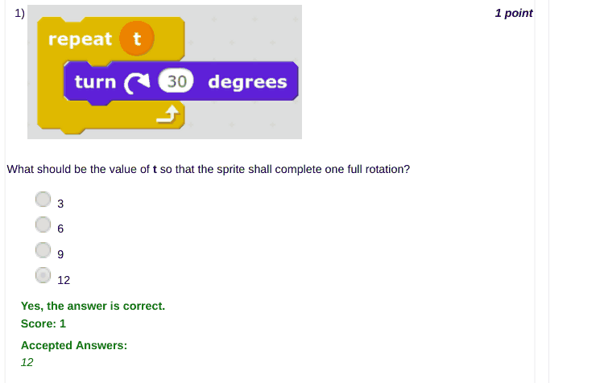

### Q2. Which of the following can be used to communicate across multiple sprites?

- [x] broadcast messages
- [ ] wait option
- [ ] sounds options
- [ ] join operator
> No, the answer is incorrect. Score: 0

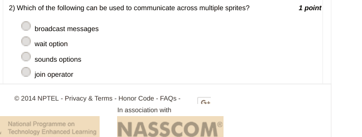

### Q3. Which of the following can never be an output of the above statement?

- [ ] 3
- [ ] 6
- [ ] 9
- [x] 12
> Yes, the answer is correct. Score: 1

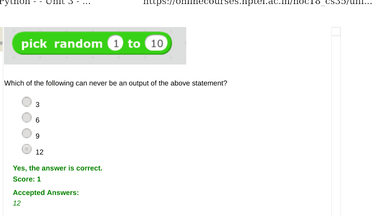

### Q4. Which of the following options was used to make the sprite disappear from the animation
stage?

- [ ] disappear
- [ ] vanish
- [x] hide
- [ ] show
> Yes, the answer is correct. Score: 1

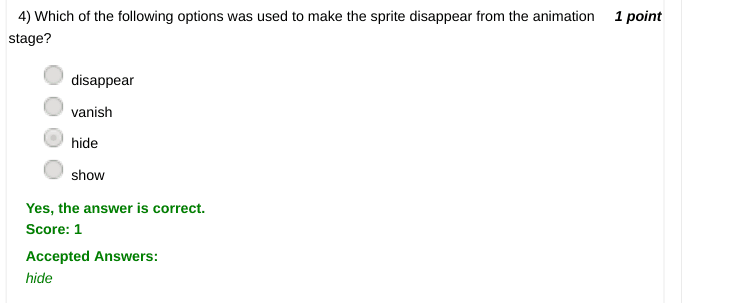

### Q5. Which of the following is a facility provided by Scratch to use sound effects?

- [ ] A sound library is provided
- [ ] We can record sound using a microphone
- [ ] We can use a sound file
- [x] All of the above
> Yes, the answer is correct. Score: 1

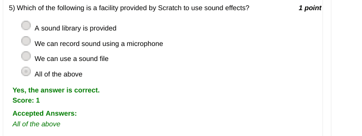

### Q6. In addition to an option of using the inbuilt sprite library in Scratch, what are the other
way(s) to use a sprite?

- [ ] You can paint a custom sprite
- [ ] Upload an image file from your computer
- [ ] You can use camera to take pictures
- [x] All the above
> No, the answer is incorrect. Score: 0

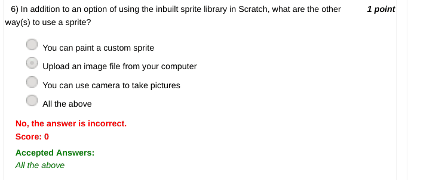

### Q7. Given first name and last name of a person, which of the following operators in Scratch can
be used to obtain the full name?

- [ ] Wednesday 14 November 2018 10:59 AM
- [ ] merge
- [x] join
- [ ] combine
- [ ] concatenate
> No, the answer is incorrect. Score: 0

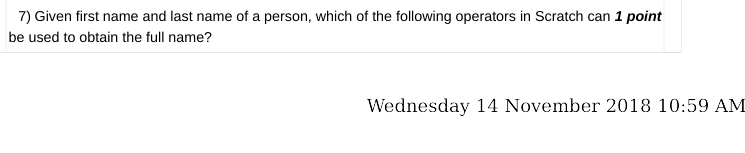

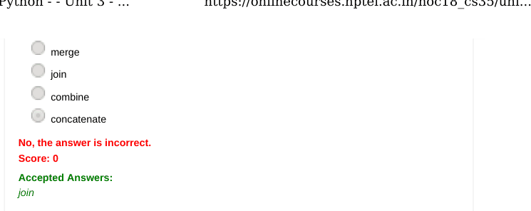

### Q8. Which of the following commands would make the sprite move backwards?

- [ ] Move 10 steps
- [x] Move -10 steps
- [ ] Both (a) and (b)
- [ ] Neither (a) nor (b)
> Yes, the answer is correct. Score: 1

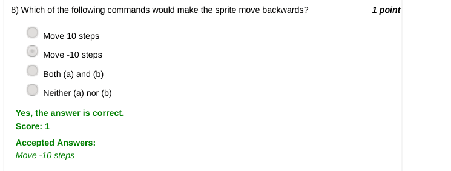

### Q9. Which of the following constructs carries out a set of instructions as long as any key in the
keyboard is pressed?

- [x] `repeat until <key [any] pressed?>` { … }
- [ ] `wait until <key [any] pressed?>`
- [ ] `if <key [any] pressed?> then` { … }
- [ ] None of the above
> Yes, the answer is correct. Score: 1

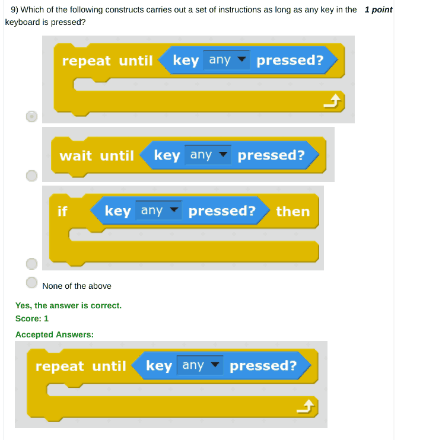

### Q10. Which of the following Scratch constructs are used to keep doing a set of instructions infinitely?

- [ ] continue
- [ ] always
- [x] forever
- [ ] do
> No, the answer is incorrect. Score: 0

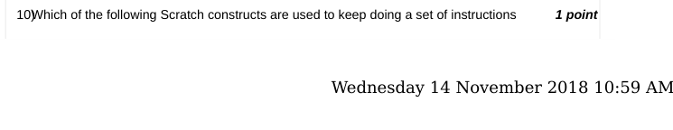

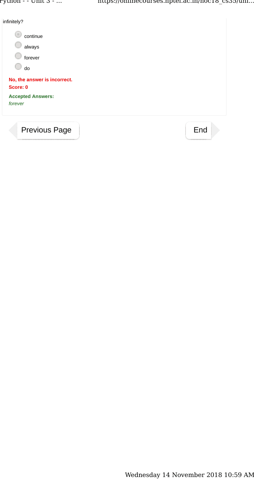
