# JOC Jul-2018 · Week 2: portal print

- Source: `JOC 2018.pdf` pages 5–8 (portal review printout). Parsed text below; the cropped image under each question is the exact page content (code, figures and ticks as printed) and is authoritative.
- `[x]` = option equal to the portal's **Accepted Answer** (official). Lines may carry stray spaces from the PDF text layer.

> reviewer3@nptel.iitm.ac.in ▼ · Due on 2018-08-15, 23:59 IST.

### Q1. What is the value of a after this sequence of instructions is carried out?
a=0
for i in range(10):
a=a+1

- [ ] 9
- [x] 10
- [ ] 11
- [ ] 12
> No, the answer is incorrect. Score: 0

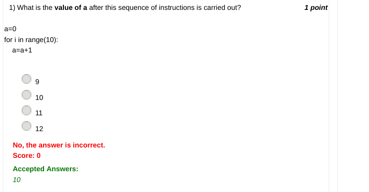

### Q2. What is the output when the following sequence of instructions is carried out in the
console?
a=1;a=a+1;a=a+2;a=a+3;print(a)

- [ ] 4
- [ ] 5
- [ ] 6
- [x] 7
> No, the answer is incorrect. Score: 0

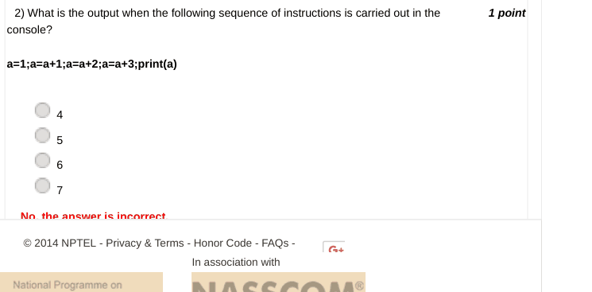

### Q3. What is the output of the following snippet if 5 is given as the input?

- [ ] Funded by c=input("Enter a number")
- [ ] Wednesday 14 November 2018 11:00 AM print(c*3)
- [ ] Powered by
- [ ] 15
- [ ] 8
- [ ] 2
- [x] 555
> No, the answer is incorrect. Score: 0

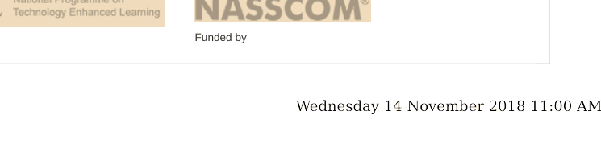

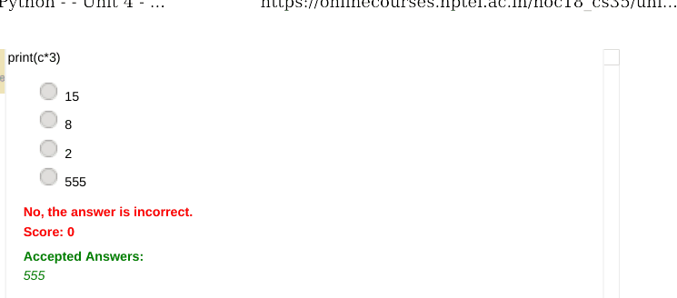

### Q4. What is the output of the following snippet?
s1="IIT "  #Remember there is a space after T in IIT
s2="Punjab"
s1=s1*2
s2="Ropar"
print(s1,s2)

- [ ] IIT IIT Punjab
- [ ] IIT Punjab
- [x] IIT IIT Ropar
- [ ] IIT Ropar
> No, the answer is incorrect. Score: 0

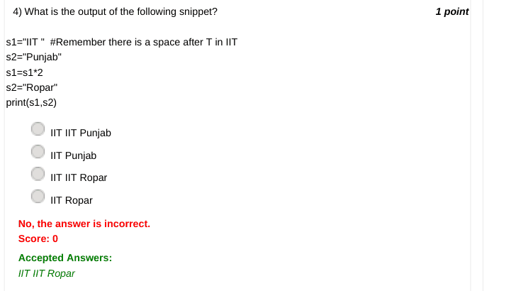

### Q5. What is the value of x at the end of the following sequence of instructions?
x=10
x=x*3
x=x+5

- [ ] 15
- [ ] 30
- [x] 35
- [ ] 45
> No, the answer is incorrect. Score: 0

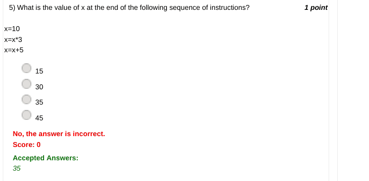

### Q6. What is the value stored in the variable answer at the end of executing the following
snippet?
answer=1
for n in range(5):
answer=answer*2

- [ ] 7
- [ ] 10
- [ ] 25
- [ ] Wednesday 14 November 2018 11:00 AM
- [x] 32
> No, the answer is incorrect. Score: 0

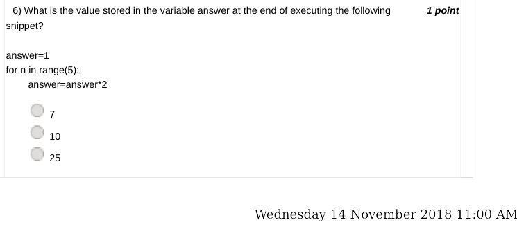

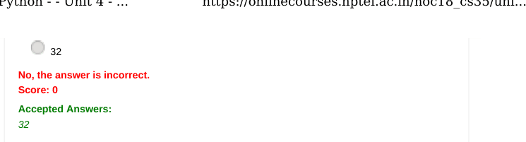

### Q7. What does the arithmetic operator % do?

- [ ] Finds the sum of two numbers
- [ ] Finds the quotient on dividing two numbers
- [x] Finds the remainder on dividing two numbers
- [ ] Finds the product of two numbers
> No, the answer is incorrect. Score: 0

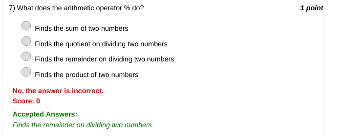

### Q8. What happens when the following code is executed?
n=5
if(n>1):
print("Hello")

- [ ] Hello
- [ ] Syntax error is thrown
- [x] Indentation error is thrown
- [ ] Nothing happens
> No, the answer is incorrect. Score: 0

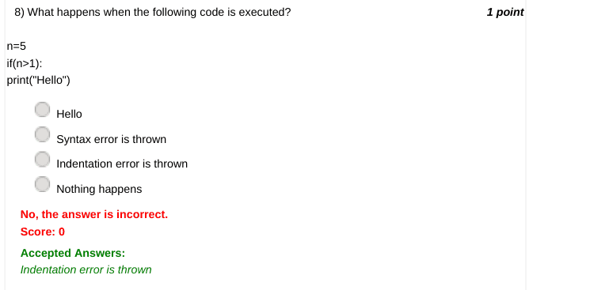

### Q9. What happens when the following code is executed?
n=5
if(n>1)
print("Hello")

- [ ] Hello
- [x] Syntax error
- [ ] Indentation error
- [ ] Nothing happens
> No, the answer is incorrect. Score: 0

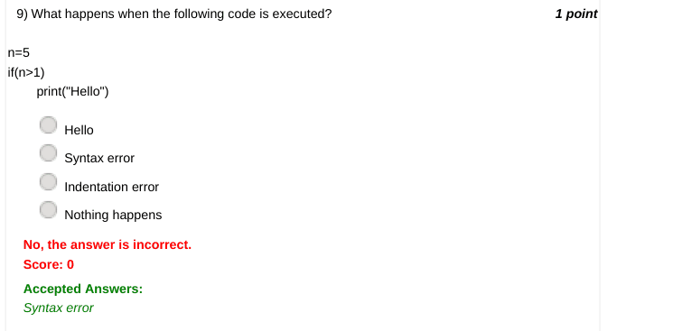

### Q10. What is the output of the following snippet?
for i in range(3):
print(i)

- [x] 0
- [ ] Wednesday 14 November 2018 11:00 AM 1 2
- [ ] 0 1 2 3
- [ ] 1 2
- [ ] 1 2 3
> No, the answer is incorrect. Score: 0

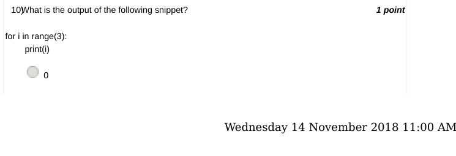

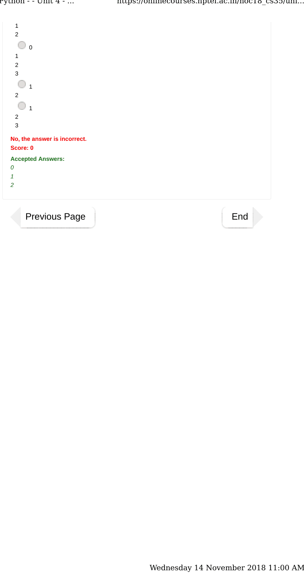
