# JOC Jul-2018 · Week 3: portal print

- Source: `JOC 2018.pdf` pages 9–12 (portal review printout). Parsed text below; the cropped image under each question is the exact page content (code, figures and ticks as printed) and is authoritative.
- `[x]` = option equal to the portal's **Accepted Answer** (official). Lines may carry stray spaces from the PDF text layer.

> reviewer3@nptel.iitm.ac.in ▼ · Due on 2018-09-05, 23:59 IST.

### Q1. Consider the following snippet:
def test(n):
if n%7==0:

- [ ] print('Hipp Hipp Hurrah') else:
- [ ] print('Alas') What would be the output of test(27)?
- [ ] Hipp Hipp Hurrah
- [ ] Hipp
- [ ] Hurrah
- [x] Alas
> No, the answer is incorrect. Score: 0

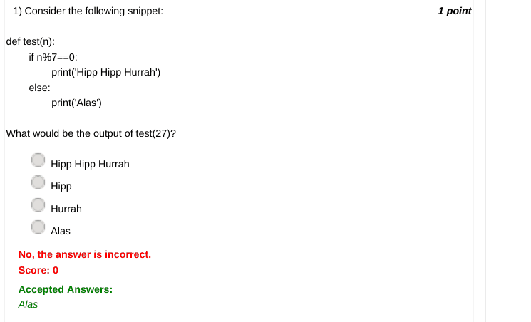

### Q2. Which of the following Python snippets would print the values from 1 to 10?

- [ ] for i in range(10):
- [x] print(i)
- [ ] for i in range(11):
- [x] print(i)
- [ ] for i in range(1,10):
- [ ] print i
- [x] for i in range(1,11):
- [ ] print(i) © 2014 NPTEL - Privacy & Terms - Honor Code - FAQs -
- [ ] In association with
> No, the answer is incorrect. Score: 0

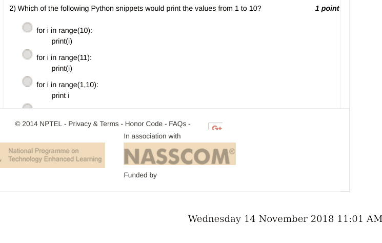

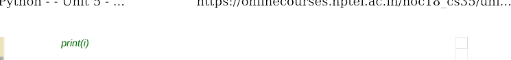

### Q3. What does the following snippet print:
for i in range(11,16):
if i%2==0:

- [ ] print('Jack') elif i%3==0:
- [ ] print('Jill') elif i%2==0 and i%3==0:
- [ ] print('Jack and Jill') else:
- [ ] print('Jill and Jack')
- [ ] Jill and Jack Jack and Jill Jill and jack Jack Jill
- [ ] Jill and Jack Jack Jill and jack Jack Jill
- [ ] Jack and Jill Jill Jack and Jill Jack Jill
- [ ] Jill and Jack Jill Jill and jack Jack Jill
> Accepted answer (not matched to a printed option): Jill and Jack; Jack; Jill and jack; Jack; Jill
> No, the answer is incorrect. Score: 0

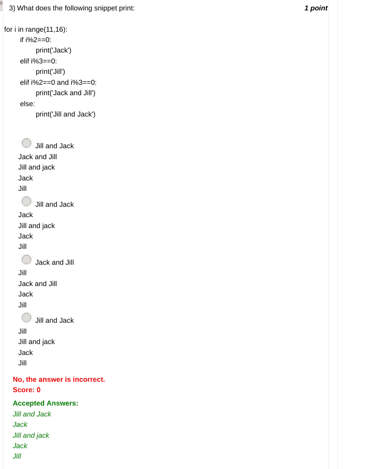

### Q4. If the word in your mind is CAT, in how many ways can you pose the jumbled question?

- [ ] 1
- [ ] 3
- [x] 5
- [ ] 7
> No, the answer is incorrect. Score: 0

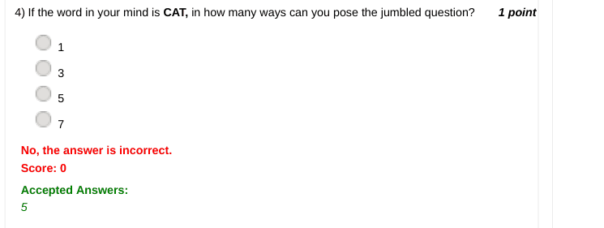

### Q5. Given the following jumbled word, guess the correct English word:

- [ ] Wednesday 14 November 2018 11:01 AM PUCROTEM
- [ ] CROPUTEM
- [ ] CROPETUM
- [ ] CROTEMPU
- [x] COMPUTER
> No, the answer is incorrect. Score: 0

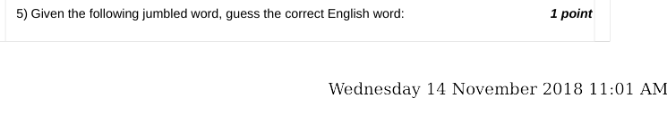

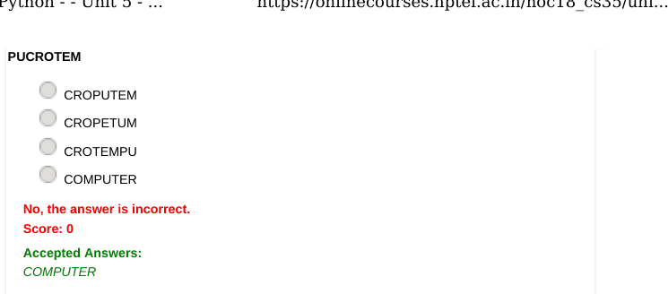

### Q6. Which of the following can be a valid output of the statement
random.choice([10,20,30,40])

- [ ] 1
- [ ] 3
- [ ] 4
- [x] 10
> No, the answer is incorrect. Score: 0

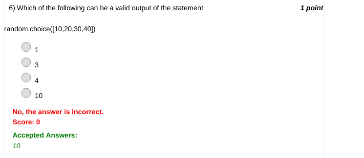

### Q7. When a file is opened in 'a' mode

- [ ] You don't have any rights to access the file
- [ ] You can only read the contents of the file
- [x] You can write contents to the end of the existing file contents.
- [ ] You can write new contents onto the file but once you write new contents existing contents would be overwriiten
> No, the answer is incorrect. Score: 0

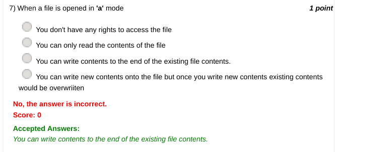

### Q8. Which of the following can be an output of
random.randint(1,10)
but can never be an output of
random.randrange(1,10) ?

- [ ] 1
- [ ] 0
- [ ] -1
- [x] 10
> No, the answer is incorrect. Score: 0

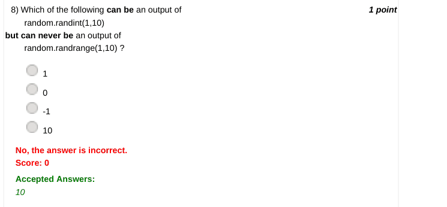

### Q9. If g^ is passed as a parameter along with plot function of matplotlib.pyplot, how would the
data points be represented?

- [ ] Wednesday 14 November 2018 11:01 AM
- [ ] green squares
- [ ] green diamonds
- [x] green triangles
- [ ] green circles or dots
> No, the answer is incorrect. Score: 0

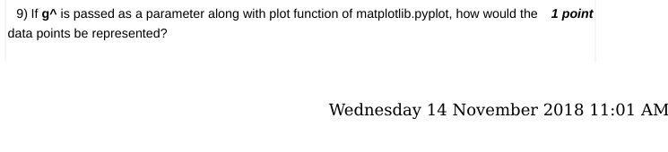

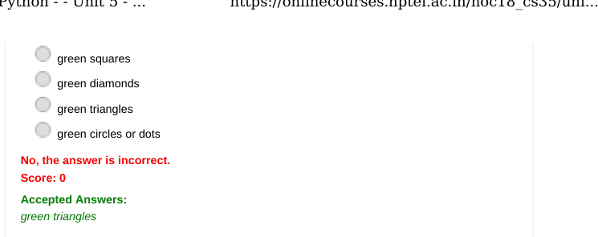

### Q10. How is trimmed mean calculated?

- [ ] Sort the values then remove top 10% or bottom 10% of the values
- [x] Sort the values then remove top 10% and bottom 10% of the values
- [ ] Sort the values then remove top 10% of the values
- [ ] Sort the values then remove bottom 10% of the values
> No, the answer is incorrect. Score: 0

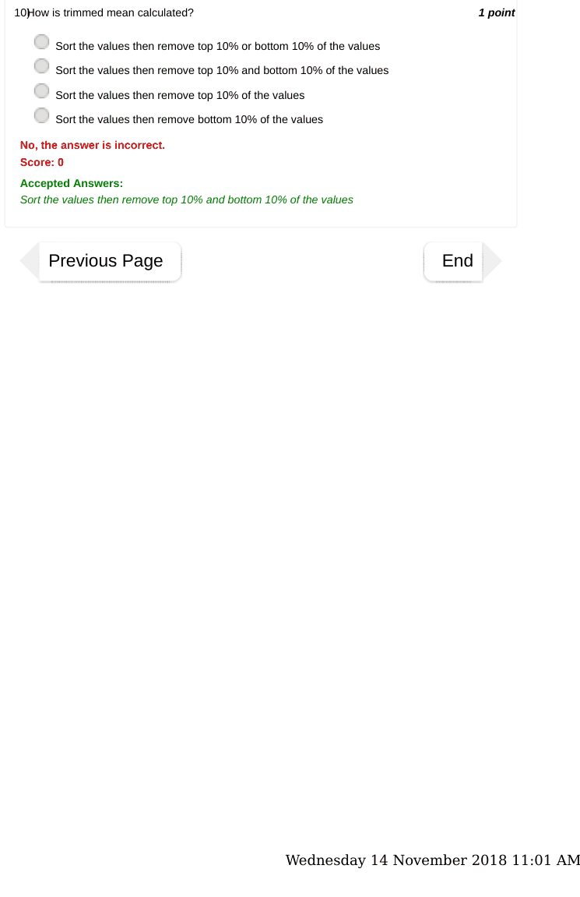
