# JOC Jul-2018 · Week 4: portal print

- Source: `JOC 2018.pdf` pages 13–17 (portal review printout). Parsed text below; the cropped image under each question is the exact page content (code, figures and ticks as printed) and is authoritative.
- `[x]` = option equal to the portal's **Accepted Answer** (official). Lines may carry stray spaces from the PDF text layer.

> reviewer3@nptel.iitm.ac.in ▼ · Due on 2018-09-05, 23:59 IST.

### Q1. Guess the Movie name.
I_C_P_ I O_

- [x] INCEPTION
- [ ] INTUITION
- [ ] INCUBATION
- [ ] INTERVENTION
> No, the answer is incorrect. Score: 0

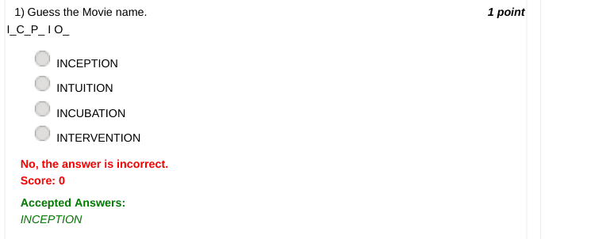

### Q2. In "Guess the Movie Name" game, what will happen if the player asks to open up a letter
that is not present in the actual movie name?

- [ ] The game comes to an end and the player is declared a loser.
- [ ] The closest letter that precedes this requested letter in the alphabetical order and present in the actual movie name is opened up.
- [ ] The closest letter that succeeds this requested letter in the alphabetical order and present in the actual movie name is opened up.
- [ ] A message that the letter is not present is displayed then the game continues asking him to guess some other letter.
> Accepted answer (not matched to a printed option): A message that the letter is not present is displayed then the game continues asking him to guess some; other letter.; © 2014 NPTEL - Privacy & Terms - Honor Code - FAQs -
> No, the answer is incorrect. Score: 0

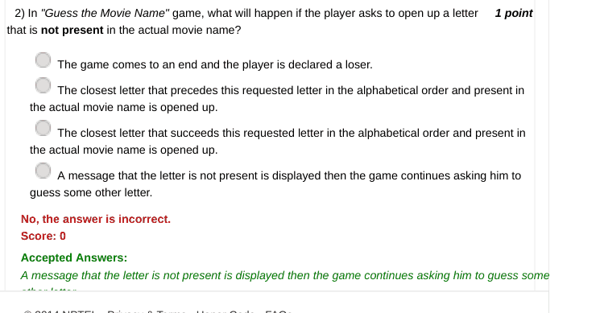

### Q3. In "Guess the Movie Name" game, we initially have all blanks (or *). Slowly as the person

- [ ] In association with guesses a letter the question undergoes a change in state (the corresponding letter is opened up). If the movie name is BANGALORE DAYS, which of the following can never be a state of the question during the run of the program?
- [ ] Funded by
- [x] B  _  _  G  A  _ O  _  _       D_ Y_
- [ ] Wednesday 14 November 2018 11:03 AM
- [ ] Powered by
- [ ] _ A _ _ A _ O _ E         _A Y _
- [ ] _ _ _ _ _ _O_ E       _ _ Y_
- [ ] _ _ _ _ _ _ O _ E      _ _ _ _
> No, the answer is incorrect. Score: 0

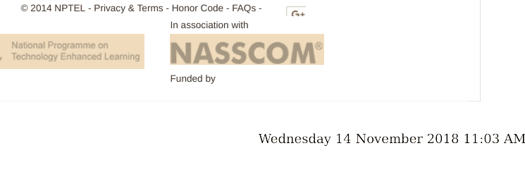

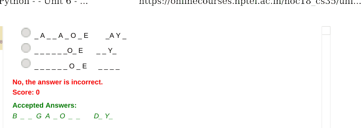

### Q4. Consider a variation in the "Guess the Movie Name" game. Only English movies are
considered in the questions space. The points you get is variable as per the following scheme:
For example if the movie name is Avengers, the question is posed as _ _ _ _ _ _ _ _.
If the player guesses correct s/he gets 8 points (as there are 8 letters which s/he found).
If the player unlocks E, question becomes _ _ E _ _ E _  _. Now if s/he guesses right s/he gets 6
points.
If s/he unlocks A instead, the question becomes A _ E _ _ E _ _. Now if s/he guesses right s/he gets 5
points.
There is no deduction in points if s/he guesses a letter not present in the Movie name.
In this game, if the player guesses the correct movie name when the question was _ A _ _ I _, how
many points would s/he get?

- [ ] 2
- [x] 4
- [ ] 6
- [ ] 8
> No, the answer is incorrect. Score: 0

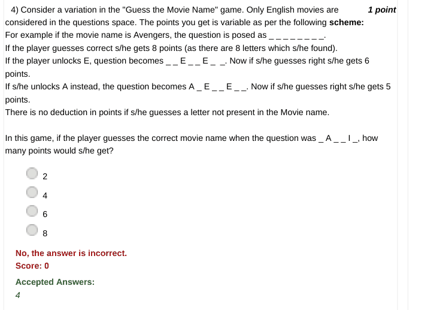

### Q5. What is the minimum number of people, you must ask the month of their birth so as to
guarantee a collision (sharing of the birth month)?

- [ ] 11
- [x] 13
- [ ] 15
- [ ] 18
> No, the answer is incorrect. Score: 0

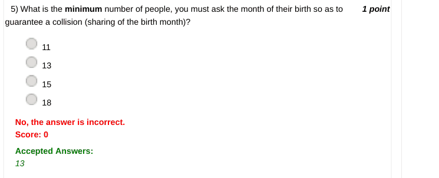

### Q6. Which of the following is a correct solution to the 3 x 3 Magic Square puzzle?

- [ ] Wednesday 14 November 2018 11:03 AM
> No, the answer is incorrect. Score: 0

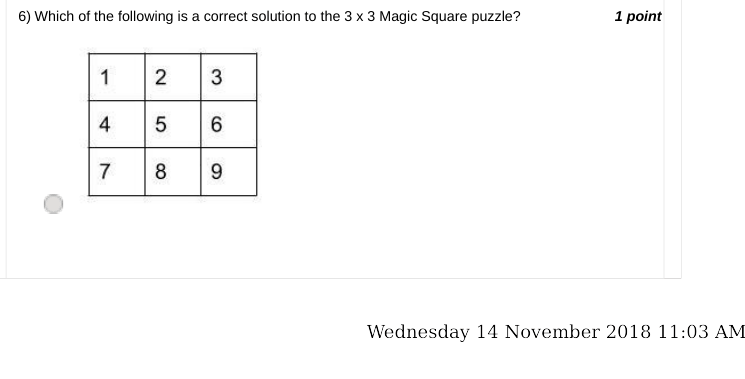

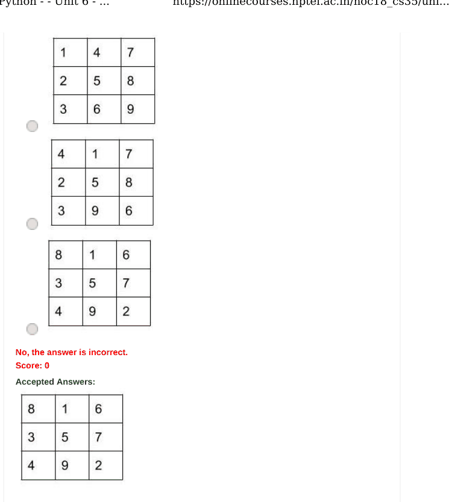

### Q7. In any 3 x 3 magic square solution, the sum across the rows or columns or diagonals is
equal to:

- [ ] 5
- [ ] 10
- [x] 15
- [ ] 20
> No, the answer is incorrect. Score: 0

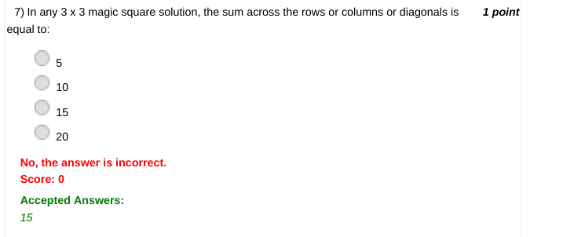

### Q8. What is the range of numbers that will be filled in a 4 x 4 magic square?

- [ ] Numbers from 1 to 8
- [x] Numbers from 1 to 16
- [ ] Numbers from 1 to 64
- [ ] Numbers from 1 to 32
> No, the answer is incorrect. Score: 0

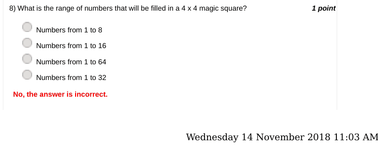

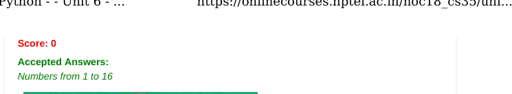

### Q9. What is the common symbol among these 2 cards?

- [ ] Scissors
- [ ] Cheese
- [ ] Cat
- [x] Sun glasses or Goggles
> No, the answer is incorrect. Score: 0

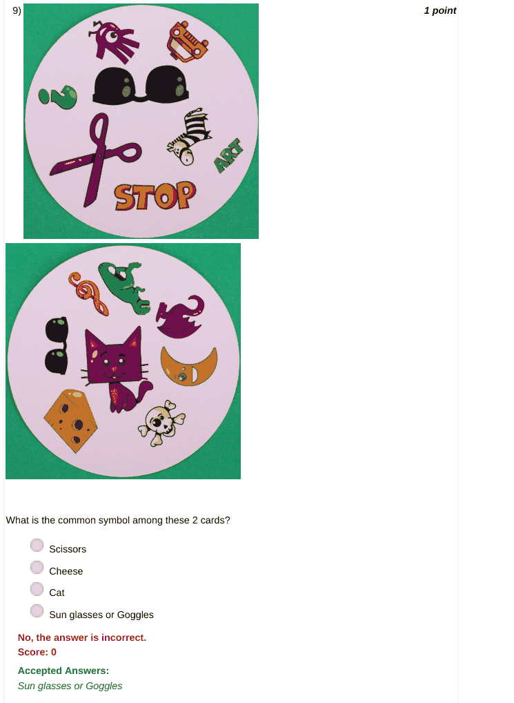

### Q10. If there were 10 symbols in each card of the dobble game, how many comparisons should
one make at the maximum to find the common symbol?

- [ ] 20
- [ ] 50
- [x] 100
- [ ] 200
- [x] Wednesday 14 November 2018 11:03 AM
> No, the answer is incorrect. Score: 0

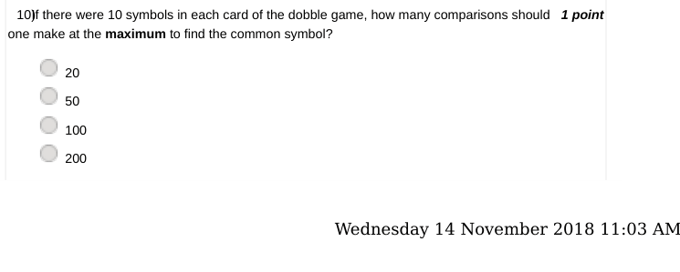

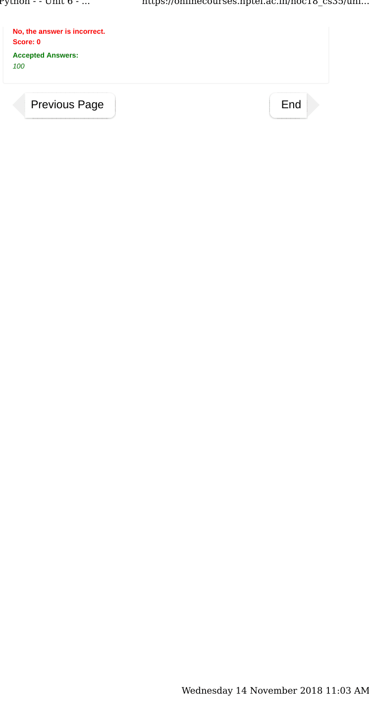
