# JOC Jul-2018 · Week 5: portal print

- Source: `JOC 2018.pdf` pages 18–21 (portal review printout). Parsed text below; the cropped image under each question is the exact page content (code, figures and ticks as printed) and is authoritative.
- `[x]` = option equal to the portal's **Accepted Answer** (official). Lines may carry stray spaces from the PDF text layer.

> reviewer3@nptel.iitm.ac.in ▼ · Due on 2018-09-14, 23:59 IST.

### Q1. What happens when you search for 35 in the list [10,20,30,40,50]?

- [x] The program would handle the case by printing a suitable message that the element is not found
- [ ] The value 30 is returned as it is the closest number less than 35 that is present in the list
- [ ] The value 40 is returned as it is the closest number greater than 35 that is present in the list
- [ ] The program will abruptly come to an end without intimating anything to the user.
> No, the answer is incorrect. Score: 0

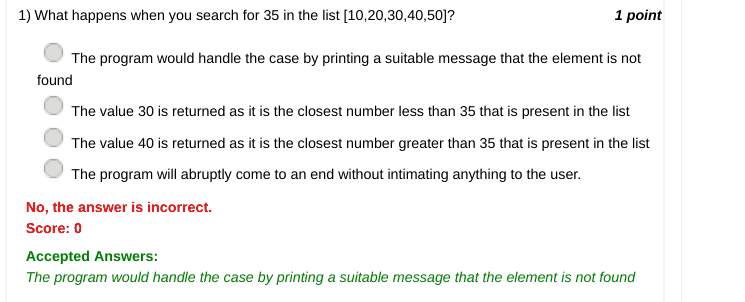

### Q2. Which of the following constraint needs to be satisfied so as to perform binary search?

- [ ] The list must contain only numbers
- [ ] The list must contain odd number of elements
- [ ] The list must contain even number of elements
- [x] The list must be sorted.
> No, the answer is incorrect. Score: 0

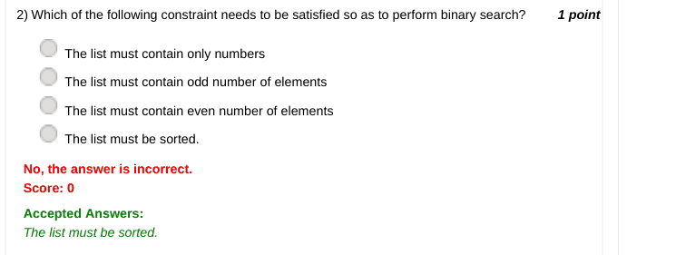

### Q3. What will be the final list contents after the list [10,25,40,70,100] has been passed to a
function that sorts the elements of a given list in ascending order?

- [x] [10,25,40,70,100]
- [ ] [100,70,40,25,10]
- [ ] [25,10,40,70,100]
- [ ] [10,25,40,100,70]
> No, the answer is incorrect. Score: 0

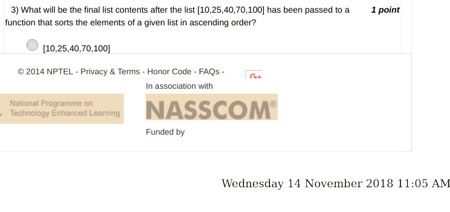

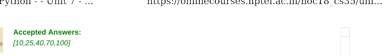

### Q4. What does the following snippet do when a list 'a' is passed to it?
for i in range( len(a) ):
for j in range(i+1, len (a) ):
if a[ i ]<a[ j ]:
a[ i ] , a[ j ]=a[ j ] , a[ i ]

- [ ] It checks if the elements of a given list are in ascending order
- [ ] It checks if the elements of a given list are in descending order
- [ ] It sorts the elements of a given list in ascending order
- [x] It sorts the elements of a given list in descending order
> No, the answer is incorrect. Score: 0

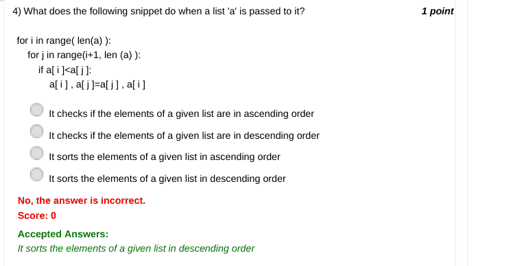

### Q5. In Rock, Paper, Scissors game, how many ways can the result be a draw?

- [x] 3
- [ ] 6
- [ ] 9
- [ ] 12
> No, the answer is incorrect. Score: 0

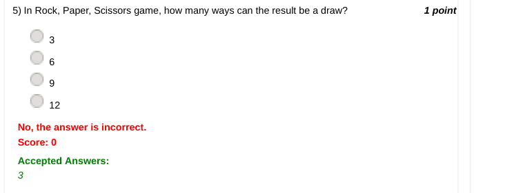

### Q6. What should you choose in the Rock Paper Scissor game so that you can definitely
guarantee your win?

- [ ] Rock
- [ ] Paper
- [ ] Scissor
- [x] None of the above
> No, the answer is incorrect. Score: 0

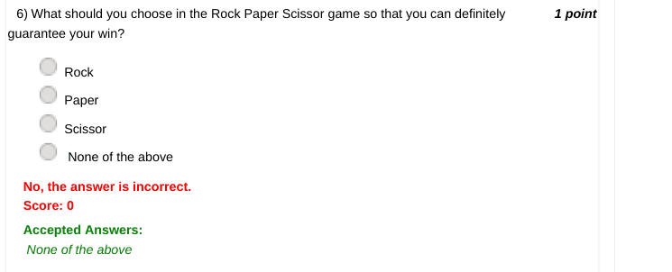

### Q7. Consider the secure Rock Paper Scissors game.
Assume for both the players:
0->Rock
1->Paper
2 ->Scissors
Player 1's input : 1000010210
Player 2's input : 1012010211
Who won?

- [ ] Player 1
- [ ] Wednesday 14 November 2018 11:05 AM
- [ ] Player 2
- [ ] Draw
- [x] Data insufficient and hence winner cannot be determined.
> No, the answer is incorrect. Score: 0

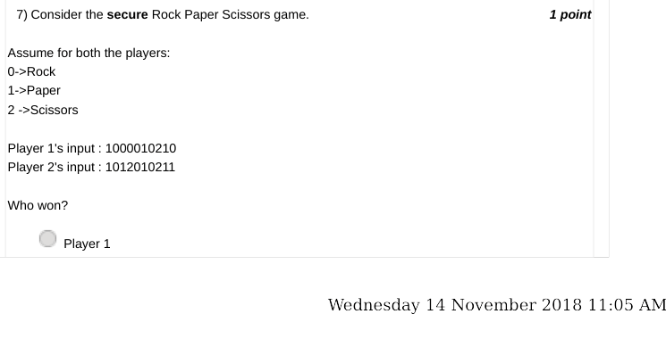

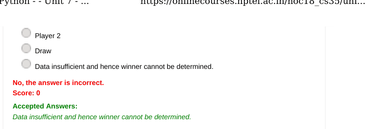

### Q8. Consider this run of secure Rock Paper Scissor game:
No of digits used :10
Assume for player 1:
0->Rock
1->Paper
2->Scissors
Secret place holder position: 3rd digit from the left
Assume for player 2:
0->Scissors
1->Rock
2->Paper
Secret place holder position: 7th digit from the left
Inputs:
Player 1: 1200210121
Player 2: 1020201120
Who won?

- [ ] Player 1
- [ ] Player 2
- [x] Draw
> No, the answer is incorrect. Score: 0

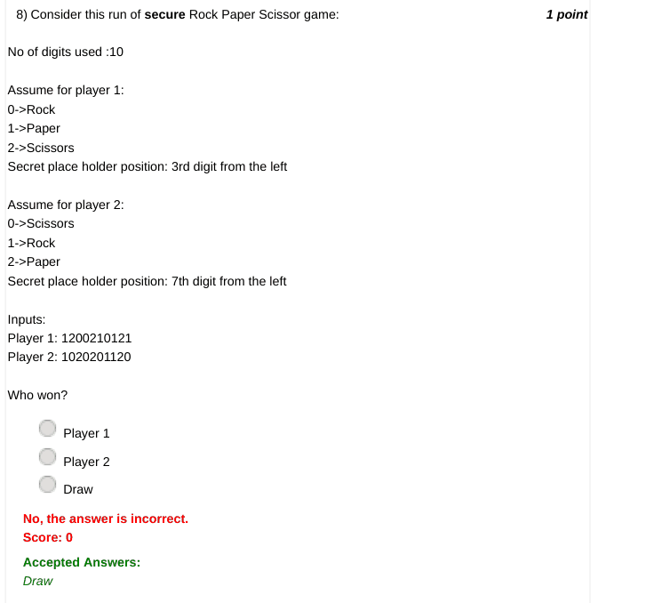

### Q9. Which file format is supported by Python Speech Recognition library?

- [ ] mp3
- [x] wav
- [ ] aiff
- [ ] au
> No, the answer is incorrect. Score: 0

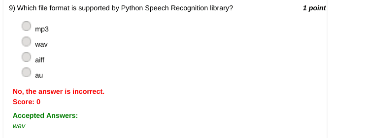

### Q10. In the simple Monte Hall  game, we had 3 doors and 1 door contained a prize. The player
has to guess which door could possibly contain the prize. That door would be opened and if it contains
the prize he wins it.
If more doors are added, the player has more choices to guess. What do you think will happen to the
probability (i.e. chance) of  winning if more doors are added?

- [x] Wednesday 14 November 2018 11:05 AM
- [ ] Increases
- [x] Decreases
- [ ] No change
> No, the answer is incorrect. Score: 0

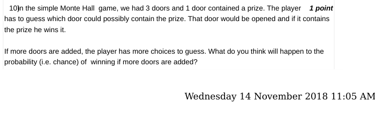

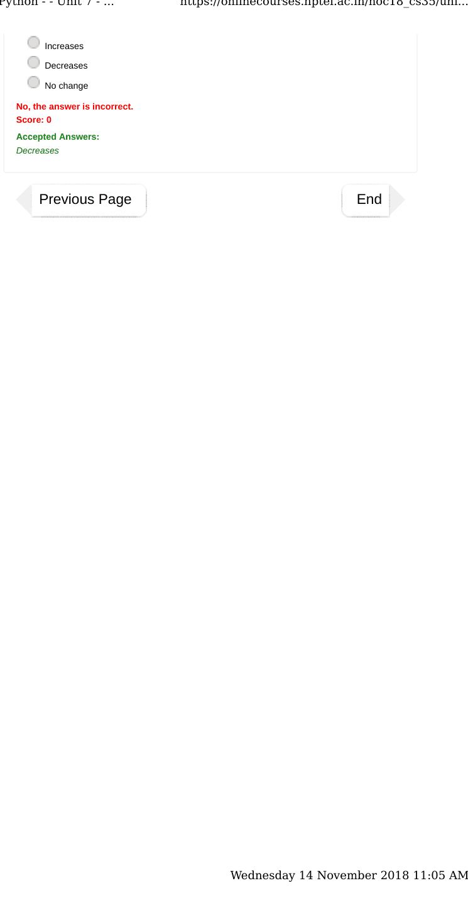
