# JOC Jul-2018 · Week 6: portal print

- Source: `JOC 2018.pdf` pages 22–25 (portal review printout). Parsed text below; the cropped image under each question is the exact page content (code, figures and ticks as printed) and is authoritative.
- `[x]` = option equal to the portal's **Accepted Answer** (official). Lines may carry stray spaces from the PDF text layer.

> reviewer3@nptel.iitm.ac.in ▼ · Due on 2018-09-12, 23:59 IST.

### Q1. If AMIT is encoded as ZLHS and SIMRAN  is encoded as RHLQZM, then how would
VIDHYA be encoded as?

- [ ] WJEIZB
- [x] UHCGXZ
- [ ] XKFJAC
- [ ] TGBFWY
> No, the answer is incorrect. Score: 0

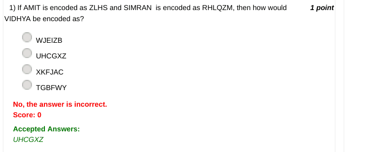

### Q2. If SUDARSHAN is encoded as YLSEFYWEG and BHAWANA is encoded as TWEUEGE,
how would SHUBH be encoded as?

- [ ] TIVCI
- [ ] RGTAG
- [x] YWLTW
- [ ] WUTEG
> No, the answer is incorrect. Score: 0

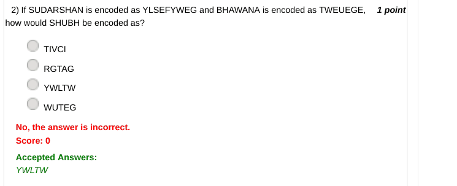

### Q3. Which of the following statements is true?

- [ ] Both Caesar cipher and Substitution cipher are the same
- [ ] Caesar and Substitution cipher are totally unrelated
- [x] Caesar cipher is a special case of Substitution cipher
- [ ] Substitution cipher is a special case of Caesar cipher
> No, the answer is incorrect. Score: 0

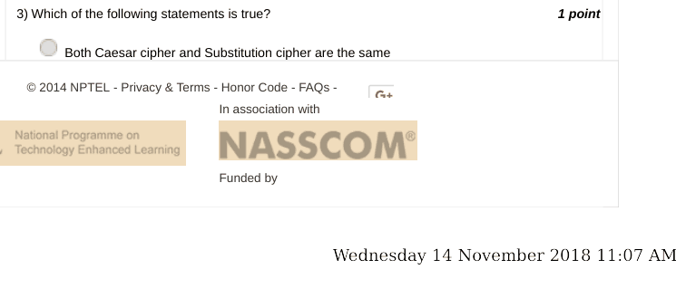

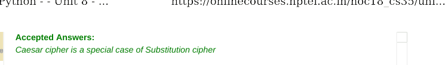

### Q4. How many winning configurations are possible for a player in the Tic Tac Toe game?

- [ ] 2
- [ ] 4
- [ ] 6
- [x] 8
> No, the answer is incorrect. Score: 0

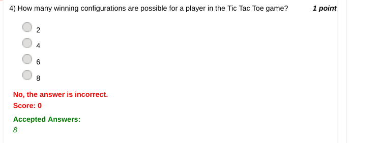

### Q5. What is the game strategy used in the Tic Tac Toe game?

- [ ] Divide and Conquer
- [ ] Greedy Strategy
- [ ] Iterative Search
- [x] Min-Max Strategy
> No, the answer is incorrect. Score: 0

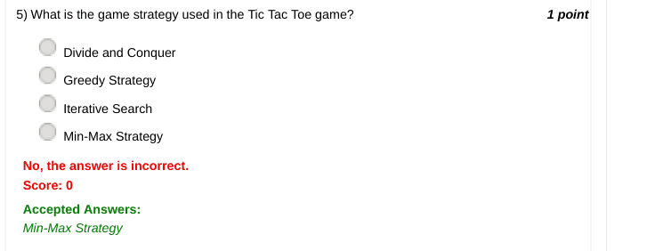

### Q6. Identify the winner of this game.

- [ ] X
- [ ] O
- [x] Draw
> No, the answer is incorrect. Score: 0

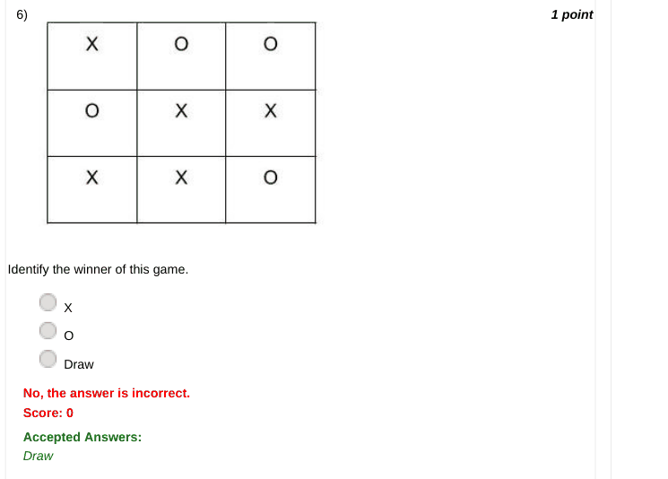

### Q7. Which of these statements is true?

- [ ] Recursion can solve a few problems which Iteration cannot.
- [ ] Iteration can solve a few problems which Recursion cannot.
- [x] Anything that Recursion can solve can be solved by Iteration.
- [ ] Wednesday 14 November 2018 11:07 AM
- [ ] Recursion and Iteration are totally unrelated.
> No, the answer is incorrect. Score: 0

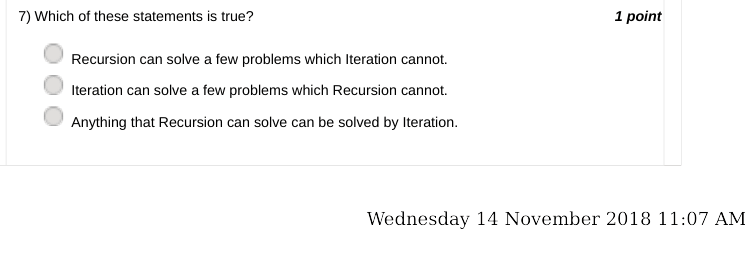

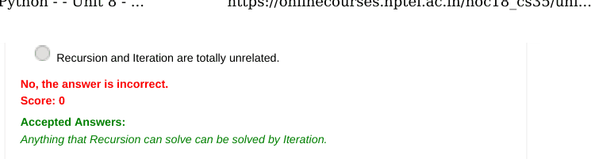

### Q8. Consider the following recursive function
def f(n):
if n<0:

- [ ] return -1 * f ( -1 * n) elif n==0:
- [ ] return 0 else:
- [ ] return 4 + f (n-1) What would be the output of f(8)?
- [ ] 12
- [ ] 4
- [x] 32
- [ ] 2
> No, the answer is incorrect. Score: 0

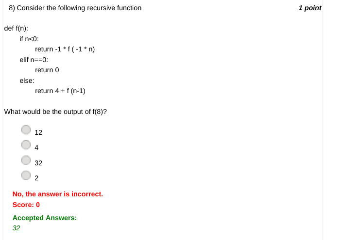

### Q9. What does the following function do?
def f(n):
if n<0:

- [ ] return -1 * f ( -1 * n) elif n==0:
- [ ] return 0 else:
- [ ] return f(n-1)+2
- [ ] Adds 2 to n (i.e calculates n+ 2)
- [ ] Subtract 2 from n (i.e. calculates n - 2)
- [x] doubles the value of n (i.e. calculates n * 2)
- [ ] halves the value of n (i.e. calculates the value of n / 2)
> No, the answer is incorrect. Score: 0

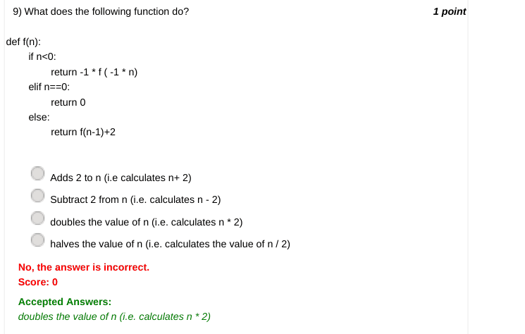

### Q10. A ____ matrix  is  required to implement tic tac toe.

- [ ] 4*4
- [ ] 5*5
- [ ] 2*2
- [x] 3*3
- [x] Wednesday 14 November 2018 11:07 AM
> No, the answer is incorrect. Score: 0

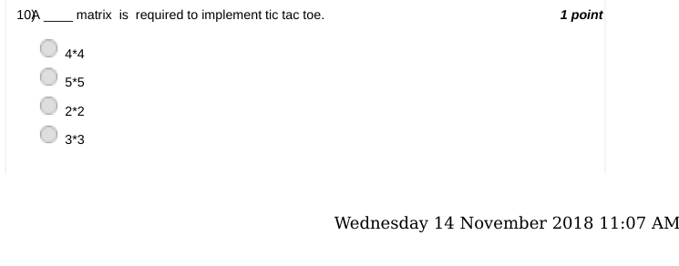

