# JOC Jul-2018 · Week 8: portal print

- Source: `JOC 2018.pdf` pages 26–29 (portal review printout). Parsed text below; the cropped image under each question is the exact page content (code, figures and ticks as printed) and is authoritative.
- `[x]` = option equal to the portal's **Accepted Answer** (official). Lines may carry stray spaces from the PDF text layer.

> reviewer3@nptel.iitm.ac.in ▼ · Due on 2018-09-26, 23:59 IST.

### Q1. Which of the following libraries is used for sentimental analysis in Python?

- [x] nltk
- [ ] gmplot
- [ ] random
- [ ] None of the above
> No, the answer is incorrect. Score: 0

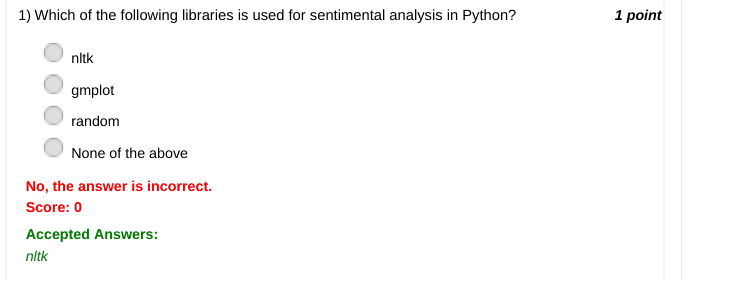

### Q2. Which of the following libraries takes into account the intensity of emotion related to
sentiment analysis?

- [ ] nltk
- [ ] pandas
- [x] vader
- [ ] None of the above
> No, the answer is incorrect. Score: 0

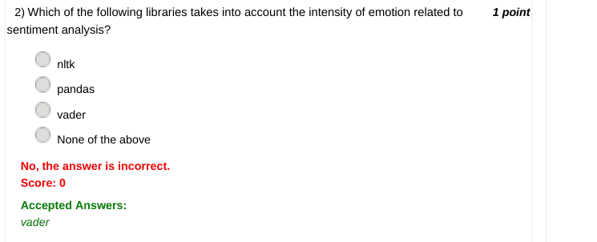

### Q3. What is lexicon?

- [x] It is a dictionary of words.
- [ ] It is a library which helps in sentiment analysis.
- [ ] It helps to generate random numbers.
- [ ] None of the above
> No, the answer is incorrect. Score: 0

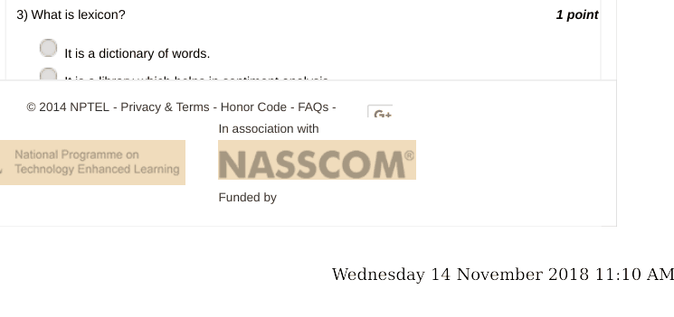

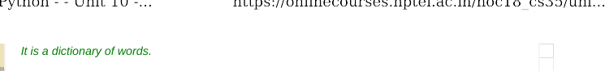

### Q4. Which of the following is the correct syntax for sorted function?

- [ ] x=[4,3,2,1] x.sorted()
- [ ] x=[4,3,2,1] sorted(x)
- [ ] x=[4,3,2,1] sorted.x()
- [ ] None of the above
> Accepted answer (not matched to a printed option): x=[4,3,2,1]; sorted(x)
> No, the answer is incorrect. Score: 0

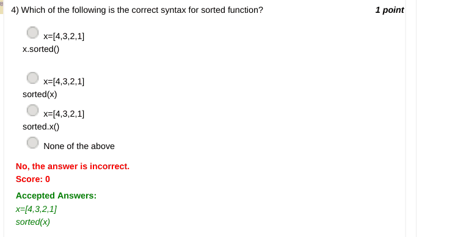

### Q5. Which of the following functions can be used to find ASCII value of a character 'A'?

- [x] ord('A')
- [ ] ASCII('A')
- [ ] int('A')
- [ ] None of the above
> No, the answer is incorrect. Score: 0

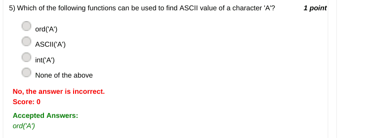

### Q6. What are the anagrams present in the following sentences?
One night, I was going through my old pictures. While going through the pictures, i observed one thing
that all those pictures were captured during first year of graduation.

- [ ] year and ear
- [ ] study and dusty
- [ ] tilt and litt
- [x] night and thing
> No, the answer is incorrect. Score: 0

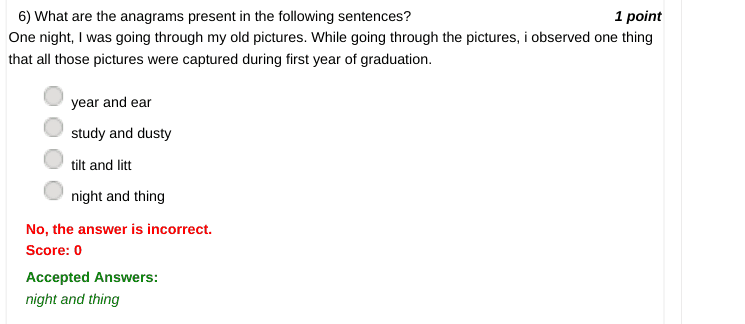

### Q7. Which of the following commands can be used to open an image named gunshot.jpg in
Python?

- [ ] i=file.open('gunshot.jpg')
- [ ] i=img.open('gunshot.jpg')
- [x] i=Image.open('gunshot.jpg')
- [ ] i=image.open('gunshot.jpg')
> No, the answer is incorrect. Score: 0

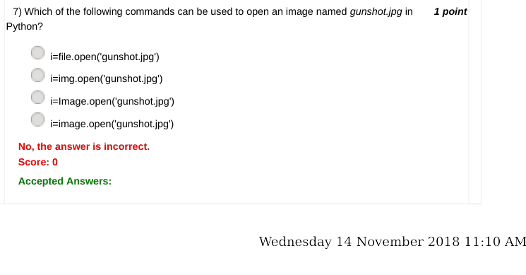

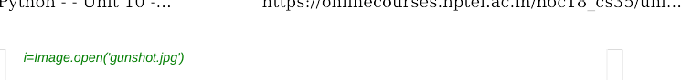

### Q8. The transpose of m*n matrix is ____

- [ ] m*1 matrix
- [ ] n*1 matrix
- [ ] 1*m matrix
- [x] n*m matrix
> No, the answer is incorrect. Score: 0

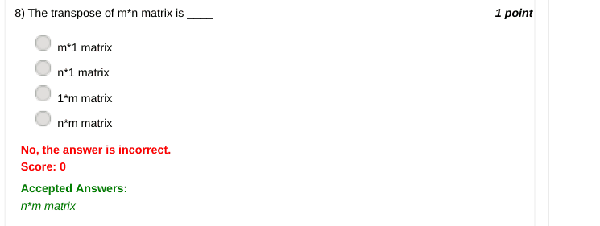

### Q9. Which one of the following denotes an empty tuple?

- [ ] t=[]
- [ ] t={}
- [x] t=()
- [ ] t=(0)
> No, the answer is incorrect. Score: 0

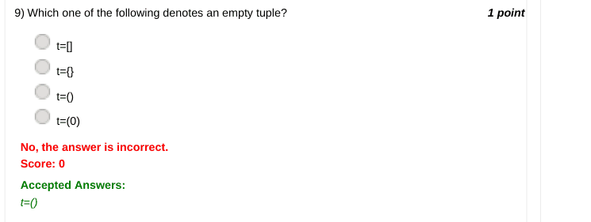

### Q10. Consider the scenario below:
Ram wants to play a lottery game in which he has to choose one ticket out of 10 tickets. If the ticket
chosen by the participant is 9, then he wins 500$. The prize for playing the lottery game is 100$. Ram
decides to play this game 10 times in order to guarantee his win. Would you advise him to play this
game?

- [ ] Yes
- [x] No
- [ ] Can't say
> No, the answer is incorrect. Score: 0

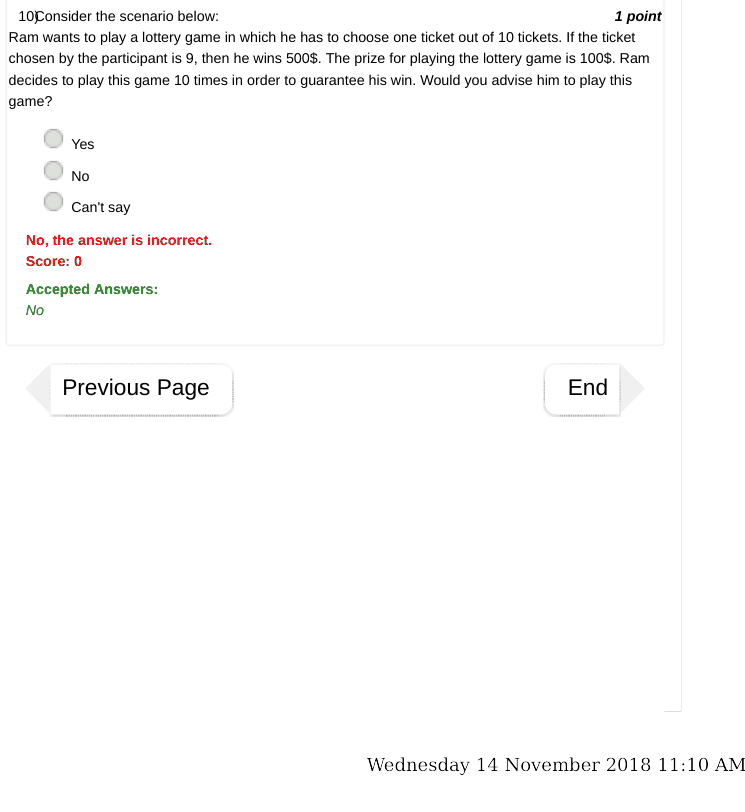

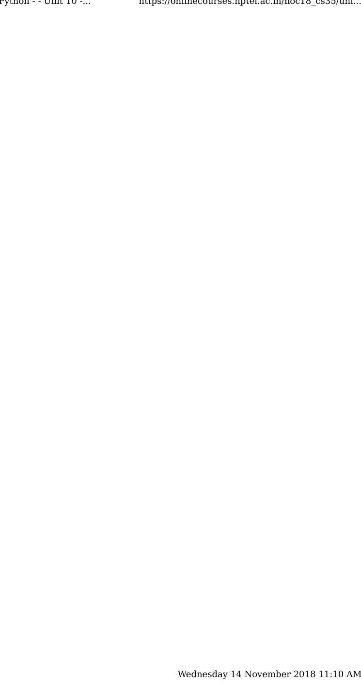
