# JOC Jul-2018 · Week 9: portal print

- Source: `JOC 2018.pdf` pages 30–33 (portal review printout). Parsed text below; the cropped image under each question is the exact page content (code, figures and ticks as printed) and is authoritative.
- `[x]` = option equal to the portal's **Accepted Answer** (official). Lines may carry stray spaces from the PDF text layer.

> reviewer3@nptel.iitm.ac.in ▼ · Due on 2018-10-03, 23:59 IST.

### Q1. If the area of a country is 5400 km^2, calculate the area of a state present in the
country. (If points are placed randomly in the map of the country, then number of points in the
country(except the state) is 70 and number of points in the state is 23.)

- [x] 1774.3 Km^2
- [ ] 502 Km^2
- [ ] 1774.3 m^2
- [ ] None of the above
> No, the answer is incorrect. Score: 0

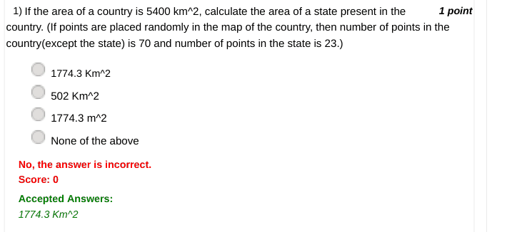

### Q2. networks.shortest_path_length(G,x,y)
What do variables x and y represent here?

- [ ] x represents target and y represents source
- [ ] x represents target and y represents target
- [ ] x represents source and y represents source
- [x] x represents source and y represents target
> No, the answer is incorrect. Score: 0

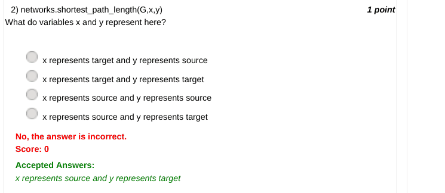

### Q3. State True or False:
An image is a matrix of pixels.
© 2014 NPTEL - Privacy & Terms - Honor Code - FAQs -

- [ ] In association with
- [x] True
- [ ] False
- [ ] Funded by
> No, the answer is incorrect. Score: 0

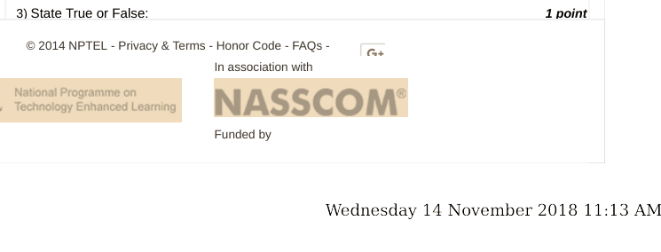

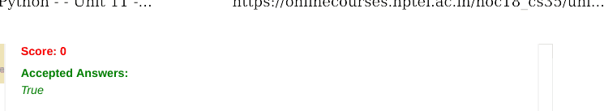

### Q4. How can we read an image in the form a matrix in Python?

- [x] i=scipy.misc.read(“Image_name.png”)
- [ ] i=numpy.misc.read(“Image_name.png”)
- [ ] i=Image.misc.read(“Image_name.png”)
- [ ] None of the above
> No, the answer is incorrect. Score: 0

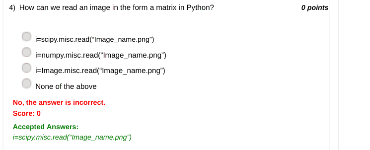

### Q5. What is Stylometry?

- [ ] Stylometry is qualitative study of literary style.
- [x] Stylometry is quantitative study of literary style.
- [ ] Both
- [ ] None of the above
> No, the answer is incorrect. Score: 0

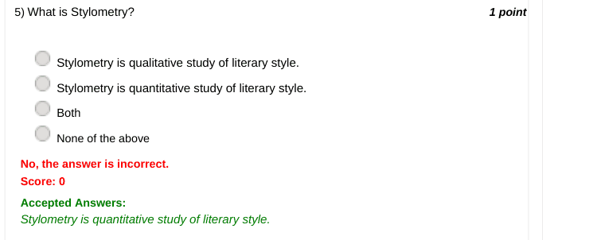

### Q6. Which of the following libraries is used for natural language processing?

- [ ] nlp
- [ ] PIL
- [x] nltk
- [ ] None of the above
> No, the answer is incorrect. Score: 0

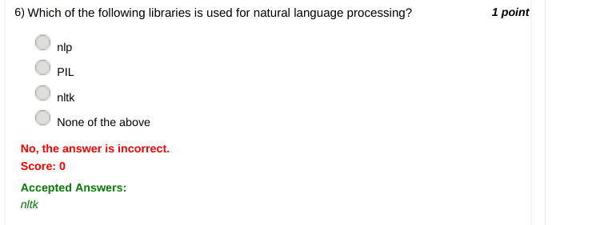

### Q7. What does word_tokenize() function in nltk do?

- [ ] It tokenises the text into sentences.
- [x] It tokenises the text into words.
- [ ] It tokenises the text into characters.
- [ ] None of the above
> No, the answer is incorrect. Score: 0

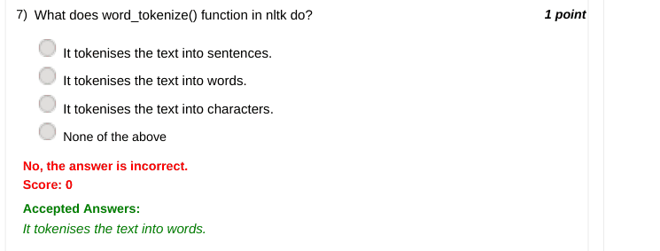

### Q8. On an average, all human beings on this planet are _____ steps away from each
other?

- [ ] Wednesday 14 November 2018 11:13 AM
- [x] 6
- [ ] 5
- [ ] 4
- [ ] 3
> No, the answer is incorrect. Score: 0

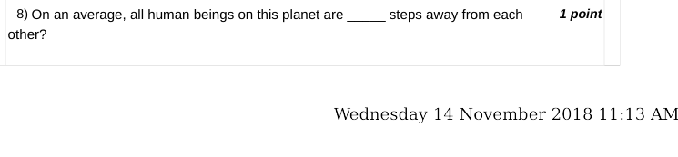

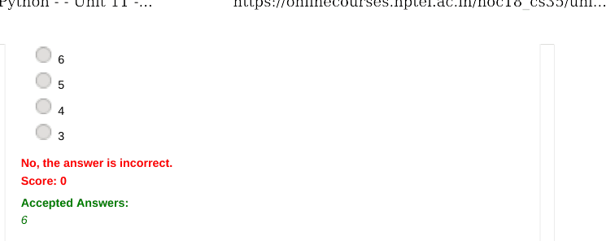

### Q9. What is Project Gutenberg?

- [ ] It is a repository comprising of free images.
- [ ] It is a repository comprising of free music.
- [x] It is a repository comprising of free ebooks.
- [ ] None of the above.
> No, the answer is incorrect. Score: 0

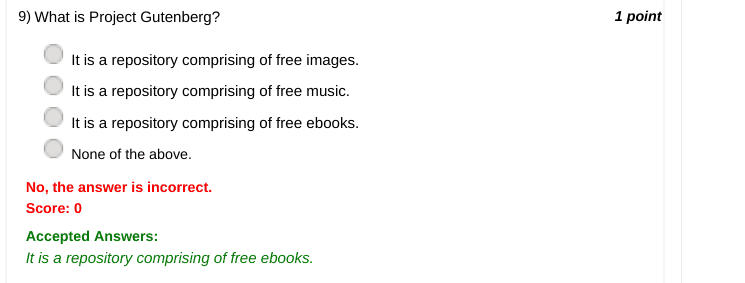

### Q10. How can nodes can be added to a graph using networkx package?

- [ ] G=networkx.Graph() G.add_node(1)
- [ ] G=networkx.Graph() add_node(1)
- [ ] networkx.add_node(1)
- [ ] nx.add_node(1)
> Accepted answer (not matched to a printed option): G=networkx.Graph(); G.add_node(1); Previous Page; End; Wednesday 14 November 2018 11:13 AM; Wednesday 14 November 2018 11:13 AM
> No, the answer is incorrect. Score: 0

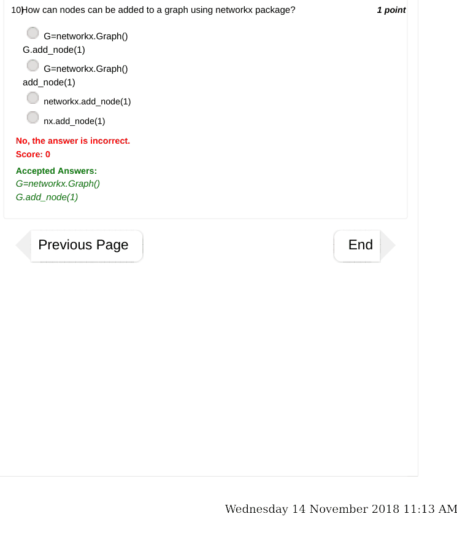

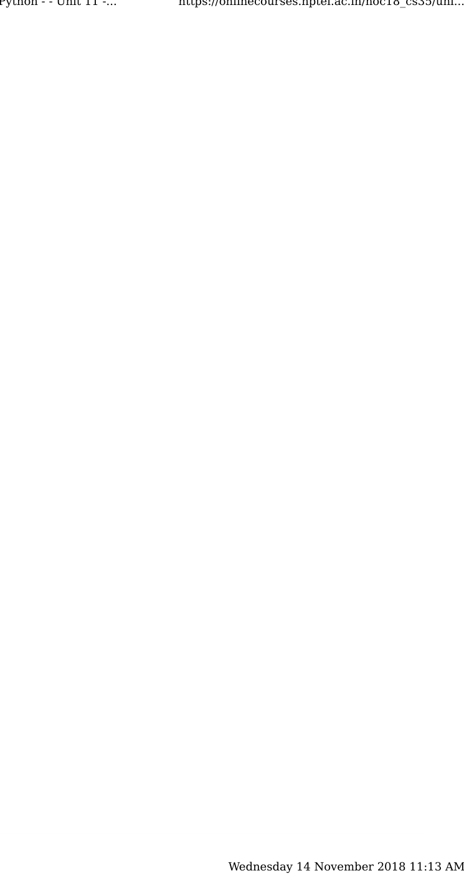
