# JOC Jul-2018 · Week 10: portal print

- Source: `JOC 2018.pdf` pages 34–37 (portal review printout). Parsed text below; the cropped image under each question is the exact page content (code, figures and ticks as printed) and is authoritative.
- `[x]` = option equal to the portal's **Accepted Answer** (official). Lines may carry stray spaces from the PDF text layer.

> reviewer3@nptel.iitm.ac.in ▼ · Due on 2018-10-10, 23:59 IST.

### Q1. What is the relationship between SAKSHI and AKASH according to the game FLAMES?

- [ ] Love
- [ ] Enemy
- [ ] Marriage
- [x] Friends
> No, the answer is incorrect. Score: 0

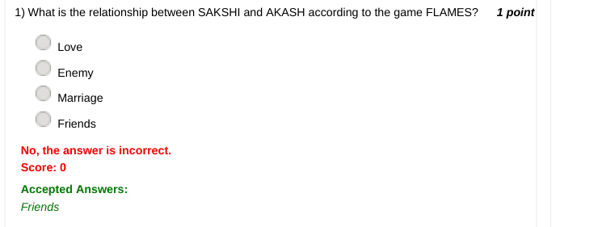

### Q2. State True or False.
numpy.asanyarray(input) converts input to an ndarray. Here, input can be images, scalars, lists, lists
of tuples, tuples, tuples of tuples, tuples of lists.

- [x] True
- [ ] False
> No, the answer is incorrect. Score: 0

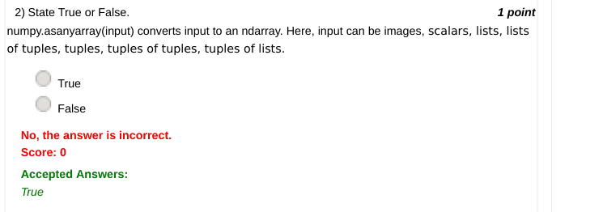

### Q3. What is the count obtained after cancelling the common letters between ALIA and ANKIT
according to the game FLAMES?

- [ ] 3
- [ ] 4
- [x] 5
- [ ] 6
> No, the answer is incorrect. Score: 0

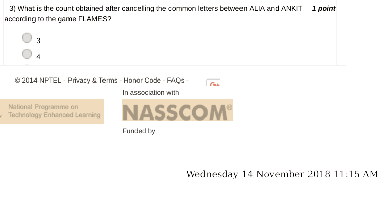

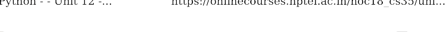

### Q4. Which Python module supports various operations on data type string?

- [x] string
- [ ] list
- [ ] array
- [ ] str
> No, the answer is incorrect. Score: 0

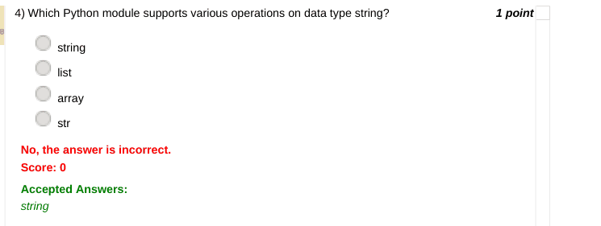

### Q5. What is the output of the statement print(numpy.array([1,2,3])) in Python?

- [x] [1 2 3]
- [ ] ['1','2','3']
- [ ] [1],[2],[3]
- [ ] None of the above
> No, the answer is incorrect. Score: 0

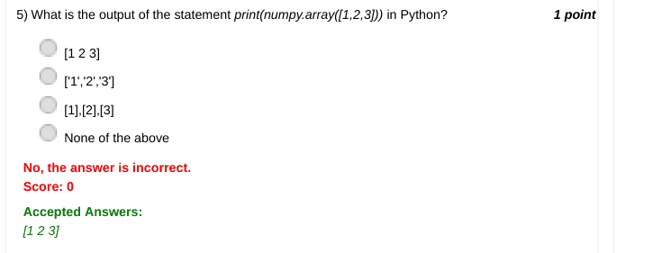

### Q6. import numpy as np
x=np.zeros(3,3)
What is x in the above code snippet?

- [ ] x is 1*3 matrix
- [x] x is 3*3 matrix comprising of zeros.
- [ ] x is 3*3 matrix comprising of some garbage values.
- [ ] None of the above
> No, the answer is incorrect. Score: 0

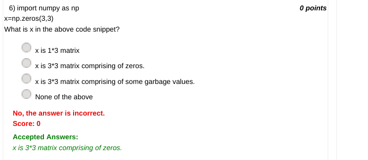

### Q7. If a is 2*3 numpy array, what would the function a.shape() return?

- [ ] (2,)
- [ ] (3,)
- [x] (2,3)
- [ ] None of the above
> No, the answer is incorrect. Score: 0

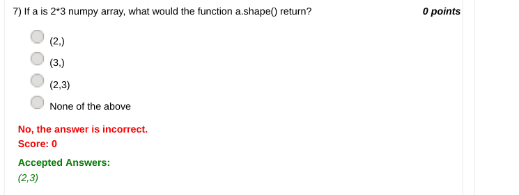

### Q8. import numpy as np
m=np.array([[99,101],[100,98]])
print(m.T)
What is the output of the above code snippet?

- [ ] Wednesday 14 November 2018 11:15 AM [[ 99 101] [100  98]] [[ 98 100] [101  99]] [[ 99 100] [98  101]] [[ 99 100] [101  98]]
> Accepted answer (not matched to a printed option): [[ 99 100]; [101  98]]
> No, the answer is incorrect. Score: 0

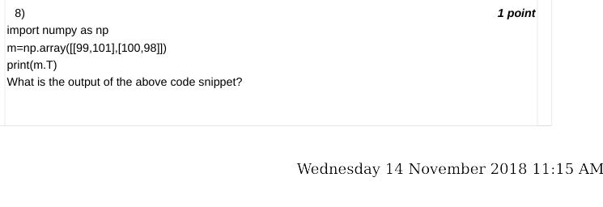

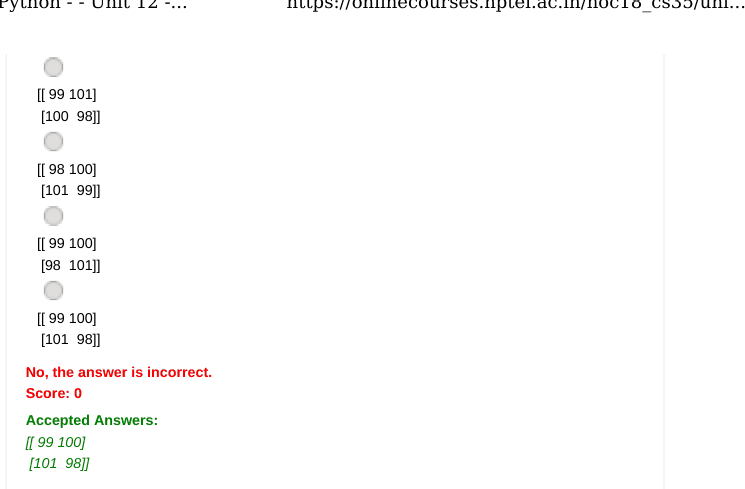

### Q9. Which of the following attributes is used to obtain picture size using PIL in Python?

- [ ] color
- [x] size
- [ ] width
- [ ] height
> No, the answer is incorrect. Score: 0

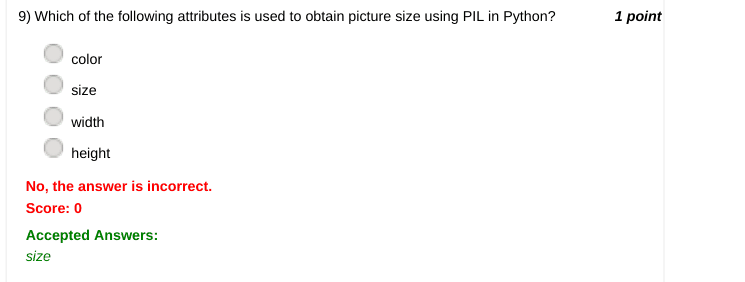

### Q10. What is the output of the statement print(s.lower()) if s='SImRan' ?

- [ ] SIMRAN
- [ ] Simran
- [ ] SIMran
- [x] simran
> No, the answer is incorrect. Score: 0

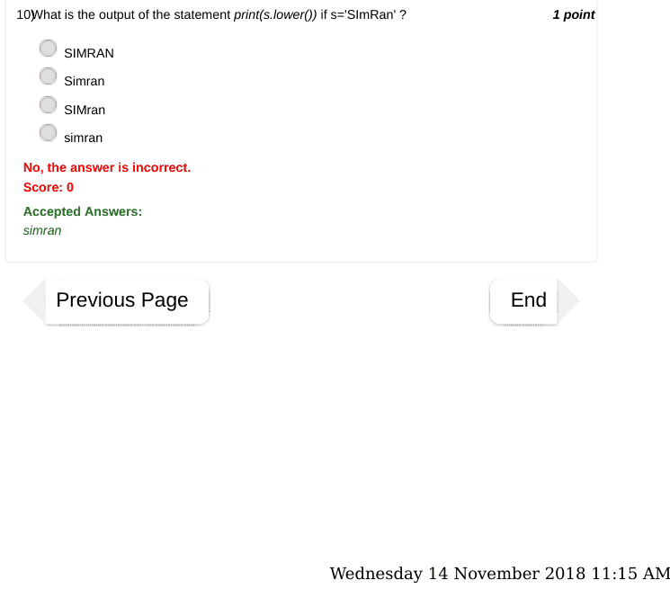

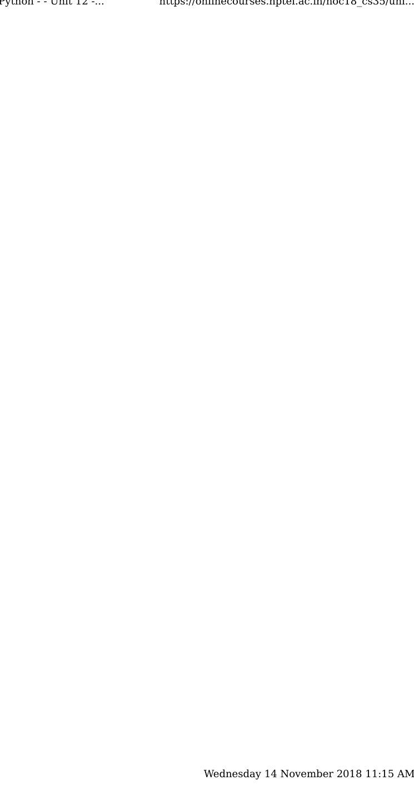
