# JOC Jan-2020 · Week 1: portal print

- Source: `JOC Jan-Aug 2020.pdf` pages 1–7 (portal review printout). Parsed text below; the cropped image under each question is the exact page content (code, figures and ticks as printed) and is authoritative.
- `[x]` = option equal to the portal's **Accepted Answer** (official). Lines may carry stray spaces from the PDF text layer.

> reviewer4@nptel.iitm.ac.in  · Due on 2020-02-12, 23:59 IST.

### Q1. Recall the programming using scratch. Which of the following set of instructions will not end
up getting the sprite (the cat) back at the initial
state (both in terms of movement and the angle)?

> No, the answer is incorrect. Score: 0

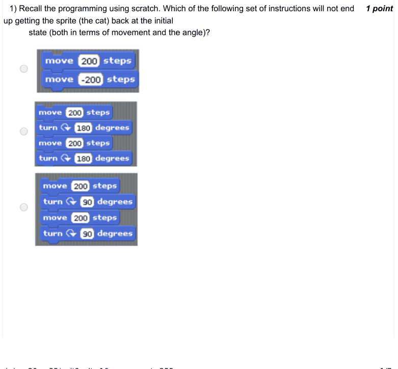

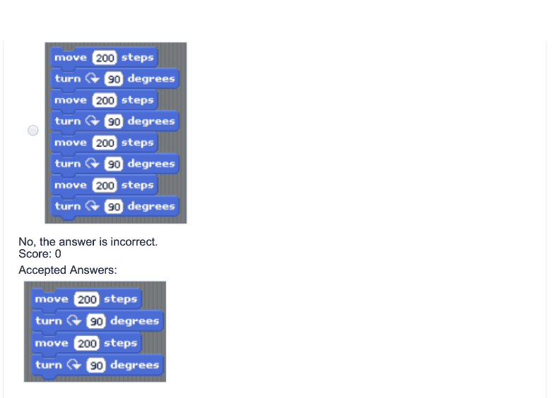

### Q2. What is the output of the following

- [ ] 3
- [x] 33
- [ ] 30
- [ ] None of the above
> No, the answer is incorrect. Score: 0

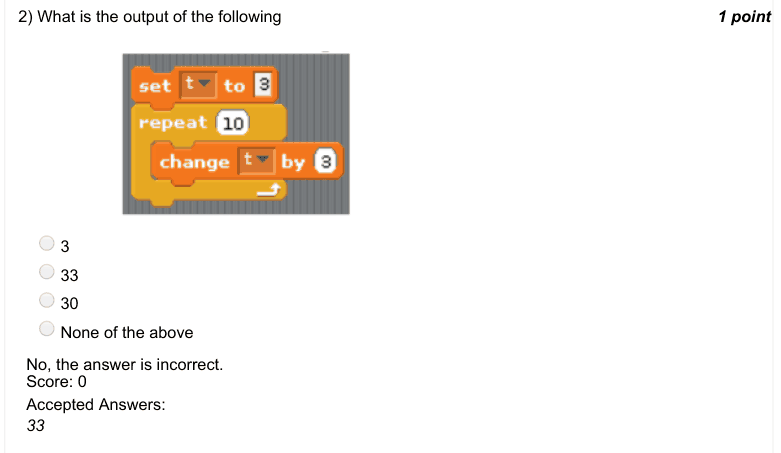

### Q3. What is the output of the following

- [ ] 0
- [ ] 10
- [x] -10
- [ ] None of the above
> No, the answer is incorrect. Score: 0

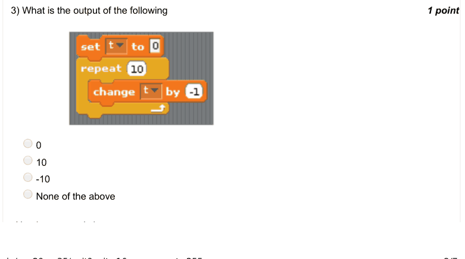

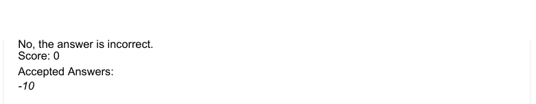

### Q4. When we double click the following instructions, the sprite (cat)

- [ ] keeps moving forward
- [ ] moves forward in steps of 10
- [ ] moves backward 10 steps and then come back to its original position
- [x] moves forward 10 steps and then come back to its original position
> No, the answer is incorrect. Score: 0

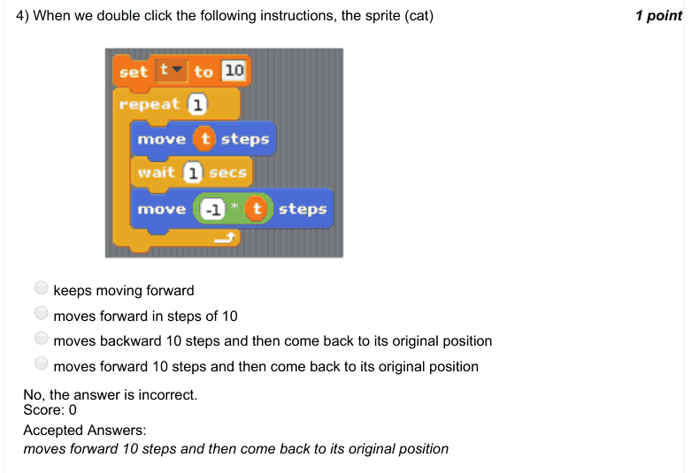

### Q5. Assuming our sprite to be an aeroplane now, the following instructions represent an aeroplane

- [ ] moving forward
- [ ] falling
- [ ] moving backward
- [x] making circular motions
> No, the answer is incorrect. Score: 0

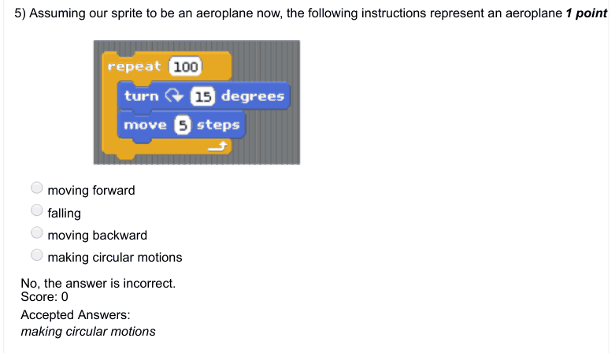

### Q6. Consider 2 blocks of instructions shown below for an aeroplane sprite. Choose the correct
option from the following

- [ ] First block represents landing while the second represents takeoff
- [x] First block represents takeoff while the second represents landing
- [ ] Both the blocks represent takeoff
- [ ] Both the blocks represent landing
> No, the answer is incorrect. Score: 0

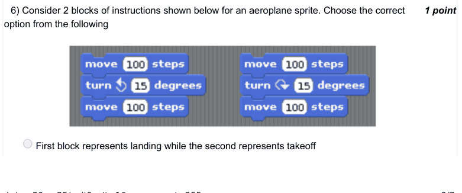

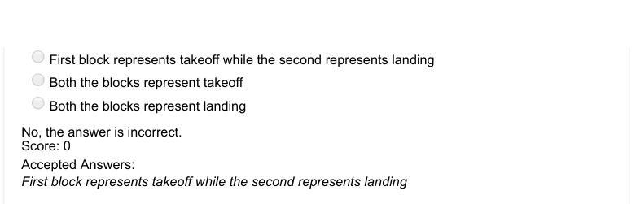

### Q7. Which of the following represents the code block for a jumping baseball which initially jumps to
a height of 200 and then in every subsequent
iteration reaches 3/4th of the height in the previous iteration till it comes to rest.

> No, the answer is incorrect. Score: 0

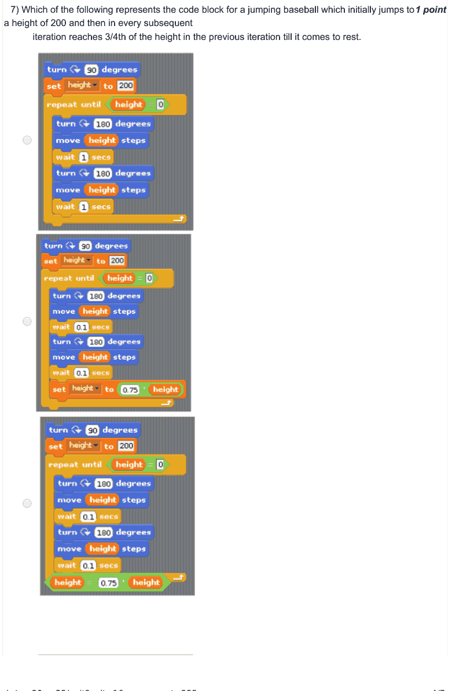

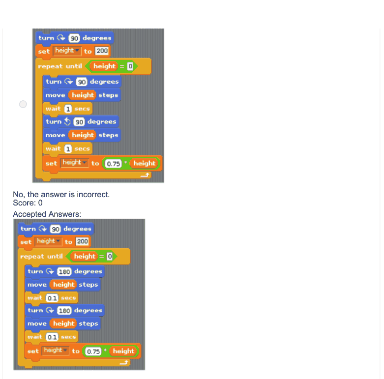

### Q8. Imagine a ghost sprite. What does the following block of instructions represent

- [ ] Ghost going vertically up and then down
- [ ] Ghost going backward and then forward
- [x] Ghost going up, flying forward for some steps and then coming down
- [ ] None of the above
> No, the answer is incorrect. Score: 0

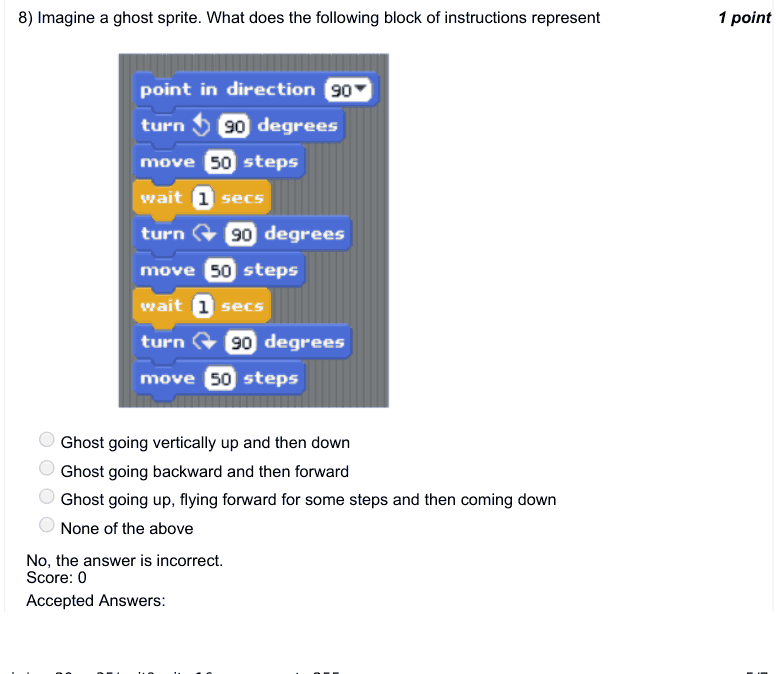

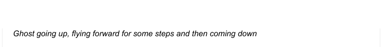

### Q9. Which of the following is true?

- [ ] We can not implement an infinite loop using scratch
- [ ] We can not create a random integer using scratch
- [ ] Scratch does not have an explicit square root function
- [x] Scratch does not have an explicit power function
> No, the answer is incorrect. Score: 0

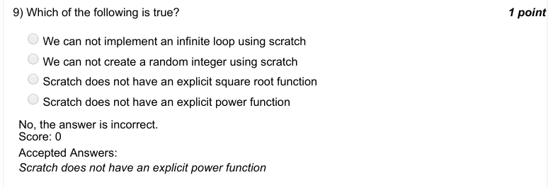

### Q10. What does the following code compute

- [x] multiplication of x and y
- [ ] x to the power y
- [ ] factorial of x
- [ ] None of the above
> No, the answer is incorrect. Score: 0

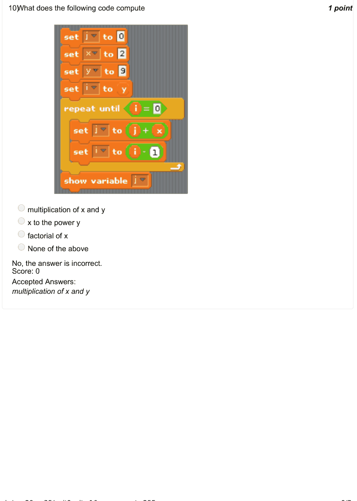

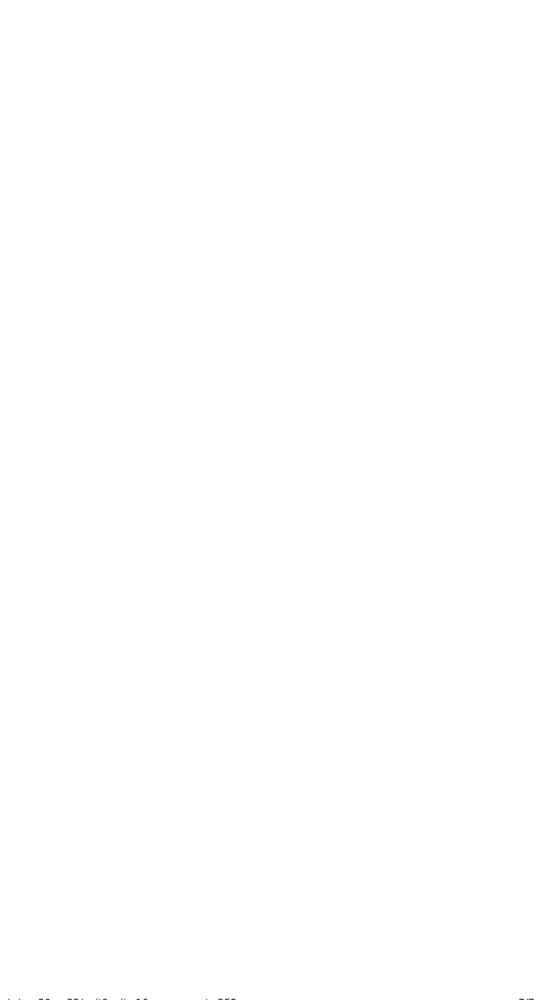
