# JOC Jan-2020 · Week 2: portal print

- Source: `JOC Jan-Aug 2020.pdf` pages 8–11 (portal review printout). Parsed text below; the cropped image under each question is the exact page content (code, figures and ticks as printed) and is authoritative.
- `[x]` = option equal to the portal's **Accepted Answer** (official). Lines may carry stray spaces from the PDF text layer.

> reviewer4@nptel.iitm.ac.in  · Due on 2020-02-12, 23:59 IST.

### Q1. Which of the following options correctly prints the phrase “Hurry Up!!”?

- [ ] printf(“Hurry Up!!”)
- [ ] print(Hurry Up!!!)
- [ ] print_sentence(Hurry Up!!!)
- [x] print(“Hurry Up!!”)
> No, the answer is incorrect. Score: 0

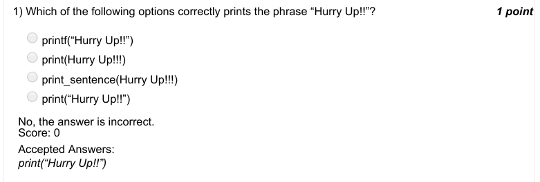

### Q2. What is the output of the following code snippet?

- [ ] Hi Arjuna Bhimaa
- [ ] Hi Arjuna Hi Bhimaa
- [x] Hi Hi Arjuna Bhimaa
- [ ] Hi Arjuna Bhimaa Hi
> No, the answer is incorrect. Score: 0

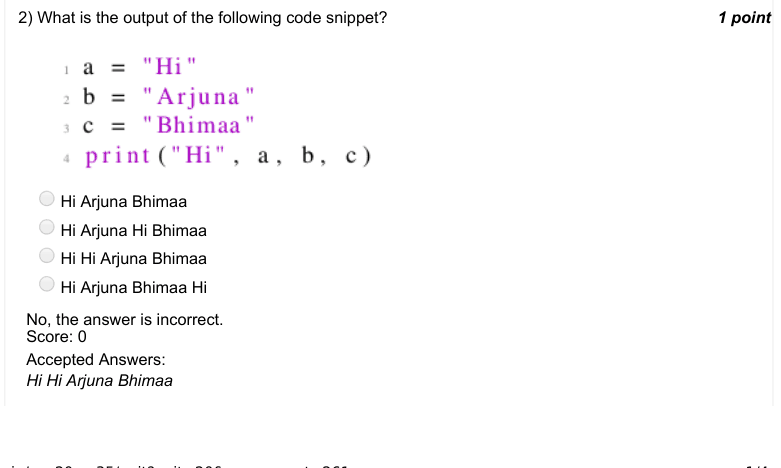

### Q3. With what extension are the python files saved?

- [ ] .p
- [ ] .python
- [ ] .pyn
- [x] .py
> No, the answer is incorrect. Score: 0

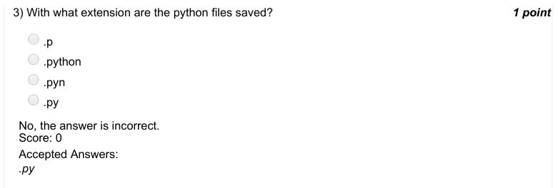

### Q4. Which of the following statements correctly represents taking input from user in python?

- [ ] a=get("Enter the value")
- [ ] a=inp("Enter the value")
- [x] a=input("Enter the value")
- [ ] None of the above
> No, the answer is incorrect. Score: 0

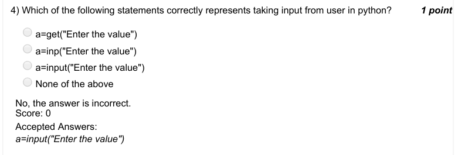

### Q5. What is the output of the following code?

- [ ] -20
- [x] Syntax error
- [ ] 20
- [ ] Displays nothing
> No, the answer is incorrect. Score: 0

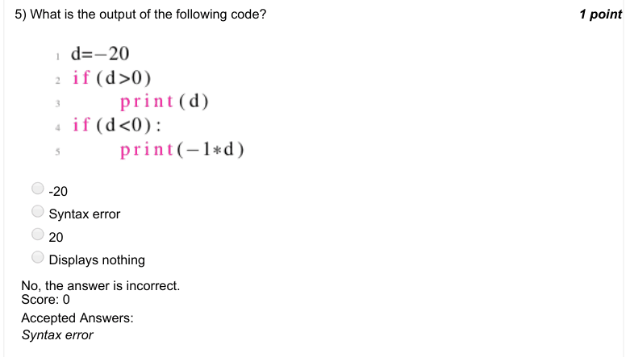

### Q6. What does the following code do?

- [x] displays numbers from 0 to 4
- [ ] displays numbers from 1 to 5
- [ ] displays numbers from 0 to 5
- [ ] none of the above
> No, the answer is incorrect. Score: 0

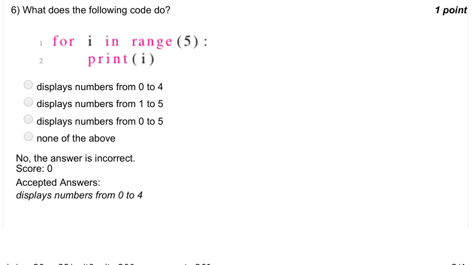

### Q7. What does the following code do?

- [ ] displays table of 2
- [ ] syntax error
- [ ] displays table of 10
- [x] none of the above
> No, the answer is incorrect. Score: 0

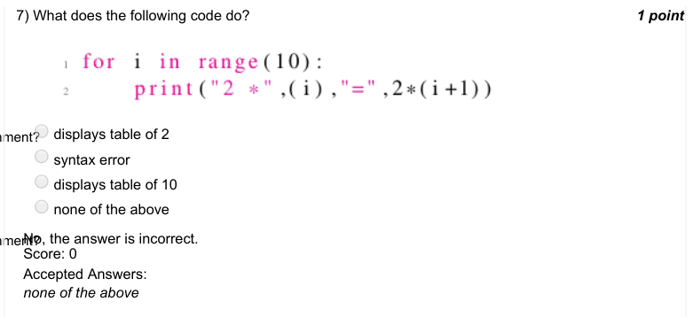

### Q8. What does the following code do?

- [ ] 24
- [ ] 0
- [x] 120
- [ ] none of the above
> No, the answer is incorrect. Score: 0

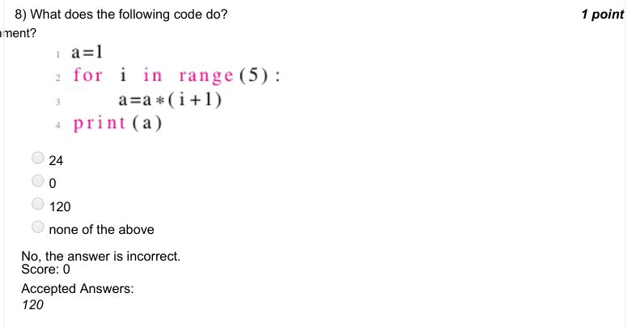

### Q9. What is the output of the following code?

- [x] 4 3 2 1
- [ ] 5 4 3 2 1
- [ ] 4 3 2 1 0
- [ ] 5 4 3 2 1 0
> No, the answer is incorrect. Score: 0

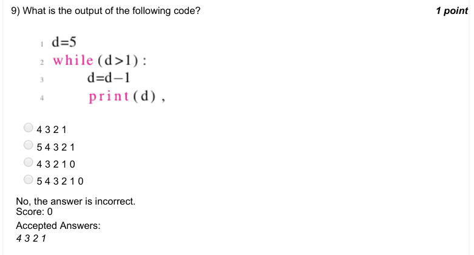

### Q10. What is the output of the following code?

- [ ] a b c
- [ ] a b
- [ ] b c
- [x] Error
> No, the answer is incorrect. Score: 0

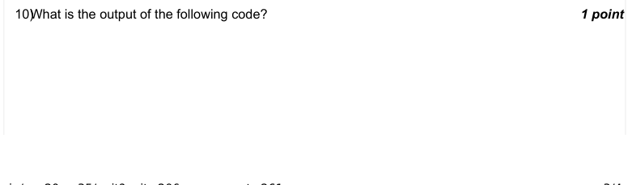

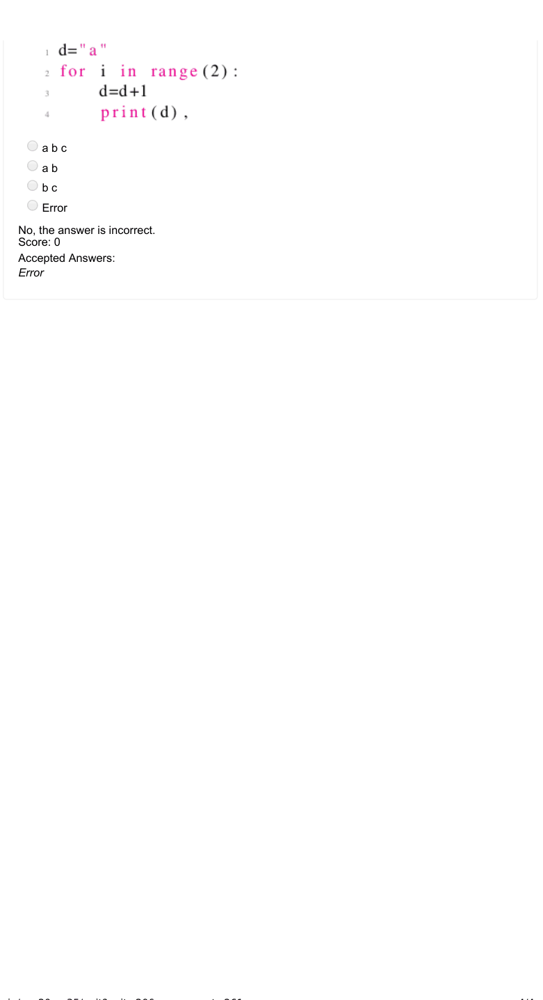
