# JOC Jan-2020 · Week 3: portal print

- Source: `JOC Jan-Aug 2020.pdf` pages 12–17 (portal review printout). Parsed text below; the cropped image under each question is the exact page content (code, figures and ticks as printed) and is authoritative.
- `[x]` = option equal to the portal's **Accepted Answer** (official). Lines may carry stray spaces from the PDF text layer.

> reviewer4@nptel.iitm.ac.in  · Due on 2020-02-19, 23:59 IST.

### Q1. Which of the following displays a code which iterates from numbers 1 to 100, displays “fizz” if
the number is divisible by a but not b, displays
“buzz” if the number is divisible by b but not a and displays “fizzbuzz” if the number is divisible by
both a and b. a and b are
inputs taken from the user.

> No, the answer is incorrect. Score: 0

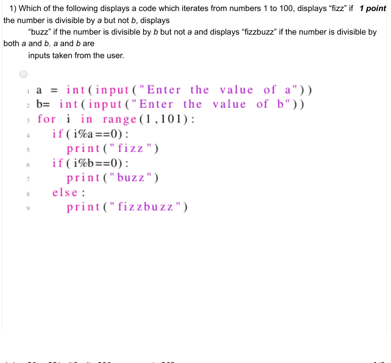

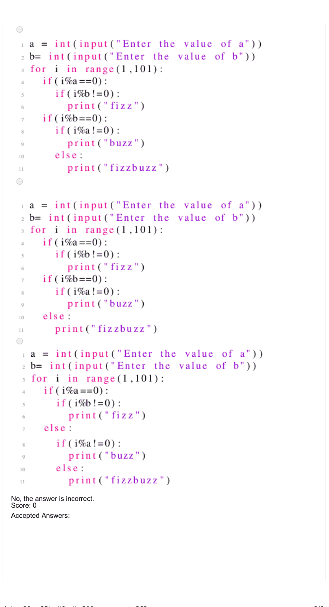

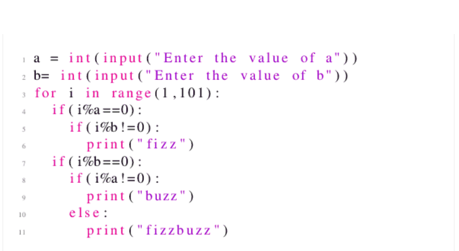

### Q2. The below code displays

- [ ] all numbers from 1 to 100 which are divisible by 10
- [ ] all numbers from 1 to 99 which are divisible by 10
- [ ] all numbers from 1 to 110 which are divisible by 10
- [x] none of the above
> No, the answer is incorrect. Score: 0

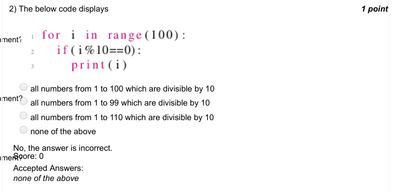

### Q3. What is the output of the following code?

- [ ] hi hi hi hi hi hi hi hi
- [ ] hi we are the elements in a list
- [ ] hi
- [x] error
> No, the answer is incorrect. Score: 0

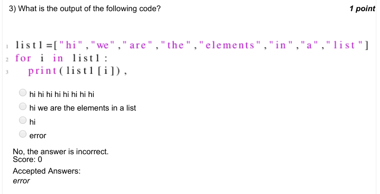

### Q4. What is the output of the following code?

- [ ] hi we are the elements in a list
- [ ] hi we are the elements
- [x] hi we are the
- [ ] hi we are
> No, the answer is incorrect. Score: 0

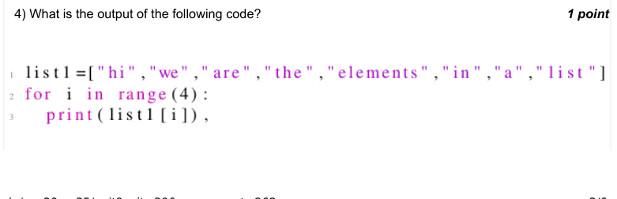

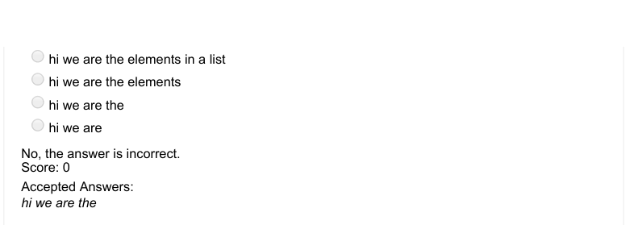

### Q5. Which of the following correctly represents a sum function in Python.

> No, the answer is incorrect. Score: 0

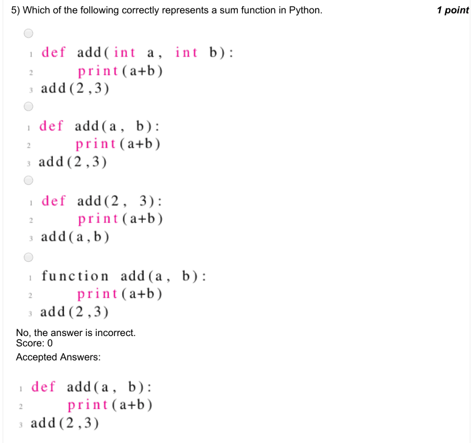

### Q6. Which of the following statements correctly represents a jumbled form of a given word. For
example, if the word=“lion”, one of the plausible
outputs can be “oinl”.

- [x] "".join(random.sample(word,len(word)))
- [ ] "a".join(random.sample(word,len(word)))
- [ ] "".join(random.sample(word))
- [ ] join(random.sample(word))
> No, the answer is incorrect. Score: 0

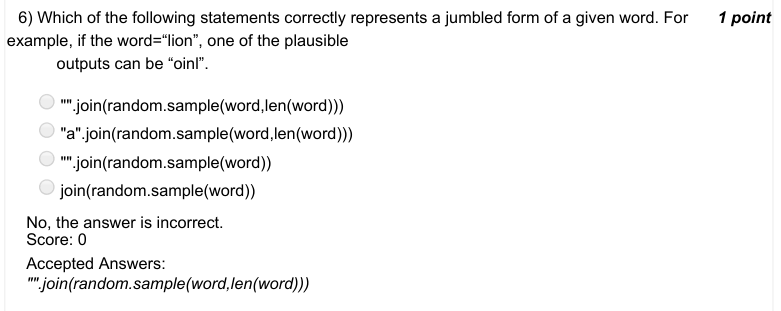

### Q7. Given a variable word which is a string where no letter is repeated, what does the following
code snippet do?

- [ ] keeps printing the jumbled form of the word in an infinite loop
- [ ] shows all the jumbled forms of the word where some forms might be repeated
- [x] shows some jumbled forms of the word where some forms might be repeated as well
- [ ] shows all unique jumbled forms of the word including the original word as well
> No, the answer is incorrect. Score: 0

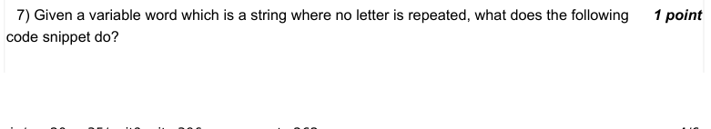

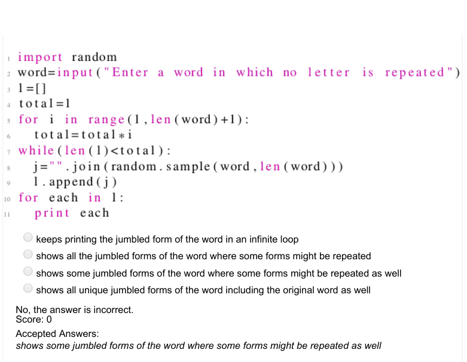

### Q8. Assuming, there is no file named "file.txt" on my computer, what does the following code do?

- [ ] Creates a file named file.txt and adds “Hey! I am writing” to it
- [ ] Shows an error because file does not exist
- [ ] Shows an error because file in not opened in the reading mode
- [x] None of the above
> No, the answer is incorrect. Score: 0

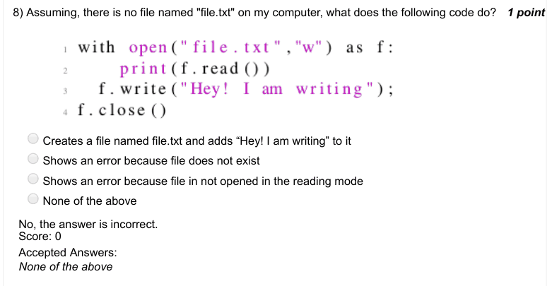

### Q9. Assuming, there is no file named "file.txt" on my computer, what does the following code do?

- [ ] Shows error
- [x] Displays: Hey I am writing the second line
- [ ] Displays: Hey! I am writing.Hey I am writing the second line.
- [ ] Displays: Hey! I am writing.
> No, the answer is incorrect. Score: 0

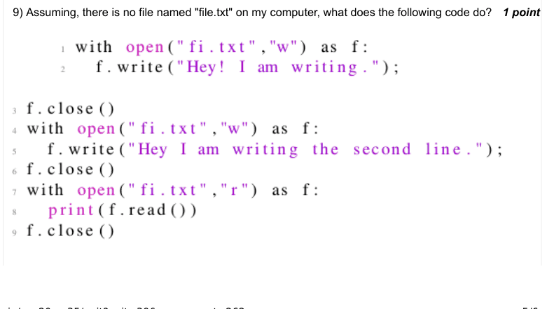

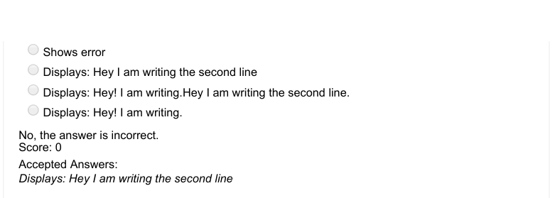

### Q10. What is the output of the following code?

- [ ] Displays 1
- [x] Displays 2
- [ ] Displays 0
- [ ] Shows error
> No, the answer is incorrect. Score: 0

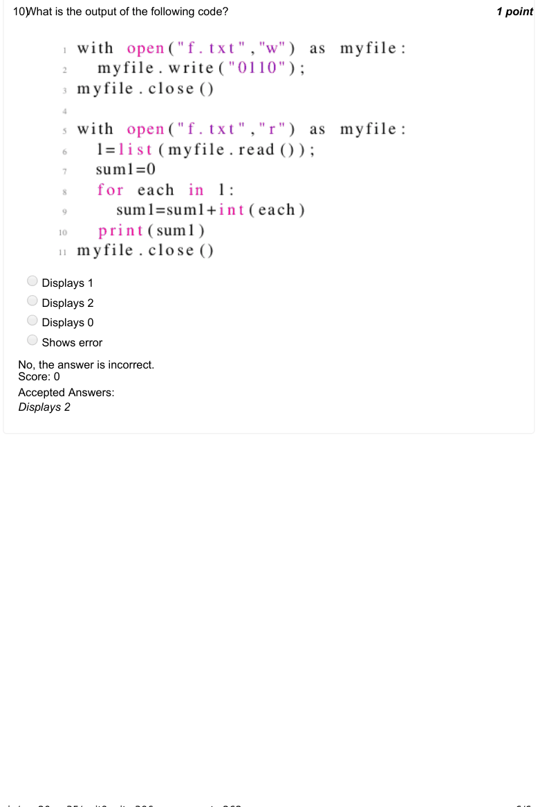
