# JOC Jan-2020 · Week 4: portal print

- Source: `JOC Jan-Aug 2020.pdf` pages 18–24 (portal review printout). Parsed text below; the cropped image under each question is the exact page content (code, figures and ticks as printed) and is authoritative.
- `[x]` = option equal to the portal's **Accepted Answer** (official). Lines may carry stray spaces from the PDF text layer.

> reviewer4@nptel.iitm.ac.in  · Due on 2020-02-26, 23:59 IST.

### Q1. What does the check_magic() function in the following code do

- [x] displays all 2 × 2 matrices where elements are from 1 to 9.
- [ ] displays all 2 × 2 matrices where elements are from 1 to 9 but no element is repeated
- [ ] displays magic squares of size 2
- [ ] none of the above
> No, the answer is incorrect. Score: 0

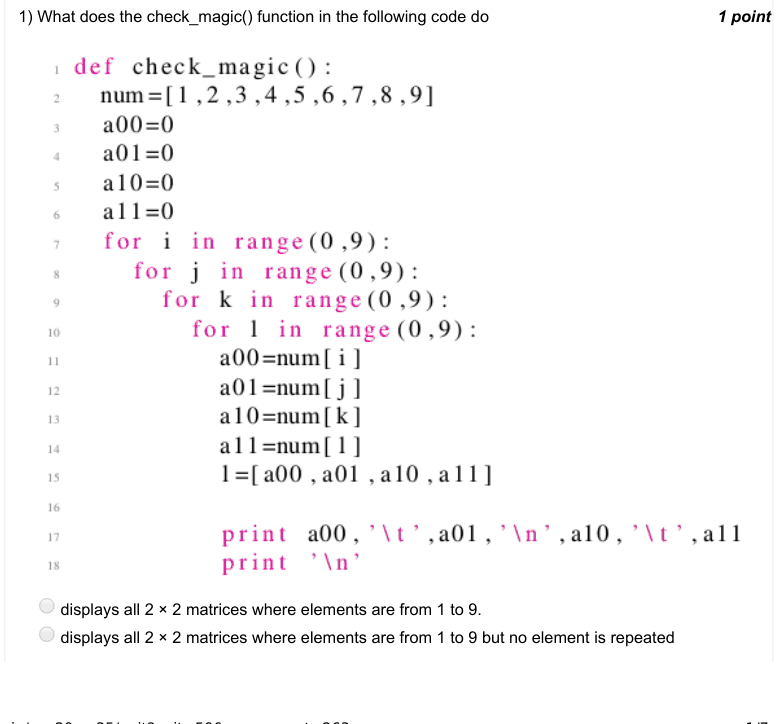

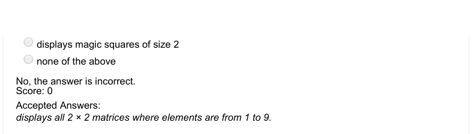

### Q2. What does the following code do?

- [ ] displays common fruits in both the lists l1 and l2
- [ ] displays fruits which are in l1 but not in l2
- [ ] displays fruits which are in l2 but not in l1
- [x] none of the above
> No, the answer is incorrect. Score: 0

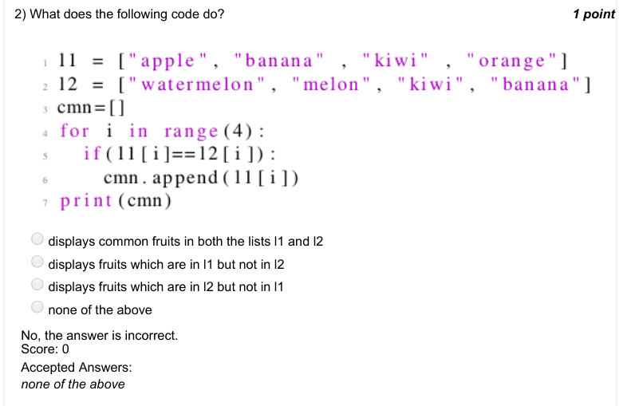

### Q3. Leap years are the years

- [ ] 1. which divisible by 4 but not divisible by 100, and, those
- [ ] 2. divisible by 400 Which of the following code does not represent a code displaying all the leap years from 1 to 2000.
> No, the answer is incorrect. Score: 0

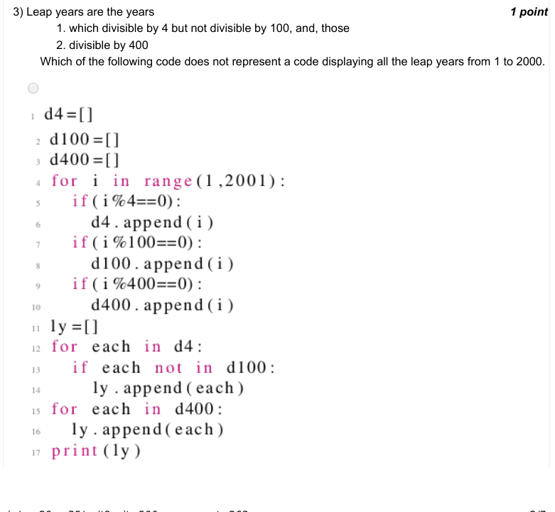

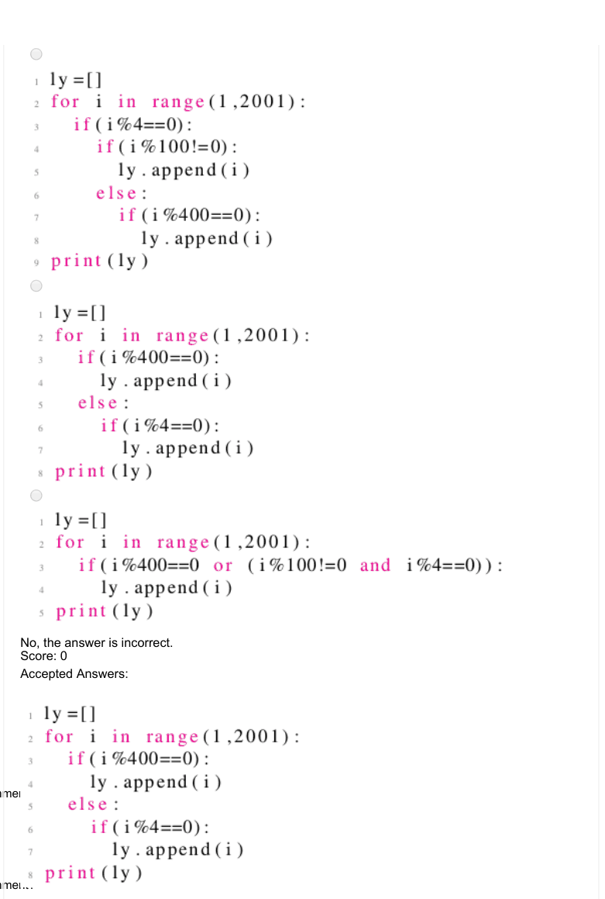

### Q4. What does the following function do

- [ ] returns true for century year and false for non century year
- [x] returns true for leap year and false for non leap year
- [ ] returns false for century year and true for non century year
- [ ] none of the above
> No, the answer is incorrect. Score: 0

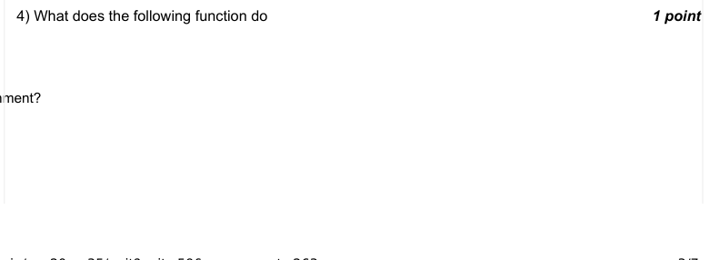

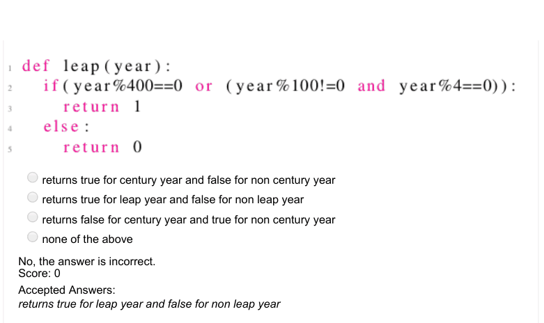

### Q5. Which of the following code correctly represents how one can display the number of dashes
equal to that of the letters in the movie name?
movies =[" t i t a n i c " , " chinatown " , " a v e n g e r s " , " 3 i d i o t s " , " c o n j u r i n g " , " j u n g l
e b o o k " , " m a t r i x " ]

- [x] ch =random . c h o i c e ( m o v i e s )
- [x] f o r  i  in  r a n g e ( l e n ( ch ) ) :
- [ ] print ( ’_ ’) , movies =[" t i t a n i c " , " chinatown " , " a v e n g e r s " , " 3 i d i o t s " , " c o n j u r i n g " , " j u n g l e b o o k " , " m a t r i x " ]
- [x] ch =random . c h o i c e ( m o v i e s )
- [ ] for i in range (100):
- [ ] print ( ’_ ’) , movies =[" t i t a n i c " , " chinatown " , " a v e n g e r s " , " 3 i d i o t s " , " c o n j u r i n g " , " j u n g l e b o o k " , " m a t r i x " ]
- [x] ch =random . c h o i c e ( m o v i e s )
- [ ] for  ch  in  r a n g e ( l e n ( ch ) ) :
- [x] print ( ’_ ’) ,
- [ ] none of these
> No, the answer is incorrect. Score: 0

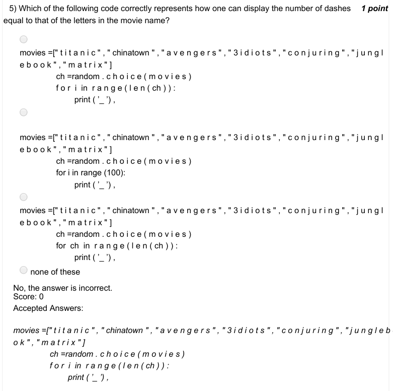

### Q6. Given a list of movies, which of the following represents a code which randonly chooses a
movie amongst all?
movies =[" t i t a n i c " , " chinatown " , " a v e n g e r s " , " 3 i d i o t s " , " c o n j u r i n g " , " j u n g l
e b o o k " , " m a t r i x " ]

- [ ] ch = m o v i e s [ random . r a n d i n t ( 0 , l e n ( m o v i e s ) ) ] movies =[" t i t a n i c " , " chinatown " , " a v e n g e r s " , " 3 i d i o t s " , " c o n j u r i n g " , " j u n g l e b o o k " , " m a t r i x " ]
- [ ] ch = m o v i e s [ random . u n i f o r m ( 0 , l e n ( m o v i e s ) ) ] movies =[" t i t a n i c " , " chinatown " , " a v e n g e r s " , " 3 i d i o t s " , " c o n j u r i n g " , " j u n g l e b o o k " , " m a t r i x " ]
- [ ] ch = m o v i e s [ random . c h o i c e ( 0 , l e n ( m o v i e s ) ) ]
- [x] none of these
> No, the answer is incorrect. Score: 0

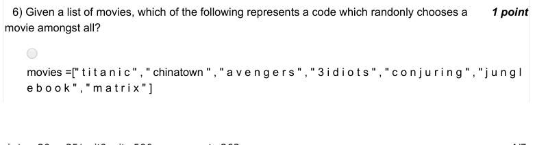

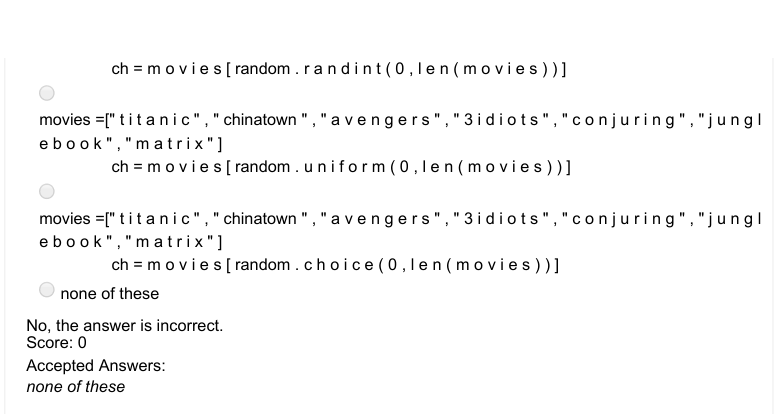

### Q7. What does the following code do?

- [ ] prints yes if both strings are same
- [x] prints yes if both strings have atleast one common character
- [ ] prints yes if first string is contained in the second
- [ ] none of the above
> No, the answer is incorrect. Score: 0

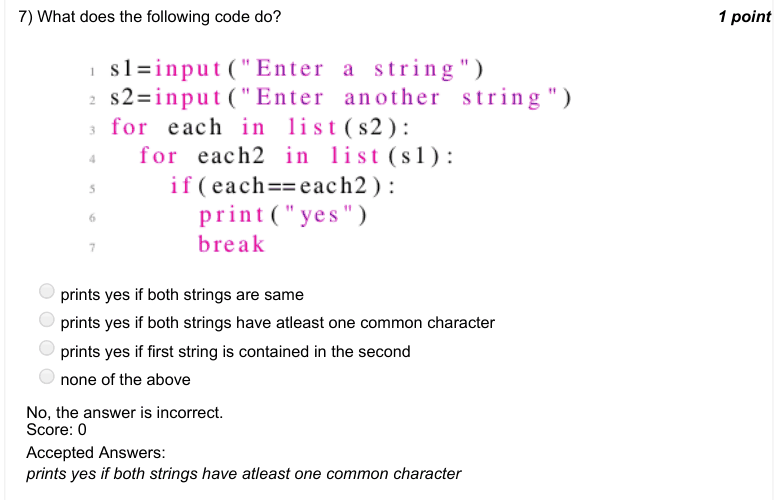

### Q8. Which numbers from 1 to 100 does the following code print?

- [x] prime numbers
- [ ] perfect squares
- [ ] numbers which are factorial of some other number
- [ ] perfect cubes
> No, the answer is incorrect. Score: 0

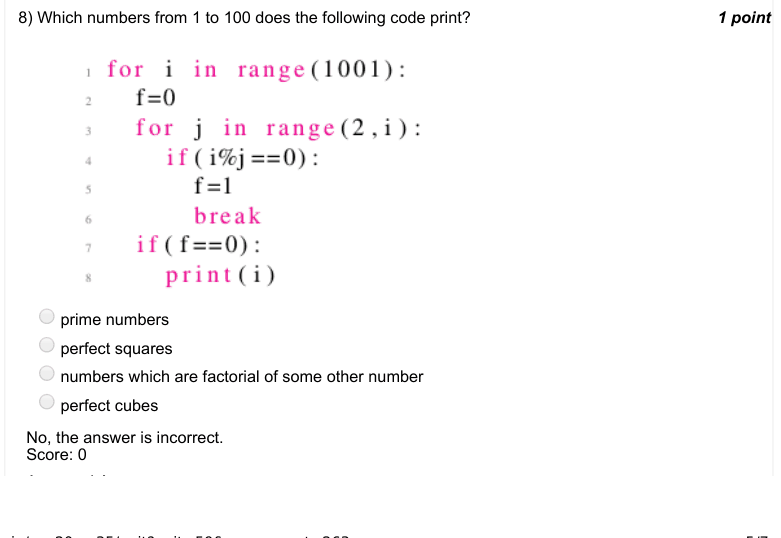

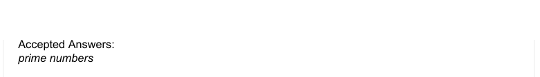

### Q9. Which numbers from 1 to 100 does the following code print?

- [ ] prime numbers
- [x] perfect squares
- [ ] numbers which are factorial of some other number
- [ ] perfect cubes
> No, the answer is incorrect. Score: 0

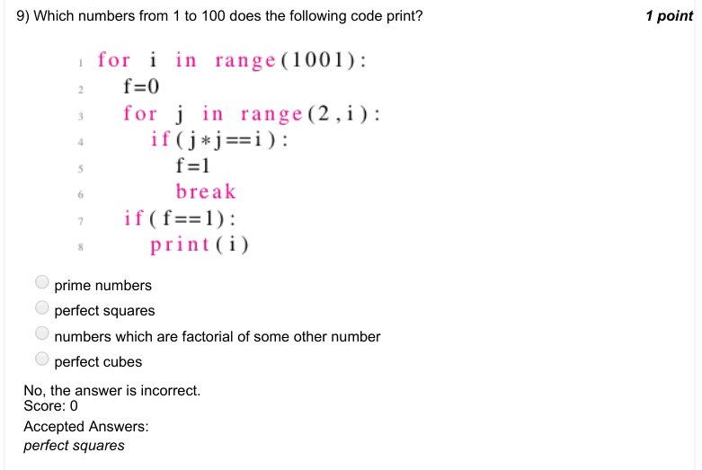

### Q10. Assume a drunkard whose movement is defined on the number line, i.e. he can either move
forward or backward. Assume he is
standing at a position p. He takes 2 steps forward followed by 4 steps backward. He falls into the
pit as soon as he steps
on the position zero. Which of the following codes correctly represents his walk? A.
p= i n t ( i n p u t ( ) )
while (p >0):

- [ ] p=p+2
- [ ] p r i n t ( " Location =" , p )
- [ ] p=p−4
- [ ] p r i n t ( " Location =" , p ) p r i n t (" Fell in p i t at location " , p ) p= i n t ( i n p u t ( ) ) while (p >0):
- [ ] p=p−2
- [ ] p r i n t ( " Location =" , p )
- [ ] p=p+4
- [ ] p r i n t ( " Location =" , p ) p r i n t (" Fell in p i t at location " , p ) p= i n t ( i n p u t ( ) ) while (p >0):
- [x] for i in range ( 2 ) :
- [x] p=p+1
- [x] p r i n t ( " Loc = " , p )
- [x] i f ( p ==0):
- [x] break
- [x] for i in range ( 4 ) :
- [x] p=p−1
- [x] p r i n t ( " Loc = " , p )
- [x] i f ( p ==0):
- [ ] break p r i n t (" Fell in p i t at location " , p )
- [ ] none of these
> No, the answer is incorrect. Score: 0

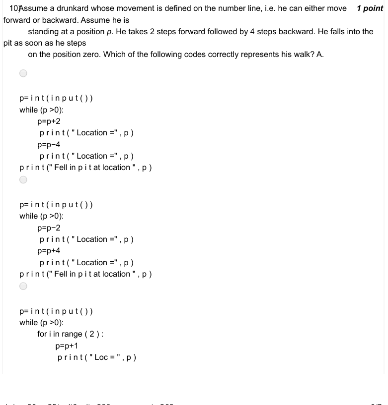

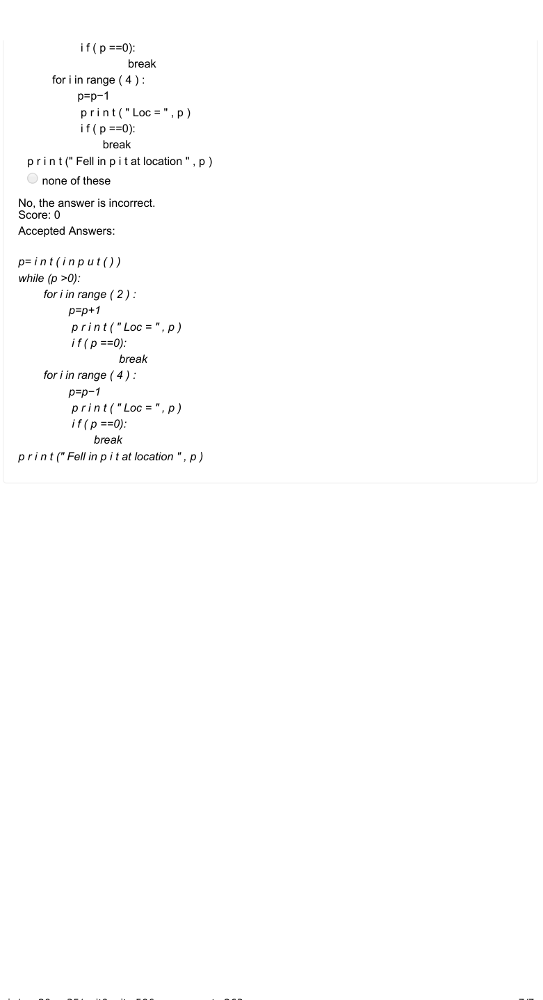
