# JOC Jan-2020 · Week 5: portal print

- Source: `JOC Jan-Aug 2020.pdf` pages 25–30 (portal review printout). Parsed text below; the cropped image under each question is the exact page content (code, figures and ticks as printed) and is authoritative.
- `[x]` = option equal to the portal's **Accepted Answer** (official). Lines may carry stray spaces from the PDF text layer.

> reviewer4@nptel.iitm.ac.in  · Due on 2020-03-04, 23:59 IST.

### Q1. What does the following code do?

- [x] creates a list where two random elements are ‘c’ and the other element is ‘g’
- [ ] creates a list where two random elements are ‘g’ and the other element is ‘c’
- [ ] creates a list where one random elements is ‘c’ and the other element is ‘g’
- [ ] none of the above
> No, the answer is incorrect. Score: 0

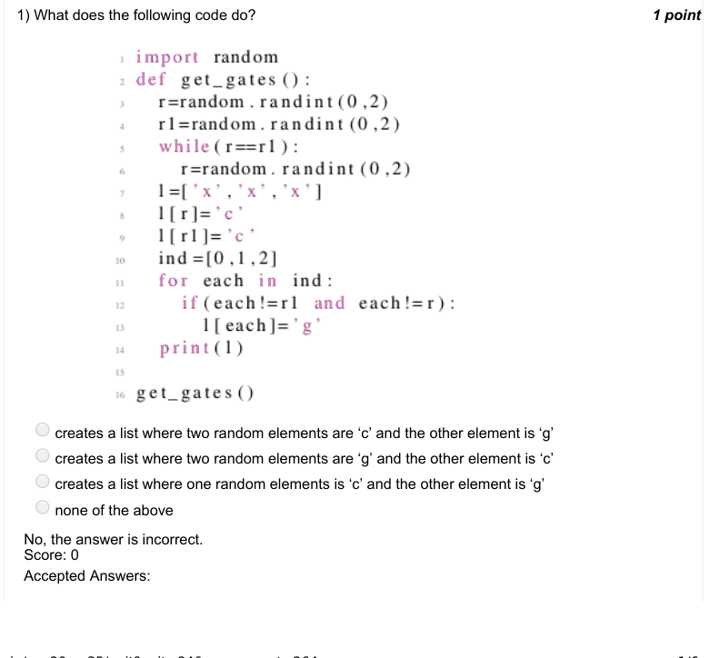

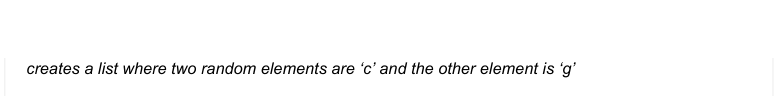

### Q2. Which of the random experiments from the options does the code represent?

- [ ] Tossing a coin once
- [ ] Tossing a coin infinite times
- [ ] Tossing a coin repeatedly till a head in encountered
- [x] none of the above
> No, the answer is incorrect. Score: 0

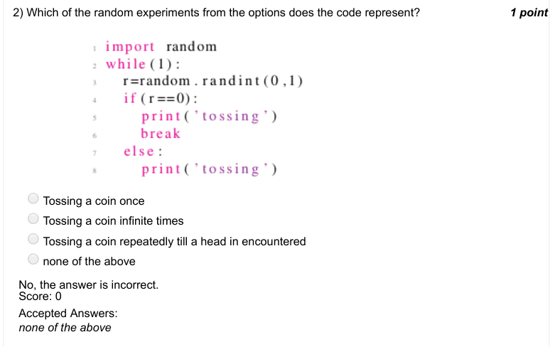

### Q3. Which of the random experiments from the options does the code represent?

- [x] Prints a success when both people select the same object
- [ ] Prints a success when both people select “rock”
- [ ] Prints a success when both people select different objects
- [ ] None of the above
> No, the answer is incorrect. Score: 0

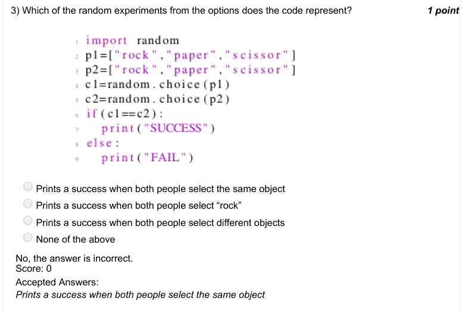

### Q4. For the code below, which of the statement in the options is false?

- [ ] The loop runs exactly 10 times
- [ ] All the integers taken as input from the user need not be in the list l
- [x] The list l consists of exactly 10 elements at the end of the program
- [ ] The list l printed in the last line is a sorted list
> No, the answer is incorrect. Score: 0

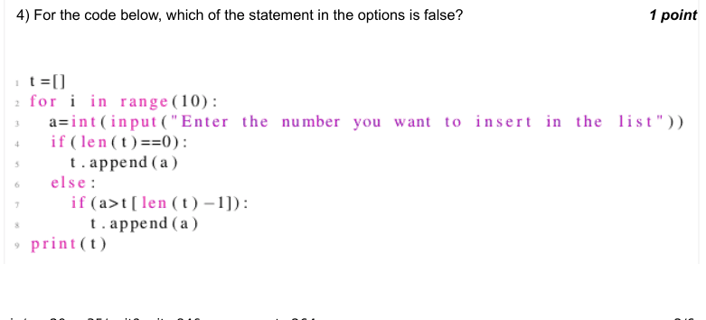

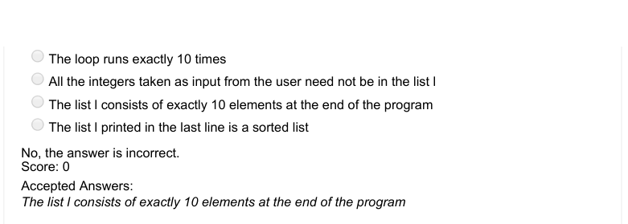

### Q5. Which of the random experiments from the options does the code represent?

- [ ] Placing 100 bins and then throwing 10 balls randomly in these bins
- [x] Placing 10 bins and then throwing 100 balls randomly in these bins
- [ ] Placing 10 bins and 10 balls and then throwing 10 balls randomly in these bins
- [ ] None of the above
> No, the answer is incorrect. Score: 0

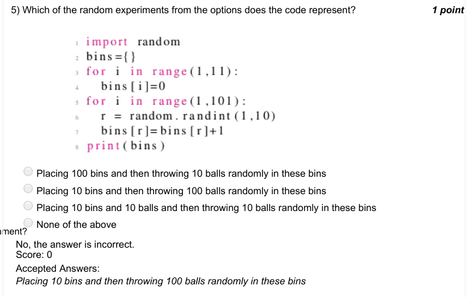

### Q6. Assuming that “bins” represents a dictionary where key is the number of a bin and value
represents the number of balls present in the
corresponding bin, what is the output of the following code?

- [ ] Displays the maximum number of balls present in any bin
- [x] Displays the number of the bin containing maximum balls
- [ ] Displays the number of the bin containing minimum balls
- [ ] None of the above
> No, the answer is incorrect. Score: 0

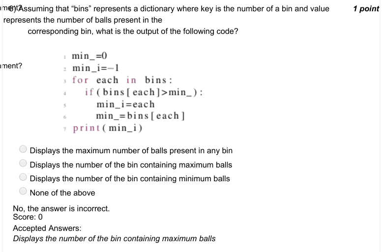

### Q7. Assuming that “bins” represents a dictionary where key is the number of a bin and value
represents the number of balls present in the
corresponding bin, what is the output of the following code?

- [ ] Displays the maximum number of balls present in any bin
- [ ] Displays bins in the ascending order of the number of balls they have
- [x] Displays bins in the descending order of the number of balls they have
- [ ] None of the above
> No, the answer is incorrect. Score: 0

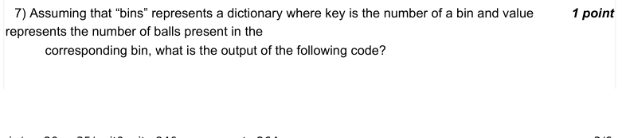

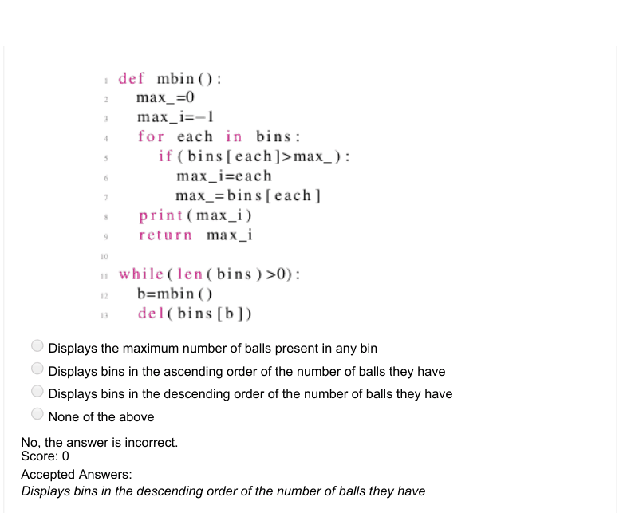

### Q8. The above code generates numbers from

- [ ] 0 to 99999
- [ ] 0 to 100000
- [x] 0 to 99998
- [ ] 1 to 99998
> No, the answer is incorrect. Score: 0

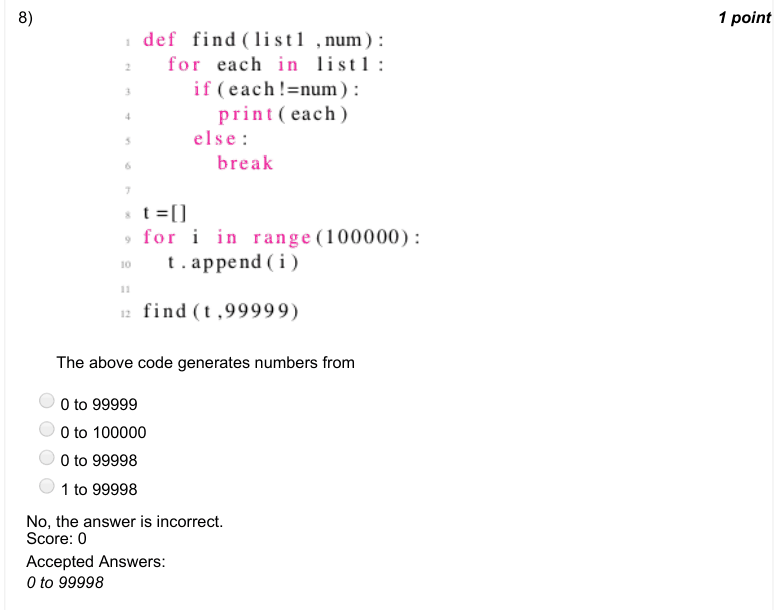

### Q9. Which of the random experiments from the options does the code represent?

- [ ] Rolling a dice once
- [ ] Rolling a dice infinite times
- [ ] Rolling a dice repeatedly till an odd number is encountered
- [x] Rolling a dice repeatedly till an even number is encountered
> No, the answer is incorrect. Score: 0

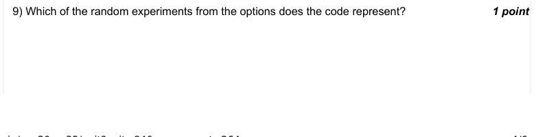

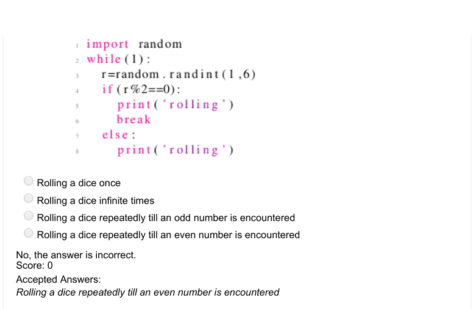

### Q10. Assuming that “bins” represents a dictionary where key is the number of a bin and value
represents the number of balls present in the
corresponding bin, what plot does the following code generate?

- [ ] X axis: Number of balls, Y axis: Number of bins having as many balls as specified by X axis
- [ ] X axis: Bin number, Y axis: Number of balls in the bin whose number is specified by X axis
- [ ] X axis: Ball number, Y axis: The bin number which contained the ball whose number is specified by the X axis
- [x] None of the above
> No, the answer is incorrect. Score: 0

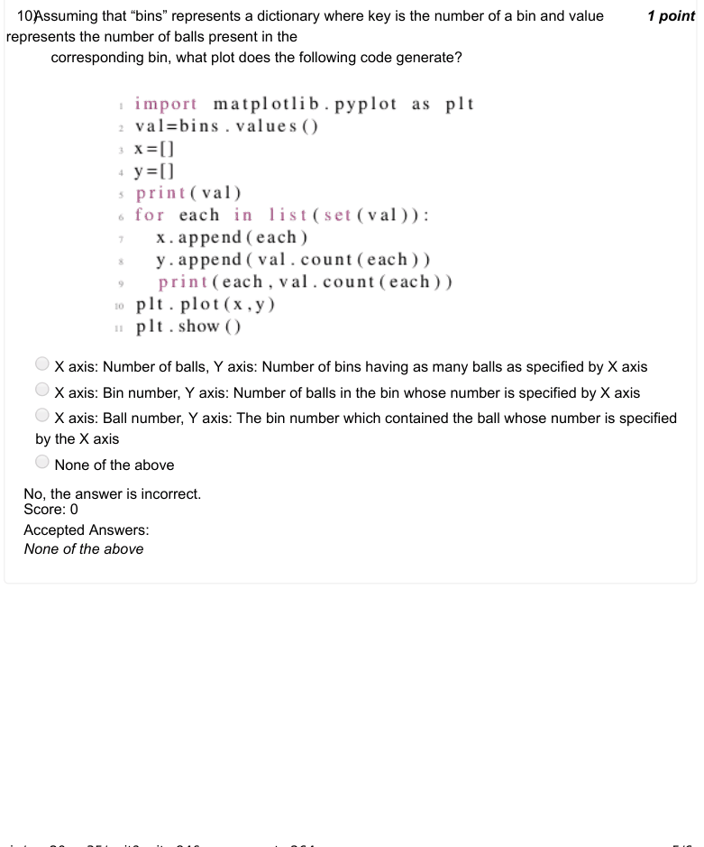

