# JOC Jan-2020 · Week 6: portal print

- Source: `JOC Jan-Aug 2020.pdf` pages 31–36 (portal review printout). Parsed text below; the cropped image under each question is the exact page content (code, figures and ticks as printed) and is authoritative.
- `[x]` = option equal to the portal's **Accepted Answer** (official). Lines may carry stray spaces from the PDF text layer.

> reviewer4@nptel.iitm.ac.in  · Due on 2020-03-11, 23:59 IST.

### Q1. Give that the statement chr(ord(alpha) + i) returns the character(alphabet or a special
character) at the location i ahead than the
alphabet alpha, eg, chr(ord(’a’)+1) returns ‘b’; what is the output of the following code?

- [ ] ABCDEFGH
- [x] BCDEFGHI
- [ ] EFGHIJKL
- [ ] none of the above
> No, the answer is incorrect. Score: 0

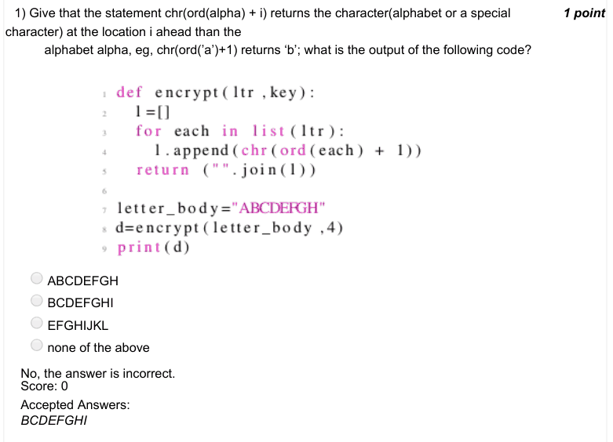

### Q2. What does the following code do?

- [ ] Keeps asking the user to guess a number until the user guesses 10
- [ ] The computer generates a random number r and keeps it. The user is repeatedly prompted to enter a number. If the user enters r, the code says success and ends, else the prompting is continued.
- [x] Enters an infinite loop
- [ ] The computer generates a random number r and keeps it. The user is repeatedly prompted to enter a number. If the user enters r, the code says success and ends, else the computer generates a new random number r and thereafter the prompting is continued.
> No, the answer is incorrect. Score: 0

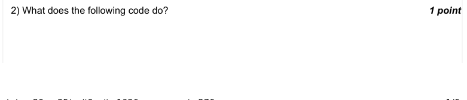

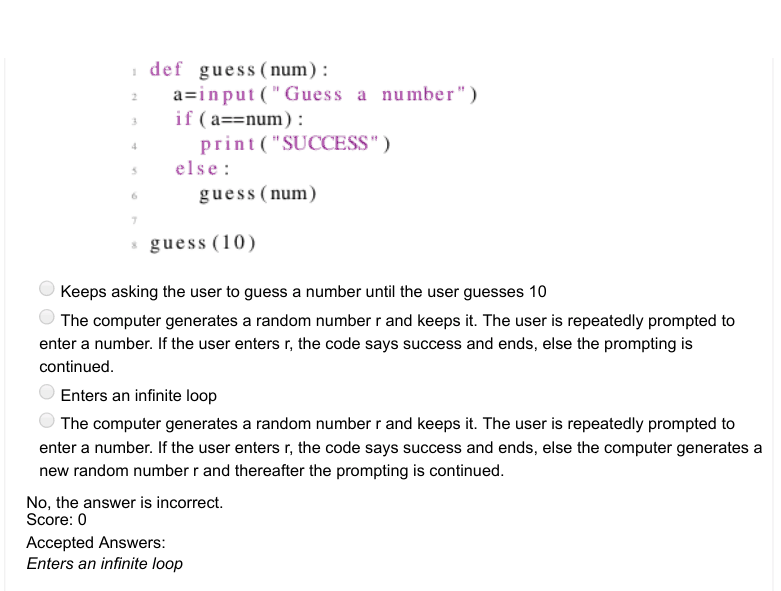

### Q3. What does the following code do?

- [ ] Keeps asking the user to guess a number until the user guesses 10
- [ ] The computer generates a random number r and keeps it. The user is repeatedly prompted to enter a number. If the user enters r, the code says success and ends, else the prompting is continued.
- [ ] Enters an infinite loop
- [ ] The computer generates a random number r and keeps it. The user is repeatedly prompted to enter a number. If the user enters r, the code says success and ends, else the computer generates a new random number r and thereafter the prompting is continued.
> Accepted answer (not matched to a printed option): The computer generates a random number r and keeps it. The user is repeatedly prompted to enter a; number. If the user enters r, the code says success and ends, else the computer generates a new random; number r and thereafter the prompting is continued.
> No, the answer is incorrect. Score: 0

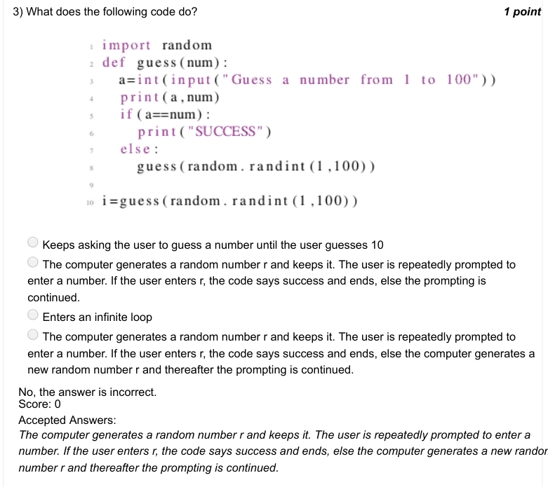

### Q4. With n as input, the code below computes

- [ ] −1 × n
- [ ] −1 + n
- [x] n
- [x] (−1)
- [x] (−1)
- [x] n
> No, the answer is incorrect. Score: 0

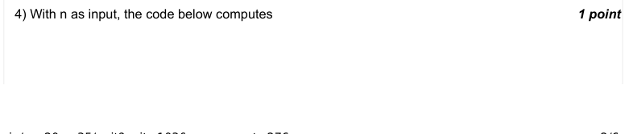

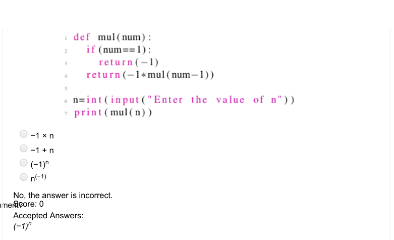

### Q5. The following code

- [ ] displays an error
- [ ] does not display an error but might display the error if we change the middle value passed in the function search() from 0 to some negative value.
- [ ] Can return a negative value in some cases when we change the values passed to the function search()
- [ ] Scans the list from first to the last element and displays the index of the value passed in the last number in the function search().
> Accepted answer (not matched to a printed option): Scans the list from first to the last element and displays the index of the value passed in the last number in; the function search().
> No, the answer is incorrect. Score: 0

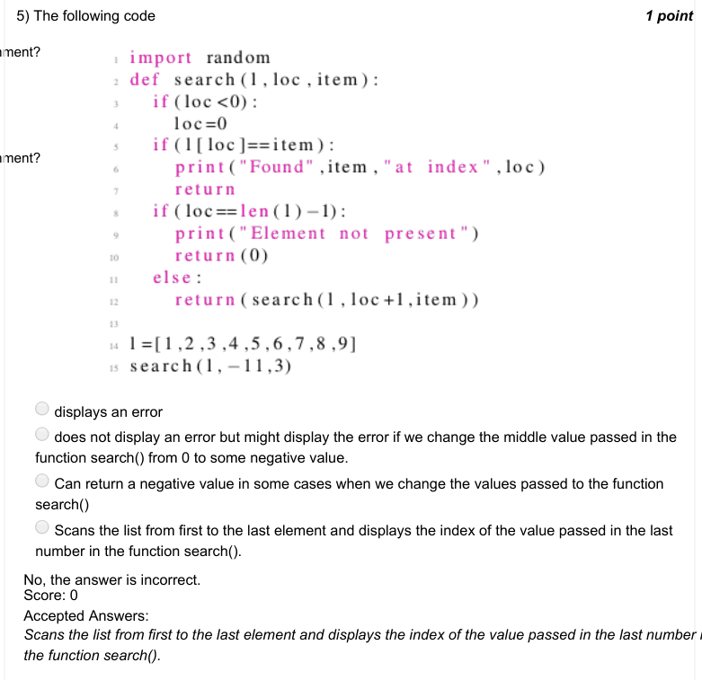

### Q6. The following code represents

- [x] recursive algorithm for linear search an element in a list
- [ ] recursive algorithm for binary search an element in a list
- [ ] non-recursive algorithm for linear search an element in a list
- [ ] none of the above
> No, the answer is incorrect. Score: 0

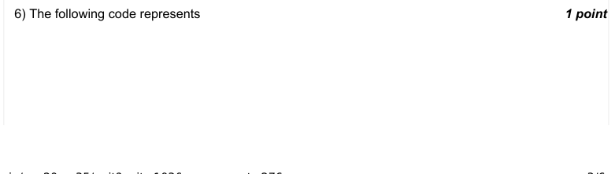

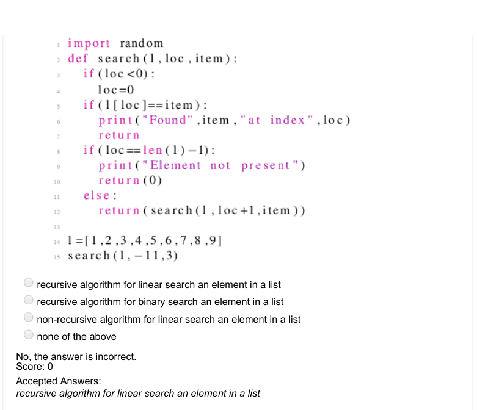

### Q7. What is the output of print(int(3.79)+int(2.1))?

- [ ] 6
- [x] 5
- [ ] 7
- [ ] 4
> No, the answer is incorrect. Score: 0

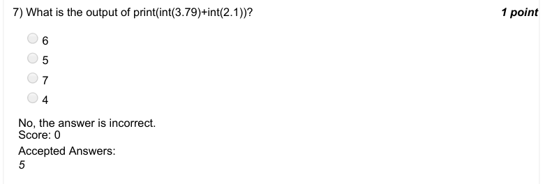

### Q8. The following code to its best, represents a scenario

- [x] A cake getting eaten by half of its current amount every time
- [ ] A student attempting alternate questions, starting from a given question
- [ ] Viruses doubling inside a body and killing the person once their population becomes 128 or more.
- [ ] Metro train serving 128 stations to and fro
> No, the answer is incorrect. Score: 0

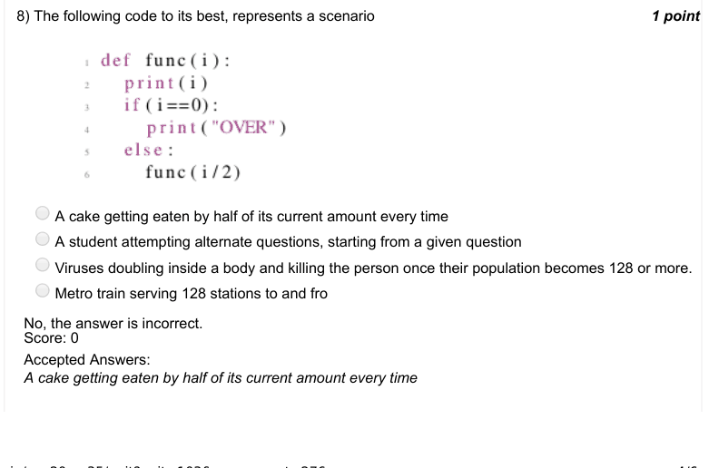

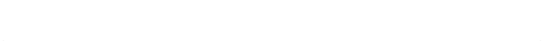

### Q9. The following code to its best, represents a scenario

- [ ] A cake getting eaten by half of its current amount every time
- [ ] A student attempting alternate questions, starting from a given question
- [x] Viruses doubling inside a body and killing the person once their population becomes 128 or more.
- [ ] Metro train serving 128 stations to and fro
> No, the answer is incorrect. Score: 0

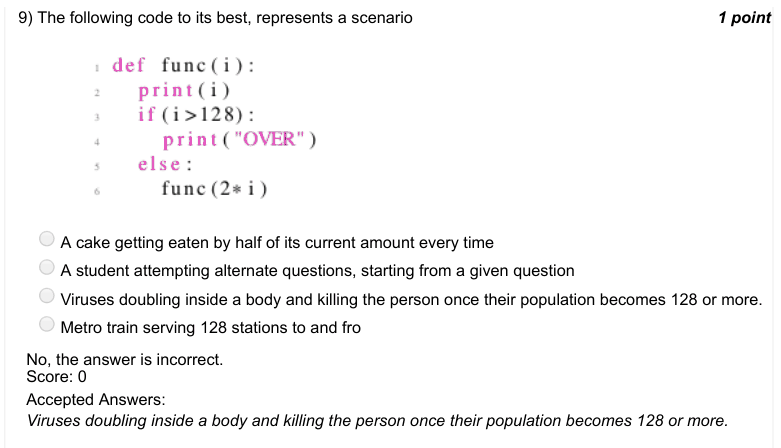

### Q10. The following code to its best, represents a scenario

- [ ] A cake getting eaten by half of its current amount every time
- [ ] A student attempting alternate questions, starting from a given question
- [ ] Viruses doubling inside a body and killing the person once their population becomes 128 or more.
- [x] Metro train serving 128 stations to and fro
> No, the answer is incorrect. Score: 0

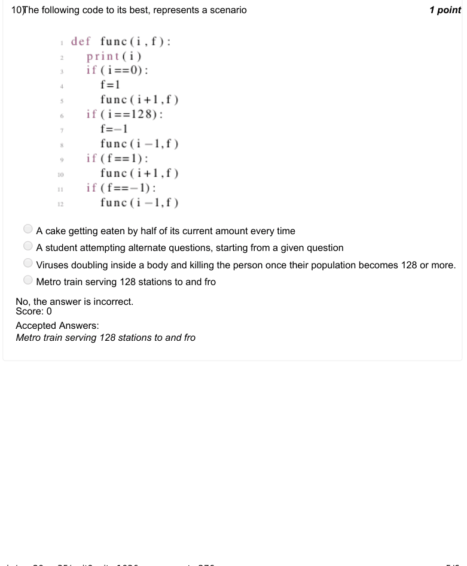

