# JOC Jan-2020 · Week 7: portal print

- Source: `JOC Jan-Aug 2020.pdf` pages 37–48 (portal review printout). Parsed text below; the cropped image under each question is the exact page content (code, figures and ticks as printed) and is authoritative.
- `[x]` = option equal to the portal's **Accepted Answer** (official). Lines may carry stray spaces from the PDF text layer.

> reviewer4@nptel.iitm.ac.in  · Due on 2020-03-18, 23:59 IST.

### Q1. Predict the output

- [ ] 7 4 1 1 4 7 2 5 8 8 5 2 3 6 9 9 6 3
- [ ] 1 4 7 2 5 8 3 6 9
- [ ] 1 4 7 8 5 2 3 6 9
- [x] 1 4 7 7 4 1 2 5 8 8 5 2 3 6 9 9 6 3
> No, the answer is incorrect. Score: 0

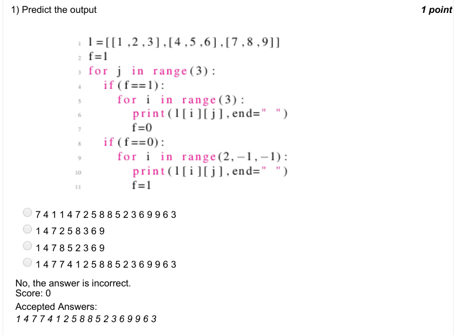

### Q2. Predict the output of the calling function func1() for a given square matrix mx of dimension 70
× 70.

> No, the answer is incorrect. Score: 0

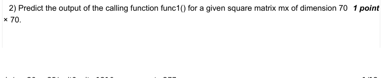

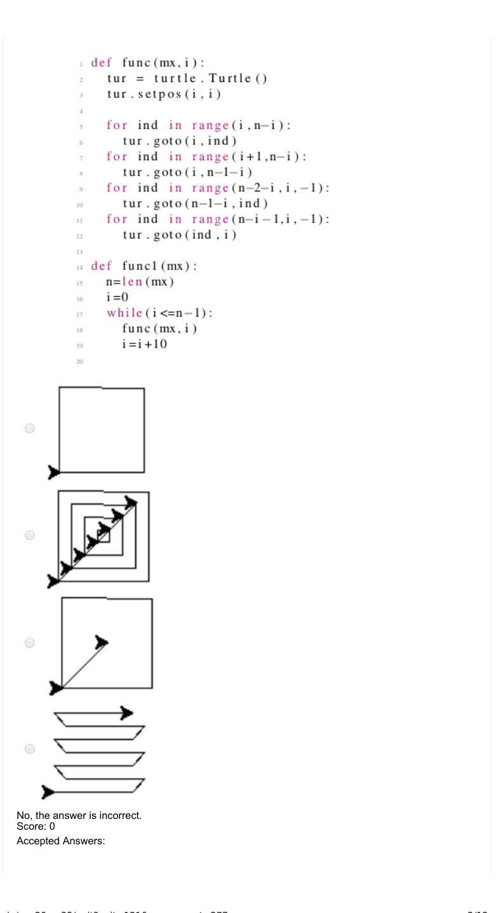

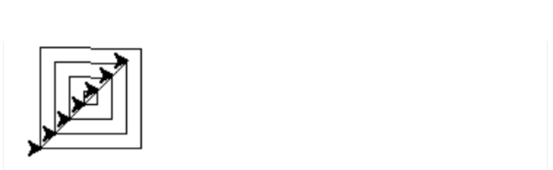

### Q3. Predict the output of the calling function func() for a given square matrix mx of dimension 70
× 70.

> No, the answer is incorrect. Score: 0

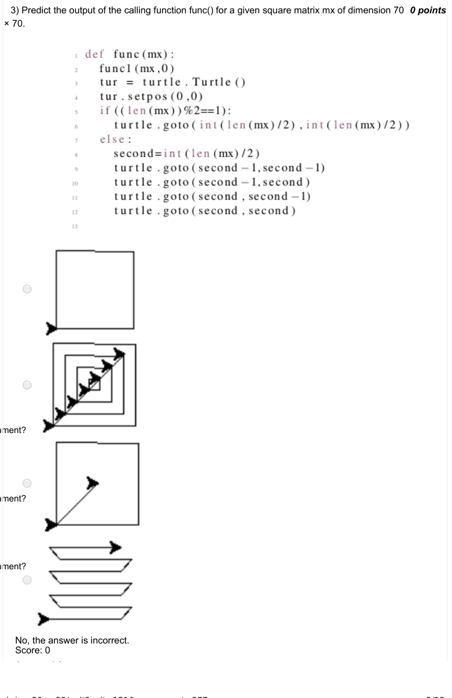

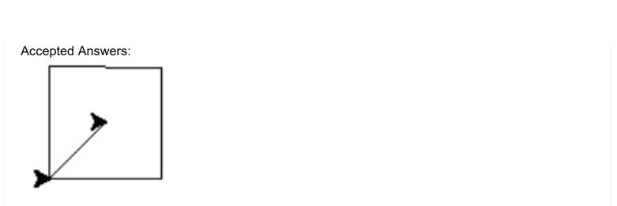

### Q4. Which of the following libraries is required to work with Google maps in Python?

- [ ] gplot
- [ ] googleplot
- [x] gmplot
- [ ] none of these
> No, the answer is incorrect. Score: 0

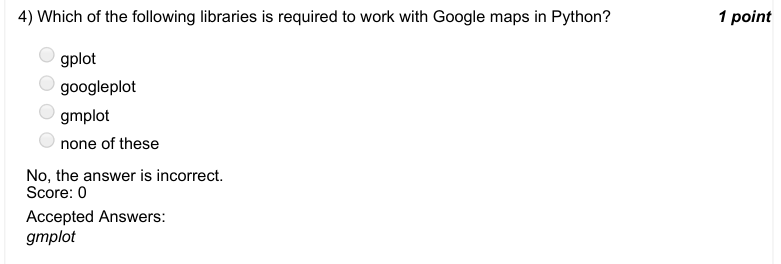

### Q5. Which of the following codes represent a correct version of a board game where the user has
to move from block 1 to block 100?
The game initialises only when the user gets a 1 or 6 on the dice and ends once he reaches 100 or
gets a number which makes
him reach beyond 100 (i.e. the player wins if he is at 99 and gets a 4).

> No, the answer is incorrect. Score: 0

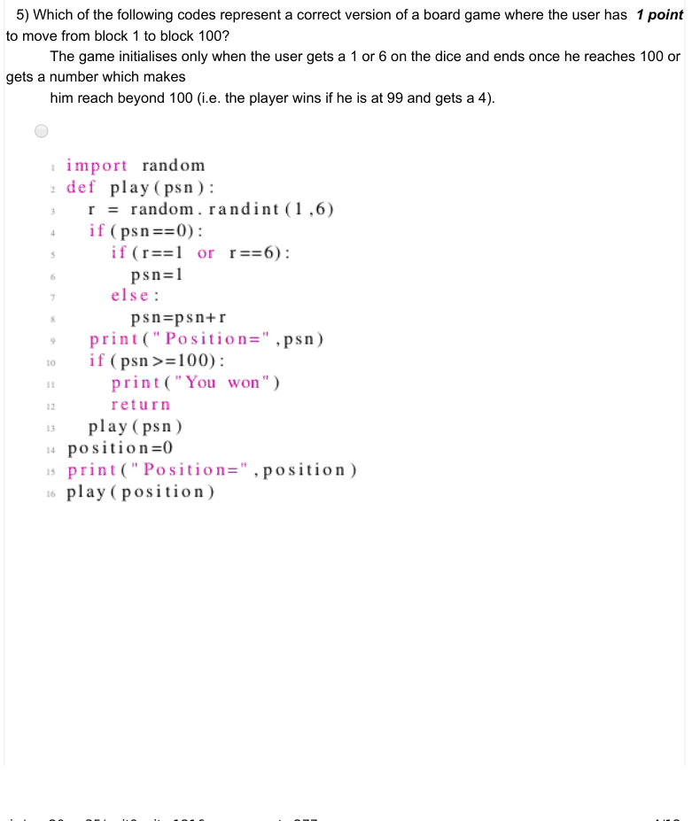

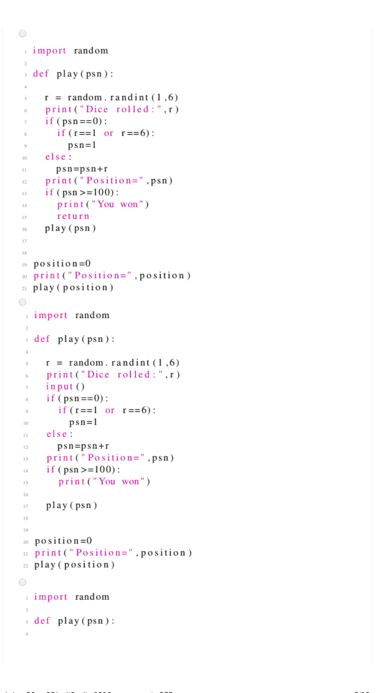

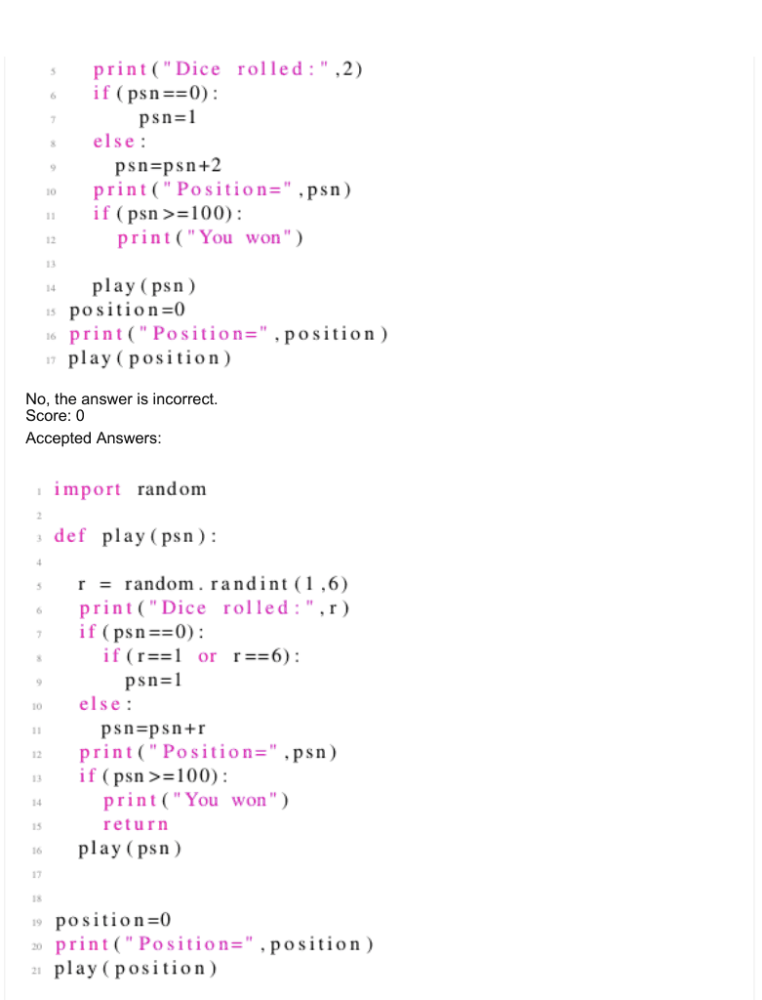

### Q6. Imagine a single player snakes and ladders game. The code below represents

- [ ] A snakes and ladders game with one snake whose position remains constant while the player is playing. The position also remains the same during any subsequent plays (i.e. the game board does not change while you sleep and play again the next day).
- [ ] A snakes and ladders game with one snake whose position remains constant while the player is playing.However, the position can change during any subsequent plays (i.e. the game board might change while you sleep and play again the next day).
- [ ] A snakes and ladders game with one snake where the snake can change its position during the game and also during any subsequent plays (a board game where the snakes keep moving). Further, the snake can bite you any number of times.
- [ ] A snakes and ladders game with one snake where the snake can change its position during the game and also during any subsequent plays (a board game where the snake keeps moving). Further, the snake can bite you only ones when you play.
> Accepted answer (not matched to a printed option): A snakes and ladders game with one snake where the snake can change its position during the game and; also during any subsequent plays (a board game where the snakes keep moving). Further, the snake can; bite you any number of times.
> No, the answer is incorrect. Score: 0

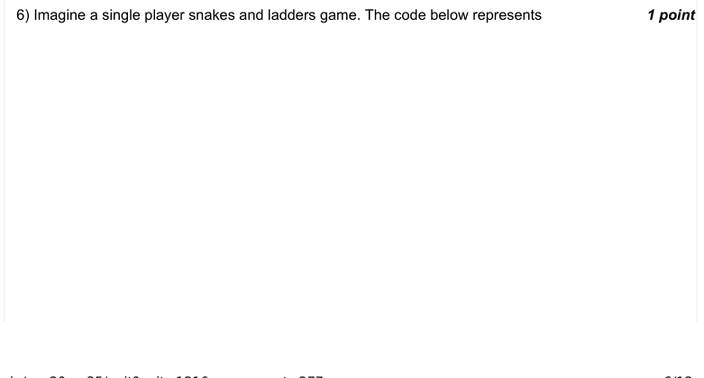

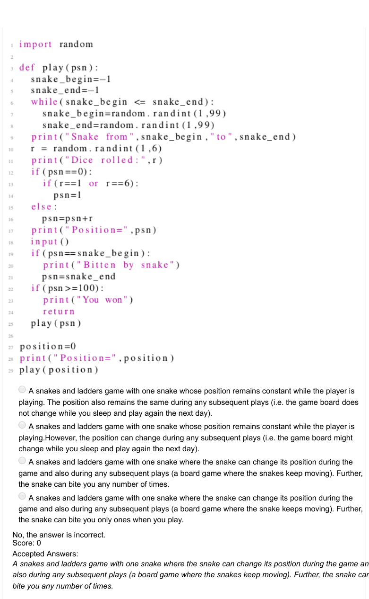

### Q7. Imagine a single player snakes and ladders game. The code below represents

- [ ] A snakes and ladders game with one snake whose position remains constant while the player is playing. The position also remains the same during any subsequent plays (i.e. the game board does not change while you sleep and play again the next day).
- [ ] A snakes and ladders game with one snake whose position remains constant while the player is playing. However, the position can change during any subsequent plays (i.e. the game board might change while you sleep and play again the next day).
- [ ] A snakes and ladders game with one snake where the snake can change its position during the game and also during any subsequent plays (a board game where the snakes keep moving). Further, the snake can bite you any number of times.
- [ ] A snakes and ladders game with one snake where the snake can change its position during the game and also during any subsequent plays (a board game where the snake keeps moving). Further, the snake can bite you only ones when you play.
> Accepted answer (not matched to a printed option): A snakes and ladders game with one snake where the snake can change its position during the game and; also during any subsequent plays (a board game where the snake keeps moving). Further, the snake can; bite you only ones when you play.
> No, the answer is incorrect. Score: 0

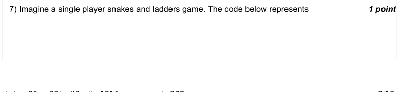

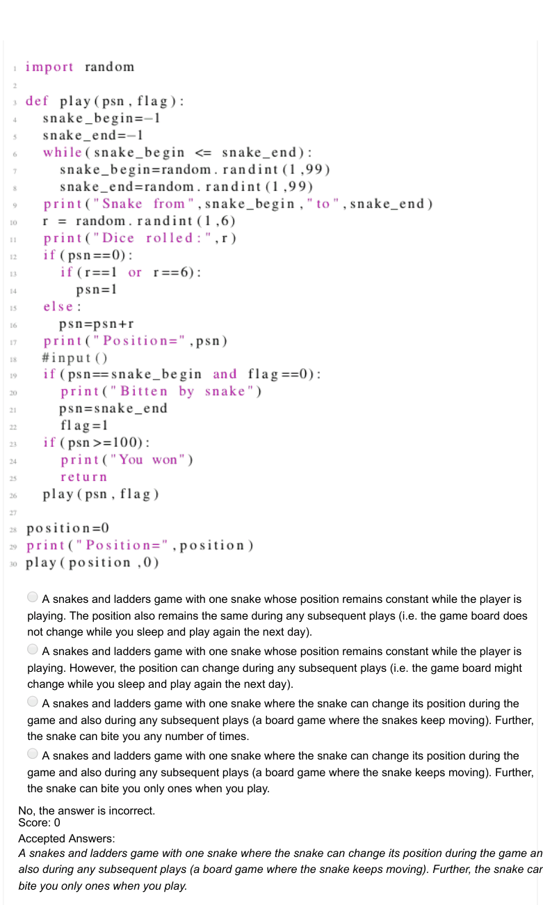

### Q8. Assuming that the play1() function implements the recursive play of snakes and ladders with
the prespecified position of the snake and the
ladder as shown in the code below, which of the ambiguities in the options can result in the code?
Kindly assume a typical snakes and ladders game.

- [ ] snake_begin=snake_end
- [ ] ladder_begin=ladder_end
- [x] ladder_begin=snake_begin
- [ ] ladder_end=snake_end
> No, the answer is incorrect. Score: 0

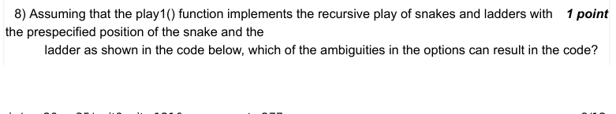

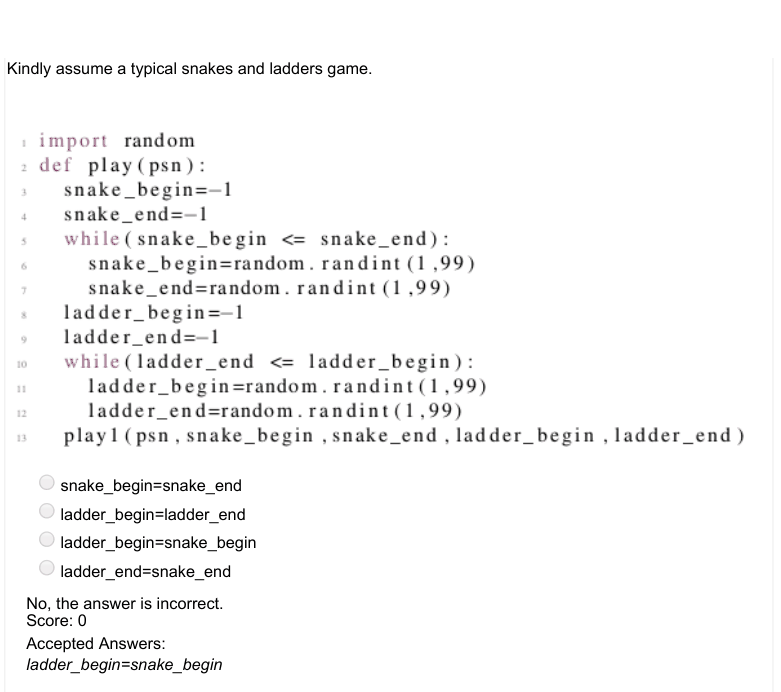

### Q9. What is the output of the following code?

> No, the answer is incorrect. Score: 0

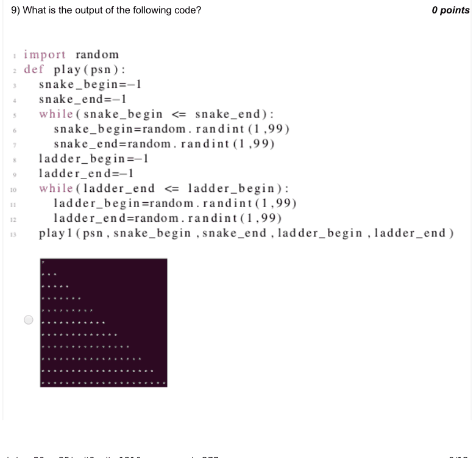

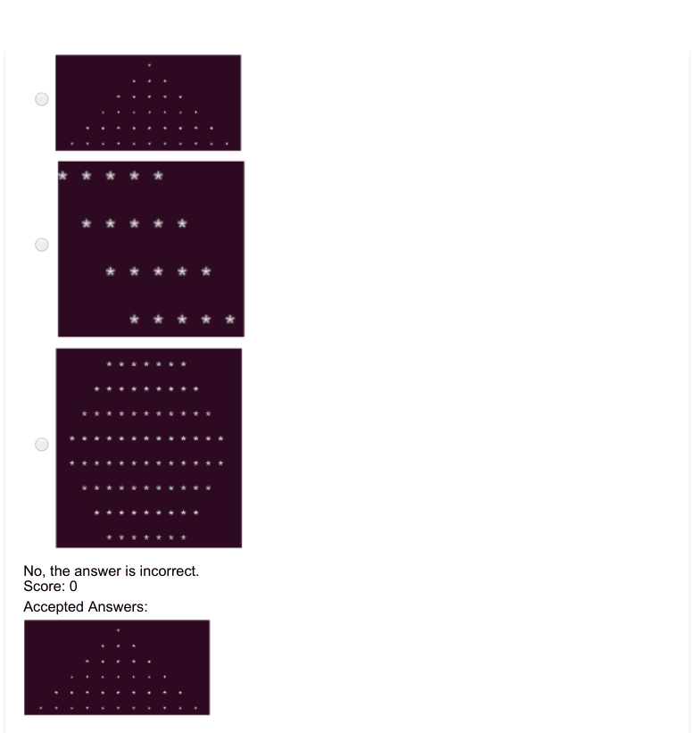

### Q10. What is the output of the following code?

> No, the answer is incorrect. Score: 0

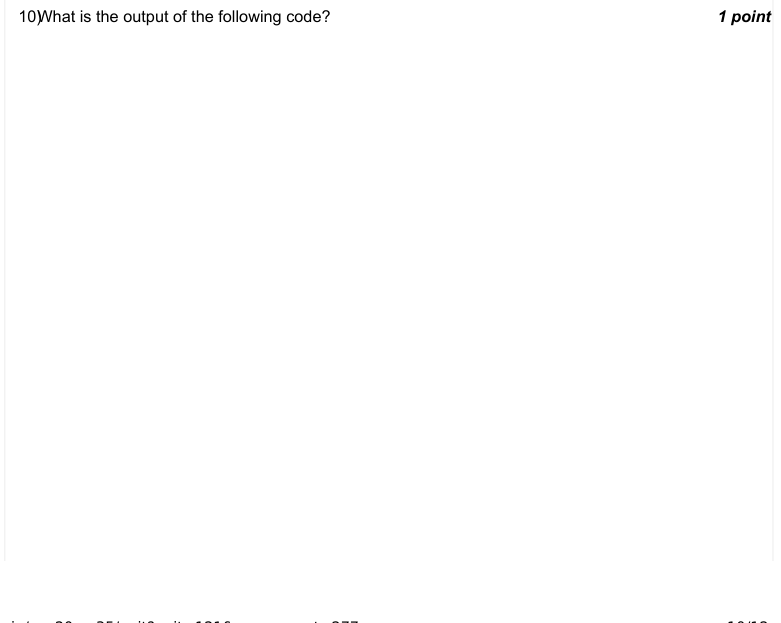

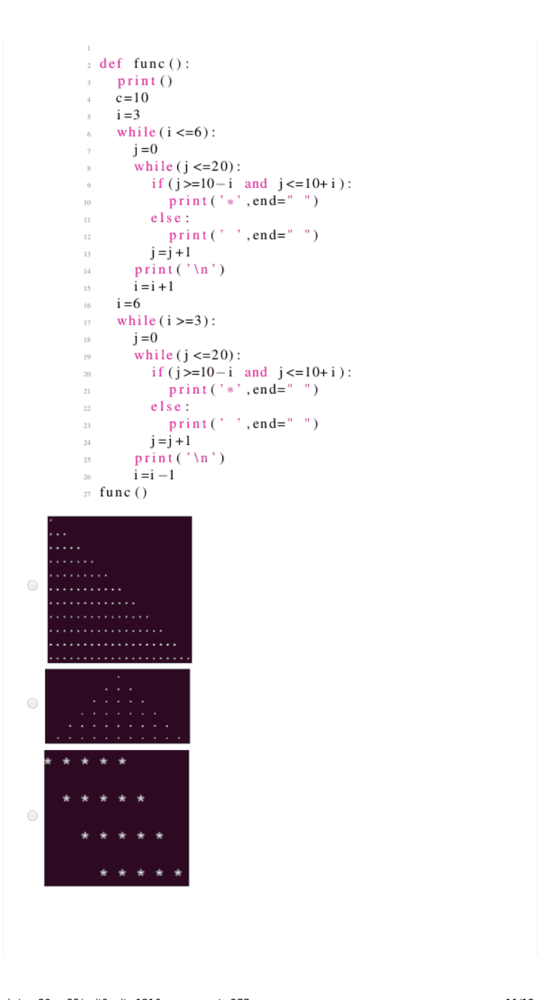

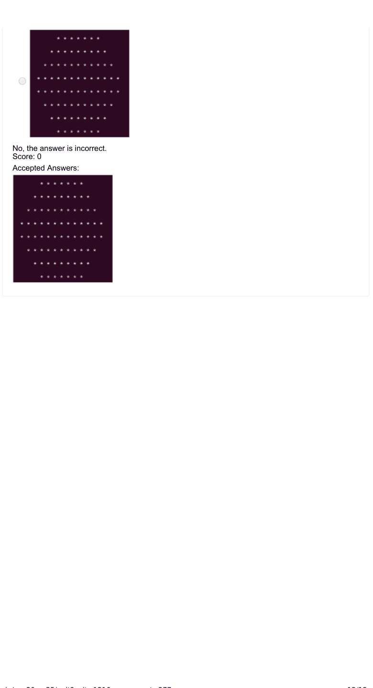
