# JOC Jan-2020 · Week 8: portal print

- Source: `JOC Jan-Aug 2020.pdf` pages 49–55 (portal review printout). Parsed text below; the cropped image under each question is the exact page content (code, figures and ticks as printed) and is authoritative.
- `[x]` = option equal to the portal's **Accepted Answer** (official). Lines may carry stray spaces from the PDF text layer.

> reviewer4@nptel.iitm.ac.in  · Due on 2020-03-25, 23:59 IST.

### Q1. Which of the following options correctly represent the full form of acronyms NLTK and VADER

- [ ] NLTK: Normal Language Toolkit, VADER: Valence Aware Dictionary and Emotional Reasoner
- [x] NLTK: Natural Language Toolkit, VADER: Valence Aware Dictionary and Sentiment Reasoner
- [ ] NLTK: Normal Language Toolkit, VADER: Valence Aware Dictionary and Sentiment Reasoner
- [ ] Natural Language Toolkit, VADER: Valence Aware Dictionary and Emotional Reasoner
> No, the answer is incorrect. Score: 0

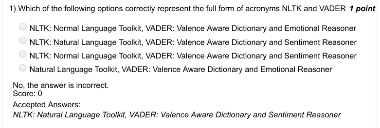

### Q2. Predict the output

- [x] [’ ’, ’!’, ’A’, ’H’, ’I’, ’a’, ’b’, ’h’, ’i’, ’m’, ’t’]
- [ ] [’!’, ’A’, ’H’, ’I’, ’a’, ’b’, ’h’, ’i’, ’m’, ’t’]
- [ ] !AHIabhimt
- [ ] !AabHhIimt
> No, the answer is incorrect. Score: 0

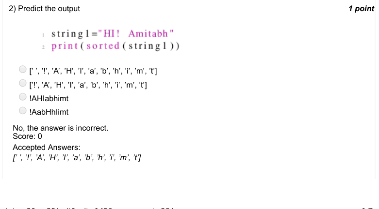

### Q3. Which of the scenarios in the options does the following code represent?

- [ ] A person going to the bar for an year. Daily he guesses a number from 1 to 10. If the guessed number if equal to the number randomly generated by bar authority, he gains one gold coin.
- [ ] A person going to the bar for a month. Daily he guesses a number from 1 to 10. If the guessed number if equal to the number randomly generated by bar authority, he gains one gold coin.
- [ ] A person going to the bar for an year. Daily he guesses a number from 1 to 10. If the guessed number if equal to the number randomly generated by bar authority, he loses one gold coin.
- [ ] A person going to the bar for a month. Daily he guesses a number from 1 to 10. If the guessed number if equal to the number randomly generated by bar authority, he loses one gold coin.
> Accepted answer (not matched to a printed option): A person going to the bar for an year. Daily he guesses a number from 1 to 10. If the guessed number if; equal to the number randomly generated by bar authority, he gains one gold coin.
> No, the answer is incorrect. Score: 0

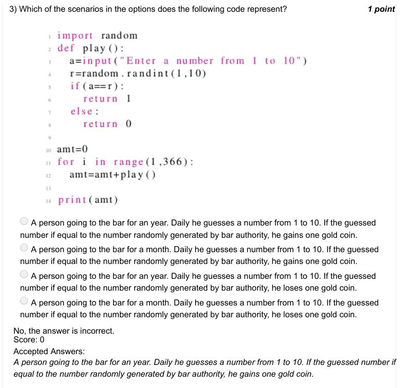

### Q4. Which of the scenarios in the options does the following code represent?

- [ ] Simulates a game play 100 times. In each play, a coin is tossed 100 times and player is given money equal to the number of heads he get. The code displays the average money earned by the player amongst all 100 plays.
- [ ] Simulates a game play 100 times. In each play, a coin is tossed 100 times and player is given money equal to the number of heads he get. The code displays the total money earned by the player amongst all 100 plays.
- [ ] Simulates a game play 100 times. In each play, a coin is tossed 100 times and player is given money equal to the number of heads he get. The code displays the money earned by the player in first play.
- [ ] none of the above
> Accepted answer (not matched to a printed option): Simulates a game play 100 times. In each play, a coin is tossed 100 times and player is given money equa; to the number of heads he get. The code displays the average money earned by the player amongst all 100; plays.
> No, the answer is incorrect. Score: 0

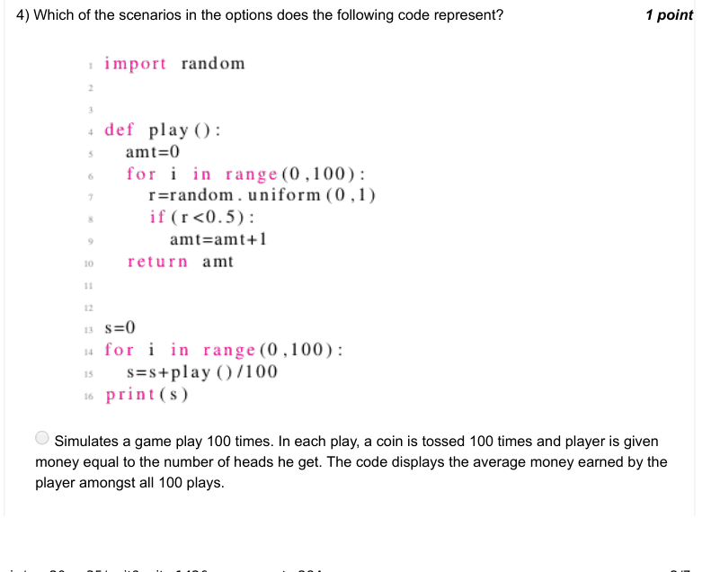

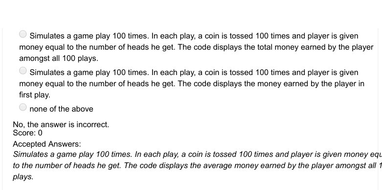

### Q5. Which of the plots in the options is most likely to be generated from the following code?

> No, the answer is incorrect. Score: 0

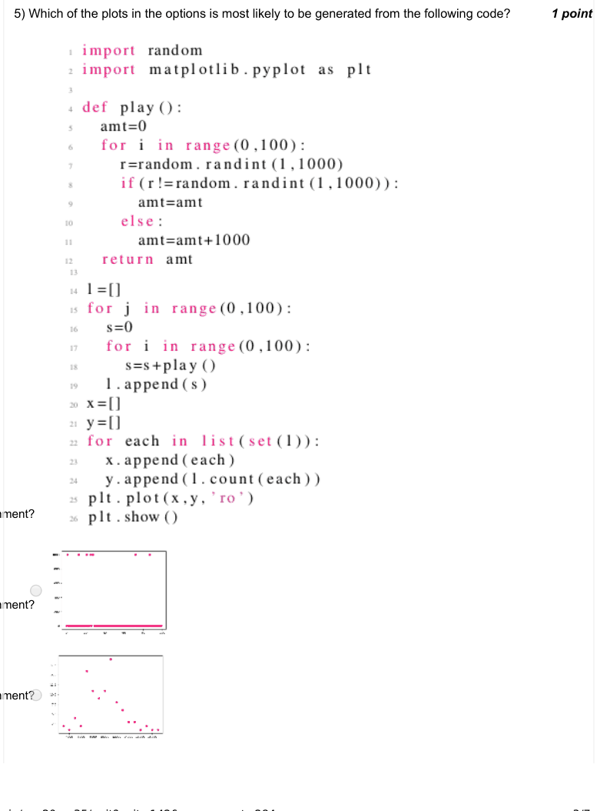

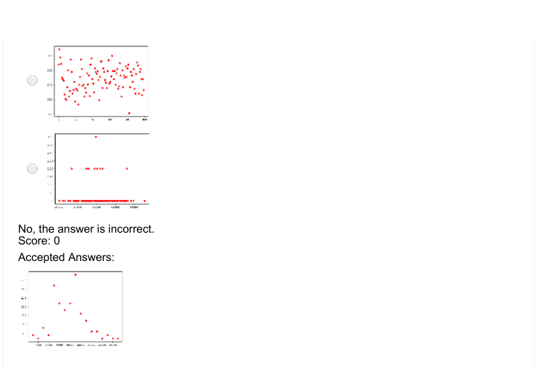

### Q6. Which of the plots in the options is most likely to be generated from the following code?

> No, the answer is incorrect. Score: 0

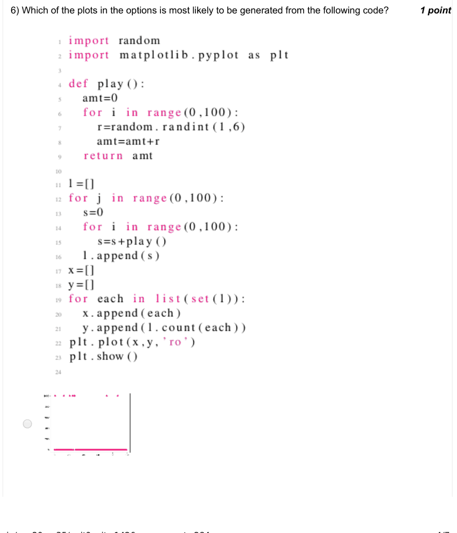

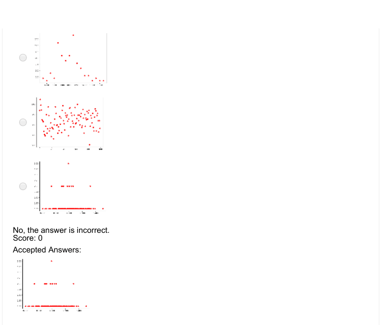

### Q7. What is the output of the following code?

- [ ] [20,10,40,30]
- [ ] [90,10,40,30]
- [ ] [10,20,30,40]
- [x] Error
> No, the answer is incorrect. Score: 0

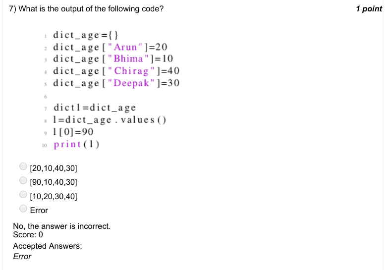

### Q8. Which of the scenarios in the options does the following code represent?

- [ ] All money is given to the oldest person
- [ ] All money is given to the youngest person
- [x] Money is given to a person with a probability proportional to his/her age
- [ ] Money is given to a person with a probability inversely proportional to his/er age
> No, the answer is incorrect. Score: 0

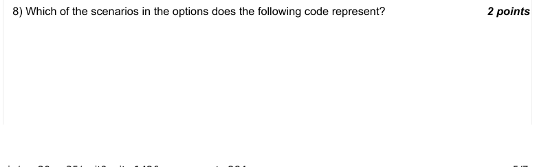

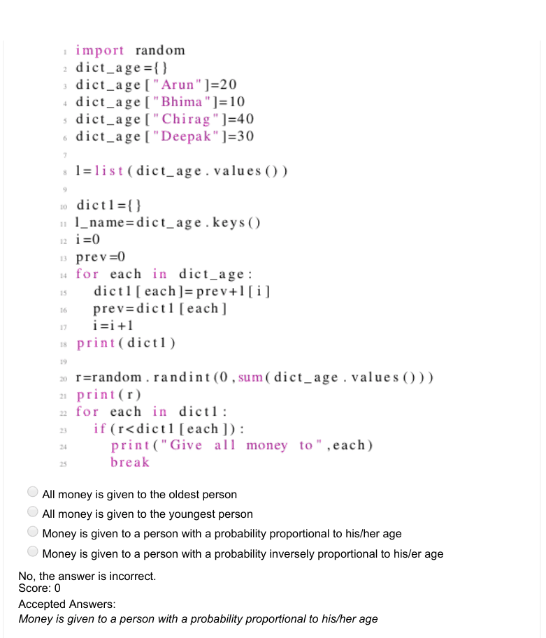

### Q9. Which of the scenarios in the options does the following code represent?

- [x] All money is given to the oldest person
- [ ] All money is given to the youngest person
- [ ] Money is given to a person with a probability proportional to his/her age
- [ ] Money is given to a person with a probability inversely proportional to his/er age
> No, the answer is incorrect. Score: 0

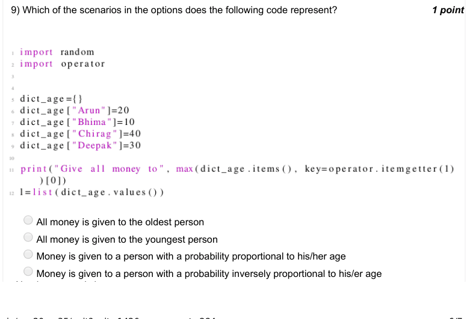

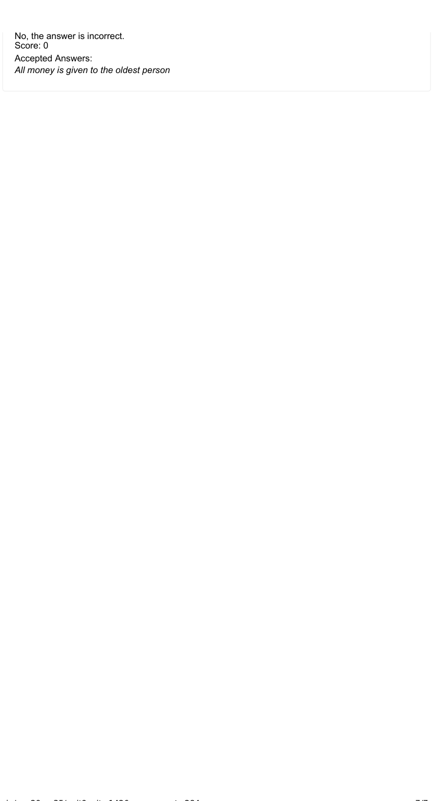
