# JOC Jan-2020 · Week 9: portal print

- Source: `JOC Jan-Aug 2020.pdf` pages 56–60 (portal review printout). Parsed text below; the cropped image under each question is the exact page content (code, figures and ticks as printed) and is authoritative.
- `[x]` = option equal to the portal's **Accepted Answer** (official). Lines may carry stray spaces from the PDF text layer.

> reviewer4@nptel.iitm.ac.in  · Due on 2020-04-01, 23:59 IST.

### Q1. The isalpha() function in NLTK

- [ ] returns true if all the words in a sentence are composed of alphabetic characters and false otherwise
- [x] returns true if all the characters in a word are alphabets and false otherwise
- [ ] returns true if all the characters in a word are alphabets or numerics and false otherwise
- [ ] None of the above
> No, the answer is incorrect. Score: 0

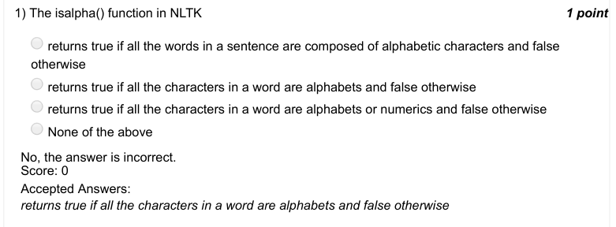

### Q2. Predict the output

- [x] [’i’, ’ ’, ’a’, ’m’, ’ ’, ’t’, ’o’, ’ ’, ’g’, ’o’, ’ ’, ’t’, ’o’, ’ ’, ’K’, ’T’, ’ ’, ’i’, ’n’, ’ ’, ’A’]
- [ ] [’i’, ’a’, ’m’, ’t’, ’o’, ’g’, ’o’, ’t’, ’o’, ’K’, ’T’, ’i’, ’n’, ’A’]
- [ ] [’i’, ’am’, ’to’, ’go’, ’to’, ’KT’, ’in’, ’A’]
- [ ] [’i’, ’ ’, ’am’,’ ’, ’to’,’ ’, ’go’,’ ’, ’to’,’ ’, ’KT’,’ ’, ’in’,’ ’, ’A’]
> No, the answer is incorrect. Score: 0

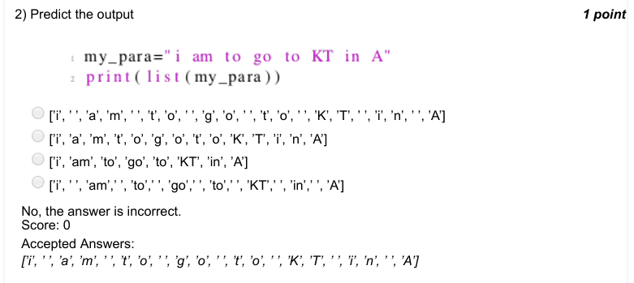

### Q3. Which of the following is a valid function in NLTK?

- [ ] freq_dist()
- [ ] frequency_distribution()
- [x] FreqDist()
- [ ] freqDist()
> No, the answer is incorrect. Score: 0

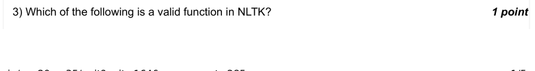

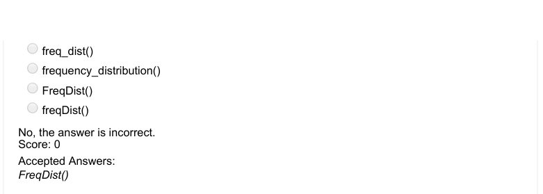

### Q4. Predict the output

- [x] True
- [ ] False
- [ ] "connected"
- [ ] can not say
> No, the answer is incorrect. Score: 0

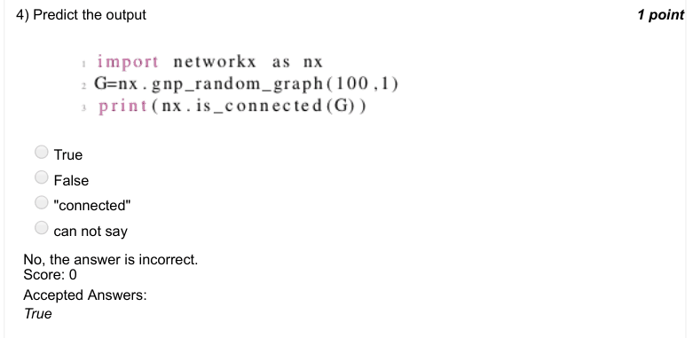

### Q5. Which of the following functions when applied to a graph G in networkx will give you its degree
of separation?

- [ ] is_connected(G)
- [ ] order(G)
- [ ] diameter(G)
- [x] None of the above
> No, the answer is incorrect. Score: 0

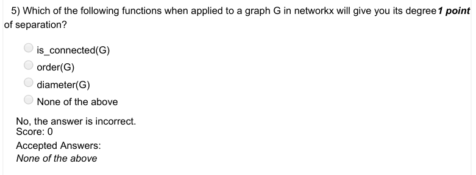

### Q6. What is the degree of separation of the following network?

- [x] 1
- [ ] 2
- [ ] 3
- [ ] 4
> No, the answer is incorrect. Score: 0

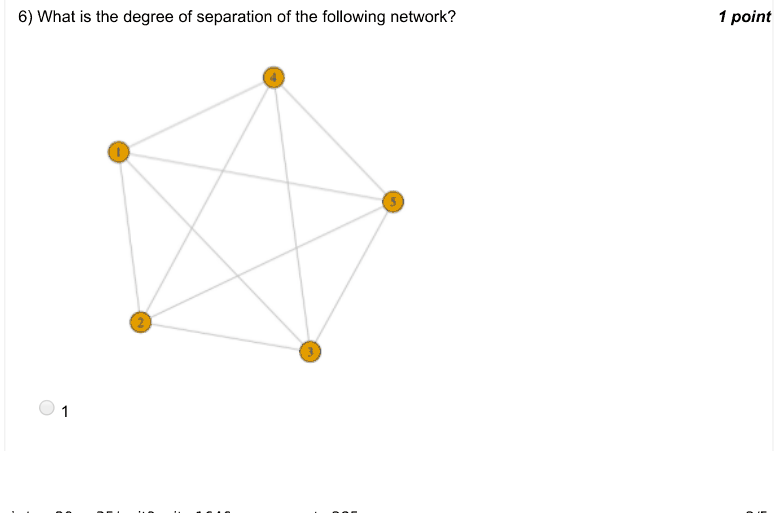

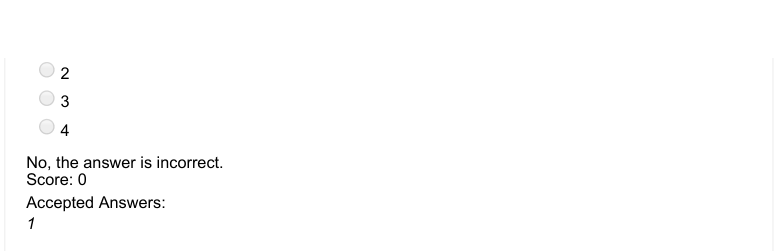

### Q7. What is the degree of separation of the following network?

- [ ] 1.333
- [ ] 2
- [x] 2.333
- [ ] 6
> No, the answer is incorrect. Score: 0

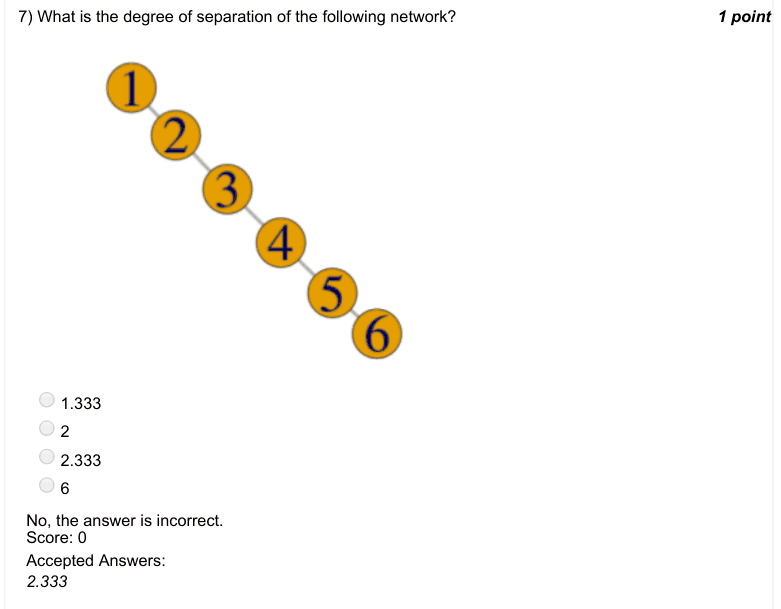

### Q8. What is the degree of separation of the following network?

- [ ] 1
- [x] 2.5
- [ ] 3.5
- [ ] 4 N
- [ ] h
- [ ] i i
> No, the answer is incorrect. Score: 0

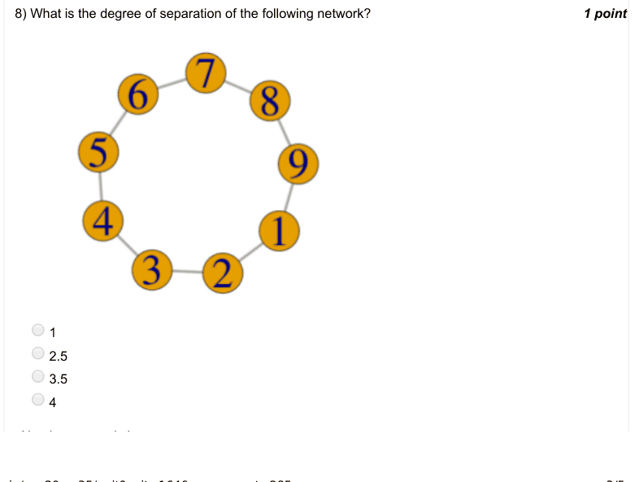

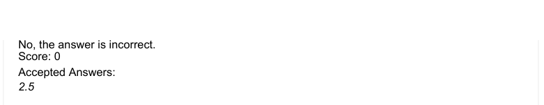

### Q9. What is the degree of separation of the following network?

- [ ] 1.82
- [ ] 2.5
- [x] 2.82
- [ ] 3
> No, the answer is incorrect. Score: 0

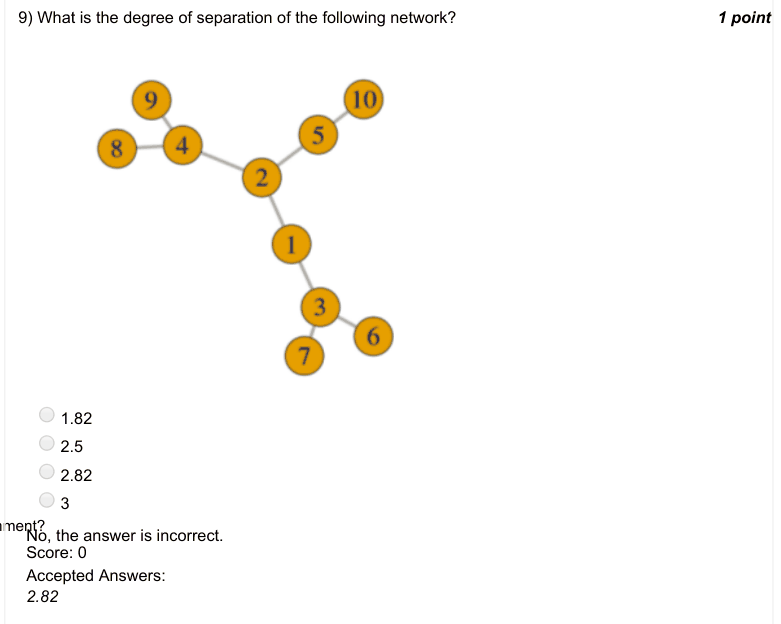

### Q10. Degree of separation of a network is same as its

- [ ] Order
- [ ] Size
- [x] Average shortest path length
- [ ] Number of components
> No, the answer is incorrect. Score: 0

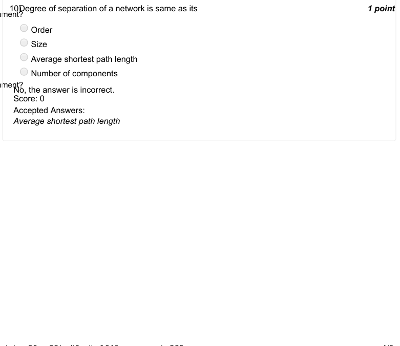

