# JOC Jan-2020 · Week 10: portal print

- Source: `JOC Jan-Aug 2020.pdf` pages 61–64 (portal review printout). Parsed text below; the cropped image under each question is the exact page content (code, figures and ticks as printed) and is authoritative.
- `[x]` = option equal to the portal's **Accepted Answer** (official). Lines may carry stray spaces from the PDF text layer.

> reviewer4@nptel.iitm.ac.in  · Due on 2020-04-08, 23:59 IST.

### Q1. Which of the following is a correct representation to convert a string “s” in uppercase in
python?

- [ ] uppercase(s)
- [x] s.upper()
- [ ] upper(s)
- [ ] s.uppercase()
> No, the answer is incorrect. Score: 0

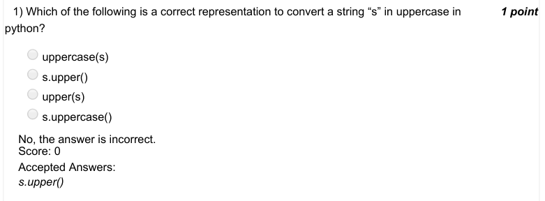

### Q2. Predict the output

- [ ] Hello
- [ ] Heslo
- [x] Hesso
- [ ] Heso
> No, the answer is incorrect. Score: 0

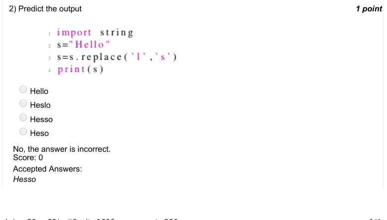

### Q3. Predict the output

- [ ] llo
- [ ] ello
- [ ] l
- [x] lo
> No, the answer is incorrect. Score: 0

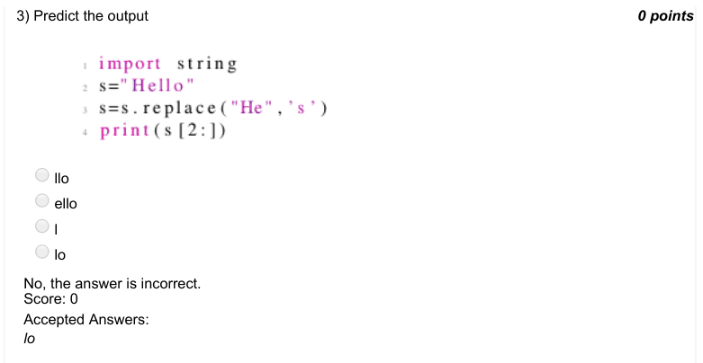

### Q4. Predict the output

- [ ] [1,2,3]
- [x] 1
- [ ] 2
- [ ] 3
> No, the answer is incorrect. Score: 0

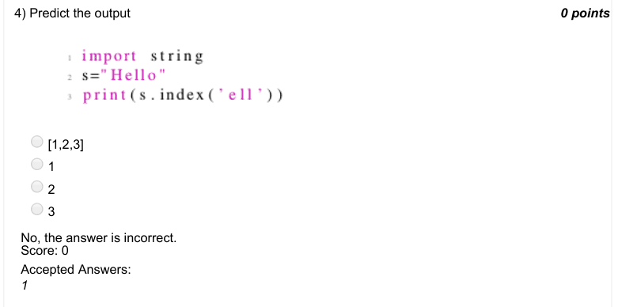

### Q5. Which of the following can be used to see the dimension of a numpy array names ‘arr’?

- [ ] dim(arr)
- [ ] shape(arr)
- [x] arr.shape
- [ ] arr.shape()
> No, the answer is incorrect. Score: 0

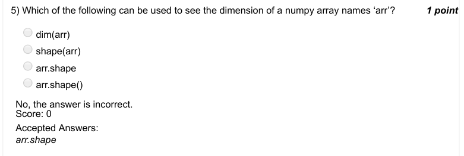

### Q6. Predict the output

- [ ] [1,4,9]
- [ ] [2,4,6] [[123] [246] [369]]
- [ ] error
> Accepted answer (not matched to a printed option): [[123]; [246]; [369]]
> No, the answer is incorrect. Score: 0

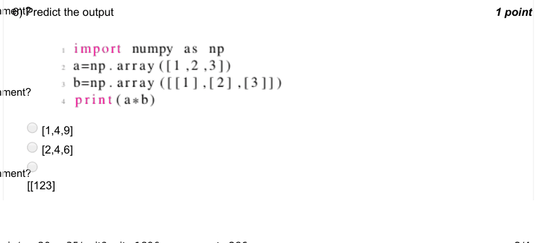

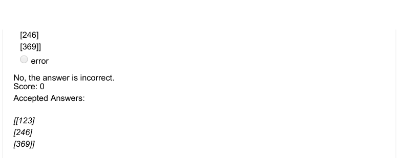

### Q7. Predict the output

- [ ] [1,4,9]
- [ ] [2,4,6] [[123] [246] [369]]
- [x] error
> No, the answer is incorrect. Score: 0

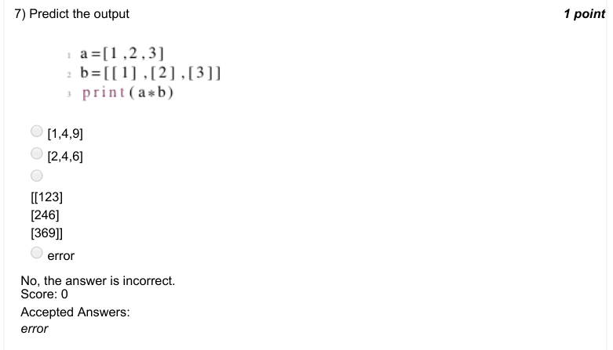

### Q8. What is the output of the following code ?

- [ ] snow
- [ ] snow world C
- [x] Error
- [ ] snos world
> No, the answer is incorrect. Score: 0

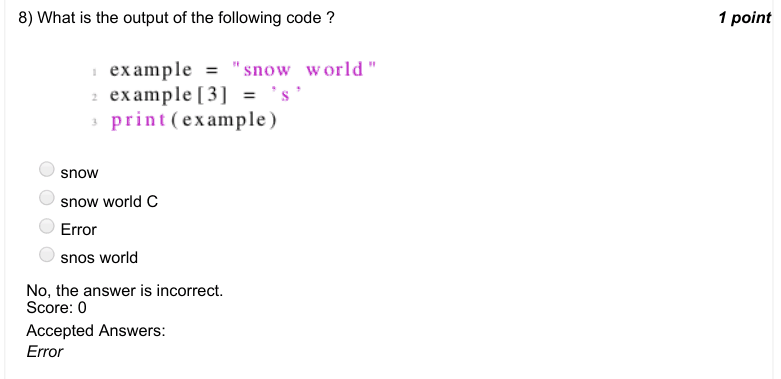

### Q9. What is the output of the following code ?

- [x] True
- [ ] False
- [ ] None
- [ ] Error N
- [ ] h
- [ ] i i
> No, the answer is incorrect. Score: 0

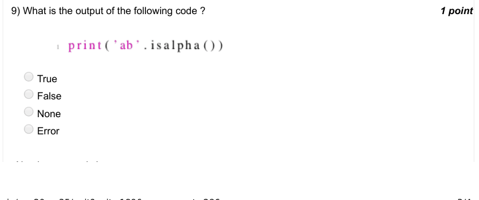

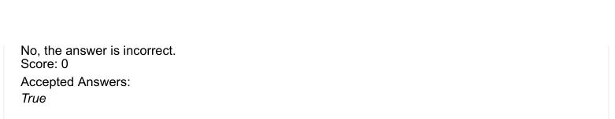

### Q10. Numpy.array(list), what it does ?

- [ ] It converts array to list
- [ ] It converts list to array
- [ ] It converts array to array
- [x] Error
> No, the answer is incorrect. Score: 0

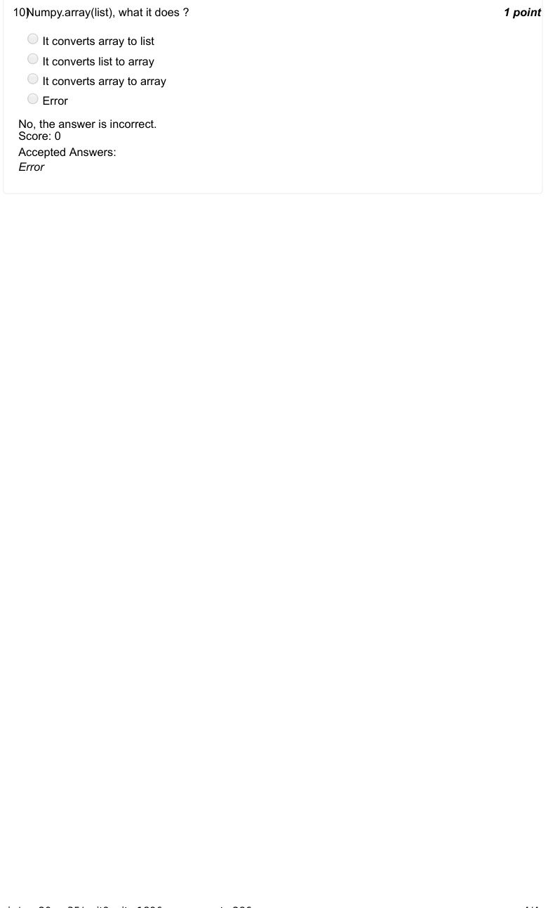
