# JOC Jan-2020 · Week 11: portal print

- Source: `JOC Jan-Aug 2020.pdf` pages 65–68 (portal review printout). Parsed text below; the cropped image under each question is the exact page content (code, figures and ticks as printed) and is authoritative.
- `[x]` = option equal to the portal's **Accepted Answer** (official). Lines may carry stray spaces from the PDF text layer.

> reviewer4@nptel.iitm.ac.in  · Due on 2020-04-15, 23:59 IST.

### Q1. Which Python library is used for browser automation?

- [ ] networkx
- [ ] numpy
- [ ] nltk
- [x] selenium
> No, the answer is incorrect. Score: 0

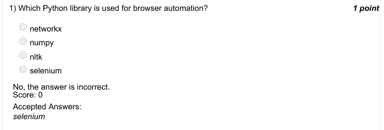

### Q2. Which package is used to work with date and time in Python?

- [ ] timedate
- [x] datetime
- [ ] dttm
- [ ] tmdt
> No, the answer is incorrect. Score: 0

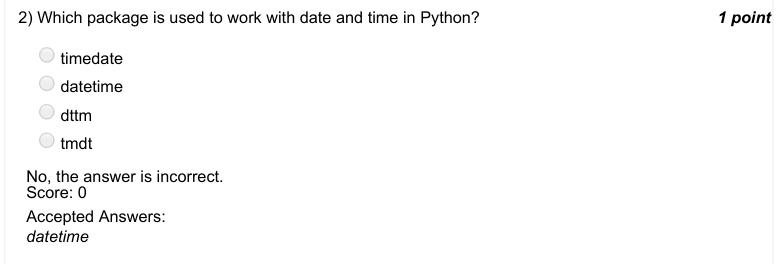

### Q3. Which function is used to see the current date and time in Python?

- [ ] current()
- [ ] today_with_time()
- [x] now()
- [ ] none of these
> No, the answer is incorrect. Score: 0

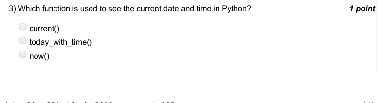

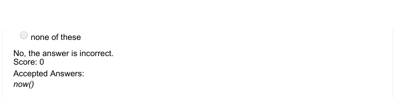

### Q4. Which Python library is used for timezone?

- [ ] timezone
- [ ] python_timezone
- [ ] pytimezone
- [x] pytz
> No, the answer is incorrect. Score: 0

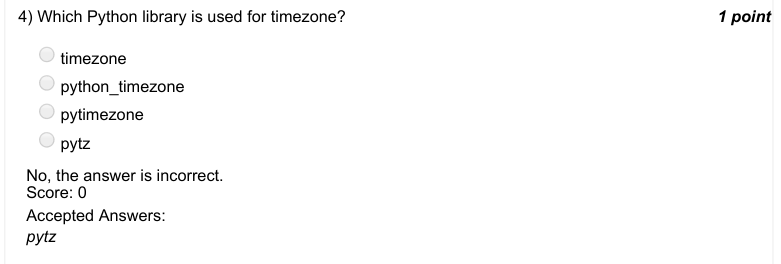

### Q5. Which of the following statement can be used to see the calendar for January 2020?

- [x] calendar.month(2020, 1)
- [ ] calendar(2020, 1)
- [ ] calendar_month(2020, 1)
- [ ] none of the above
> No, the answer is incorrect. Score: 0

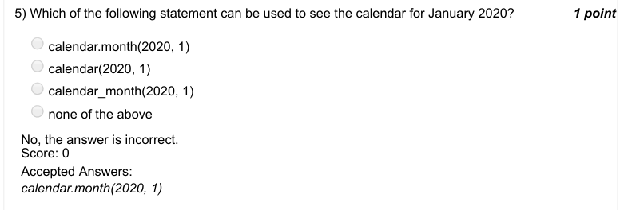

### Q6. Which statement can be used to come out of an infinite loop?

- [ ] continue
- [x] break
- [ ] try
- [ ] catch
> No, the answer is incorrect. Score: 0

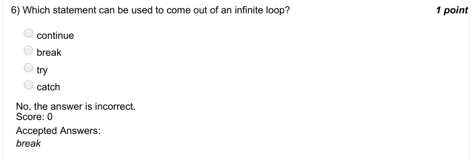

### Q7. Which of the following is not a correct conditional block in Python.

- [ ] if
- [ ] else
- [x] else_if
- [ ] elif
> No, the answer is incorrect. Score: 0

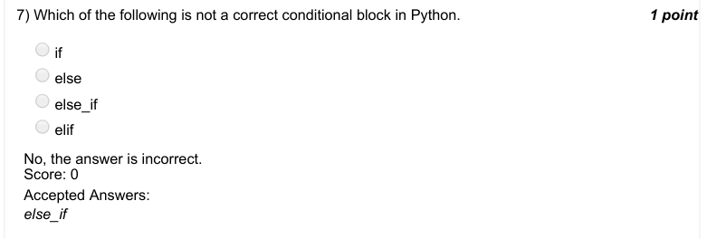

### Q8. The value returned when we use the function isoweekday() is . . . . . . . . . . . . and that for the
function weekday() is . . . . . . . . . . . . if the system
date is 19th June, 2017 (Monday).

- [ ] 0,0
- [ ] 0,1
- [x] 1,0
- [ ] 1,1
> No, the answer is incorrect. Score: 0

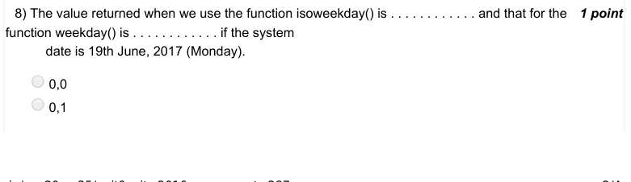

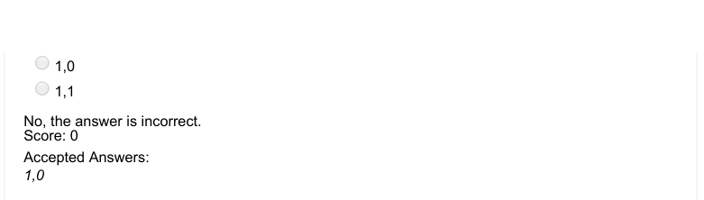

### Q9. What will be the output of the following Python code if the system date is 18th June, 2017
(Sunday)?

- [x] 6
- [ ] 1
- [ ] 0
- [ ] 7
> No, the answer is incorrect. Score: 0

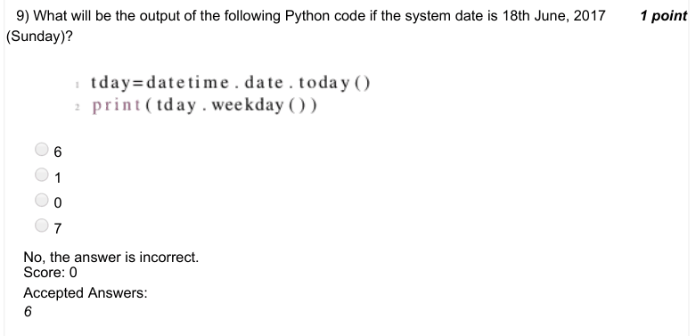

### Q10. Which of the following functions can be used to find the coordinated universal time, assuming
that the datetime module has
already been imported?

- [ ] datetime.utc()
- [ ] datetime.datetime.utc()
- [ ] datetime.utcnow()
- [x] datetime.datetime.utcnow()
> No, the answer is incorrect. Score: 0

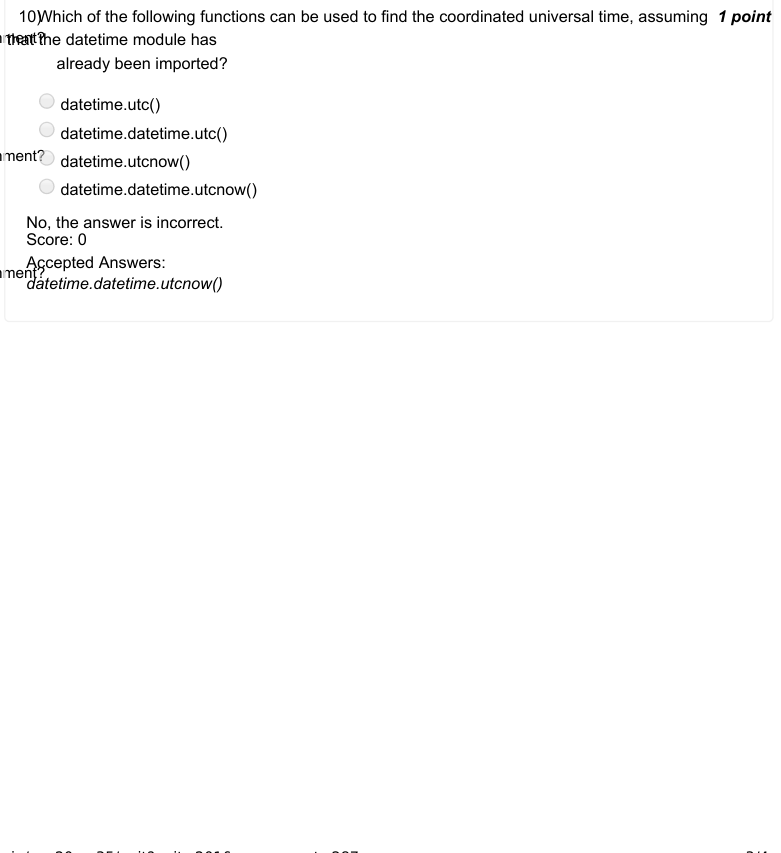

