# JOC Jan-2020 · Week 12: portal print

- Source: `JOC Jan-Aug 2020.pdf` pages 69–72 (portal review printout). Parsed text below; the cropped image under each question is the exact page content (code, figures and ticks as printed) and is authoritative.
- `[x]` = option equal to the portal's **Accepted Answer** (official). Lines may carry stray spaces from the PDF text layer.

> reviewer4@nptel.iitm.ac.in  · Due on 2020-04-22, 23:59 IST.

### Q1. In web graph, on which we perform Google page ranking

- [x] Web pages are the nodes and hyperlinks are the edges
- [ ] Hyperlinks are the nodes and web pages are the edges
- [ ] Both hyperlinks and web pages are nodes
- [ ] Both hyperlinks and web pages are edges
> No, the answer is incorrect. Score: 0

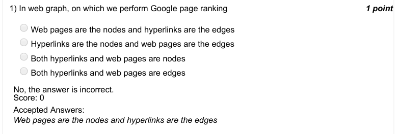

### Q2. In pagerank algorithm on a directed network, we randomly move from a node A to

- [ ] a random node which is pointing to A
- [x] a random node which A is pointing to
- [ ] a random node out of all the nodes which are either pointing to A or the nodes which A is pointing to
- [ ] none of the above
> No, the answer is incorrect. Score: 0

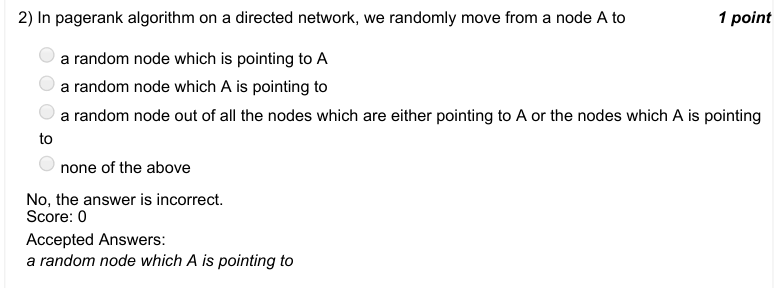

### Q3. Which of thew following statements is FALSE?

- [ ] Barbell graph is connected
- [ ] In both complete graph and cycle graph, every node has the same degree
- [ ] In any star graph having more than 2 nodes, there are at least 2 nodes having the same degree
- [x] All the above statements are true
> No, the answer is incorrect. Score: 0

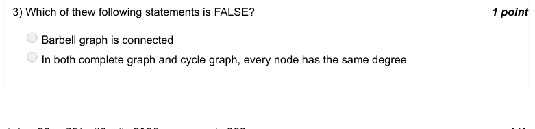

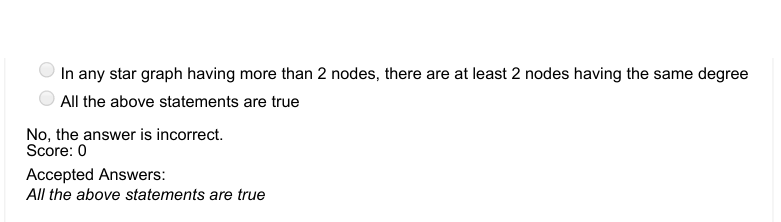

### Q4. Which of the following statements choose a random node from a graph G?

- [ ] random.choice(G)
- [ ] random.node(G.nodes())
- [ ] random.choice(G.nodes())
- [x] none of the above
> No, the answer is incorrect. Score: 0

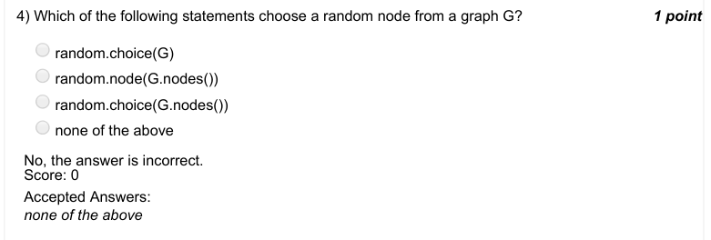

### Q5. The function networkx.pagerank(G) returns

- [ ] a list
- [ ] a set
- [x] a dictionary
- [ ] a numpy array
> No, the answer is incorrect. Score: 0

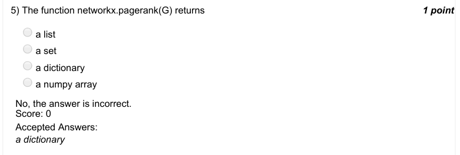

### Q6. Choose one network from following which is not directed.

- [ ] citation network
- [ ] Follower-followee network of Twitter
- [ ] Supply chain network
- [x] Friendship network of Facebook
> No, the answer is incorrect. Score: 0

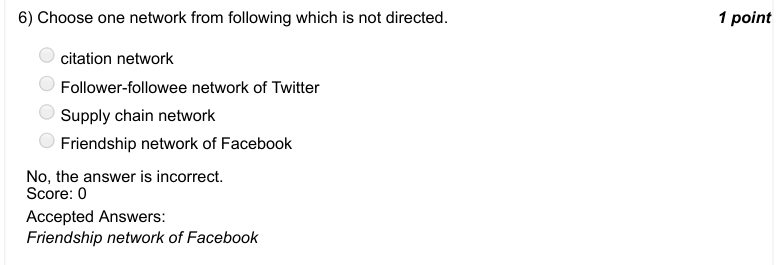

### Q7. Which of the following functions is used to make a directed graph?

- [x] networkx.DiGraph
- [ ] networkx.digraph
- [ ] networkx.Digraph
- [ ] networkx.diGraph
> No, the answer is incorrect. Score: 0

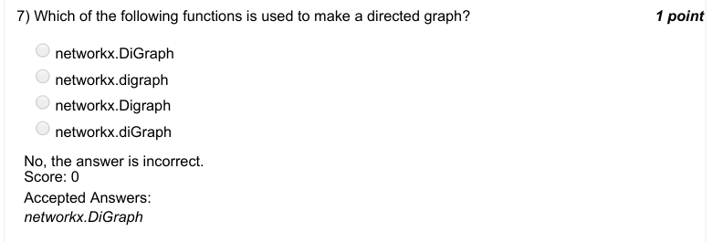

### Q8. The output of G.out_edges(nodename) is

- [ ] List of lists
- [ ] List of dictionaries
- [ ] List of vertices
- [x] List of tuples
> No, the answer is incorrect. Score: 0

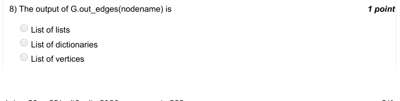

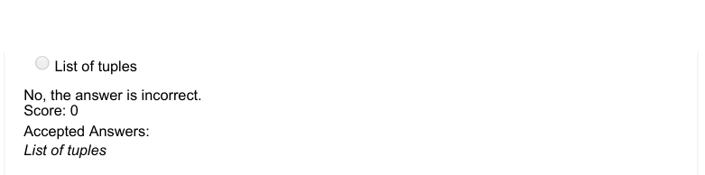

### Q9. What happens when a gold coin distribution game is played on the following network?

- [x] One node ends up having all coins and the game stops
- [ ] The game stops after some iterations but one node does not end up having all the coins
- [ ] The game enters an infinite loop
- [ ] None of the above
> No, the answer is incorrect. Score: 0

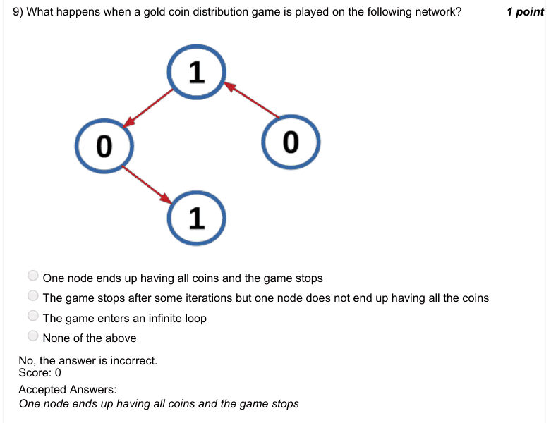

### Q10. The number of gold coins in the gold coin distribution game

- [ ] keeps increasing in every subsequent iteration
- [ ] keeps decreasing in every subsequent iteration
- [ ] keeps varying randomly in every subsequent iteration
- [x] remains constant
> No, the answer is incorrect. Score: 0

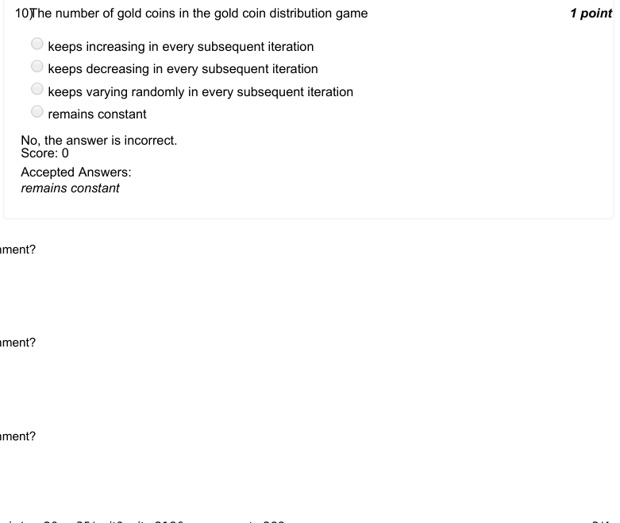

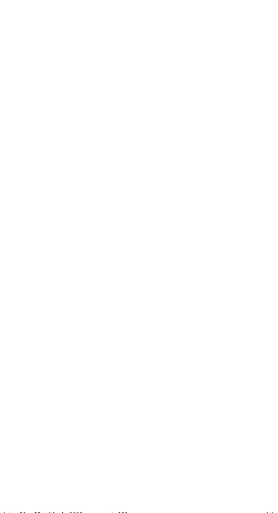
