# JOC Sep-2020 · Week 1: portal print

- Source: `JOC Sep-Dec 2020.pdf` pages 1–10 (portal review printout). Parsed text below; the cropped image under each question is the exact page content (code, figures and ticks as printed) and is authoritative.
- `[x]` = option equal to the portal's **Accepted Answer** (official). Lines may carry stray spaces from the PDF text layer.

> getpythoncode@gmail.com  · Due on 2020-09-30, 23:59 IST. · Assignment submitted on 2020-09-21, 12:42 IST

### Q1. Which of the following is true about a computer program?

- [x] It is a sequence of instructions
- [ ] Instructions that are written in simple english
- [ ] There is only one universal programming language
- [ ] It is meant for only software developers
> Yes, the answer is correct. Score: 1

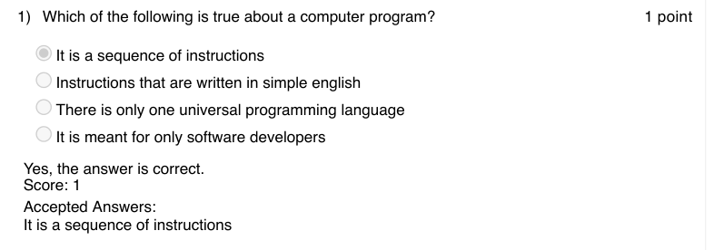

### Q2. Assume you are given two images, each displaying two basic positions of situps.
Identify the set of commands to perform an exercise with both images.

- [ ] Turn clockwise 90 degree / Turn clockwise -90 degrees
- [ ] Move 10 steps / Move -10 steps
- [x] Hide / Show
- [ ] point in direction 90 / point in direction -90
> Yes, the answer is correct. Score: 1

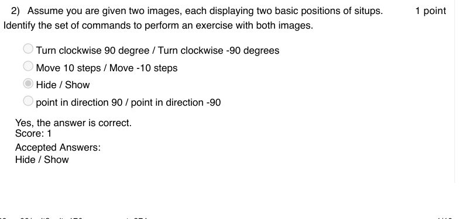

### Q3. Choose the best command to be used at the start of your code, to locate the sprite at
an initial position every time you play the animation.
change x to val
set x to val / set y to val
point in direction 90
point towards mouse pointer

Accepted answer(s): set x to val / set y to val
> No, the answer is incorrect. Score: 0

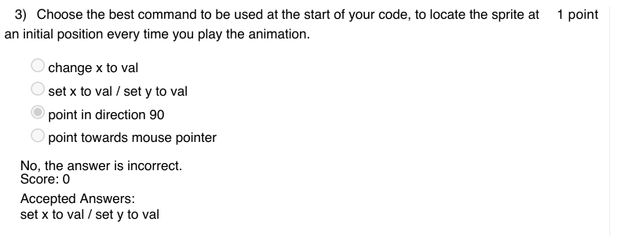

### Q4. Assume the sprite is a ball and predict the output of the following control structure.
The ball glides to a random position in 1 second
The ball glides to 10 random positions taking 1 second to reach each position
The ball glides to a random position and waits there for 10 seconds
The ball glides to 10 random positions within 1 second

Accepted answer(s): The ball glides to 10 random positions taking 1 second to reach each position
> Yes, the answer is correct. Score: 1

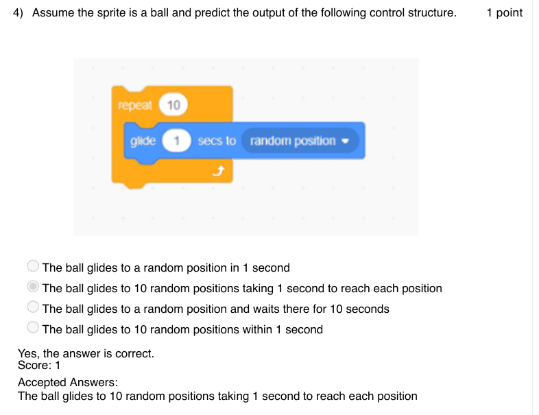

### Q5. Pick the snippet that helps the sprite to find the factorial of 5 as output.

- [ ] Given: Factorial (n)=1 x 2 x 3 x .. x (n-1) x n
> No, the answer is incorrect. Score: 0

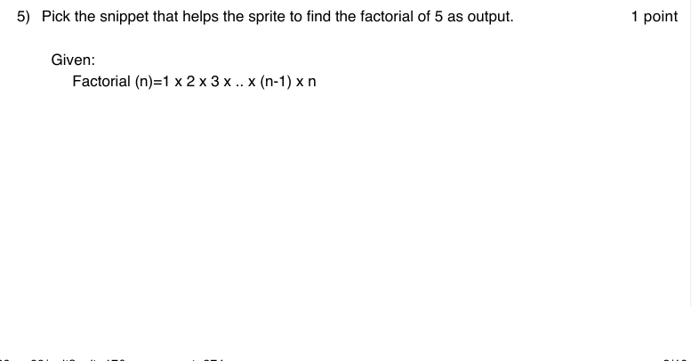

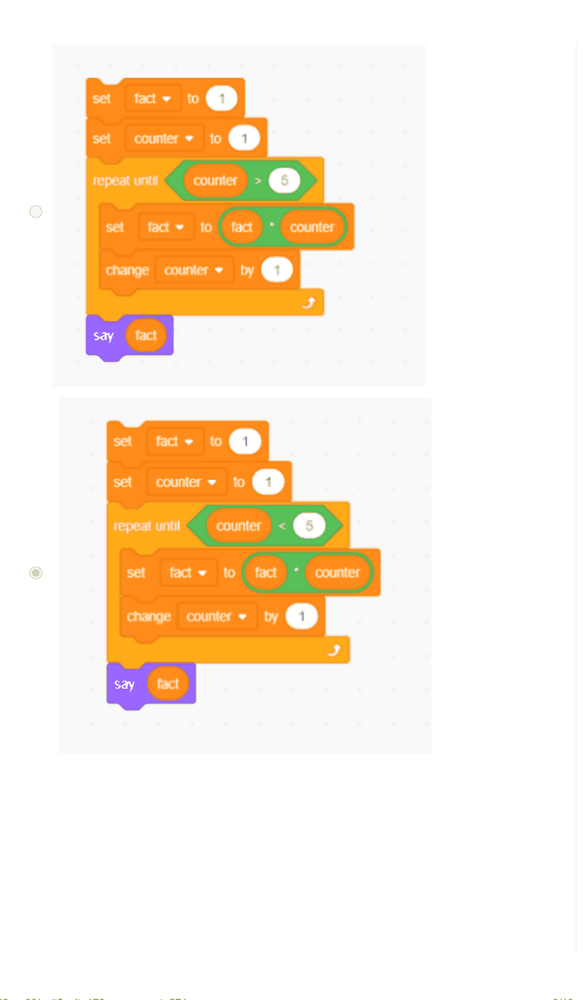

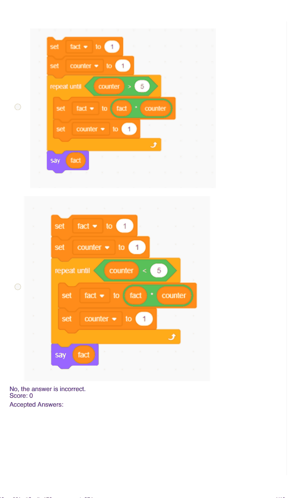

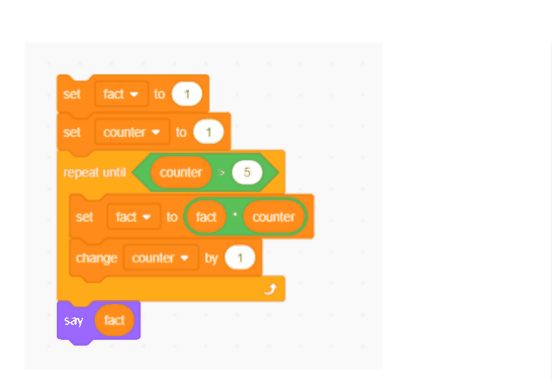

### Q6. Predict the sequence of numbers that the sprite recites:

- [ ] 1, 2, 3, . . , 19
- [x] 1, 3, 5, . . , 19
- [ ] 3, 5, 7, . . , 19
- [ ] 1, 2, 3, . . , 20
> Yes, the answer is correct. Score: 1

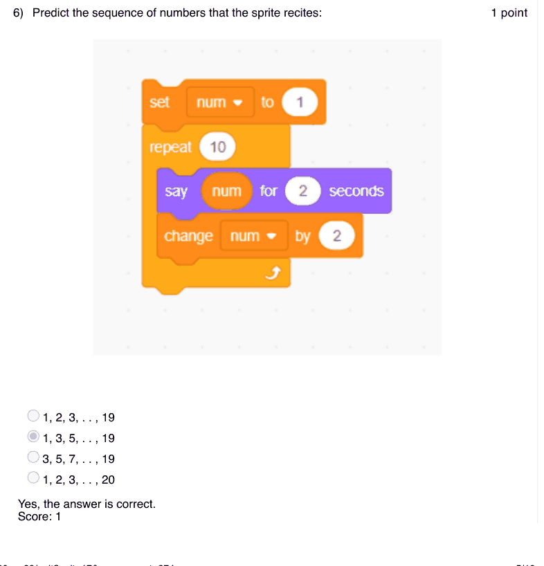

### Q7. Consider a road inclined at an angle of
and we have a car sprite to be driven over
this road. Pick the code that helps to perform the same.
90∘

- [ ] Hint: The initial direction of the sprite is .
> No, the answer is incorrect. Score: 0

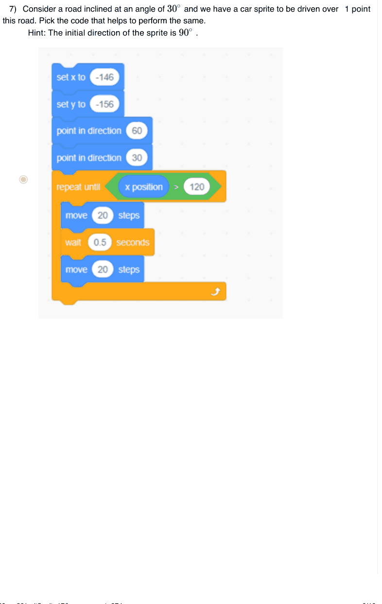

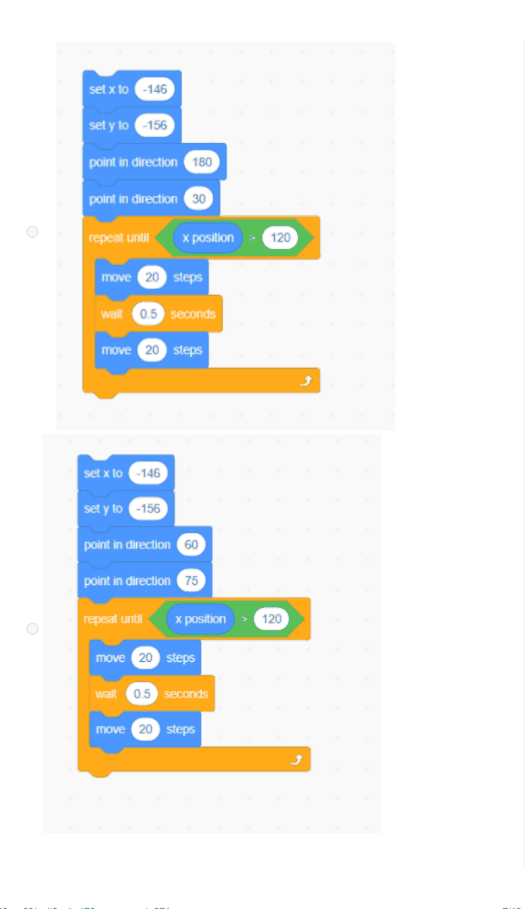

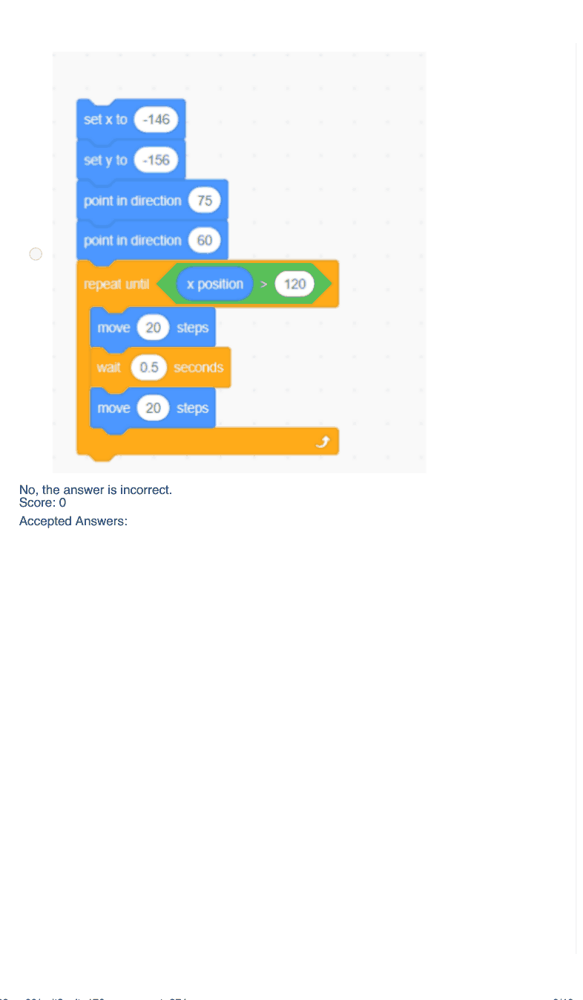

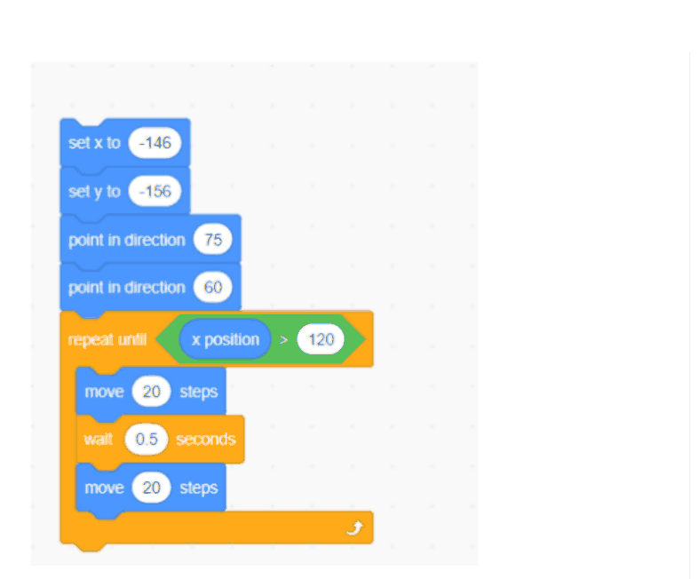

### Q8. Identify the command to communicate across multiple sprites.

- [ ] say message
- [ ] play sound
- [x] Broadcast message
- [ ] touching color
> Yes, the answer is correct. Score: 1

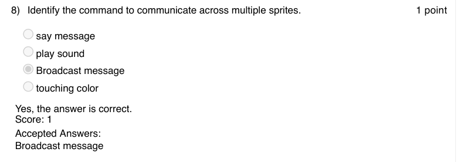

### Q9. Pick out the scratch library that provides the functionality to switch backdrop?

- [ ] Motion
- [ ] Control
- [x] Looks
- [ ] Sensing
> Yes, the answer is correct. Score: 1

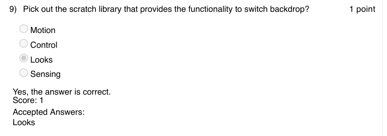

### Q10. Imagine a Magic wand sprite and predict the output for the following set of instructions.

- [ ] The Magic wand flies to a random position takes 1 sec pause and then reaches another random position.
- [ ] The Magic wand flies to a random position in 1 sec and after a 0.25 sec pause, it repeats the same until it is stopped.
- [ ] The Magic wand reaches all edges of the screen in a uniform pattern
- [ ] The Magic wand flies between the top and bottom edges repeatedly.
> Accepted answer (not matched to a printed option): The Magic wand flies to a random position in 1 sec and after a 0.25 sec pause, it repeats the; same until it is stopped.
> Yes, the answer is correct. Score: 1

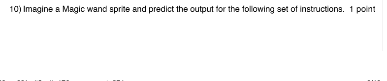

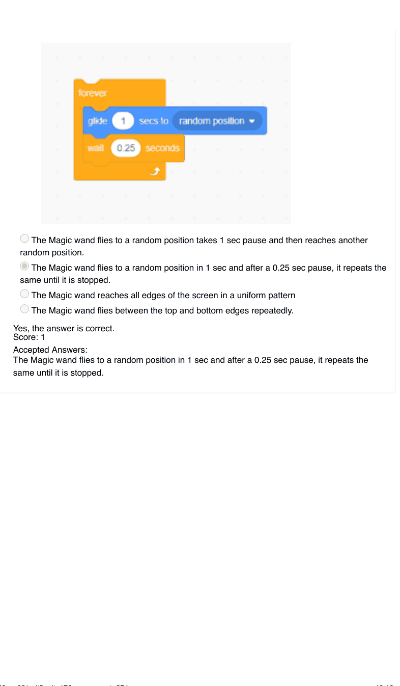
