# JOC Sep-2020 · Week 2: portal print

- Source: `JOC Sep-Dec 2020.pdf` pages 11–16 (portal review printout). Parsed text below; the cropped image under each question is the exact page content (code, figures and ticks as printed) and is authoritative.
- `[x]` = option equal to the portal's **Accepted Answer** (official). Lines may carry stray spaces from the PDF text layer.

> Due on 2020-09-30, 23:59 IST. · Assignment submitted on 2020-09-29, 21:16 IST

### Q1. Identify the statement with an invalid syntax. Expected Output: Stay Safe! Friends

- [ ] print(“Stay Safe!”,“Friends”)
- [ ] print(“Stay Safe! Friends”)
- [ ] print(‘Stay Safe! Friends’)
- [x] print(Stay Safe Friends)
> Yes, the answer is correct. Score: 1

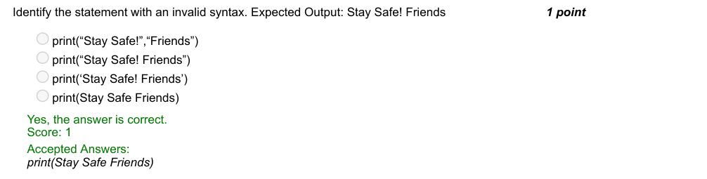

### Q2. Predict the output for the following code that checks the eligibility to vote.

- [ ] Hey! You are eligible to vote
- [ ] OOPS! You are not eligible to vote
- [x] Syntax Error: invalid syntax
- [ ] Invalid age
> No, the answer is incorrect. Score: 0

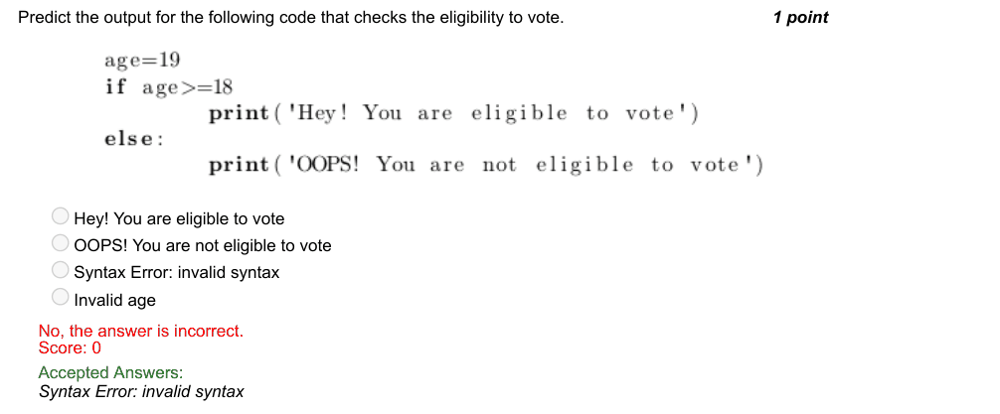

### Q3. What is the output of the following code?

> Score: 0

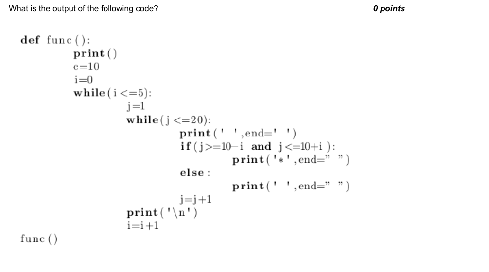

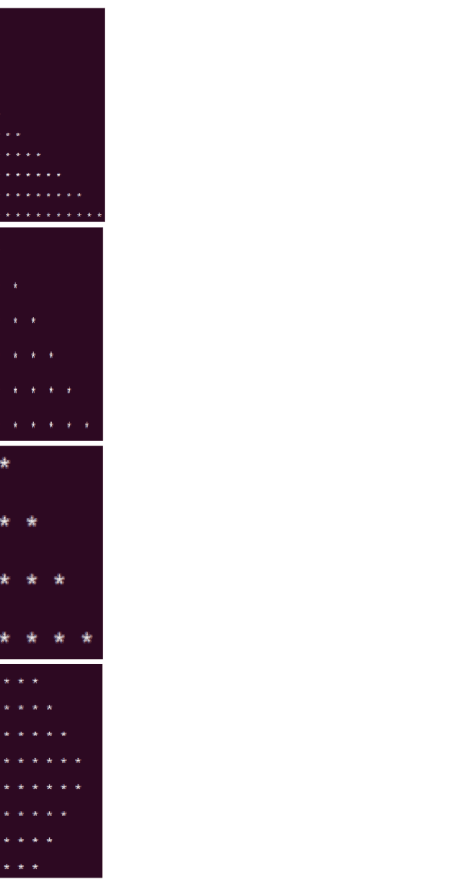

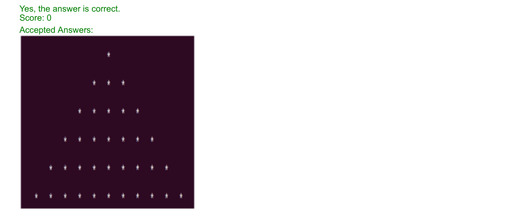

### Q4. With n as input, the code below computes

- [ ] −1 × n
- [ ] −1×n
- [ ] −1 + n
- [ ] −1+n
- [x] (−1)n
- [x] (−1)n
- [ ] n(−1)
- [ ] n(−1)
> Yes, the answer is correct. Score: 0

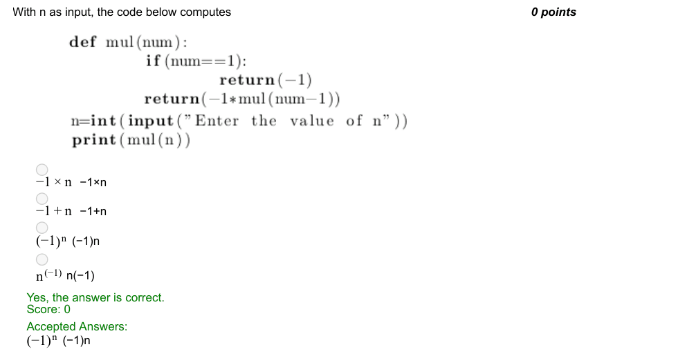

### Q5. For the given code, what is the value of ‘total’ variable at the end of execution?

- [ ] syntax error
- [ ] 264
- [ ] 988779
- [x] 987987
> Yes, the answer is correct. Score: 1

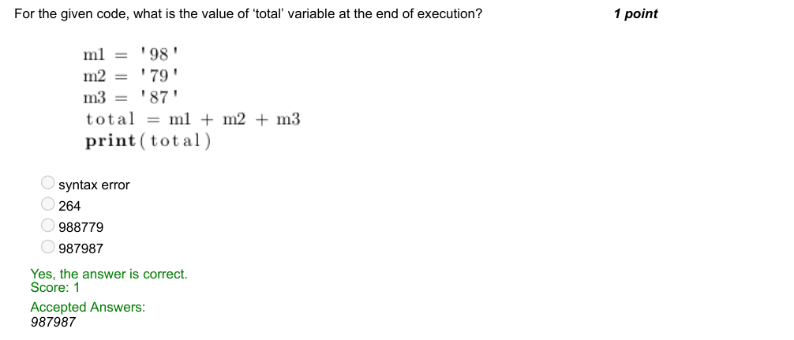

### Q6. Replace the given set of instructions with a for loop.

> Yes, the answer is correct. Score: 1

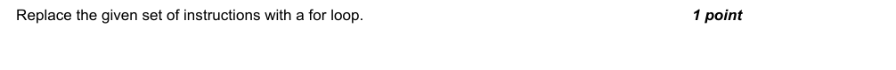

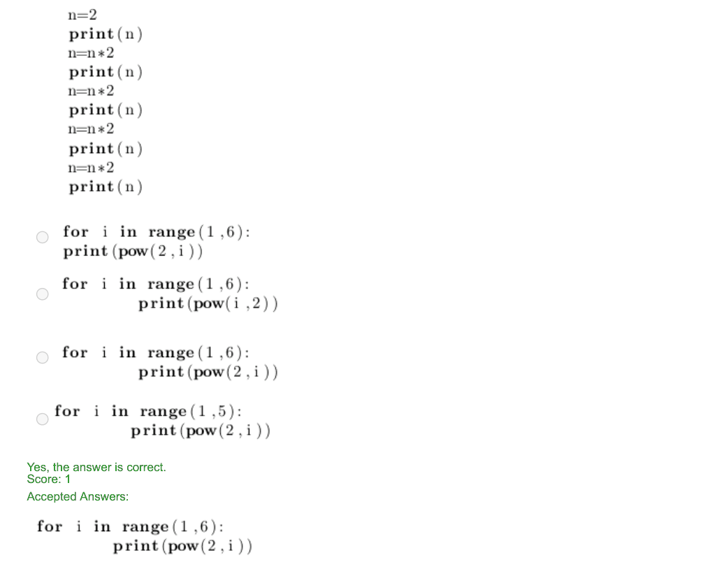

### Q7. Which of the following is the output for the given code?

> Yes, the answer is correct. Score: 1

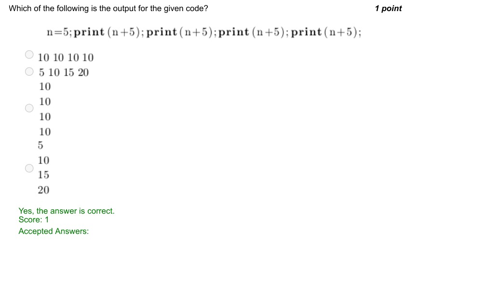

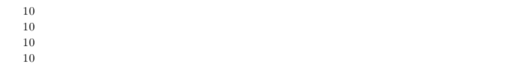

### Q8. Identify the appropriate output.

- [ ] Hello! Avani Chaturvedi! How are you? Proud to meet you!
- [ ] Hello! Avani Chaturvedi!
- [ ] How are you?
- [x] Proud to meet you!
- [ ] Hello!
- [ ] Avani Chaturvedi!
- [ ] How are you?
- [x] Proud to meet you!
- [x] Hello! Avani Chaturvedi! How are you?
- [x] Proud to meet you!
> Yes, the answer is correct. Score: 1

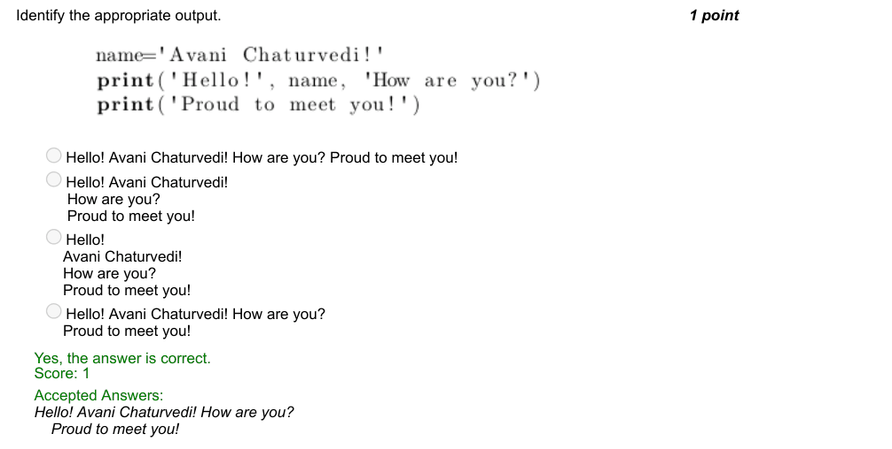

### Q9. What happens if we key in number 5 for the variable c in the below code?

- [x] Loop terminates
- [ ] Continues execution
- [ ] Program restarts execution
- [ ] None of the above
> Yes, the answer is correct. Score: 1

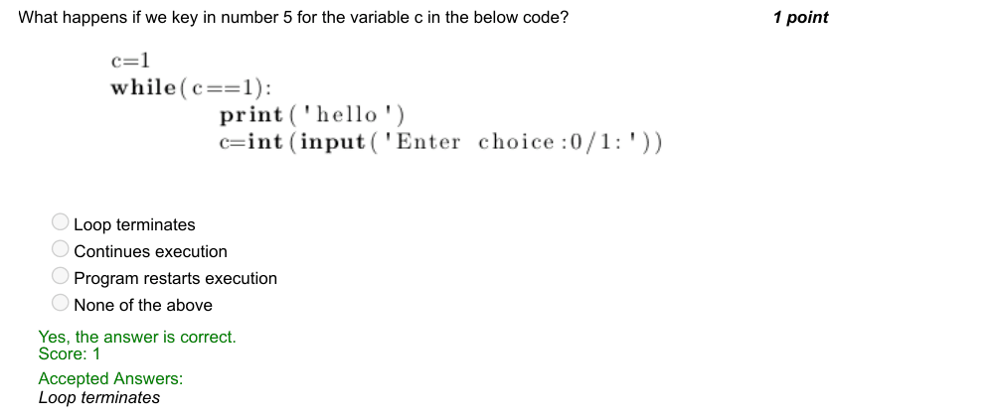

### Q10. What is the output of the following code?

- [ ] Infinite loop
- [ ] -20 20
- [ ] 20
- [ ] -20

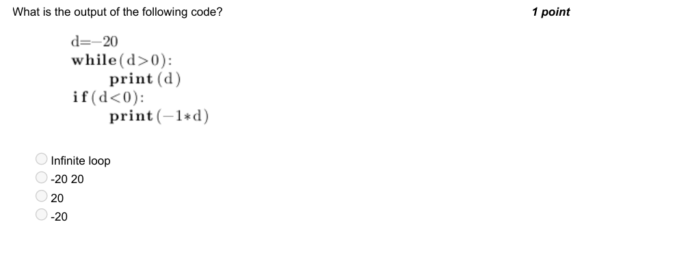

