# JOC Sep-2020 · Week 3: portal print

- Source: `JOC Sep-Dec 2020.pdf` pages 17–20 (portal review printout). Parsed text below; the cropped image under each question is the exact page content (code, figures and ticks as printed) and is authoritative.
- `[x]` = option equal to the portal's **Accepted Answer** (official). Lines may carry stray spaces from the PDF text layer.

> Due on 2020-10-07, 23:59 IST. · Assignment submitted on 2020-10-07, 23:54 IST

### Q1. What is the expected output for the following code?

- [ ] [ ' coffee ' , ' jaggery ' , ' cheese ' , ' butter ' ]
- [ ] [' coffee ' , ' sugar ' , ' cheese ' , ' butter ' ]
- [x] coffee
- [x] jaggery
- [x] cheese
- [x] butter
- [ ] coffee jaggery cheese butter
> Yes, the answer is correct. Score: 1

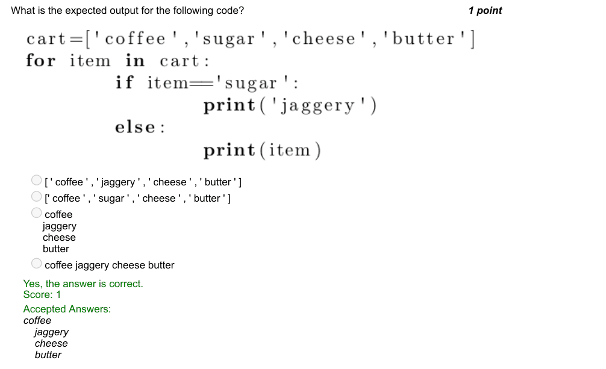

### Q2. Which of the following code prints the sum of weights of people in the lift?

> Yes, the answer is correct. Score: 1

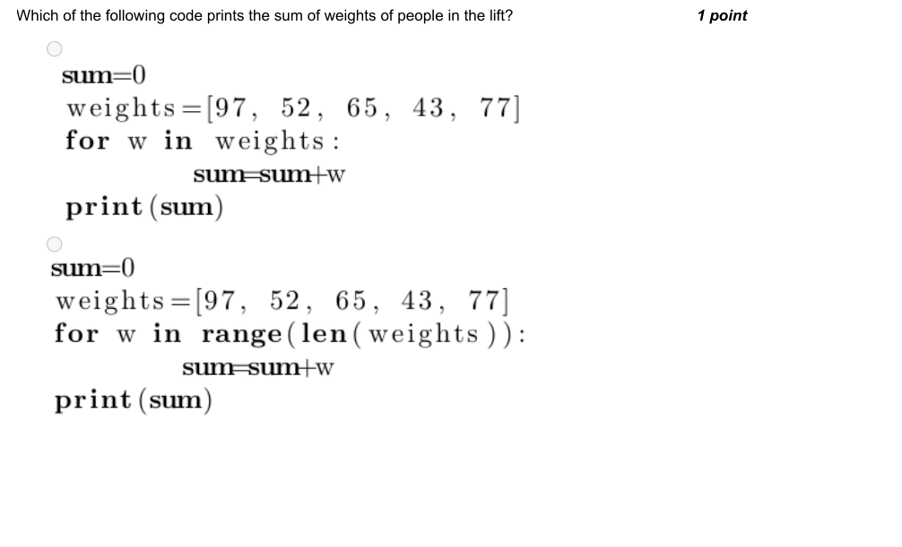

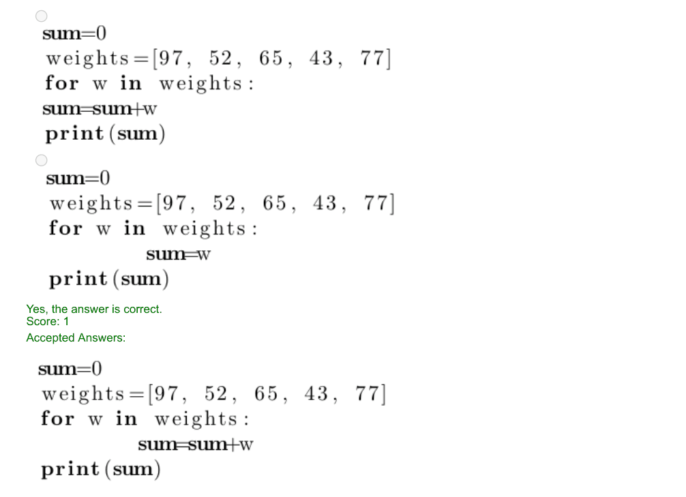

### Q3. Consider a python list named ‘book titles’. Pick the statement to add ‘Who moved my cheese?’ as
the third item.
Given: book titles = [‘Exam Warriors’, ‘Evil in the Mahabharata’, ‘6 TIMES THINNER’, ‘The Driver in the
Driverless Car’, ‘Evolution’]

- [ ] book titles.append(2,‘Who moved my cheese?’)
- [x] book titles.insert(2,‘Who moved my cheese?’)
- [ ] book titles.insert(3,‘Who moved my cheese?’)
- [ ] book titles.append(3,‘Who moved my cheese?’)
> Yes, the answer is correct. Score: 1

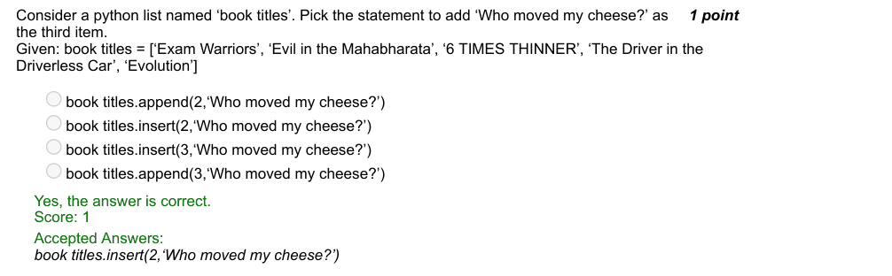

### Q4. Pick the relevant output for the given code.

- [ ] [1, 2, 4, 8, 17, 21]
- [ ] [21, 17, 8, 4, 2, 1]
- [x] [17, 21, 8, 2, 4, 1]
- [ ] [1, 4, 2, 8, 21, 17]
> Yes, the answer is correct. Score: 1

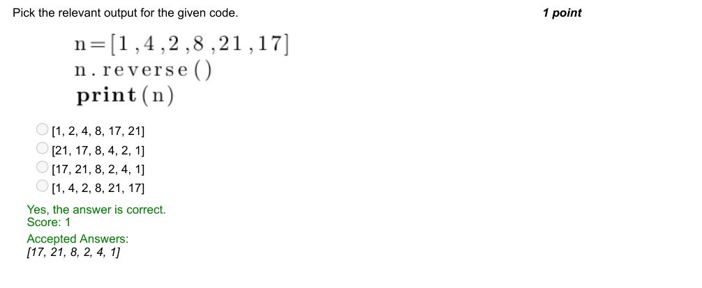

### Q5. Specify the purpose of ‘break’ statement inside a nested loop.

- [ ] Ends execution of the program
- [ ] Ends execution of the outermost loop
- [ ] Skips the current iteration of the loop
- [x] Ends the execution of the loop
> No, the answer is incorrect. Score: 0

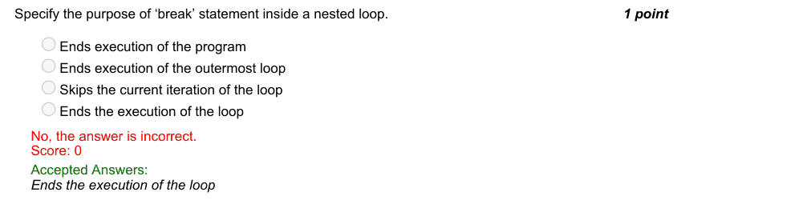

### Q6. You are given a list, ‘marks’ scored by 30 students. Identify the instruction to find the 2% trimmed
mean for the given data.

- [ ] m=stats.trim_mean(marks,0.2)
- [ ] m=stats.trim_mean(marks,0.03)
- [ ] m=stats.trim_mean(30,0.02)
- [x] m=stats.trim_mean(marks,0.02)
> Yes, the answer is correct. Score: 1

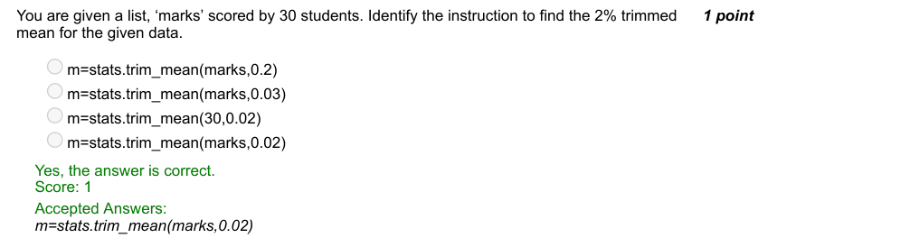

### Q7. How will you simulate ‘Rolling a Dice’ with six faces by making use of ‘random’ library?

- [ ] roll= random.choice(1,2,3,4,5,6)
- [ ] roll= random.range(1,5)
- [x] roll= random.randint(1,6)
- [ ] roll= random.random(6)
> Yes, the answer is correct. Score: 1

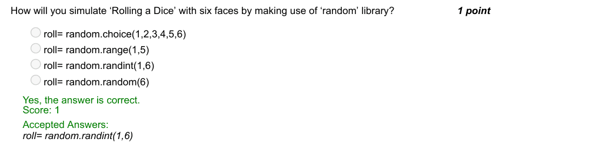

### Q8. Consider a python list named ‘book_titles’.
Given: book_titles = [‘Exam Warriors’, ‘Evil in the Mahabharata’, ‘6 TIMES THINNER’, ‘The Driver in the
Driverless Car’, ‘Evolution’]
What is the output for the following operation?
book_titles[4:]

- [x] [‘Evolution’]
- [ ] [‘Exam Warriors’,‘Evil in the Mahabharata’, ‘6 TIMES THINNER’,
- [ ] ‘The Driver in the Driverless Car’]
- [ ] [ ]
- [ ] [‘Exam Warriors’, ‘Evil in the Mahabharata’, ‘6 TIMES THINNER’]
> Yes, the answer is correct. Score: 1

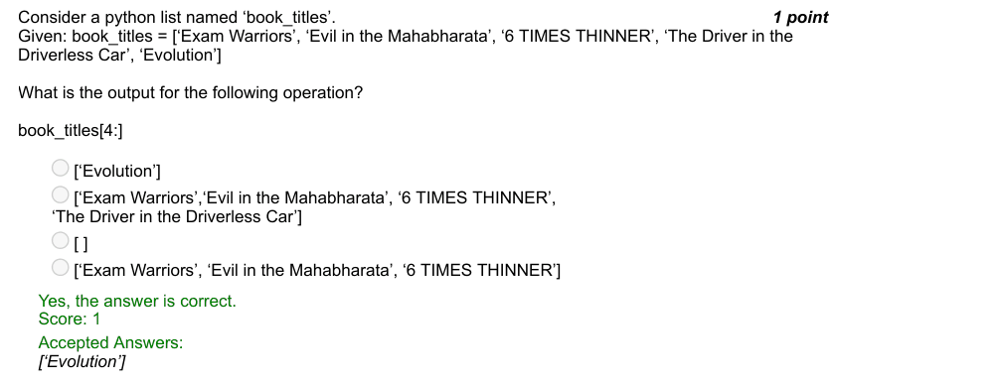

### Q9. Assuming, there is no file named ‘file.txt’ on my computer, what does the following code do?

- [ ] Shows error
- [x] Displays: Hey I am writing the second line
- [ ] Displays: Hey! I am writing.Hey I am writing the second line.
- [ ] Displays: Hey! I am writing.
> Yes, the answer is correct. Score: 1

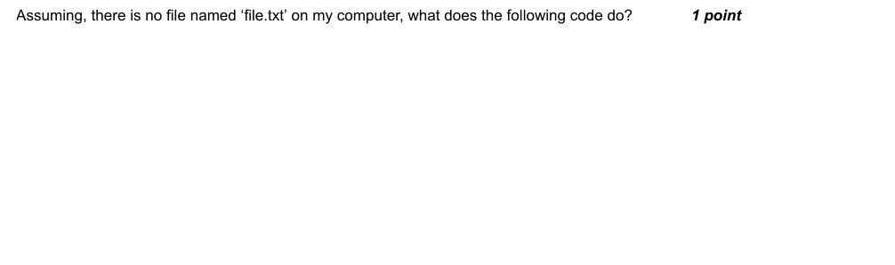

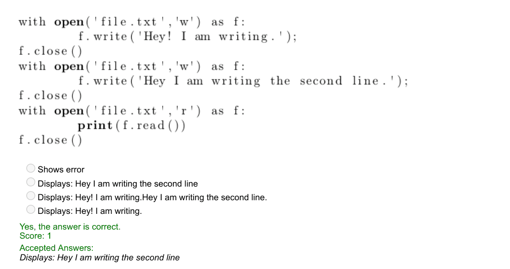

### Q10. Predict the output

> Yes, the answer is correct. Score: 1

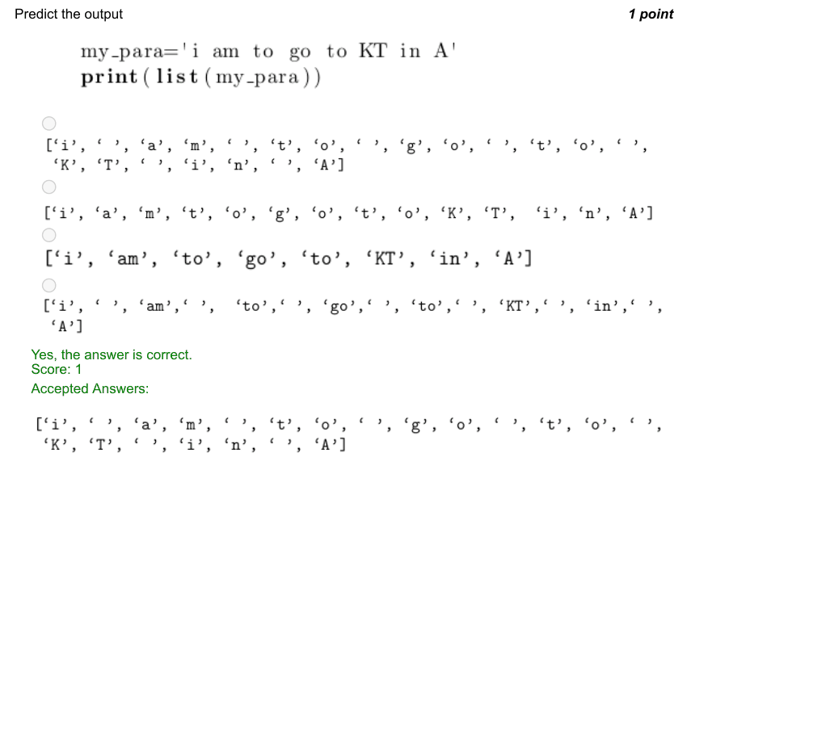
