# JOC Sep-2020 · Week 4: portal print

- Source: `JOC Sep-Dec 2020.pdf` pages 21–24 (portal review printout). Parsed text below; the cropped image under each question is the exact page content (code, figures and ticks as printed) and is authoritative.
- `[x]` = option equal to the portal's **Accepted Answer** (official). Lines may carry stray spaces from the PDF text layer.

> Due on 2020-10-14, 23:59 IST. · Assignment submitted on 2020-10-14, 21:33 IST

### Q1. Which statement can be used to come out of an infinite loop?

- [ ] continue
- [x] break
- [ ] try
- [ ] catch
> Yes, the answer is correct. Score: 1

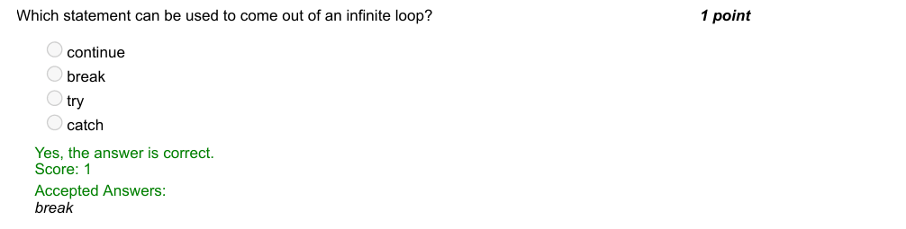

### Q2. You are supposed to code your ‘To do’ list that contains all the activities that you plan to perform in a
day. Assume you recharged your mobile and want
to delete it from the list. Identify the statement to perform the same.
Given: to_do=[‘Send Email’, ‘Recharge Mobile’, ‘Workshop preparation’]

- [ ] to_do.delete(“Recharge Mobile ”)
- [ ] to_do.clear(“Recharge Mobile”)
- [x] to_do.remove(“Recharge Mobile”)
- [ ] to_do.pop()
> Yes, the answer is correct. Score: 1

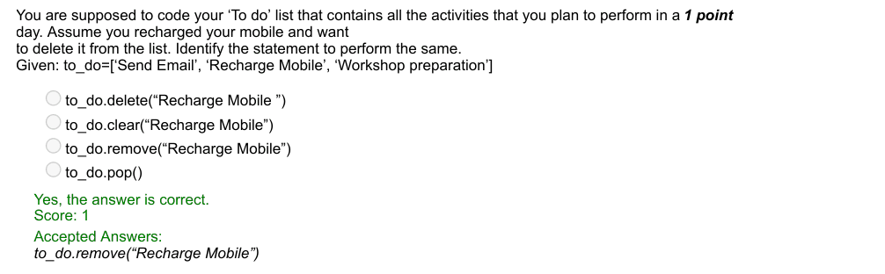

### Q3. Simulate a ‘Lot Box’ that contains all alphabets from ‘A’ to ‘Z’. Draw and Display.

- [ ] print(random.choice(list(string.ascii_letters)))
- [x] print(random.choice(list(string.ascii_uppercase)))
- [ ] print(random.choice(list(string.ascii_lowercase)))
- [ ] print(random.choice(string.ascii_uppercase))
> Yes, the answer is correct. Score: 0

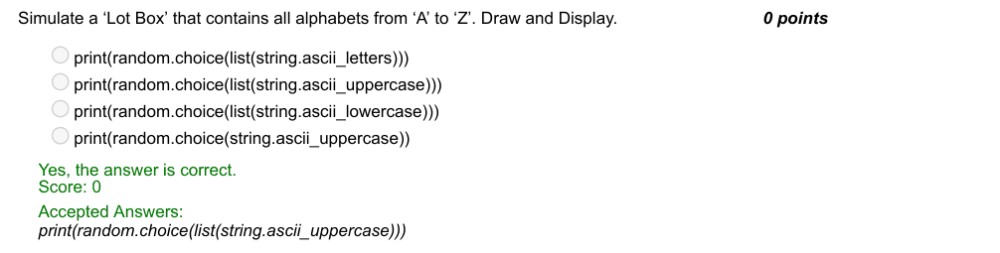

### Q4. The following snippet produces TypeError: int object not callable. Pick out the correct code.

- [ ] r e s u l t=a ( b+(c * * 2 ) ) where a , b and  c  a r e  any  i n t e g e r s
- [ ] result=ax(b+(c**2))
- [ ] result=a//(b+(c**2))
- [x] result=a*(b+(c**2))
- [ ] result=a.(b+(c**2))
> Yes, the answer is correct. Score: 1

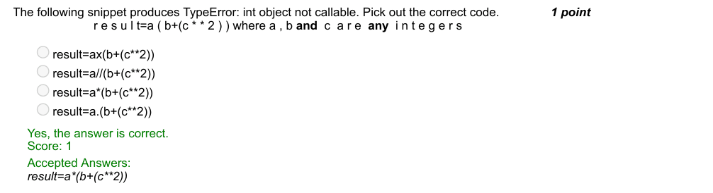

### Q5. How will you display the current date in ‘mm/dd/yy’ format?

- [ ] print(datetime.datetime.now().strftime(‘%c’))
- [ ] print(datetime.datetime.now().strftime(‘%B’))
- [ ] print(datetime.datetime.now().strftime(‘%C’))
- [x] print(datetime.datetime.now().strftime(‘%x’))
> Yes, the answer is correct. Score: 1

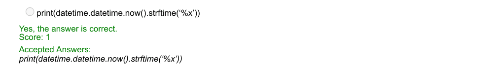

### Q6. What does the following code do?

- [ ] prints yes if both strings are same
- [x] prints yes if both strings have atleast one common character
- [ ] prints yes if first string is contained in the second
- [ ] none of the above
> Yes, the answer is correct. Score: 0

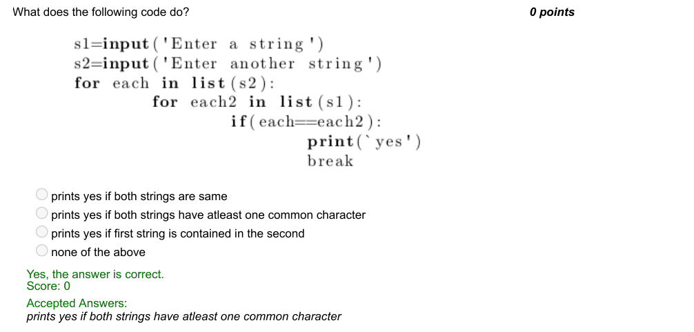

### Q7. What does the following function do?

- [ ] returns true for century year and false for non century year
- [x] returns true for leap year and false for non leap year
- [ ] returns false for century year and true for non century year
- [ ] none of the above
> Yes, the answer is correct. Score: 1

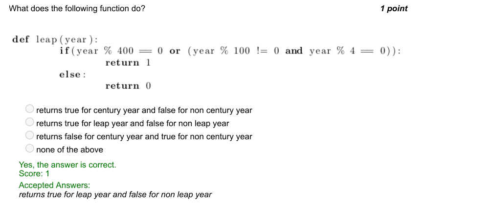

### Q8. Given a

- [ ] n×n
- [ ] square matrix mx in the form of list of lists in figure, what is the output of the statement func(mx,2) given n=7?
- [x] 3 2 1 8 5 6 7 6
- [ ] 3 2 1 6 7 8 7 6 5
- [ ] 3 2 1 1 8 5 5 6 7 7 6 3
- [ ] 3 6 7 7 7 2 1 8 5
> Yes, the answer is correct. Score: 1

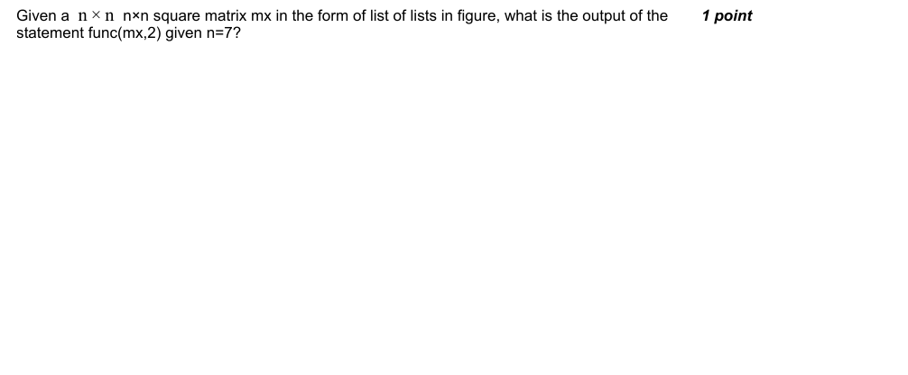

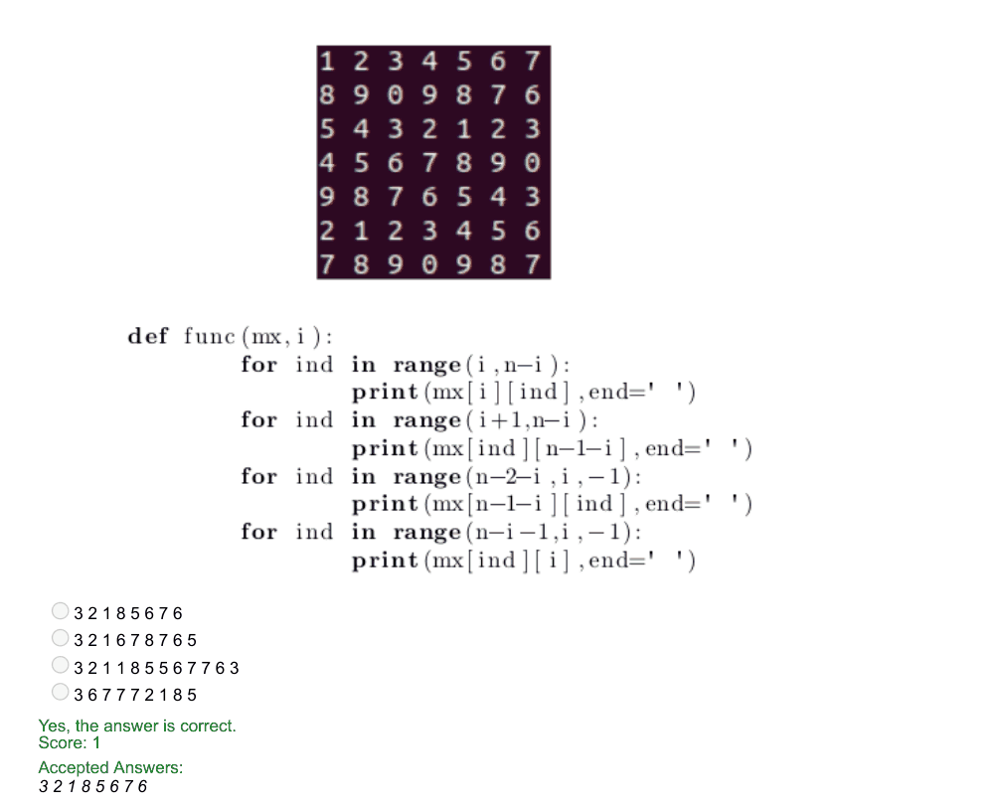

### Q9. Pick out the snippet to perform integer division.

- [x] a // b
- [ ] a / b
- [ ] a mod b
- [ ] a % b
> Yes, the answer is correct. Score: 1

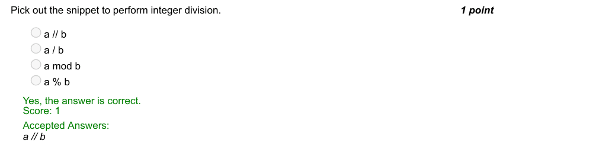

### Q10. Pick out the valid function call to the definition given below:

- [ ] is_participating(‘Raji’,‘Shiva’,‘Raji’,‘Priya’)
- [ ] is_participating(‘Raji’,[‘Shiva’,‘Raji’,‘Priya’])
- [ ] is_participating[‘Raji’,{‘Shiva’,‘Vani’,‘Priya’}]
- [ ] is_participating(’Raji’,{‘Shiva’,‘Raji’,‘Priya’})

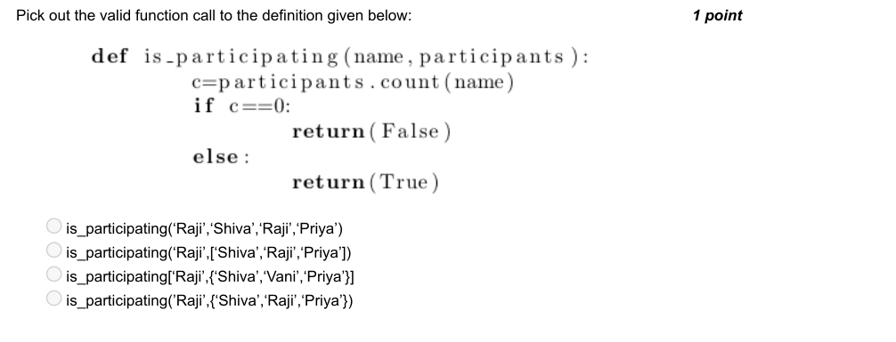

