# JOC Sep-2020 · Week 5: portal print

- Source: `JOC Sep-Dec 2020.pdf` pages 25–28 (portal review printout). Parsed text below; the cropped image under each question is the exact page content (code, figures and ticks as printed) and is authoritative.
- `[x]` = option equal to the portal's **Accepted Answer** (official). Lines may carry stray spaces from the PDF text layer.

> Due on 2020-10-21, 23:59 IST. · Assignment submitted on 2020-10-21, 23:42 IST

### Q1. Select the command to empty or reset the ’employee’ dictionary.

- [ ] del employee
- [ ] del employee[0:2]
- [ ] employee.remove()
- [x] employee.clear()
> Yes, the answer is correct. Score: 1

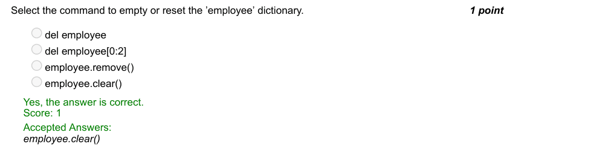

### Q2. Which of the following code represents creating a dictionary from a list where keys are the unique
elements from the list and the value corresponding to a key is the number of times that key occurs in the
list.

- [ ] none of these
> Score: 1

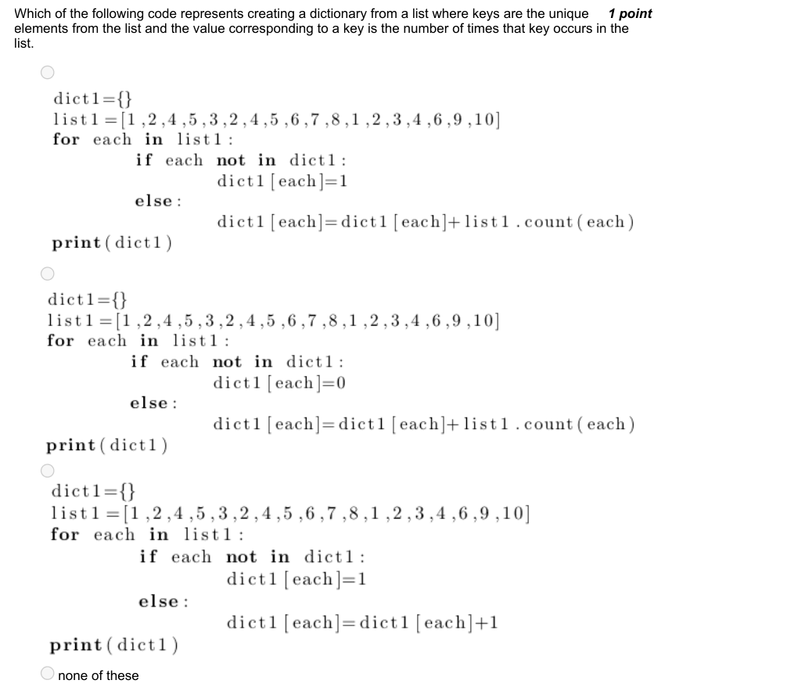

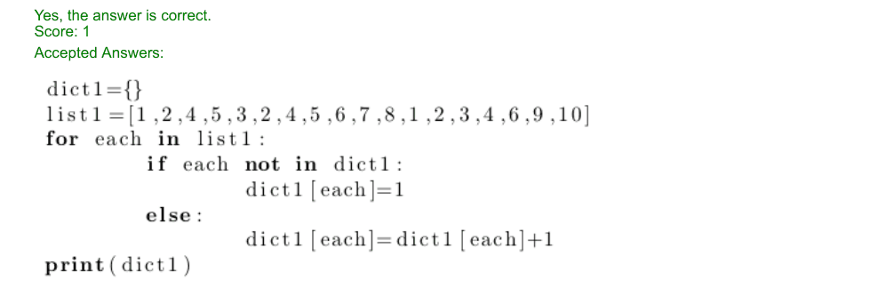

### Q3. Identify the audio file format that is NOT supported by Python Speech Recognition Module.

- [ ] FLAC
- [ ] AIFF
- [ ] WAV
- [x] MP3
> Yes, the answer is correct. Score: 1

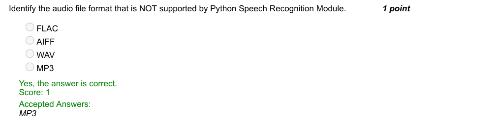

### Q4. Which of the following exception can be used to handle the error that occurs when Google cannot
understand the audio content in speech recognition?

- [x] UnknownValueError
- [ ] RequestError
- [ ] ValueError
- [ ] RunTimeError
> Yes, the answer is correct. Score: 1

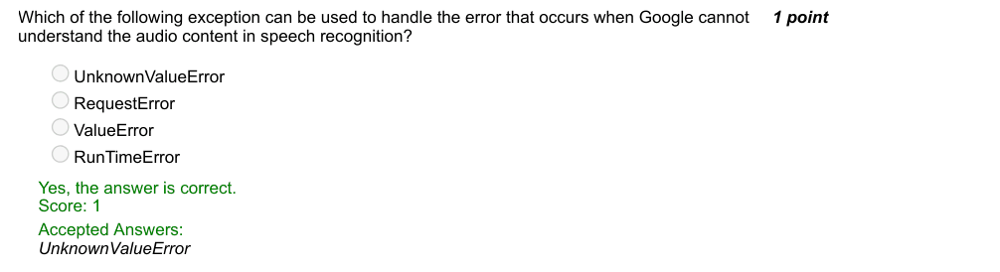

### Q5. Which of the following statements is correct for the Monte Hall problem?
Statement I: If you choose the correct door on the first try, then switching loses
Statement II: Contestants who switch have 2/3 chances to win whereas contestants who donot switch have
1/3 chances of win.

- [ ] I only
- [ ] II only
- [x] Both I & II
- [ ] None
> Yes, the answer is correct. Score: 1

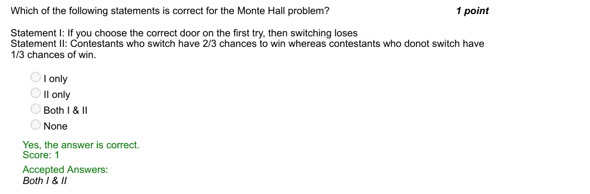

### Q6. Which of the random experiments from the options does the code represent?

- [x] Prints a success when both people select the same object
- [ ] Prints a success when both people select “rock”
- [ ] Prints a success when both people select different objects
- [ ] None of the above
> Yes, the answer is correct. Score: 1

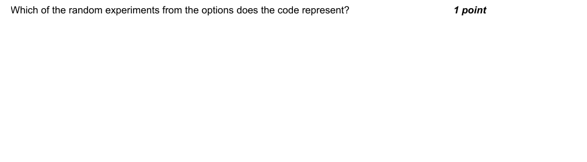

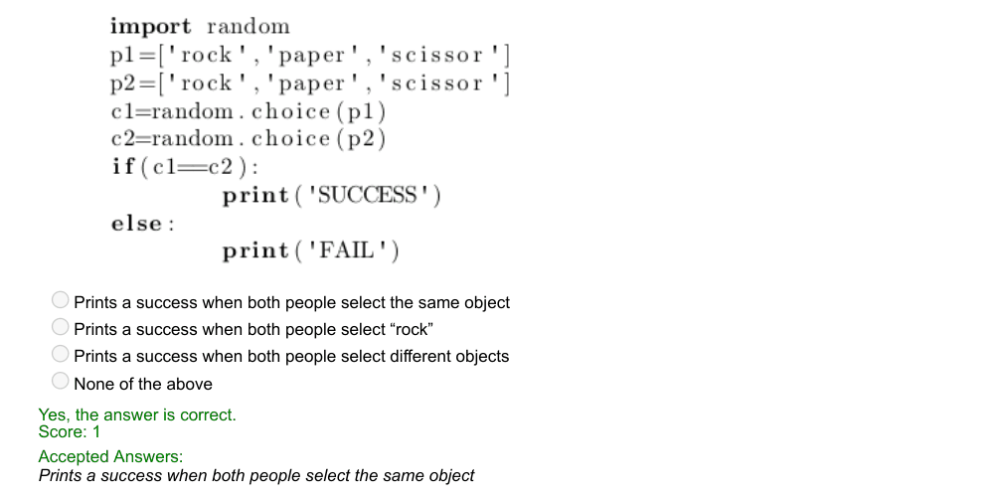

### Q7. What does the following code represent?

- [ ] A drunkard moving on a straight line, moving one step forward with probability 0.4, one step
- [ ] backward with probability 0.4 and staying at the same place with probability 0.2
- [ ] A drunkard moving on a XY plane, moving right with probability 0.4, upwards with probability 0.8 and
- [ ] diagonally up-right with probability 1.
- [x] A drunkard moving on a XY plane, moving right with probability 0.4, upwards with probability 0.4 and
- [x] diagonally up-right with probability 0.2.
- [ ] A drunkard moving on a XY plane, moving left with probability 0.4, downwards with probability 0.8
- [ ] and diagonally down-left with probability 1.
> Yes, the answer is correct. Score: 1

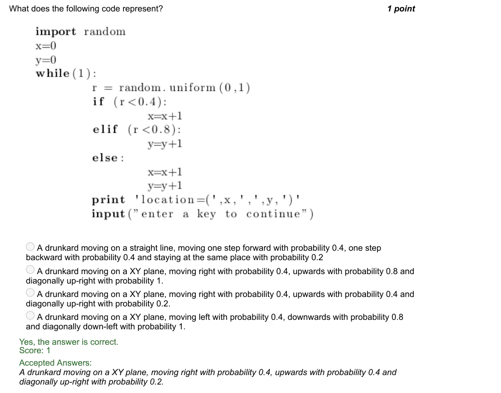

### Q8. The following code takes a list as input and prints the sorted list as an output. The outer for loop is to
count the number of iterations. What is the purpose of the inner for loop?

- [x] To fetch the pair of consecutive elements to be compared
- [ ] Index of the element for which the right position is to be found
- [ ] To identify the max element
- [ ] To check if the list is sorted
> No, the answer is incorrect. Score: 0

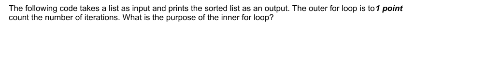

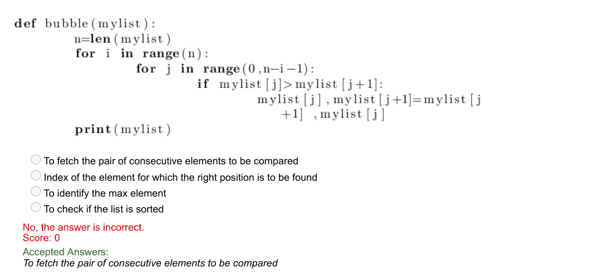

### Q9. The following code to its best, represents a scenario:

- [ ] A cake getting eaten by half of its current amount every time
- [ ] A student attempting alternate questions, starting from a given question
- [ ] Viruses doubling inside a body and killing the person once their population becomes 128 or more.
- [x] Metro train serving 128 stations to and from
> Yes, the answer is correct. Score: 1

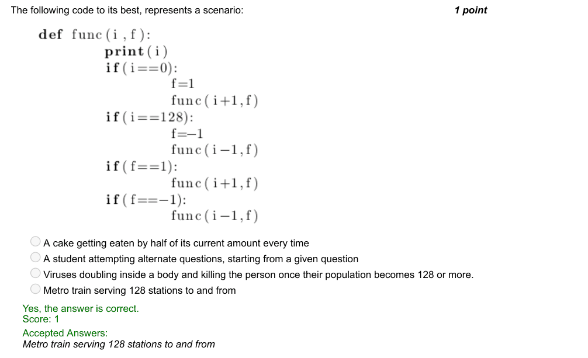

### Q10. Given that you have a sorted list of 1000 elements and the element to find is at the end of your
list(worst case),
what is the number of comparisons to search such an element using linear search and binary search?

- [x] 1000, 10
- [ ] 10, 2
- [ ] 1000, 2
- [ ] 10, 10
> Yes, the answer is correct. Score: 1

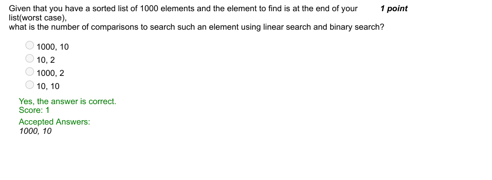
