# JOC Sep-2020 · Week 6: portal print

- Source: `JOC Sep-Dec 2020.pdf` pages 29–32 (portal review printout). Parsed text below; the cropped image under each question is the exact page content (code, figures and ticks as printed) and is authoritative.
- `[x]` = option equal to the portal's **Accepted Answer** (official). Lines may carry stray spaces from the PDF text layer.

> Due on 2020-10-28, 23:59 IST. · Assignment submitted on 2020-10-28, 21:30 IST

### Q1. Look at the following functions.
Which of the following set of statements correctly represent encryption and decryption using substitution
cipher?
It is also given that the set of characters for substitution is chosen from the plain text.

- [x] plain_text=input("Enter the string you want to encrypt")
- [x] key=create_encryption_key(plain_text)
- [x] cipher_list= encrypt(plain_text,key)
- [x] cipher_text=(‘ ’.join(cipher_list))
- [x] plain_list= encrypt(cipher_list,reverse(key))
- [x] plain_text= (‘ ’.join(plain_list))
- [x] plain_text=input("Enter the string you want to encrypt")
- [x] key=create_encryption_key(plain_text)
- [x] cipher_list= encrypt(plain_text,key)
- [x] cipher_text=(‘ ’.join(cipher_list))
- [ ] plain_list= encrypt(cipher_list,key)
- [x] plain_text= (‘ ’.join(plain_list))
- [x] plain_text=input("Enter the string you want to encrypt")
- [x] key=create_encryption_key(plain_text)
- [x] cipher_list= encrypt(plain_text,key)
- [x] cipher_text=(‘ ’.join(cipher_list))
- [ ] plain_list= encrypt(plain_list,reverse(key))
- [x] plain_text= (‘ ’.join(plain_list))
- [ ] None of the above
> Yes, the answer is correct. Score: 1

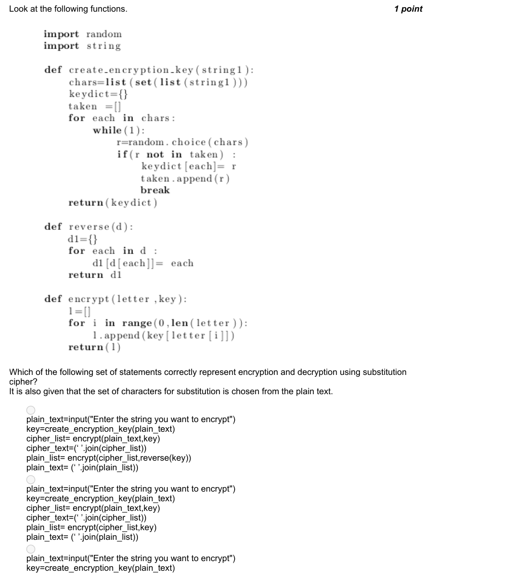

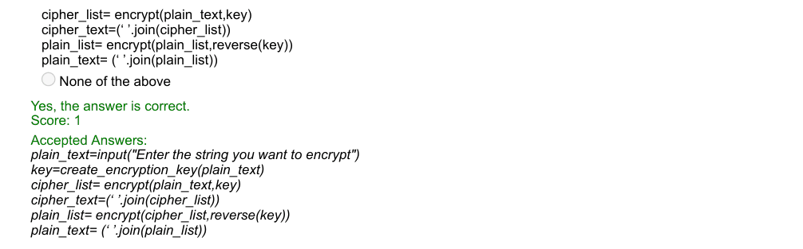

### Q2. Assuming, there is no file named 'file.txt' on my computer, what does the following code do?

- [ ] Creates a file named file.txt and adds ‘Hey! I am writing’ to it
- [ ] Shows an error because file does not exist
- [ ] shows an error because file in not opened in the reading mode
- [x] None of the above
> No, the answer is incorrect. Score: 0

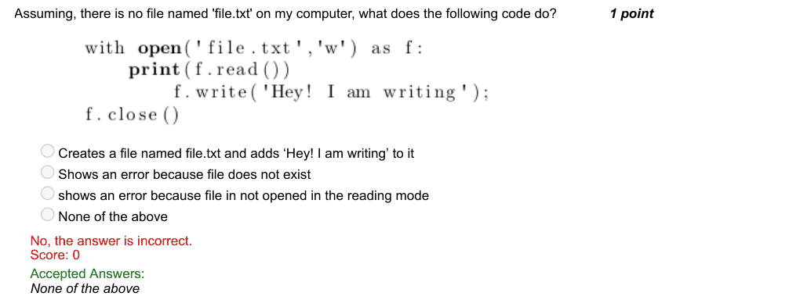

### Q3. What does the function ’confidential’ do?

- [ ] Generates the secret code for the given mobile number with every digit coded with the next digit.
- [ ] Generates the secret code for the given mobile number with every digit coded with the previous
- [ ] digit.
- [ ] Generates the secret code for the given mobile number with every digit coded with a random digit.
- [ ] Generates the secret code for the given mobile number with every digit coded with a special
- [ ] character.
> Accepted answer (not matched to a printed option): Generates the secret code for the given mobile number with every digit coded with the previous digit.
> Yes, the answer is correct. Score: 1

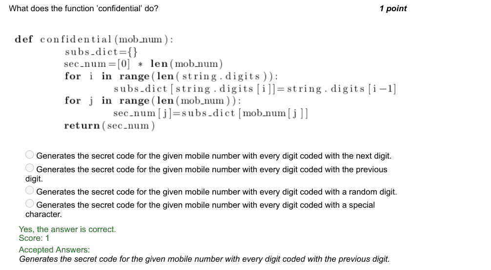

### Q4. What is the output for the given code?

- [ ] 15
- [ ] 9
- [x] 6
- [ ] 24
> No, the answer is incorrect. Score: 0

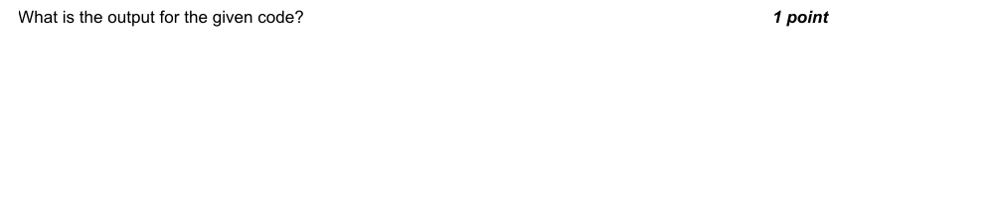

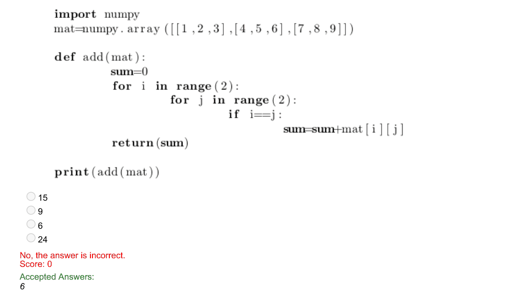

### Q5. Which of the following can be used to see the dimension of a numpy array named ‘arr’ ?

- [ ] dim(arr)
- [ ] shape(arr)
- [x] arr.shape
- [ ] arr.shape()
> Yes, the answer is correct. Score: 1

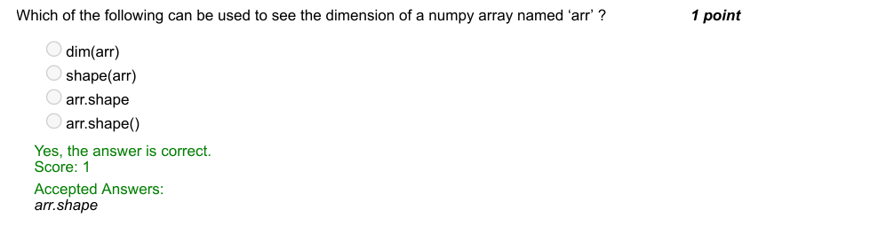

### Q6. What happens if we fail to check the anchor case in a recursive function?

- [x] Results in an infinite loop
- [ ] RunTimeError
- [ ] Never gets executed
- [ ] Returns a wrong output
> Yes, the answer is correct. Score: 1

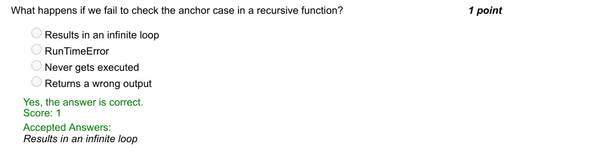

### Q7. What is the output of the following code ?

- [x] True
- [ ] False
- [ ] None
- [ ] Error
> Yes, the answer is correct. Score: 1

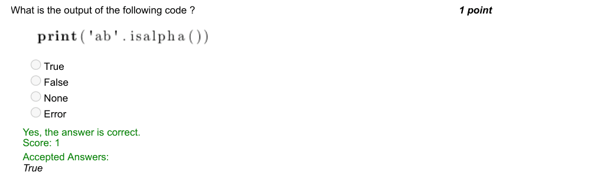

### Q8. If GOLD is encoded as FNKC, then how is PLATINUM encoded?

- [ ] NKYRGLSK
- [ ] OKZSHMUL
- [ ] NJYRGLSK
- [x] OKZSHMTL
> Yes, the answer is correct. Score: 1

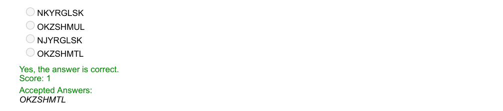

### Q9. Which of these statements is true?

- [ ] Recursion can solve only a subset of problems which Iteration can.
- [ ] Recursion is not related to Iteration.
- [ ] Recursion cannot solve the problems that can be solved by iteration.
- [x] Any problem that Recursion can solve, can also be solved by Iteration
> Yes, the answer is correct. Score: 1

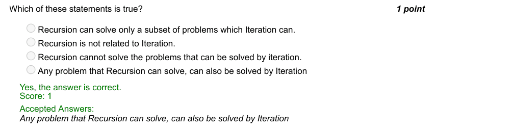

### Q10. Which of the following strategy of play does Tic Tac Toe belong to?

- [ ] Max-max
- [x] Min-max
- [ ] Max-min
- [ ] Min-min
> Yes, the answer is correct. Score: 1

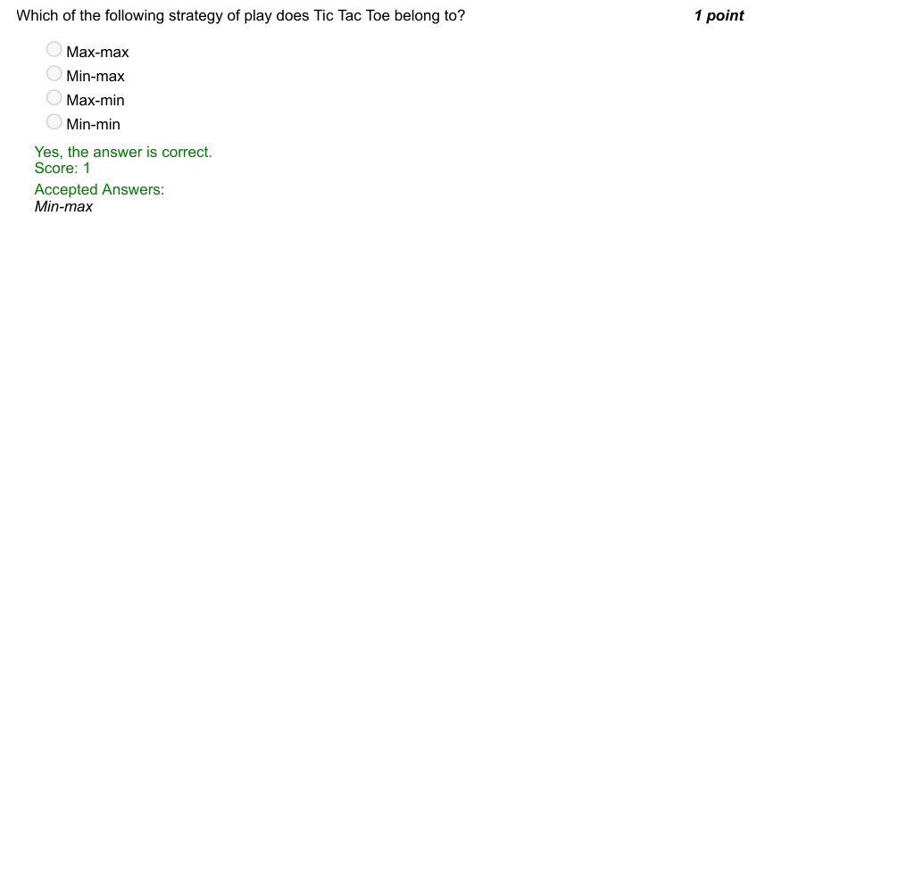
