# JOC Sep-2020 · Week 7: portal print

- Source: `JOC Sep-Dec 2020.pdf` pages 33–40 (portal review printout). Parsed text below; the cropped image under each question is the exact page content (code, figures and ticks as printed) and is authoritative.
- `[x]` = option equal to the portal's **Accepted Answer** (official). Lines may carry stray spaces from the PDF text layer.

> Due on 2020-11-04, 23:59 IST. · Assignment submitted on 2020-11-04, 20:47 IST

### Q1. Imagine a single player snakes and ladders game. The code below represents

- [ ] A snakes and ladders game with one snake whose position remains constant while the player is
- [ ] playing. The position also remains the same during any subsequent plays (i.e. the game board does
- [ ] not change while you sleep and play again the next day).
- [ ] A snakes and ladders game with one snake whose position remains constant while the player is
- [ ] playing. However, the position can change during any subsequent plays (i.e. the game board might
- [ ] change while you sleep and play again the next day).
- [ ] A snakes and ladders game with one snake where the snake can change its position during the
- [ ] game and also during any subsequent plays (a board game where the snakes keep moving). Further,
- [ ] the snake can bite you any number of times.
- [ ] A snakes and ladders game with one snake where the snake can change its position during the
- [ ] game and also during any subsequent plays (a board game where the snake keeps moving). Further,
- [ ] the snake can bite you only once when you play.
> Accepted answer (not matched to a printed option): A snakes and ladders game with one snake where the snake can change its position during the game and; also during any subsequent plays (a board game where the snake keeps moving). Further, the snake can; bite you only once when you play.
> Yes, the answer is correct. Score: 1

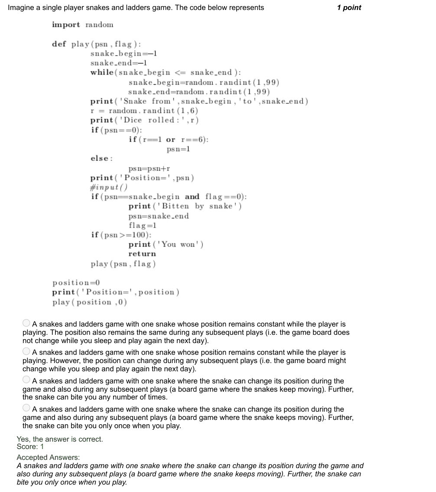

### Q2. Consider the code given below. Assume your current position being 19 and what happens when you
roll 2?

- [x] You climb up the ladder to reach 42
- [ ] You are bitten by a snake to reach 42
- [ ] You win
- [ ] You Quit
> Yes, the answer is correct. Score: 1

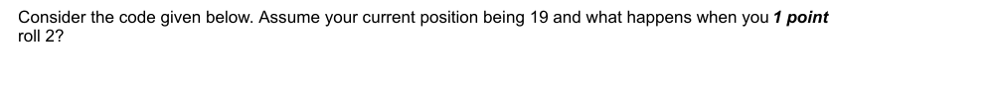

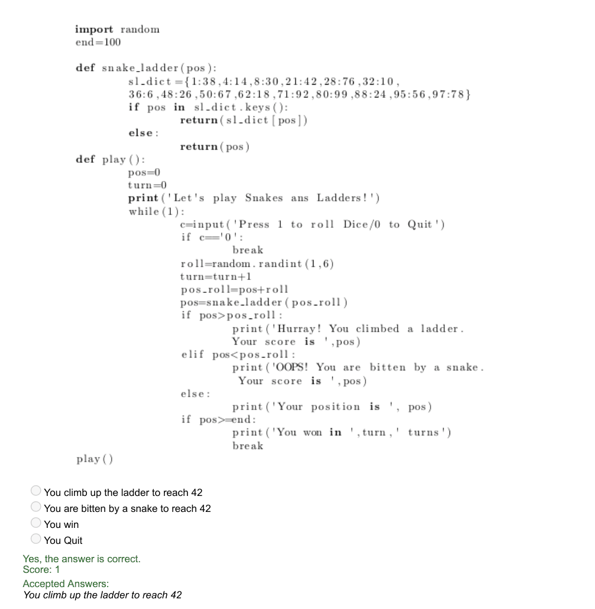

### Q3. Imagine a single player snakes and ladders game. The code below represents

- [ ] A snakes and ladders game with one snake whose position remains constant while the player is
- [ ] playing. The position also remains the same during any subsequent plays (i.e. the game board does
- [ ] not change while you sleep and play again the next day).
- [ ] A snakes and ladders game with one snake whose position remains constant while the player is
- [ ] playing. However, the position can change during any subsequent plays (i.e. the game board might
- [ ] change while you sleep and play again the next day).
- [ ] A snakes and ladders game with one snake where the snake can change its position during the
- [ ] game and also during any subsequent plays (a board game where the snakes keep moving). Further,
- [ ] the snake can bite you any number of times.
- [ ] A snakes and ladders game with one snake where the snake can change its position during the
- [ ] game and also during any subsequent plays (a board game where the snake keeps moving). Further,
- [ ] the snake can bite you only ones when you play.
> Accepted answer (not matched to a printed option): A snakes and ladders game with one snake where the snake can change its position during the game and; also during any subsequent plays (a board game where the snakes keep moving). Further, the snake can; bite you any number of times.
> Yes, the answer is correct. Score: 1

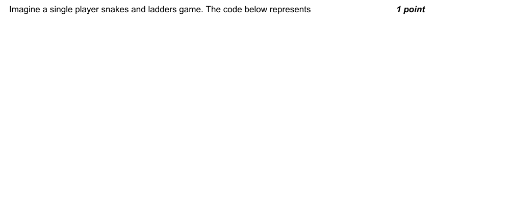

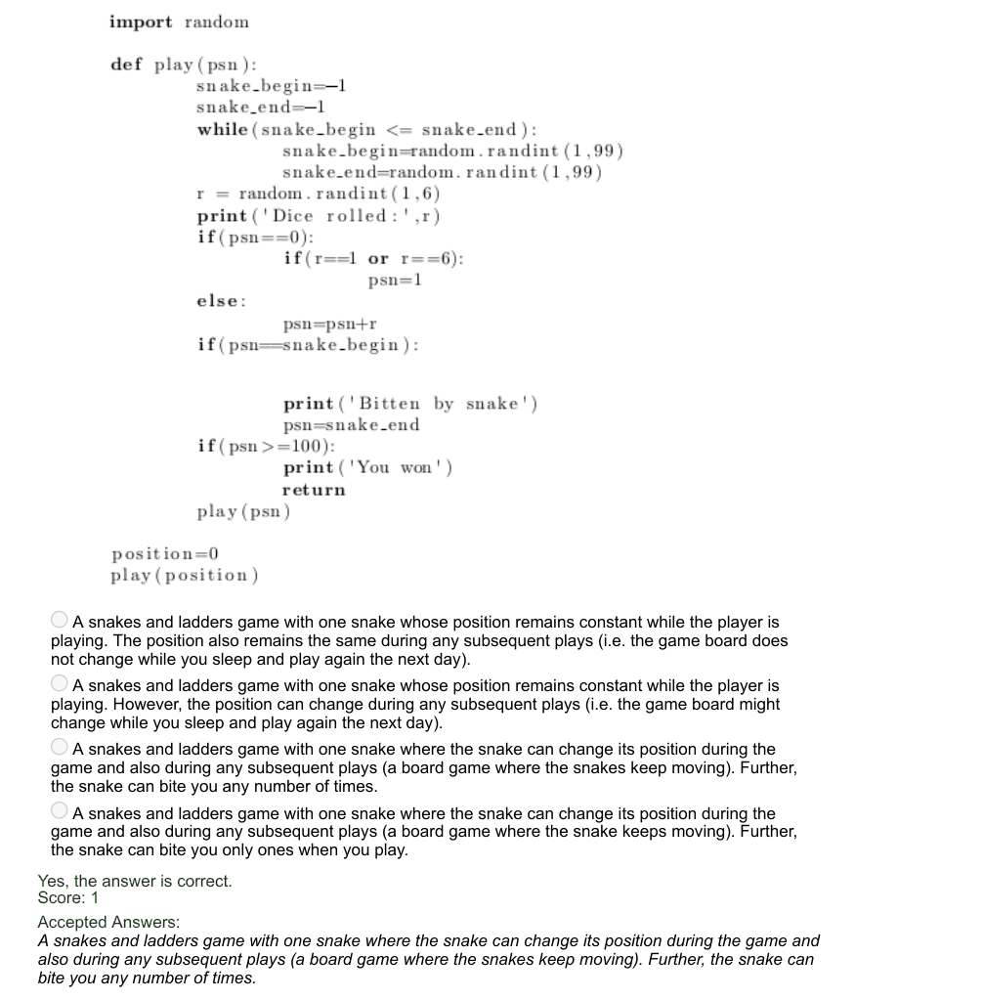

### Q4. Predict the output of the calling function func(mx) for a given square matrix, mx of dimension 70 ×
70.

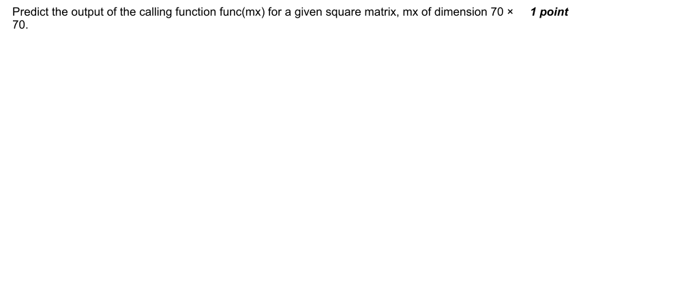

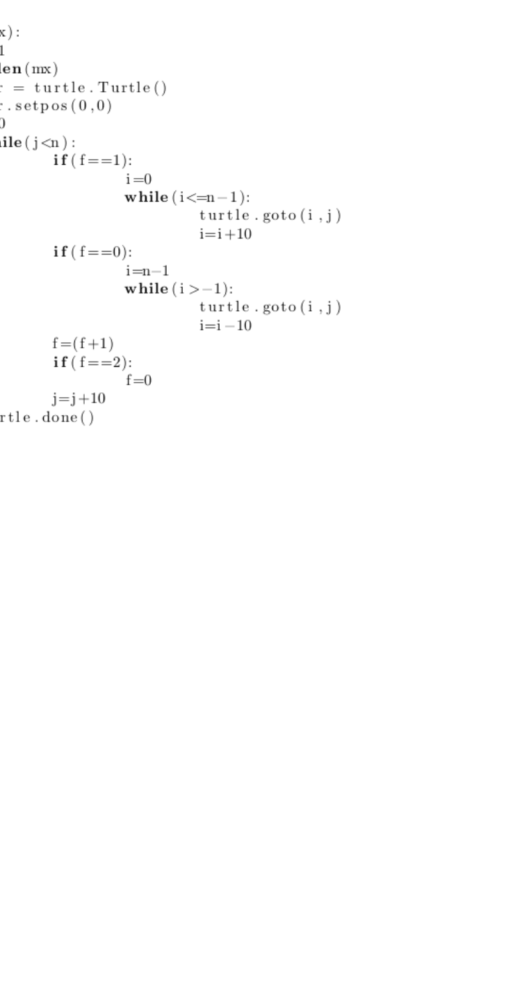

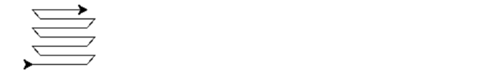

### Q5. Predict the output of the calling function func() for a given square matrix mx of dimension 70 × 70.

> Yes, the answer is correct. Score: 1

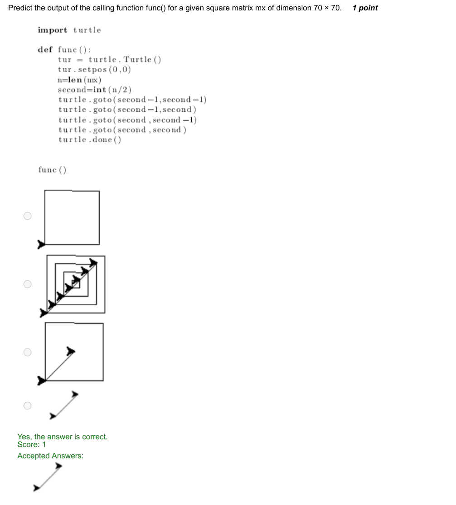

### Q6. Identify the package that is used to import an image.

- [ ] Pandas
- [ ] Scipy
- [x] PIL
- [ ] numpy
> Score: 1

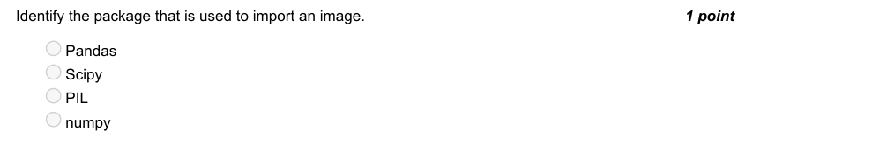

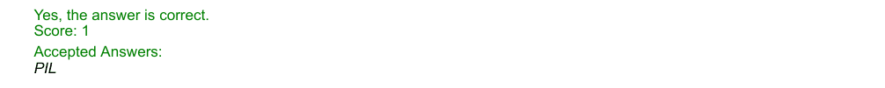

### Q7. Given a

- [ ] n×n
- [ ] square matrix mx in the form of list of lists in the following figure, what is the output of the statement func(mx)?
> Yes, the answer is correct. Score: 1

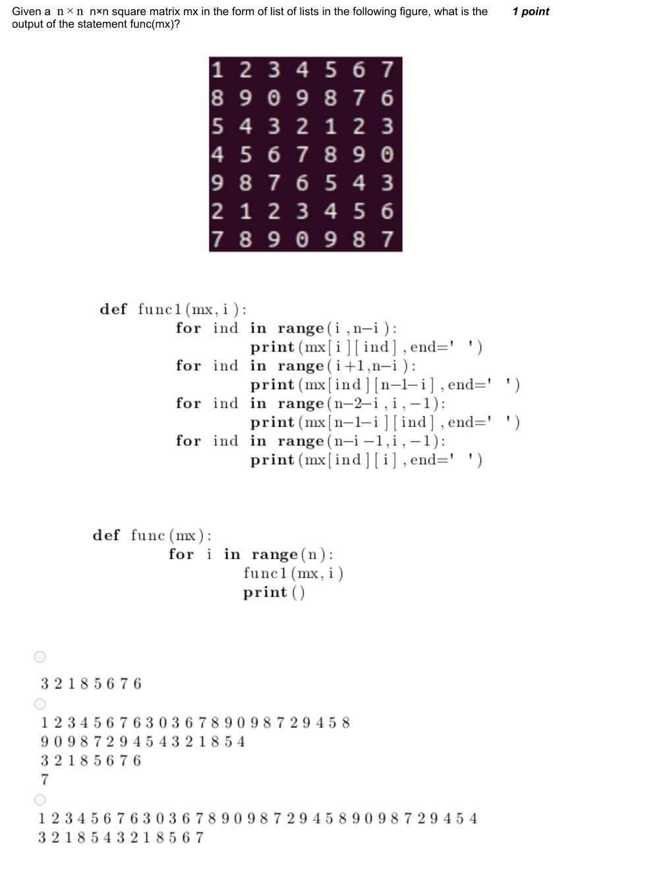

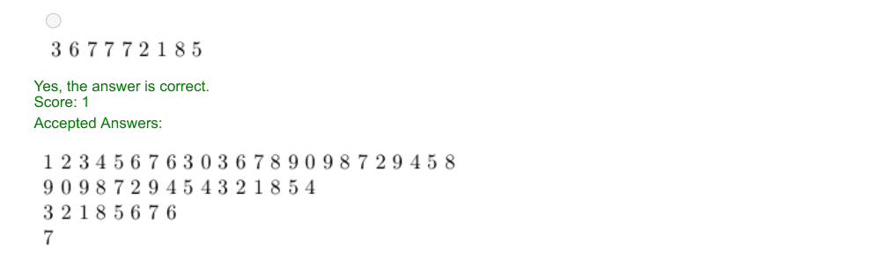

### Q8. How do you create a base map using gmplot package?

- [x] gmap=gmplot.GoogleMapPlotter(cent_lat,cent_long, zoom)
- [ ] gmap=gmplot.GoogleMapPlotter(cent_long,cent_lat, zoom)
- [ ] gmap=gmplot.GoogleMapPlotter(cent_lat,cent_long)
- [ ] gmap=gmplot.GoogleMapPlotter(zoom,cent_lat,cent_long)
> Yes, the answer is correct. Score: 1

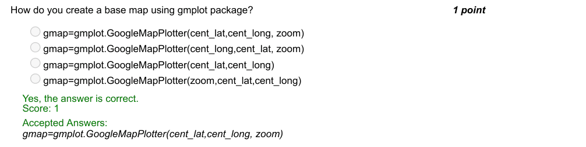

### Q9. Comment on the following code:

- [ ] Red marker is used for initial and final positions
- [ ] Yellow marker is used for the final position only
- [x] Yellow marker is placed for all positions except first position which has a red marker.
- [ ] Red marker is placed for all positions except first position which has a yellow marker
> Yes, the answer is correct. Score: 1

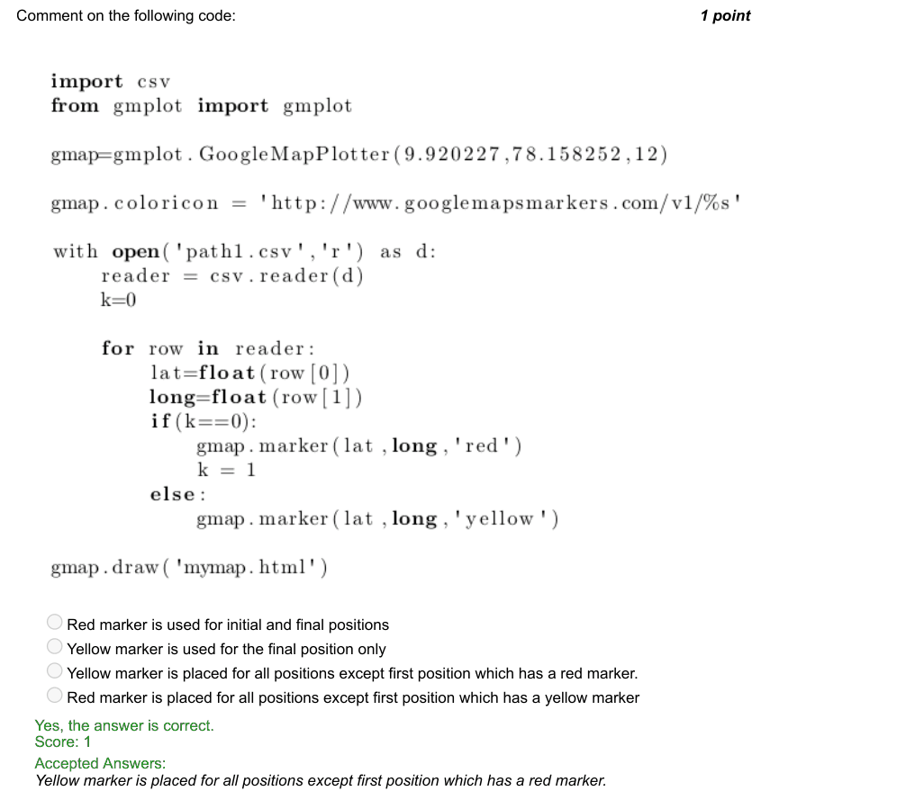

### Q10. How will you download and install packages that are unavailable in conda cloud?

- [x] pip install packagename
- [ ] conda list
- [ ] conda install packagename
- [ ] sudo apt-get install packagename
> Yes, the answer is correct. Score: 1

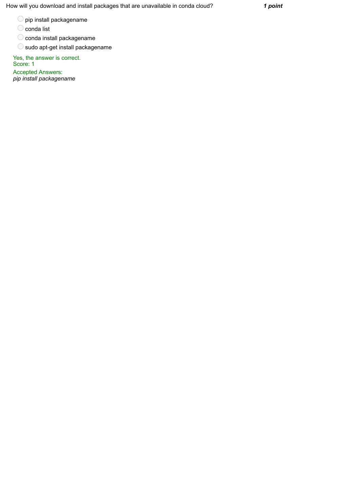
