# JOC Sep-2020 · Week 8: portal print

- Source: `JOC Sep-Dec 2020.pdf` pages 41–44 (portal review printout). Parsed text below; the cropped image under each question is the exact page content (code, figures and ticks as printed) and is authoritative.
- `[x]` = option equal to the portal's **Accepted Answer** (official). Lines may carry stray spaces from the PDF text layer.

> Due on 2020-11-11, 23:59 IST. · Assignment submitted on 2020-11-11, 19:53 IST

### Q1. What is the output of the following snippet?

- [ ] 5
- [x] 10
- [ ] Error, because there is no len() function for Tuple
- [ ] Error, because Tuples are immutable
> Yes, the answer is correct. Score: 1

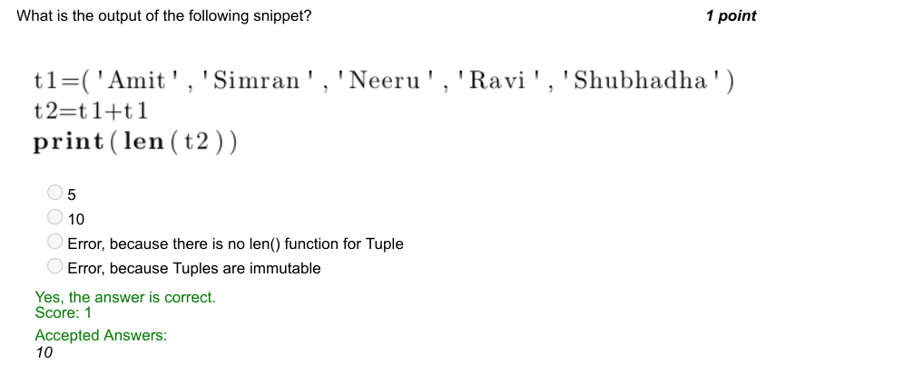

### Q2. Which of the following instruction produces a tuple, Team with ‘Poonam’ as the sixth member?
Given:

- [ ] Team=Team.append(‘Poonam’)
- [ ] Team=Team+tuple(‘Poonam’)
- [ ] Team=Team+(‘Poonam’)
- [x] Team=Team+(‘Poonam’,)
> Yes, the answer is correct. Score: 1

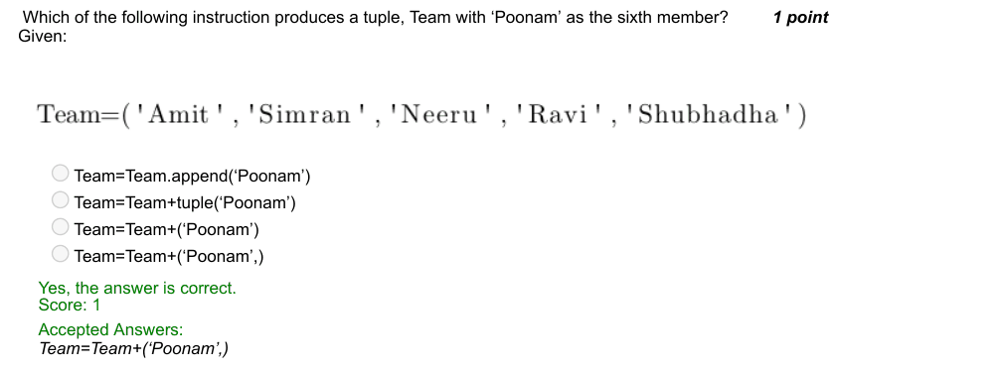

### Q3. Which of the scenarios in the options does the following code represent?

- [ ] A person going to the bar for a year. Daily he guesses a number from 1 to 10. If the guessed
- [ ] number is equal to the number randomly generated by bar authority, he gains one gold coin.
- [ ] A person going to the bar for a month. Daily he guesses a number from 1 to 10. If the guessed
- [ ] number is equal to the number randomly generated by bar authority, he gains one gold coin.
- [ ] A person going to the bar for a year. Daily he guesses a number from 1 to 10. If the guessed
- [ ] number is equal to the number randomly generated by bar authority, he loses one gold coin.
- [ ] A person going to the bar for a month. Daily he guesses a number from 1 to 10. If the guessed
- [ ] number is equal to the number randomly generated by bar authority, he loses one gold coin.
> Accepted answer (not matched to a printed option): A person going to the bar for a year. Daily he guesses a number from 1 to 10. If the guessed number is; equal to the number randomly generated by bar authority, he gains one gold coin.
> Yes, the answer is correct. Score: 1

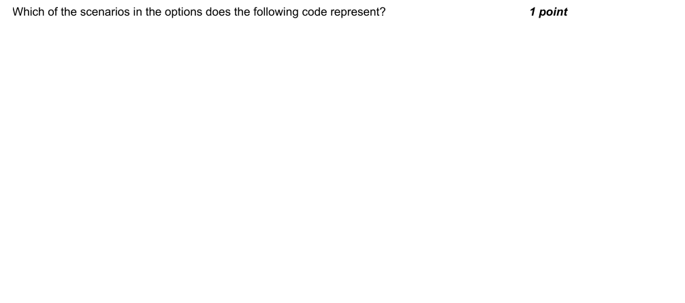

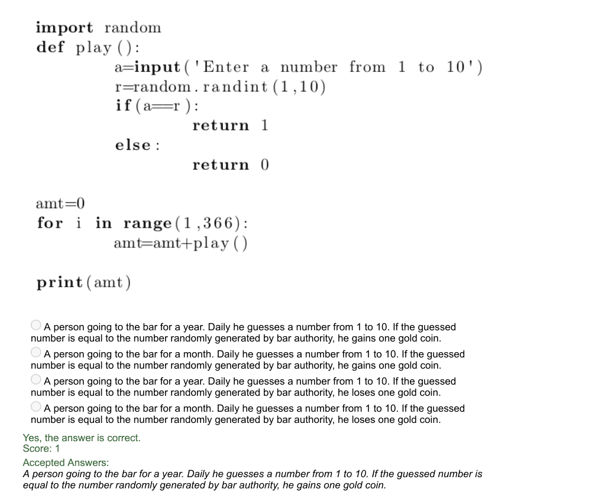

### Q4. Consider the following two codes:

- [x] Probability of winning in Game 1 > Probability of winning in Game 2.
- [ ] Probability of winning in Game 1 < Probability of winning in Game 2.
- [ ] Probability of winning in Game 1 = Probability of winning in Game 2.
- [ ] Can’t say
> No, the answer is incorrect. Score: 0

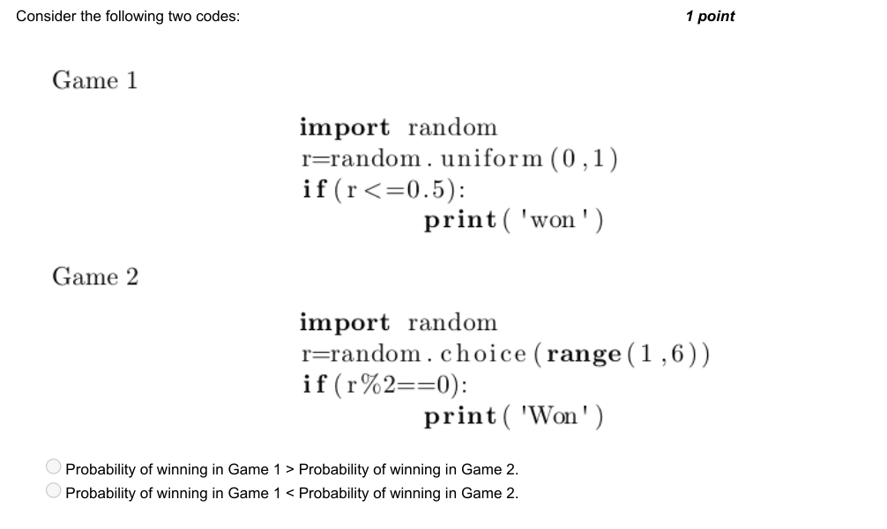

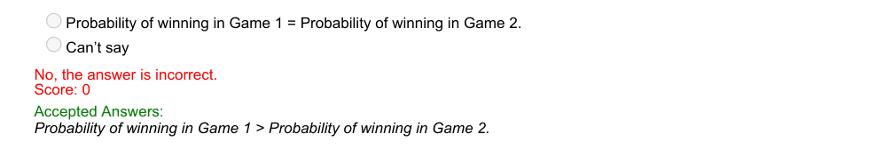

### Q5. Choose the appropriate instruction to retrieve the mirror image of the given image.

- [ ] mirror_image=img.transpose(Image.FLIP_TOP_BOTTOM)
- [ ] mirror_image=img.flip(Image.FLIP_LEFT_RIGHT)
- [x] mirror_image=img.transpose(Image.FLIP_LEFT_RIGHT)
- [ ] mirror_image=img.composite(Image.FLIP_LEFT_RIGHT)
> Yes, the answer is correct. Score: 1

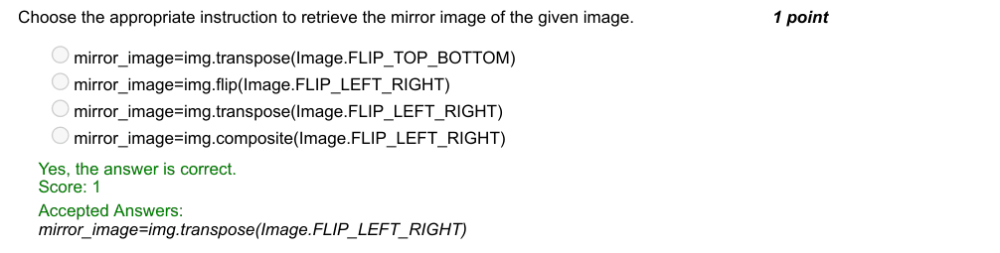

### Q6. Identify the technique that can be used to enhance image in cv2.

- [x] enh_img=clahe.apply(gray)
- [ ] enh_img=canny.apply(gray)
- [ ] enh_img=sobel.apply(gray)
- [ ] enh_img=enhance.apply(gray)
> Yes, the answer is correct. Score: 1

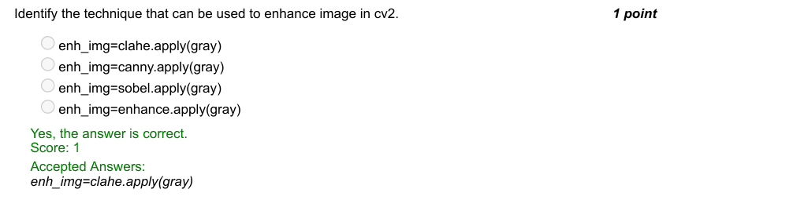

### Q7. Identify the best instruction to debug the following code that checks if the given strings are
Anagrams:

- [ ] if s1.sort()==s2.sort():
- [ ] if s1.sorted()==s2.sorted():
- [x] if sorted(s1)==sorted(s2):
- [ ] if sorted(s1)!=sorted(s2):
> Yes, the answer is correct. Score: 1

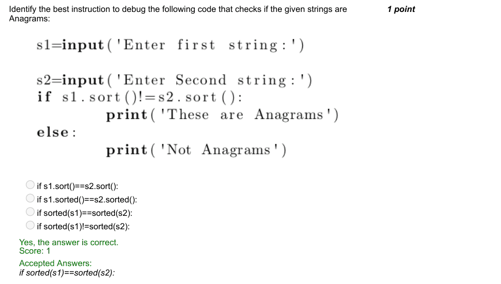

### Q8. Which of the following libraries helps us to find the intensity of emotion in sentiment analysis?

- [ ] vader
- [ ] nltk
- [ ] pandas
- [ ] scipy
> Yes, the answer is correct. Score: 1

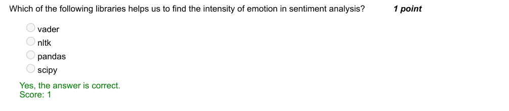

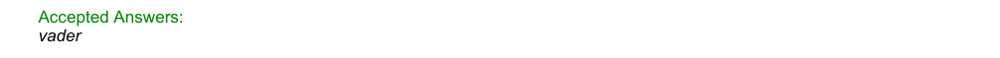

### Q9. The isalpha() function in NLTK

- [ ] returns true if any of the words in a sentence are composed of alphabetic characters and false
- [ ] otherwise
- [x] returns true if all the characters in a word are alphabets and false otherwise
- [ ] returns true if all the characters in a word are alphabets or numerics and false otherwise
- [ ] None of the above
> Yes, the answer is correct. Score: 1

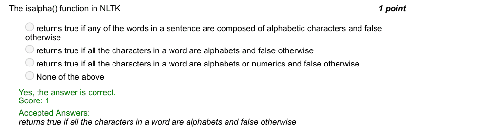

### Q10. Every character, either alphabet or digit or special character has an ASCII value. Choose the
appropriate method to find the ASCII value of ‘f’.

- [ ] ASCII(‘f’)
- [x] ord(‘f’)
- [ ] int(‘f’)
- [ ] ASC_val(‘f’)
> Yes, the answer is correct. Score: 1

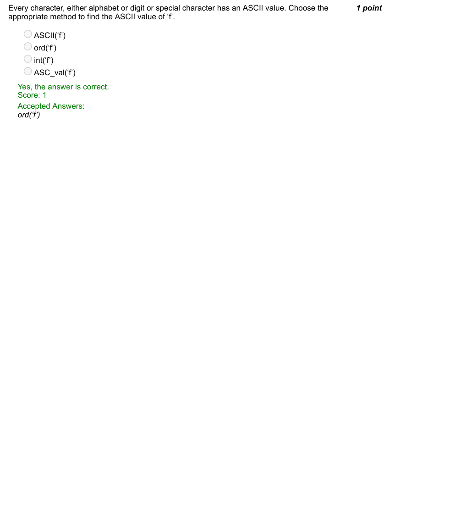
