# JOC Sep-2020 · Week 9: portal print

- Source: `JOC Sep-Dec 2020.pdf` pages 45–47 (portal review printout). Parsed text below; the cropped image under each question is the exact page content (code, figures and ticks as printed) and is authoritative.
- `[x]` = option equal to the portal's **Accepted Answer** (official). Lines may carry stray spaces from the PDF text layer.

> Due on 2020-11-18, 23:59 IST. · Assignment submitted on 2020-11-18, 20:11 IST

### Q1. Which of the following commands is used to draw the following graph?

- [x] G = nx.complete_graph(10)
- [ ] G = nx.complete_graph(9)
- [ ] G = nx.Graph(10)
- [ ] G = nx.Digraph(10)
> Yes, the answer is correct. Score: 1

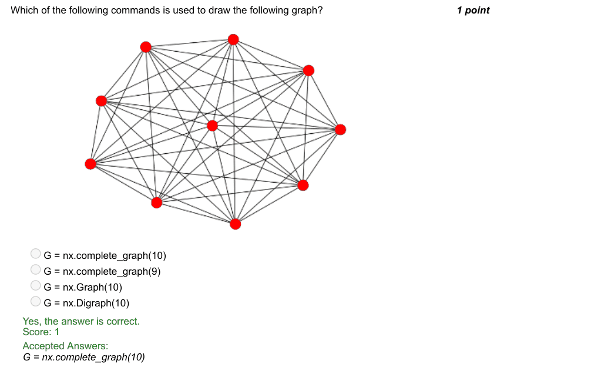

### Q2. Identify the option that best describes the graph output of the following code.

- [ ] A complete graph with 10 nodes
- [ ] A complete graph with 9 nodes
- [x] A connected graph with 10 nodes
- [ ] A connected graph with 9 nodes
> Yes, the answer is correct. Score: 1

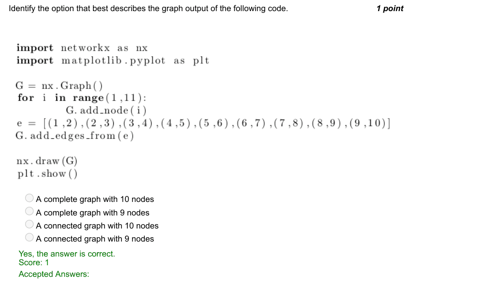

### Q3. How will you convert a graph, g into gexf format?

- [ ] nx.build_gexf(g,‘Friendship.gexf’)
- [ ] nx.create_gexf(g,‘Friendship.gexf’)
- [ ] nx.write(g,‘Friendship.gexf’)
- [x] nx.write_gexf(g,‘Friendship.gexf’)
> Yes, the answer is correct. Score: 1

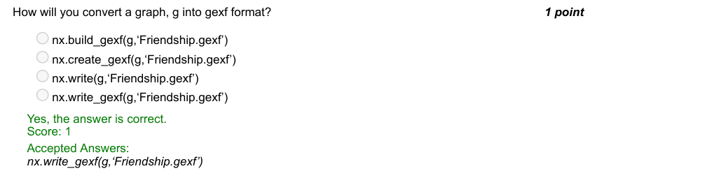

### Q4. What does p and q represent in the following instruction to find the shortest path length?

- [ ] p and q represent to two lists of nodes
- [x] p represents the source node and q represents the target node
- [ ] p represents the target node and q represents source the node
- [ ] p and q represent two paths
> Yes, the answer is correct. Score: 1

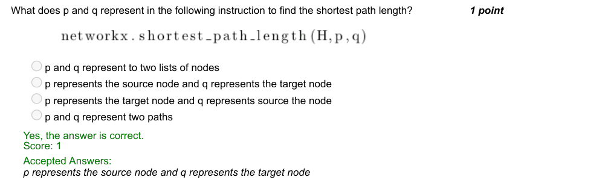

### Q5. Given a newspaper article, the first step to perform text analytics is to break down the paragraph into
smaller chunks of words. Select the instruction that does it for you.

- [x] word_tokenize(text)
- [ ] word_sent(text)
- [ ] text.word_tokenizer()
- [ ] text.sent_tokenizer()
> Yes, the answer is correct. Score: 1

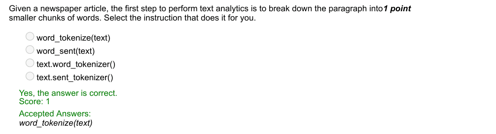

### Q6. Predict the output for the given code:

> Yes, the answer is correct. Score: 1

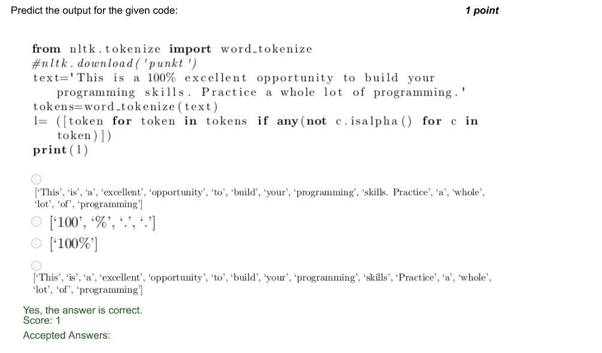

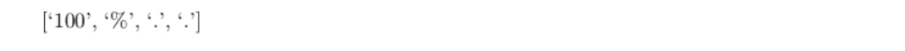

### Q7. Pick out the valid function to find the frequency distribution.

- [x] nltk.FreqDist()
- [ ] nltk.Freq_Dist()
- [ ] nltk.Frequency_Dist()
- [ ] nltk.FDist()
> Yes, the answer is correct. Score: 1

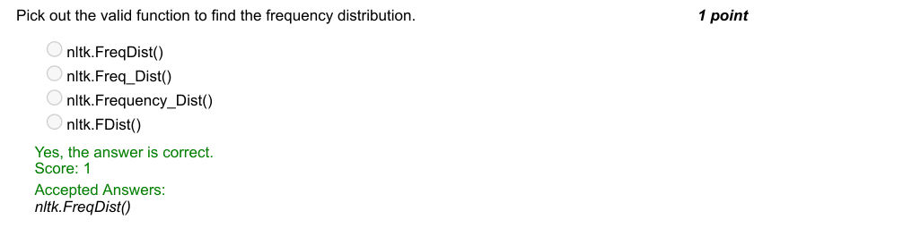

### Q8. Which of the following commands is used to create an image for an array?

- [ ] Image.array(array)
- [x] Image.fromarray(array)
- [ ] Image.imagefromarray(array)
- [ ] Image.imgarray(array)
> Yes, the answer is correct. Score: 1

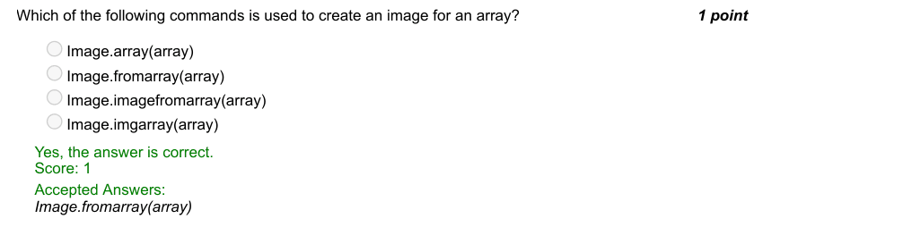

### Q9. What is the output of the following snippet?

- [ ] Image of size 200 x 200 with Red on left and Blue on right
- [ ] Image of size 200 x 3 with Red on top and Blue at the bottom
- [ ] Image of size 200 x 200 with Red on top and Green at the bottom
- [x] Image of size 200 x 200 with Red on top and Blue at the bottom
> Yes, the answer is correct. Score: 1

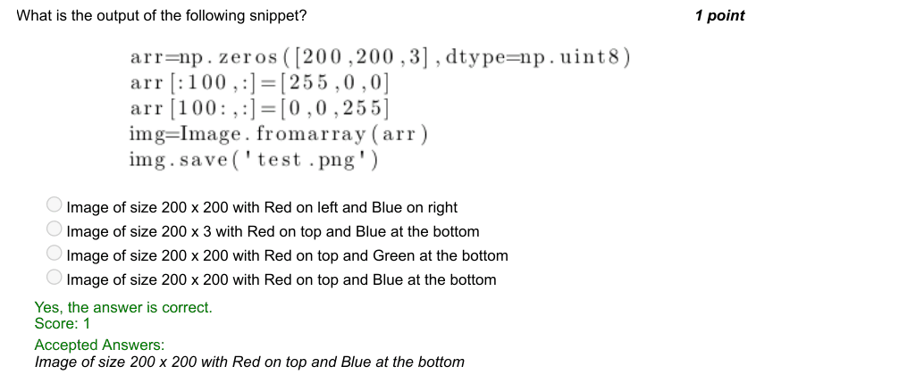

### Q10. Consider the program to estimate the area calcuation of your state. How can you increase the
accuracy of the estimate?

- [x] By increasing the number of iterations the experiment is performed.
- [ ] By decreasing the number of iterations the experiment is performed.
- [ ] By reducing the number of iterations the experiment to one.
- [ ] By increasing the number of iterations to 100.
> Yes, the answer is correct. Score: 1

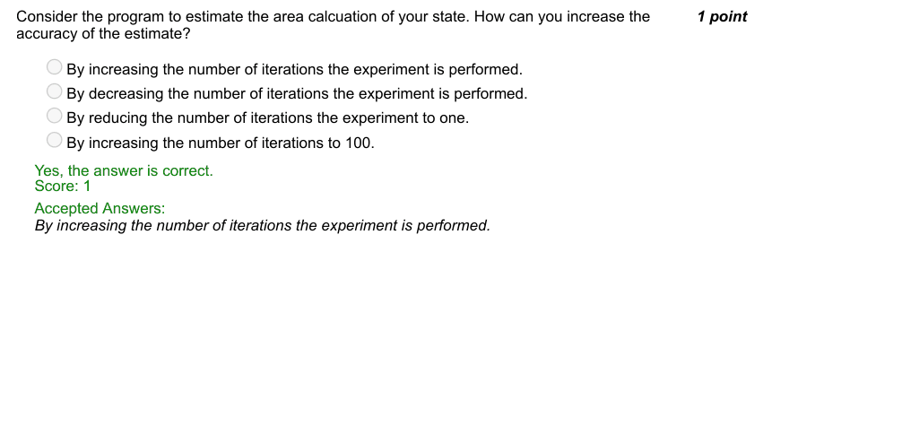
