# JOC Sep-2020 · Week 10: portal print

- Source: `JOC Sep-Dec 2020.pdf` pages 48–52 (portal review printout). Parsed text below; the cropped image under each question is the exact page content (code, figures and ticks as printed) and is authoritative.
- `[x]` = option equal to the portal's **Accepted Answer** (official). Lines may carry stray spaces from the PDF text layer.

> Due on 2020-11-25, 23:59 IST. · Assignment submitted on 2020-11-25, 19:33 IST

### Q1. Which of the following attributes is used to obtain picture size using PIL in Python?

- [ ] len
- [x] size
- [ ] dimension
- [ ] length
> Yes, the answer is correct. Score: 1

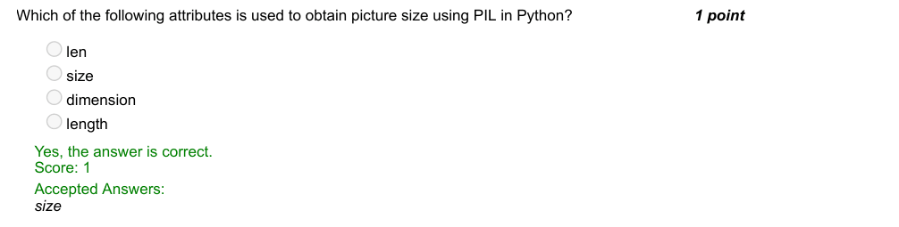

### Q2. Predict the output.

- [ ] 1,4
- [ ] [1, 4, 6, 12]
- [x] [1, 4]
- [ ] [2, 3, 5, 6, 12]
> Yes, the answer is correct. Score: 1

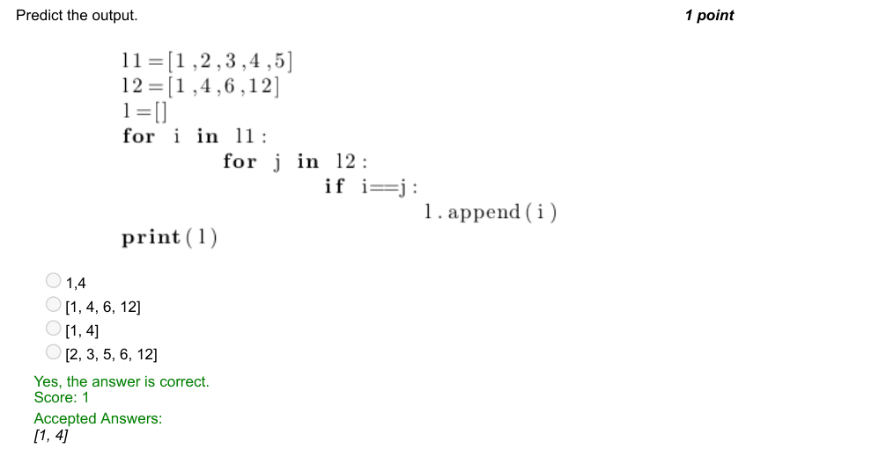

### Q3. What is the output for the following snippet?

> Yes, the answer is correct. Score: 1

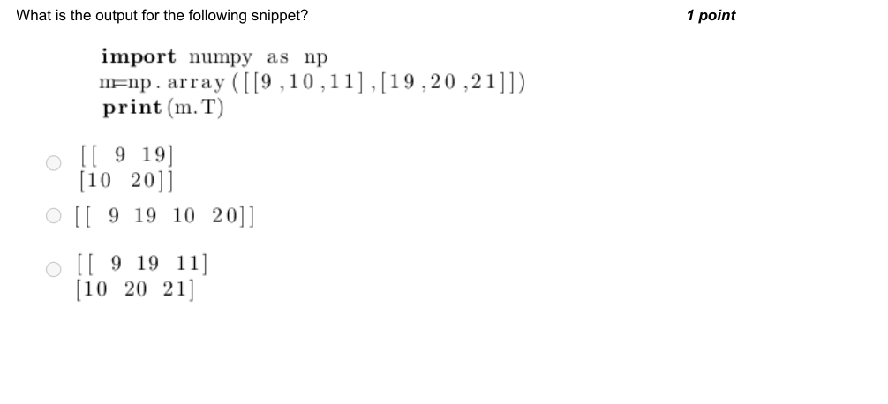

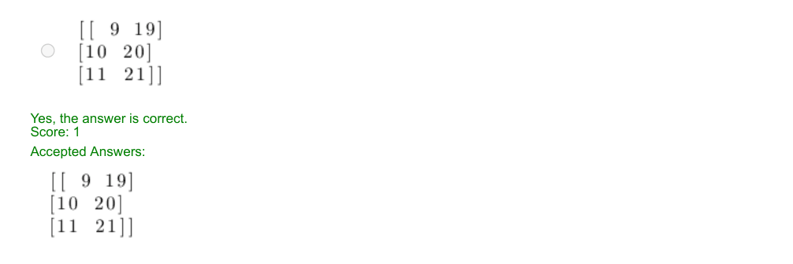

### Q4. What does the following command perform?

- [ ] Chennai and Chennai are same. Chennai and Chennai are same. Chennai=Chennai,
- [ ] Chennai=Chennai
- [ ] Chennai and Chennai are same. Chennai and Chennai are same. Chennai=Madras,
- [ ] Madras=Chennai
- [ ] Madras and Madras are same. Madras and Madras are same. Chennai=Madras, Madras=Chennai
- [ ] Chennai and Chennai are same. Chennai and Chennai are same. Chennai=Chennai,
- [ ] Madras=Chennai
> Accepted answer (not matched to a printed option): Chennai and Chennai are same. Chennai and Chennai are same. Chennai=Madras, Madras=Chennai
> Yes, the answer is correct. Score: 1

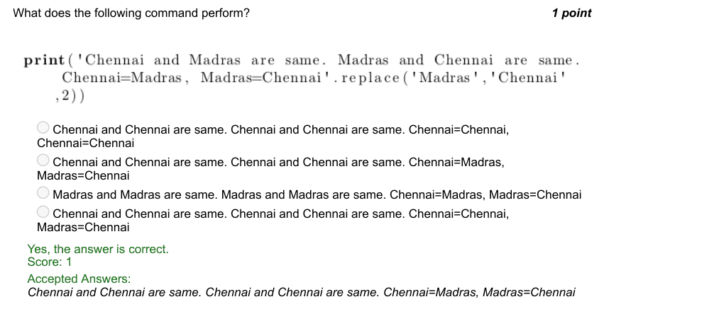

### Q5. Given:
What is the output for the following command?

- [ ] array([5, 7, 9])
- [ ] array([ 6, 15])
- [x] AxisError: axis 2 is out of bounds for array of dimension 2
- [ ] array([15])
> Yes, the answer is correct. Score: 1

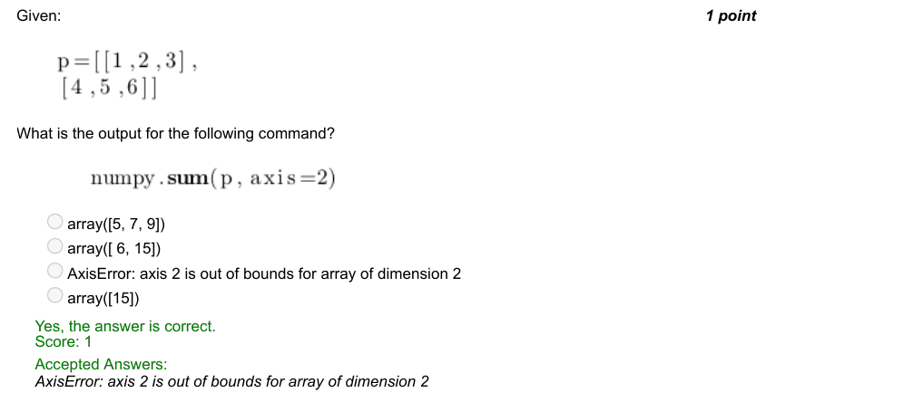

### Q6. Pick out the correct output.

- [ ] numpy . ones ( ( 3 , 3 ) )
> Yes, the answer is correct. Score: 1

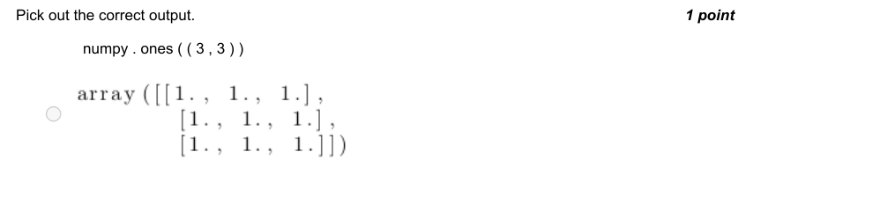

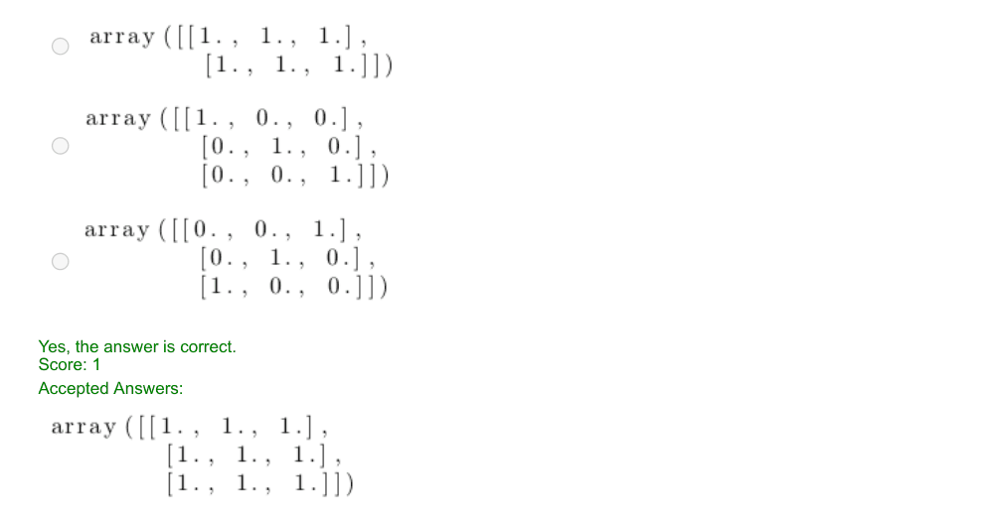

### Q7. How will you create a blank image of the same size and type of a given image?

- [ ] img=Image.new(im.mode,im.shape)
- [x] img=Image.new(im.mode,im.size)
- [ ] img=Image.new(im.type,im.size)
- [ ] img=Image.blank(im.mode,im.size)
> No, the answer is incorrect. Score: 0

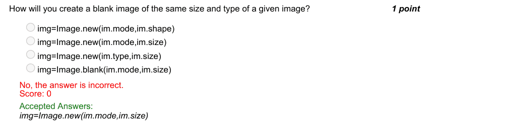

### Q8. Choose the relevant image for test3.png created by the given code.

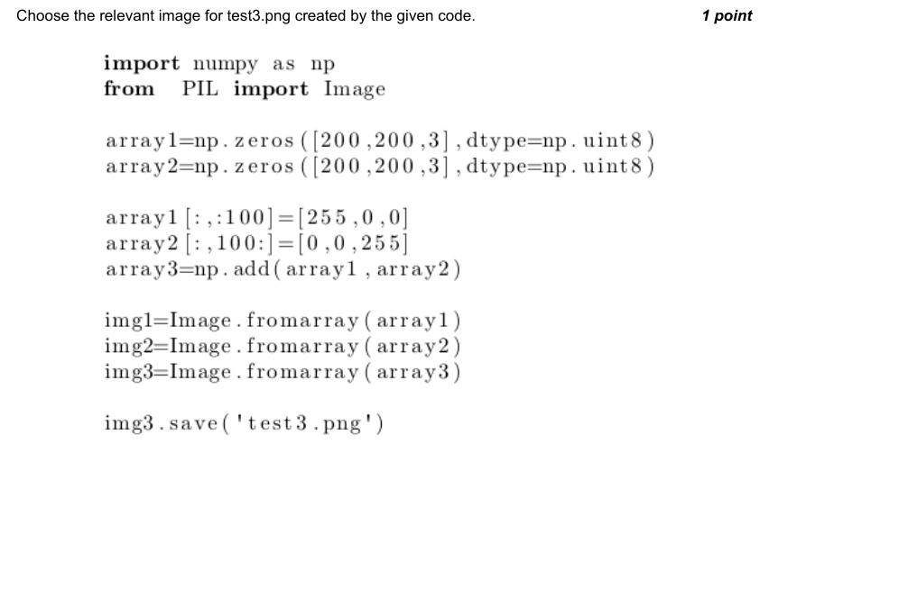

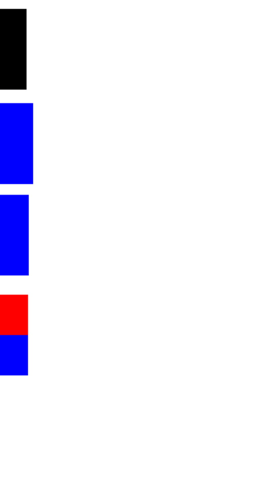

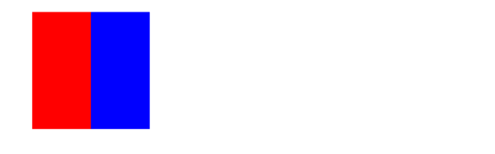

### Q9. Predict the output.

- [x] 13
- [ ] 38
- [ ] 14
- [ ] 39
> Yes, the answer is correct. Score: 1

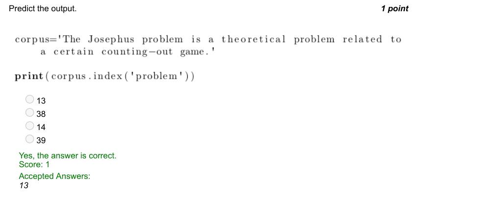

### Q10. Which of the following options is a best description of the output for the following command?

- [ ] 2 x 5 numpy array with random integers from 1 to 5
- [ ] 1 x 5 numpy array with random integers from 2 to 4
- [x] 2 x 5 numpy array with random integers from 1 to 4
- [ ] 1 x 5 numpy array with random integers from 2 to 5
> Yes, the answer is correct. Score: 1

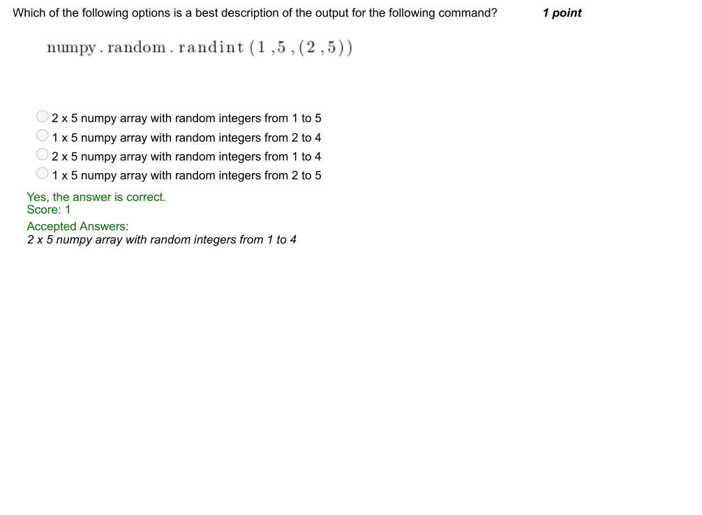
