# JOC Sep-2020 · Week 11: portal print

- Source: `JOC Sep-Dec 2020.pdf` pages 53–55 (portal review printout). Parsed text below; the cropped image under each question is the exact page content (code, figures and ticks as printed) and is authoritative.
- `[x]` = option equal to the portal's **Accepted Answer** (official). Lines may carry stray spaces from the PDF text layer.

> Due on 2020-12-02, 23:59 IST. · Assignment submitted on 2020-11-29, 16:11 IST

### Q1. Which of the following methods cannot be used to identify an element on the web page?

- [ ] find_element_by_id()
- [ ] find_element_by_link_text()
- [ ] find_element_by_class_name()
- [x] send_keys()
> Yes, the answer is correct. Score: 1

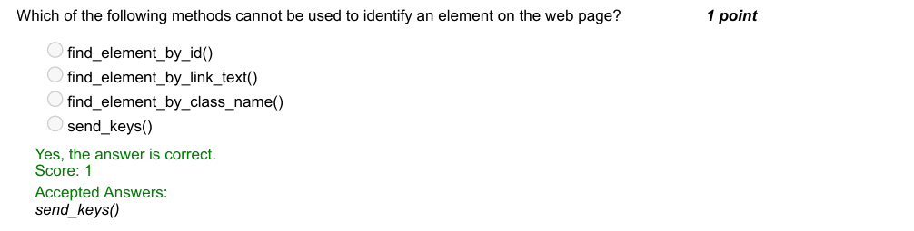

### Q2. Identify the python library required for Browser Automation.

- [x] Selenium
- [ ] Time
- [ ] Webdriver
- [ ] Chromedriver
> Yes, the answer is correct. Score: 1

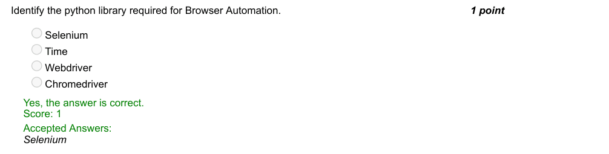

### Q3. Pick out the driver method to open a website in selenium.

- [ ] driver.getwebpage()
- [x] driver.get()
- [ ] driver.request()
- [ ] driver.open()
> Yes, the answer is correct. Score: 1

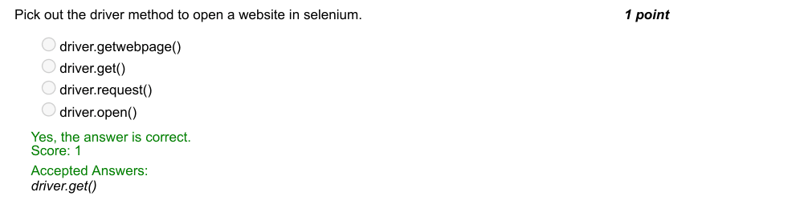

### Q4. What is the purpose of the given command when we request to open a web page?

- [ ] To record login information
- [ ] To check certificate information of the web page
- [x] To give buffer time for the driver in case there is a slow network connection
- [ ] To collect cookies information
> Yes, the answer is correct. Score: 1

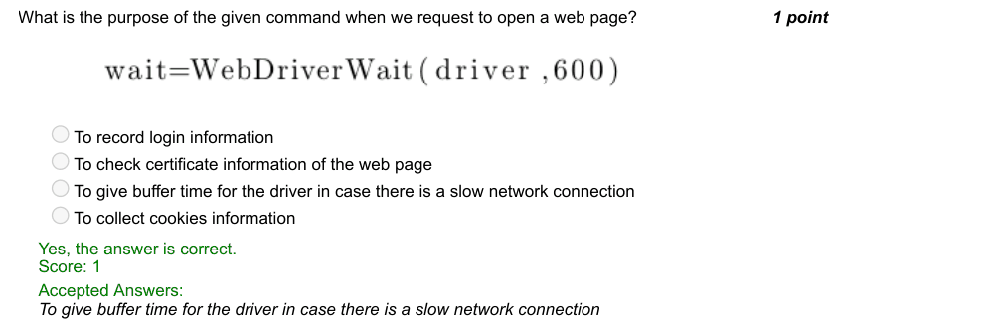

### Q5. In Browser automation, you have identified the login box. Identify the instruction to type your name
and press ENTER.

- [x] login_box.send_keys(name + Keys.ENTER)
- [ ] login_box.press_keys(name + Keys.ENTER)
- [ ] login_box.send_keys(name + ENTER)
- [ ] login_box.hot_key(name + Keys.ENTER)
> Yes, the answer is correct. Score: 1

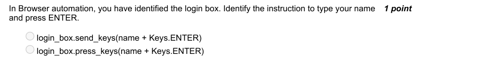

### Q6. Which of the following libraries can be used to print time according to different timezones?

- [ ] datetime
- [ ] date
- [ ] calendar
- [x] pytz
> Yes, the answer is correct. Score: 1

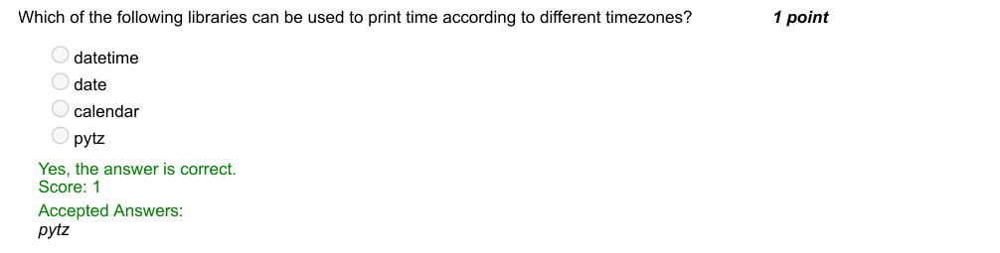

### Q7. How will you find the day of the week, given a date?

> No, the answer is incorrect. Score: 0

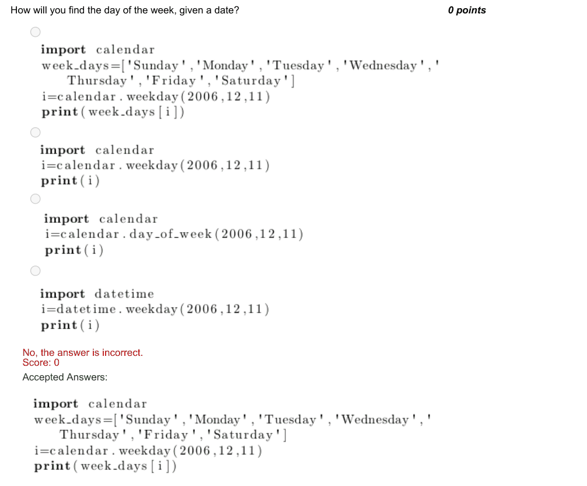

### Q8. Find the output:

- [x] month=10
- [ ] month=11
- [ ] month=23
- [ ] month=2
> Yes, the answer is correct. Score: 1

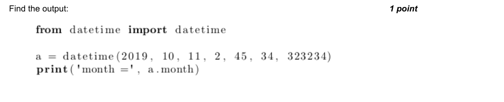

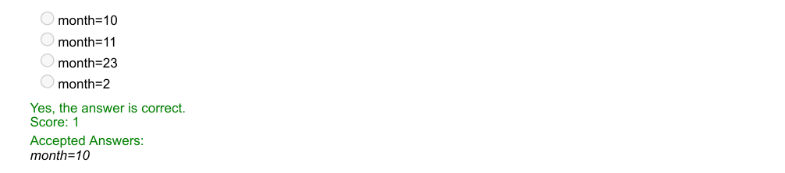

### Q9. What is the last argument for the datetime function in the following command?

- [ ] nanoseconds
- [ ] milliseconds
- [ ] minutes
- [x] microseconds
> Yes, the answer is correct. Score: 0

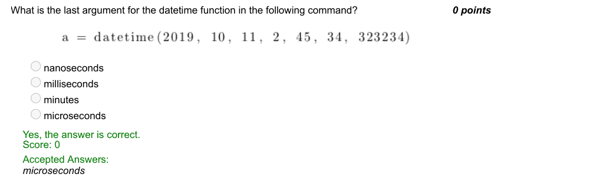

### Q10. How will you retrieve current date using date library?

- [x] date.today()
- [ ] date.now()
- [ ] date.current date()
- [ ] date.date()
> Yes, the answer is correct. Score: 1

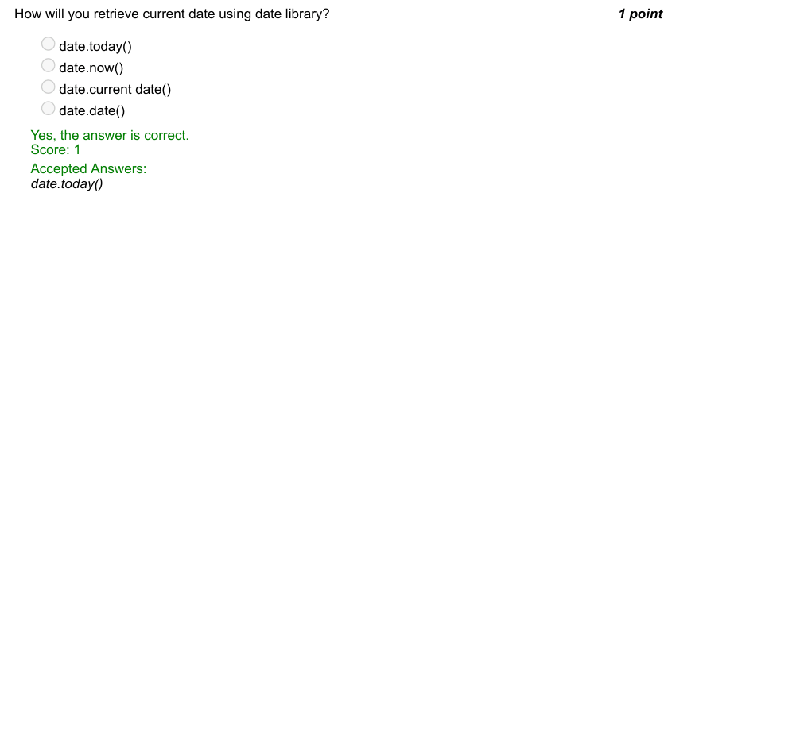
