# JOC Sep-2020 · Week 12: portal print

- Source: `JOC Sep-Dec 2020.pdf` pages 56–60 (portal review printout). Parsed text below; the cropped image under each question is the exact page content (code, figures and ticks as printed) and is authoritative.
- `[x]` = option equal to the portal's **Accepted Answer** (official). Lines may carry stray spaces from the PDF text layer.

> Due on 2020-12-09, 23:59 IST. · Assignment submitted on 2020-12-09, 19:55 IST

### Q1. In a page rank algorithm, after taking an optimum number of random walks in a web graph, what can
you say about the nodes with maximum points?

- [x] These nodes are the most visited
- [ ] These nodes are least visited
- [ ] These nodes have maximum number of in-links
- [ ] These nodes have maximum number of out-links
> Yes, the answer is correct. Score: 1

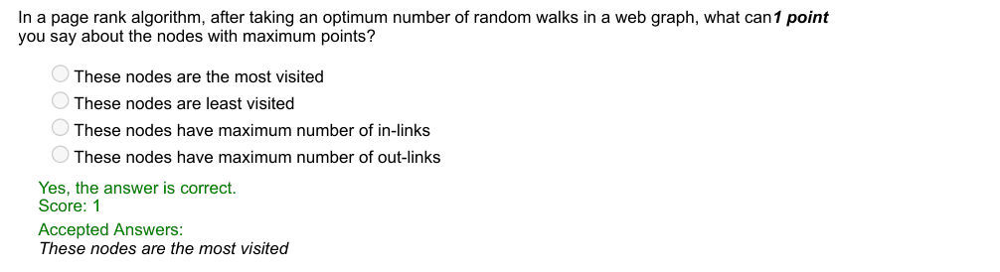

### Q2. Identify the graph created using the following command.

> Yes, the answer is correct. Score: 1

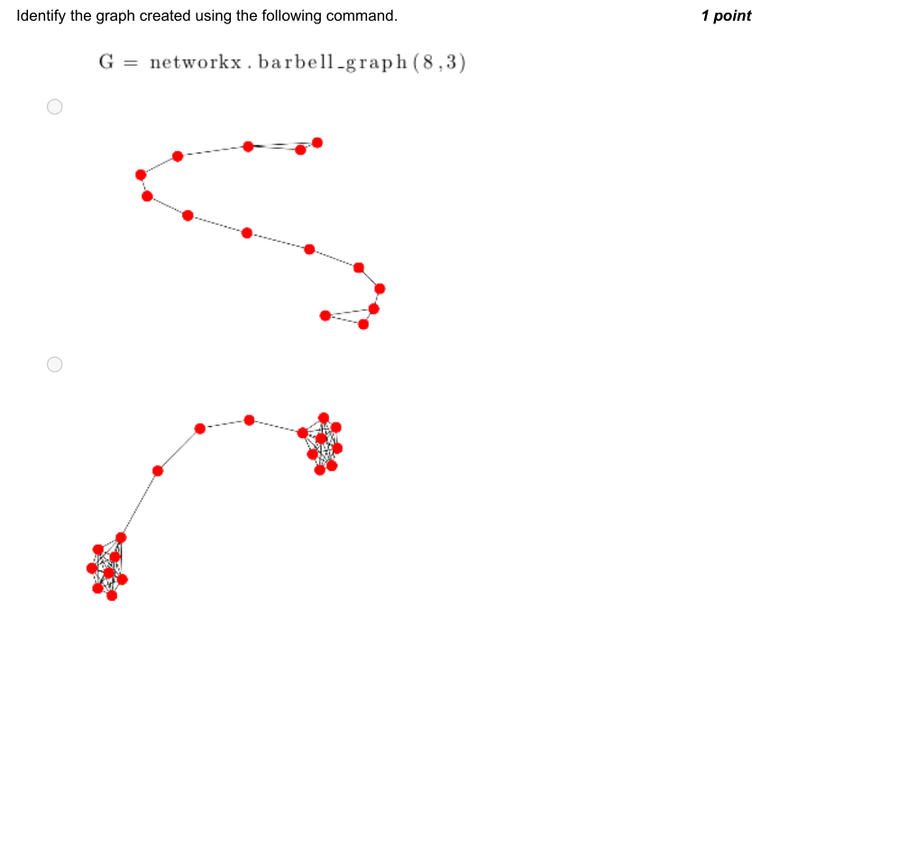

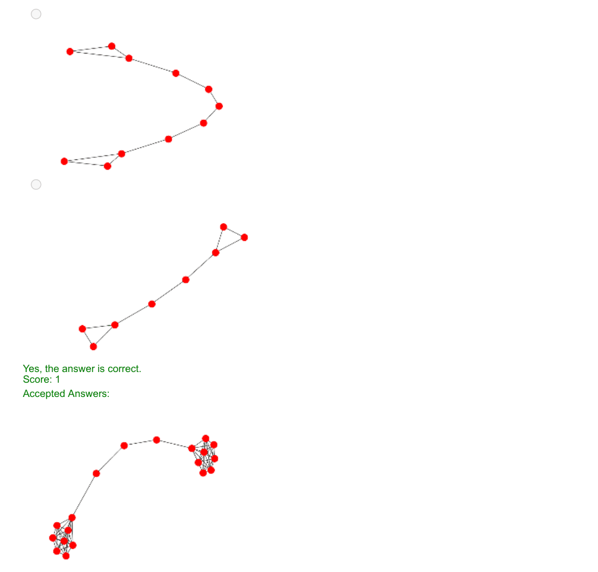

### Q3. Which of the following commands is used to create the graph given below:

- [ ] G = networkx.complete_graph(7)
- [ ] G = networkx.cycle_graph(6)
- [ ] G = networkx.star_graph(6)
- [ ] G = networkx.star_graph(7)
> Yes, the answer is correct. Score: 1

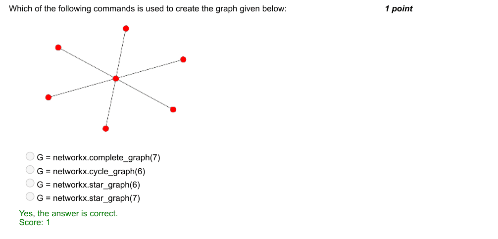

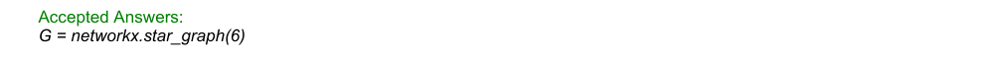

### Q4. Comment on the purpose of the following command.

- [ ] Sort the items of dictionary, p by key
- [x] Sort the items of dictionary, p by values
- [ ] Sort the elements of list, p by values
- [ ] Sort the items of Tuple, p by values
> Yes, the answer is correct. Score: 1

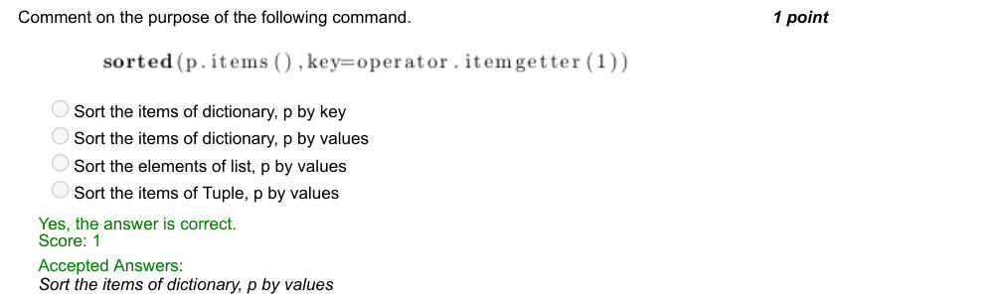

### Q5. Identify the graph that can never be an output of the following code.

> Yes, the answer is correct. Score: 1

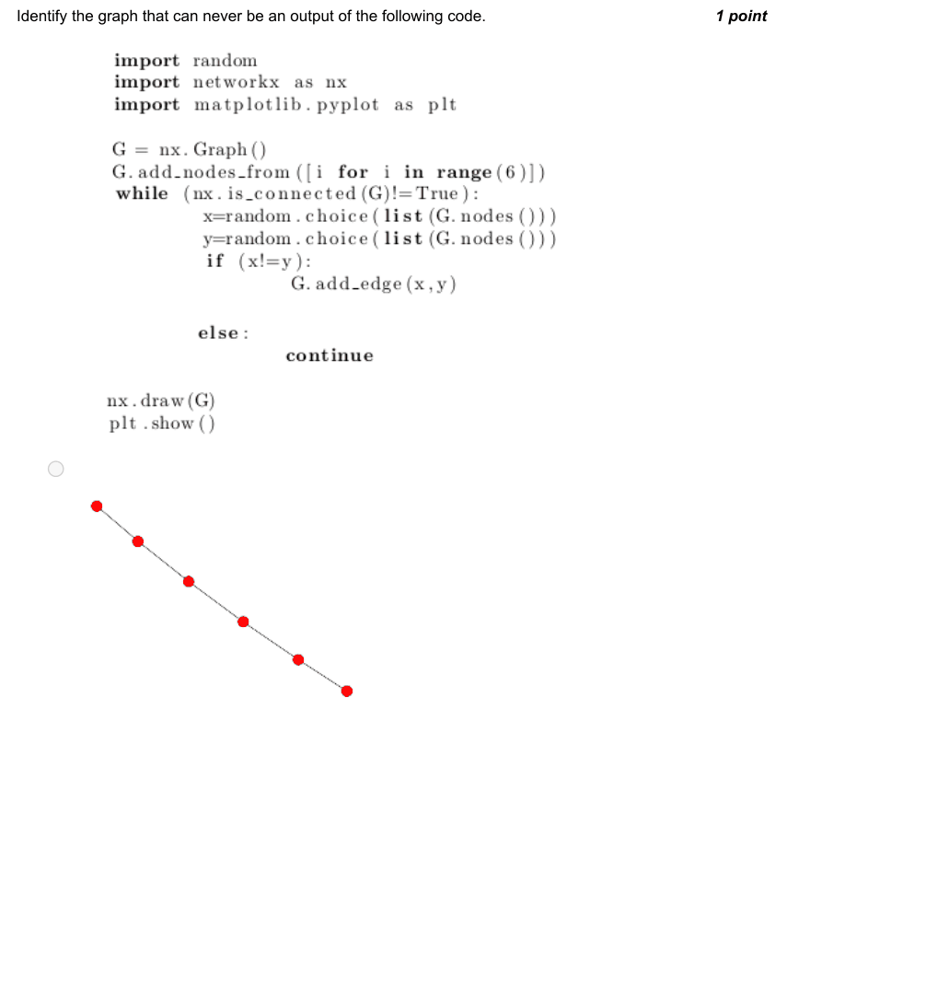

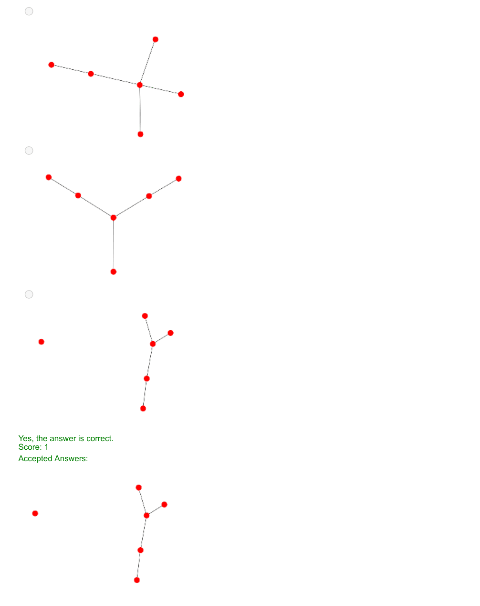

### Q6. Which of the following real world networks represent an undirected graph?

- [ ] Wikigraph
- [ ] Citation network
- [x] Facebook Friendship network
- [ ] World wide web
> Score: 1

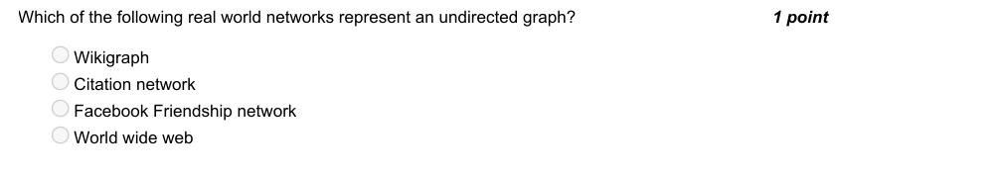

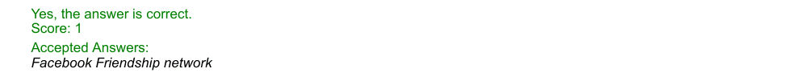

### Q7. What happens to the total Points with every iteration in the Points distribution method?

- [ ] Increases every iteration
- [ ] Decreases for every iteration
- [ ] Increases or decreases depending on the structure of the graph
- [x] Remains constant
> Yes, the answer is correct. Score: 1

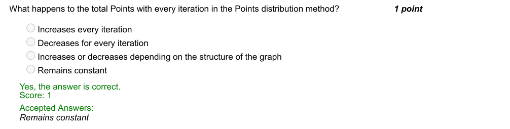

### Q8. How many iterations does the number, 75 take to converge in Collatz Conjecture?

- [x] 14
- [ ] 15
- [ ] 13
- [ ] 12
> No, the answer is incorrect. Score: 0

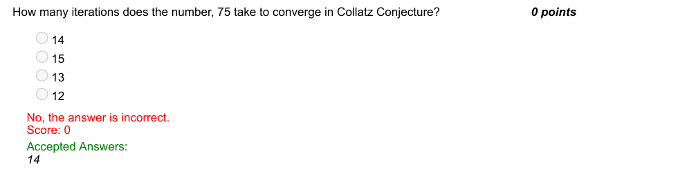

### Q9. Which of the sequence do you obtain by executing 3n+1 algorithm for n = 10?

- [ ] 31, 15, 7, 3, 1
- [x] 5, 16, 8, 4, 2, 1
- [ ] 5, 3, 2, 1
- [ ] doesnot converge
> Yes, the answer is correct. Score: 1

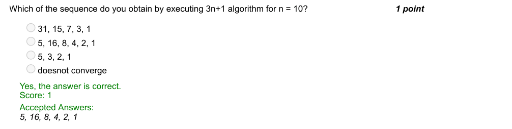

### Q10. How will you choose the next node to traverse in a random walk method of Page Rank algorithm?

- [ ] Choose the node that has not been traversed yet
- [ ] Choose the most weighted out-link
- [x] Randomly choose one of the out-links
- [ ] Choose the least weighted out-link
> Yes, the answer is correct. Score: 1

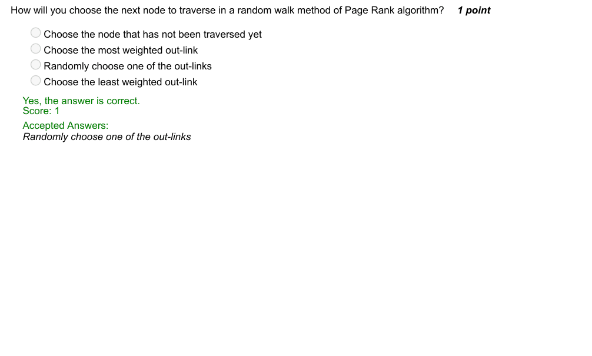
