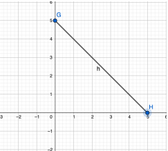
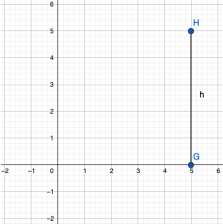
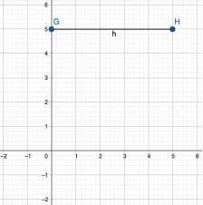
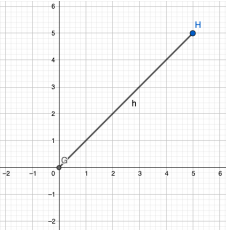
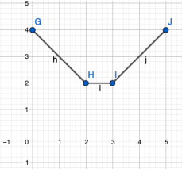
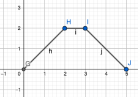
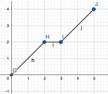
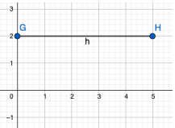

# Week 0 Quiz 💡

**1. What are the prime factors of the number 124**
 - 2,62
 - 2,31 ✅
 - 1,124
 - None of the above

**2. What is the Lowest Common multiple of 5,15**
 - 5
 - 10
 - 15 ✅
 - 20

**3. A car traveled 281 km in 4 hours 41 minutes. What was the average speed of the car in km per minute?**
 - 1 ✅
 - 2
 - 3
 - 4

**4. The length of a rectangle is four times its width. If the area is 100m2 what is the width of the rectangle?**
 - 10
 - 5 ✅
 - 4
 - 6

**5. The length of a rectangle is increased to 2 times its original size and its width is increased to 3 times its original size. If the area of the new rectangle is equal to 1800 square meters, what is the area of the original rectangle?**
 - 1200 square meters
 - Remains same
 - 300 square meters ✅
 - 200 square meters

**6. Water is being pumped out , at a constant rate, from an underground storage tank that has a height 5 Meters. Which of the graphs below best represent the changes in the height of water in the tank as a function of the time (X axis - Time, Y axis - Height)?**

-   ✅

- 

- 

- 
 

**7. Rama drove at a constant speed for 2 hours. He then stopped for an hour to do some shopping and have a rest and then drove back home driving at a constant speed. Which graph best represents the changes in the distance from home as Rama was driving (X axis - Time, Y axis - Distance)?**

- 

-   ✅

- 

- 
 
**8. In a certain college, 40% of a class are taking Physics, 30% are taking calculus and 10% are taking both. If 40 students are enrolled in the class, how many students are taking neither Physics nor calculus?**
 - 12
 - 4
 - 8
 - 16 ✅

**9. The circumference of a circle inscribed inside a square with a side of 20 meters.**
 - 10π
 - 10√2π
 - 20π ✅
 - 20√2π

**10. Two different schools (A and B) have the same number of pupils. The ratio of the boys in school A and the boys in school B is 2:1 and the ratio of the girls in school A and the girls in school B is 4:5. Find the ratio of the boys in school A to the girls in school A.**
 - 1:4
 - 1:5
 - 2:5
 - 1:2 ✅
