# JOC Jan-2021 · Week 1: portal print

- Source: `JOC Jan-Apr 2021 (text PDF).pdf` pages 1–4 (portal review printout). Parsed text below; the cropped image under each question is the exact page content (code, figures and ticks as printed) and is authoritative.
- `[x]` = option equal to the portal's **Accepted Answer** (official). Lines may carry stray spaces from the PDF text layer.

> getpythoncode@gmail.com  · Due on 2021-02-03, 23:59 IST. · Assignment submitted on 2021-01-19, 14:53 IST

### Q1. A function calling itself with a smaller instance is called as_______________

- [x] Recursion
- [ ] Self-calling function
- [ ] Iteration
- [ ] Smaller instance function
> Yes, the answer is correct. Score: 1

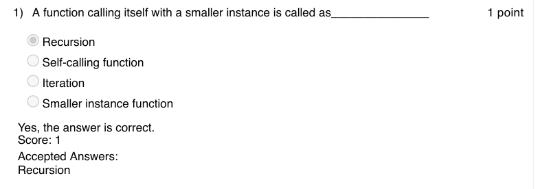

### Q2. __________ option in Scratch is used to wait between the commands

- [ ] Events
- [x] Control
- [ ] Sensing
- [ ] Operators
> Yes, the answer is correct. Score: 1

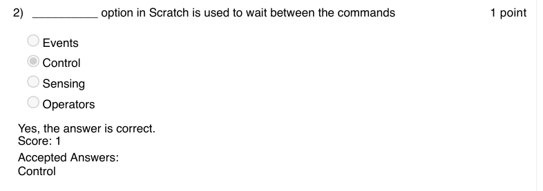

### Q3. Which of the following is the extension for a scratch file?

- [ ] sf
- [ ] sh
- [ ] sc
- [x] sb
> Yes, the answer is correct. Score: 1

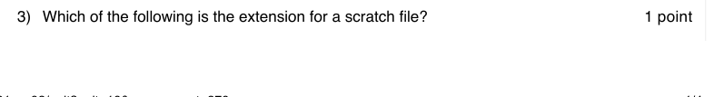

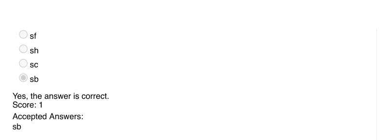

### Q4. The command to make sprite walk by certain steps is

- [ ] walk
- [x] move
- [ ] ahead
- [ ] forward
> Yes, the answer is correct. Score: 1

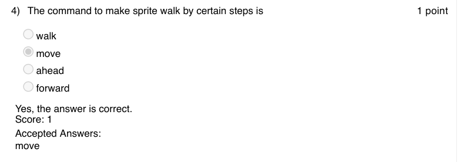

### Q5. What is the action of next-costume command on sprite in Scratch?

- [ ] Changes color of sprite
- [x] Changes style of sprite
- [ ] Moves sprite to different position
- [ ] Shows animation of sprite
> Yes, the answer is correct. Score: 1

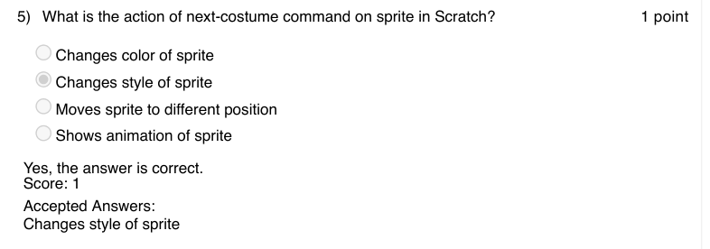

### Q6. What is the output of the following

- [ ] 0
- [ ] 100
- [x] 80
- [ ] 20
> Yes, the answer is correct. Score: 1

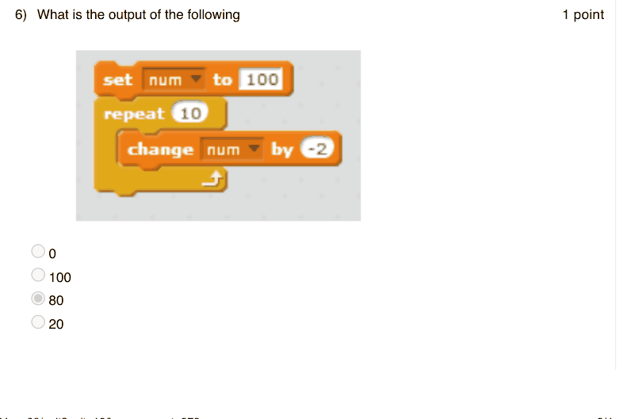

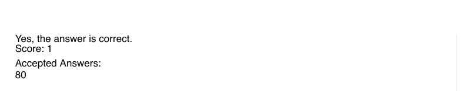

### Q7. Which of the following is not a control command in Scratch?

- [ ] repeat
- [ ] repeat until
- [ ] forever
- [x] forever until
> Yes, the answer is correct. Score: 1

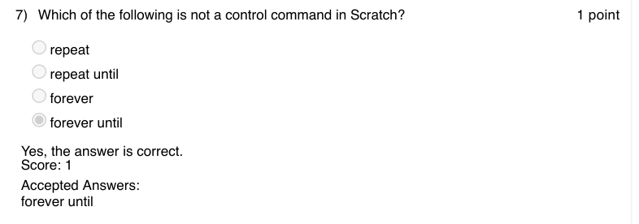

### Q8. What one iteration of the  following block of instructions represent?

- [ ] Sprite going vertically up by 10 steps
- [x] Sprite going backward by 10 steps
- [ ] Sprite going forward by 10
- [ ] Sprite remains in its place
> Yes, the answer is correct. Score: 1

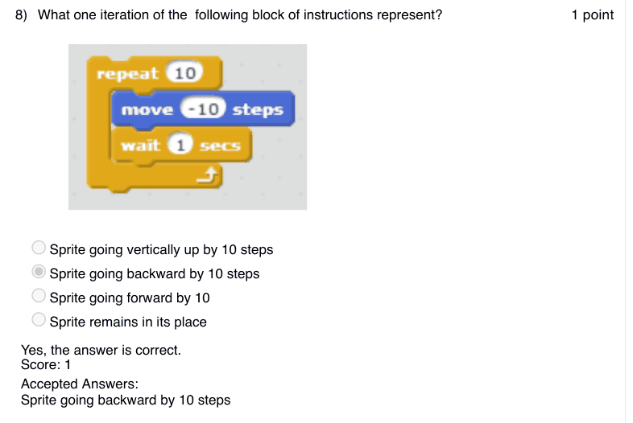

### Q9. The command used to make the Sprite disappear from the animation stage is

- [ ] Show
- [ ] Vanish
- [x] Hide
- [ ] Disappear
> Yes, the answer is correct. Score: 1

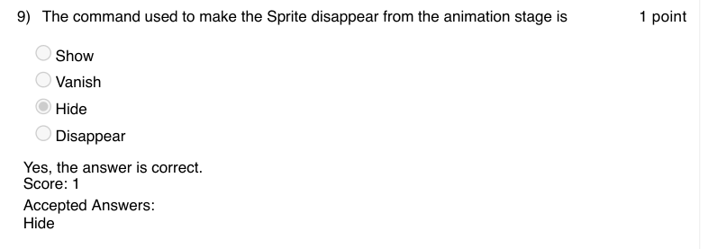

### Q10. What is the output of the following code?

- [x] Multiplication table of 2
- [ ] Power of 2
- [ ] Factorial of x
- [ ] None of the above
> Yes, the answer is correct. Score: 1

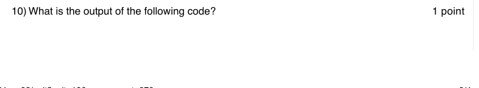

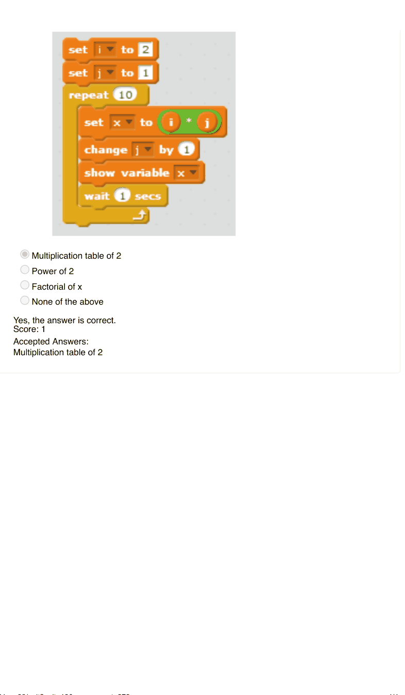
