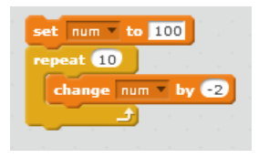
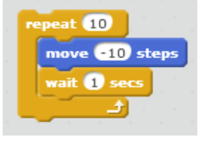
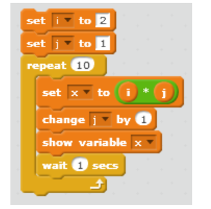

# Week 1 Quiz 💡

**1. A function calling itself with a smaller instance is called as________________**
 - Recursion ✅
 - Self-calling function
 - Iteration
 - Smaller instance function

**2. __________ option in Scratch is used to wait between the commands**
 - Events
 - Control ✅
 - Sensing
 - Operators

**3. Which of the following is the extension for a scratch file?**
 - sf
 - sh
 - sc
 - sb ✅

**4. The command to make sprite walk by certain steps is**
 - walk
 - move ✅
 - ahead
 - forward

**5. What is the action of next-costume command on sprite in Scratch?**
 - Changes color of sprite
 - Changes style of sprite  ✅ 
 - Moves sprite to different position
 - Shows animation of sprite  

**6. What is the output of the following**	

                                                                                                                      
 - 0
 - 100
 - 80 ✅
 - 20

**7. Which of the following is not a control command in Scratch?**
 - repeat
 - repeat until
 - forever
 - forever until ✅

**8. What one iteration of the  following block of instructions represent?**

 - Sprite going vertically up by 10 steps
 - Sprite going backward by 10 steps ✅
 - Sprite going forward by 10
 - Sprite remains in its place

**9. The command used to make the Sprite disappear from the animation stage is**
 - Show
 - Vanish
 - Hide ✅
 - Disappear

**10. What is the output of the following code?**	

 - Multiplication table of 2 ✅
 - Power of 2
 - Factorial of x
 - None of the above
