# JOC Jan-2021 · Week 2: portal print

- Source: `JOC Jan-Apr 2021 (text PDF).pdf` pages 5–8 (portal review printout). Parsed text below; the cropped image under each question is the exact page content (code, figures and ticks as printed) and is authoritative.
- `[x]` = option equal to the portal's **Accepted Answer** (official). Lines may carry stray spaces from the PDF text layer.

> getpythoncode@gmail.com  · Due on 2021-02-07, 23:59 IST. · Assignment submitted on 2021-01-26, 09:39 IST

### Q1. When we save a Python code it will be saved as file name with the extension?

- [ ] .p
- [ ] .pyt
- [ ] .python
- [x] .py
> Yes, the answer is correct. Score: 1

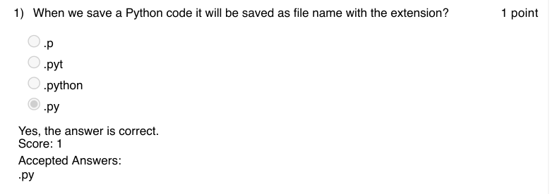

### Q2. You are calculating the simple interest using a python program. How do you get the
interest as an input from the user?

- [x] r=float(input(”Enter the interest rate”))
- [ ] r=int(input(”Enter the interest rate”))
- [ ] r=input(”Enter the interest rate”)
- [ ] None of these
> Yes, the answer is correct. Score: 1

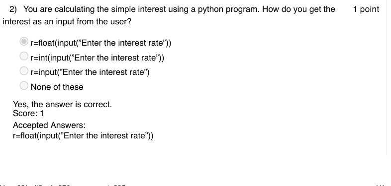

### Q3. Consider that you are developing a 2 player game in python. You have taken the names
of both the users and stored them as variables user1 and user2.
If you want to say Hi to both the users, print their names and welcome them to your game, which of
the following statement(s) will fit to your requirement?

- [x] print(”Hi”+user1+”and”+user2+”Welcome to the game”)
- [x] print(”Hi”,user1,”and”,user2,”Welcome to the game”)
- [ ] print(”Hi”,”user1”,”and”,”user2”,”Welcome to the game”)
- [x] print(”Hi”+user1,”and”,user2+”Welcome to the game”)
> Partially Correct. Score: 0.33

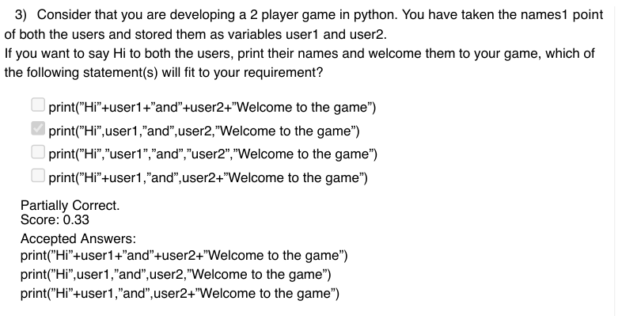

### Q4. What is the output of this code snippet ?

- [x] numbers are equal
- [ ] numbers are not equal
> Yes, the answer is correct. Score: 1

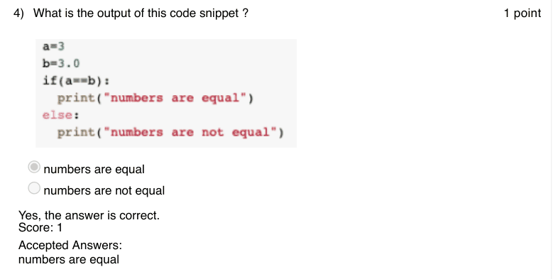

### Q5. What does the following code snippet print?

- [ ] All numbers from 0 to 19
- [ ] Pair of numbers from 0 to 19 whose difference is 2
- [x] All even numbers from 0 to 19
- [ ] All odd numbers from 0 to 19
> Yes, the answer is correct. Score: 1

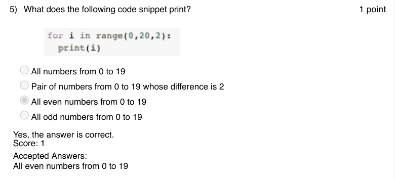

### Q6. What is the output of the code snippet given?

- [ ] 10 100
- [ ] 10 90
- [ ] An error will be generated
- [x] 10 10
> Yes, the answer is correct. Score: 1

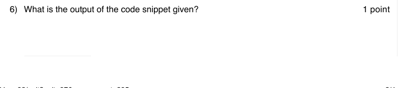

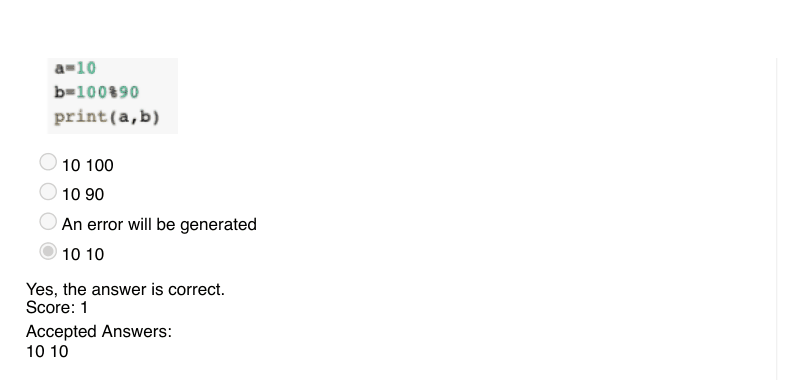

### Q7. Given this code snippet, determine its output?

- [x] 5040
- [ ] 4050
- [ ] 504
- [ ] 405
> Yes, the answer is correct. Score: 1

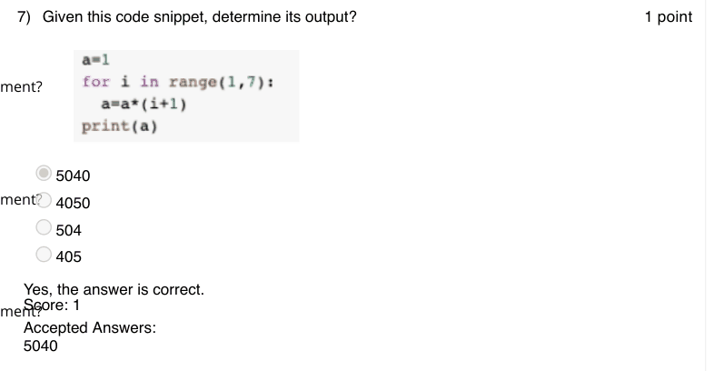

### Q8. Consider the code snippet given, describe its output?

- [ ] Some 7 numbers
- [ ] First 6 natural numbers
- [x] Next 6 Numbers after the input number a
- [ ] Next 7 Numbers after the input number a
> Yes, the answer is correct. Score: 1

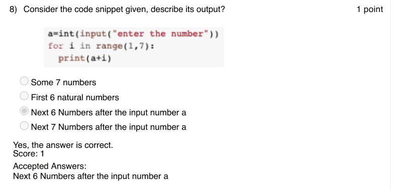

### Q9. Consider the code snippet given, What might be the output of this?

- [x] Decreasing order of natural numbers from 7
- [ ] Decreasing order of natural numbers from 8
- [ ] Increasing order of natural numbers till 7
- [ ] Increasing order of natural numbers till 8
> Yes, the answer is correct. Score: 1

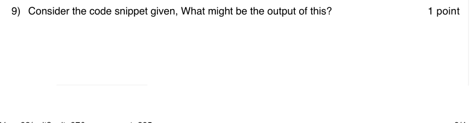

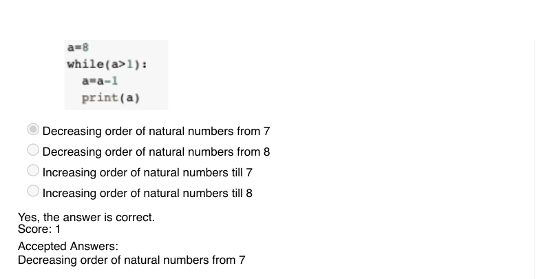

### Q10. Which of the following is not a valid variable name?

- [x] var-1
- [ ] var1
- [ ] Var1
- [ ] var 1
> No, the answer is incorrect. Score: 0

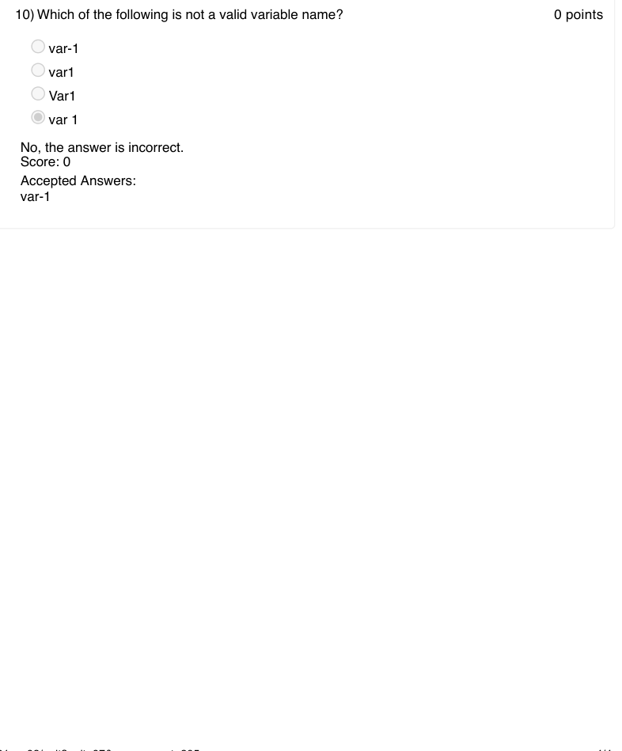
