# JOC Jan-2021 · Week 3: portal print

- Source: `JOC Jan-Apr 2021 (text PDF).pdf` pages 9–12 (portal review printout). Parsed text below; the cropped image under each question is the exact page content (code, figures and ticks as printed) and is authoritative.
- `[x]` = option equal to the portal's **Accepted Answer** (official). Lines may carry stray spaces from the PDF text layer.

> getpythoncode@gmail.com  · Due on 2021-02-10, 23:59 IST. · Assignment submitted on 2021-02-03, 18:59 IST

### Q1. What is the output of the following code?

> Yes, the answer is correct. Score: 1

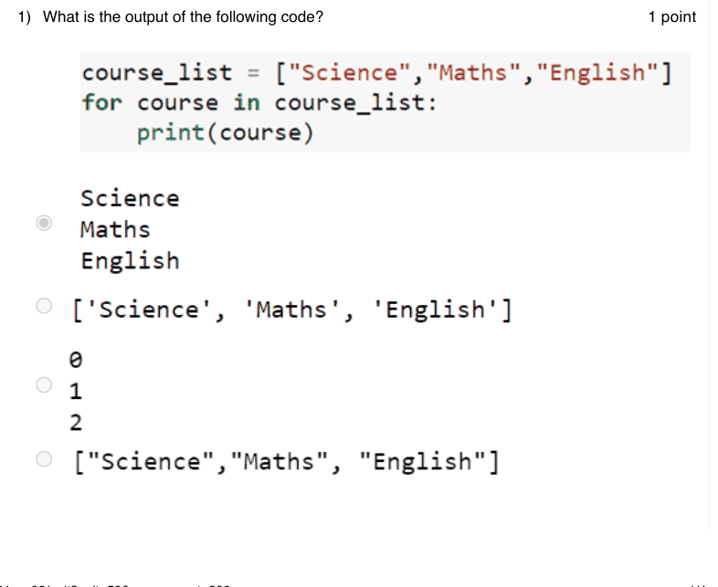

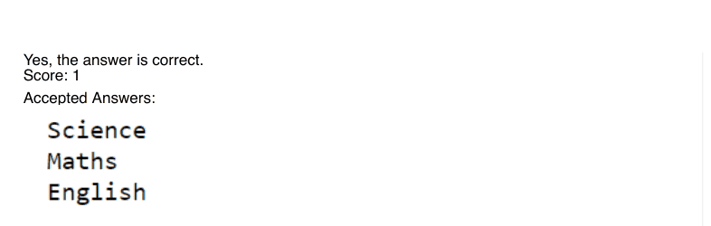

### Q2. Consider the list L= [0, 1, 1, 2, 3, 5, 8, 13, 21, 34].What will be output of the statement L
[3:6]?

- [x] [2, 3, 5]
- [ ] [0, 1, 1]
- [ ] [1, 2, 3]
- [ ] none
> Yes, the answer is correct. Score: 1

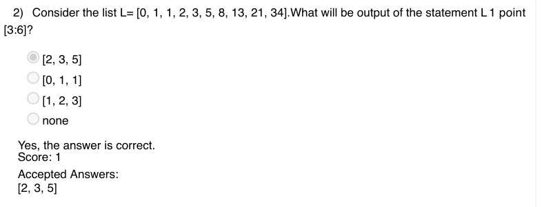

### Q3. Which of the following is the method to insert an item into a specified position in a list?

- [ ] Append
- [x] Insert
- [ ] Add
- [ ] InsertAt
> Yes, the answer is correct. Score: 1

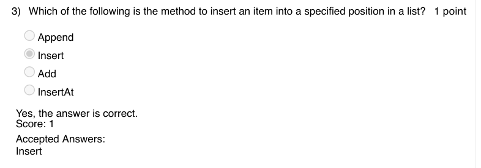

### Q4. __________ method returns the number of occurrences of an element in a list.

- [ ] NumberOf
- [ ] Total
- [x] Count
- [ ] Length
> Yes, the answer is correct. Score: 1

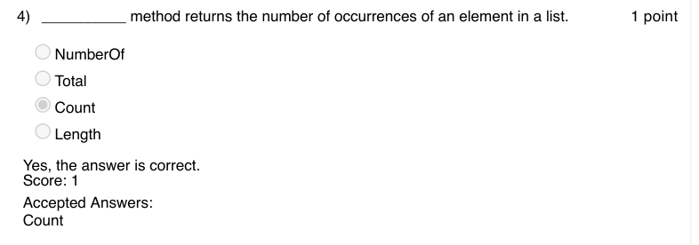

### Q5. In the game FizzBuzz, what should be the output for the number 510?

- [ ] Fizz
- [ ] Buzz
- [x] FizzBuzz
- [ ] Either A or B
> Yes, the answer is correct. Score: 1

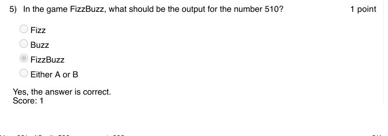

### Q6. Which of the following trims the list L by 10%
Stats.trim_mean(L, 10)
Stats.trim_mean(L, 0.1)
Stats.trim_mean(L, -10)
Stats.trim_mean(L, -0.1)

Accepted answer(s): Stats.trim_mean(L, 0.1)
> Yes, the answer is correct. Score: 1

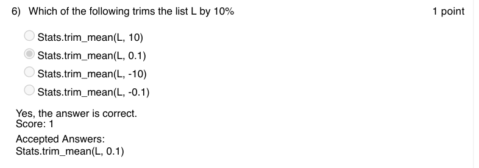

### Q7. Which of the following code is invalid?

- [x] import matplotlib.pyplot as plt
- [ ] plt.plot([1,2,3,4],[1,3,6,9],'b+')
- [x] import matplotlib.pyplot as plt
- [ ] plt.plot([1,2,3,4],[1,3,6,9],'b++') import matplotlib.pyplot as plt plt.plot([1,2,3,4],[1,3,6,9],'b*')
- [x] import matplotlib.pyplot as plt
- [ ] plt.plot([1,2,3,4],[1,3,6,9],'b--')
> Yes, the answer is correct. Score: 1

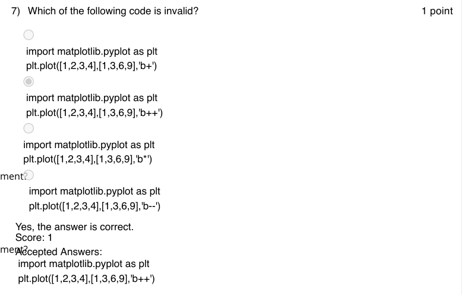

### Q8. In how many different ways can you arrange the letters in the word COMP?
24
4
6
20

Accepted answer(s): 24
> Yes, the answer is correct. Score: 1

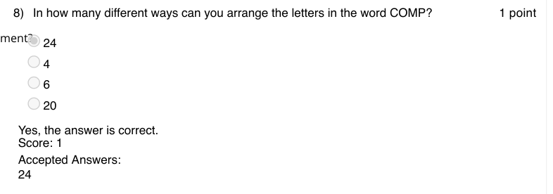

### Q9. The method open(“file1.txt”, r+) opens the file file1.txt in
Read mode
Write mode
Read write mode
Append mode

Accepted answer(s): Read write mode
> Yes, the answer is correct. Score: 1

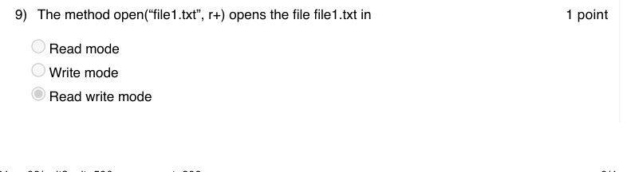

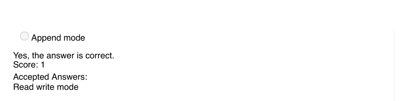

### Q10. The function random.randint(1,100) in python generates

- [x] A random integer between 1 to 100 with 1 and 100 both inclusive
- [ ] A random integer between 1 to 100 with 1 and 100 both exclusive
- [ ] A random integer between 1 to 100 with only 100 inclusive
- [ ] None of the above
> Yes, the answer is correct. Score: 1

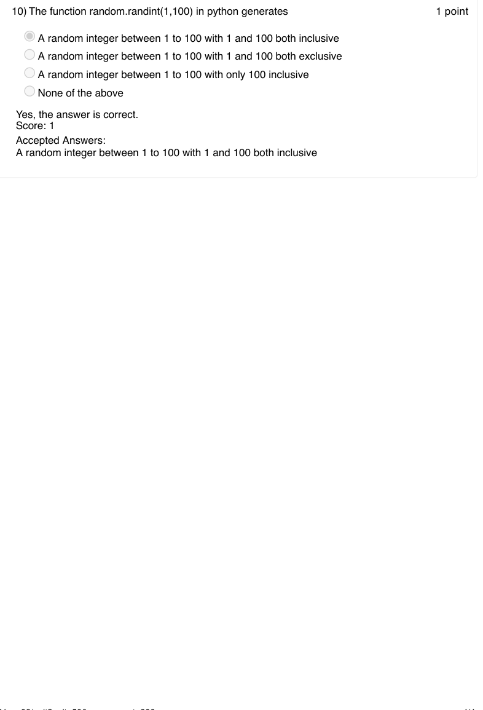
