# JOC Jan-2021 · Week 4: portal print

- Source: `JOC Jan-Apr 2021 (text PDF).pdf` pages 13–17 (portal review printout). Parsed text below; the cropped image under each question is the exact page content (code, figures and ticks as printed) and is authoritative.
- `[x]` = option equal to the portal's **Accepted Answer** (official). Lines may carry stray spaces from the PDF text layer.

> getpythoncode@gmail.com  · Due on 2021-02-17, 23:59 IST. · Assignment submitted on 2021-02-14, 22:54 IST

### Q1. A magic square is an n ×n matrix in which

- [ ] Sum of numbers in each row is same
- [ ] Sum of numbers in each column is same
- [ ] Sum of numbers in each diagonal is same
- [x] All of the above
> Yes, the answer is correct. Score: 1

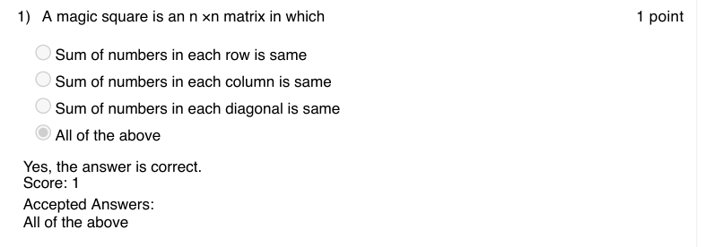

### Q2. For any magic square of n × n, the magic number M is given by

- [x] n (n^2 + 1) / 2
- [ ] n (n + 1) / 2
- [ ] (n^2 + 1) / 2
- [ ] (n + 1) / 2
> Yes, the answer is correct. Score: 1

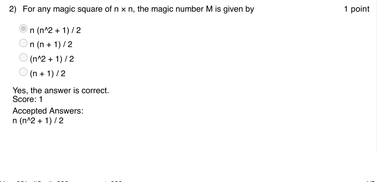

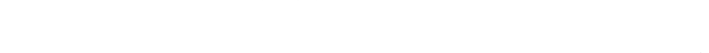

### Q3. Assuming that num is always a 2-digit number, what is the output of the following code?

- [x] Prints the number if the sum of squares of its digits is the number itself
- [ ] Prints the number if the sum its digits is the number itself
- [ ] Prints the number if the product of its digits is the number itself
- [ ] Prints nothing
> No, the answer is incorrect. Score: 0

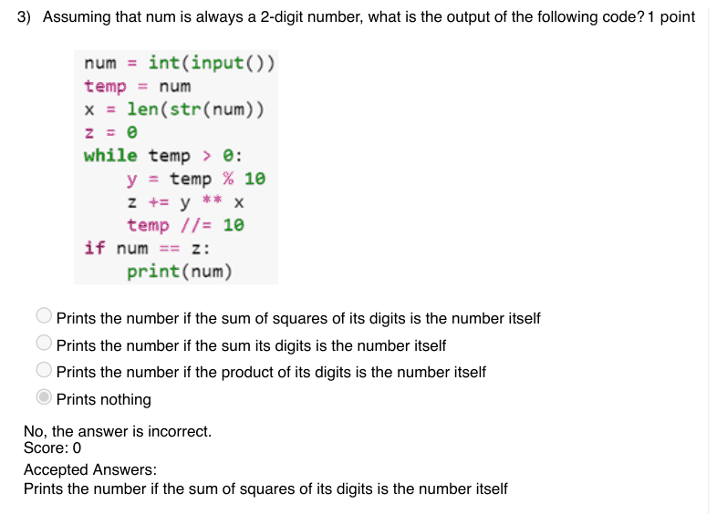

### Q4. In a double game each pair of cards will have

- [ ] Only two symbols in common
- [x] Only one symbol in common
- [ ] All symbols in common
- [ ] No symbols in common
> Yes, the answer is correct. Score: 1

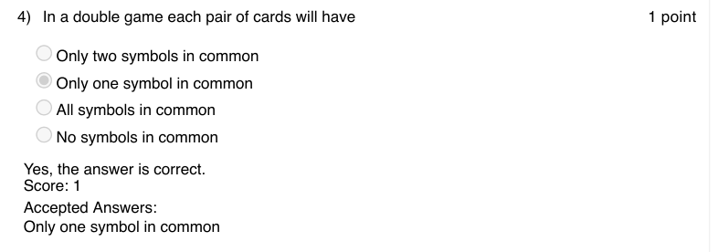

### Q5. The minimum number of people required to guarantee that at least two people will have
their birthdays falling on the same day of a
non-leap year is

- [ ] 365
- [ ] 364
- [x] 366
- [ ] 367
> Yes, the answer is correct. Score: 1

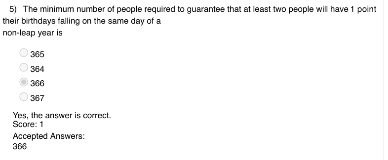

### Q6. What does the following code snippet in python compute?

- [ ] num = int(input())
- [ ] for i in range(1, 11):
- [ ] print(num*i)
- [ ] Factorial of num
- [x] Multiplication table of num
- [ ] Powers of num
- [ ] None
> Yes, the answer is correct. Score: 1

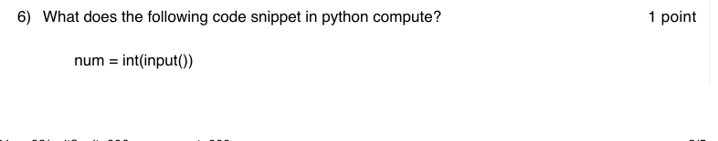

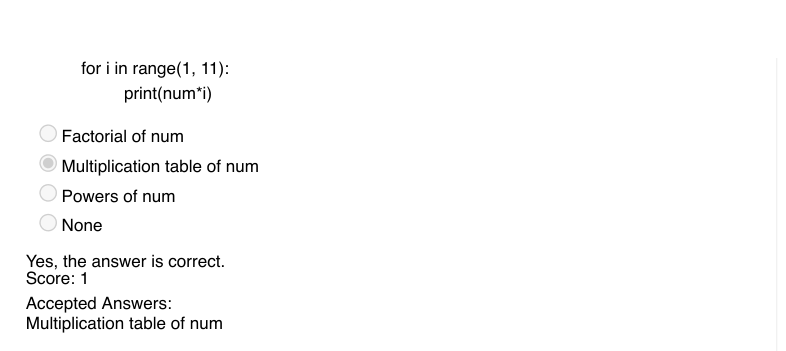

### Q7. Which of the following will print all prime numbers in an interval?

> Yes, the answer is correct. Score: 1

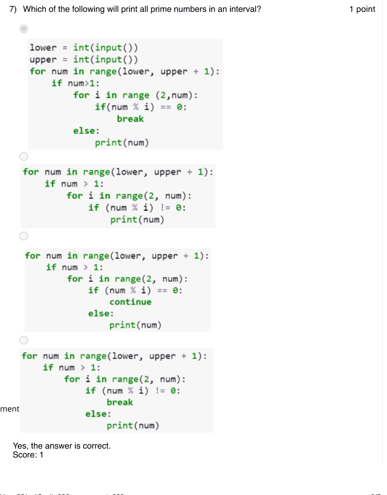

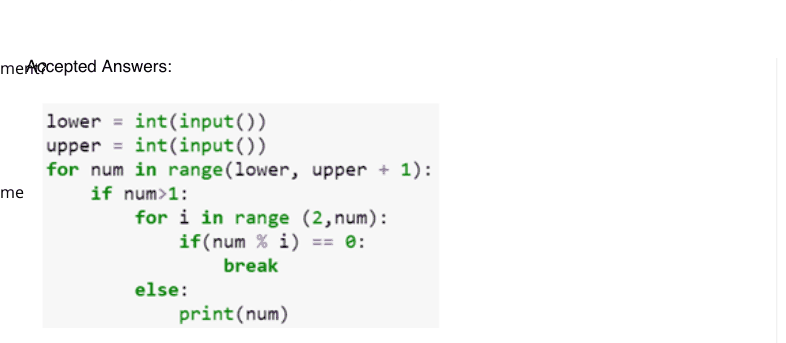

### Q8. Which of the following method in python choses a movie from the list of movie names
given below?
movies =["zindagi" , " chinatown " , "darr" , " 3idiots " , "sixthsense" , "speed" , "avtaar"]

- [ ] random.random(movies)
- [x] random.choice(movies)
- [ ] random.select(movies)
- [ ] All of the above
> Yes, the answer is correct. Score: 1

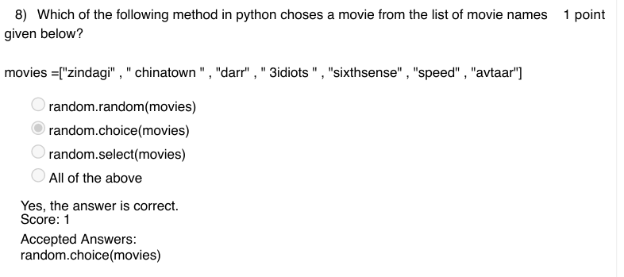

### Q9. In “Guess the Movie Name” game, at-most how many guesses do you need to make
for a five lettered movie name with all distinct letters in it?

- [x] 53,130
- [ ] 6,37,5600
- [ ] 120
- [ ] 5
> No, the answer is incorrect. Score: 0

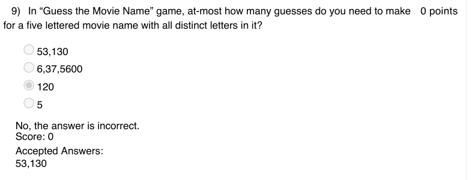

### Q10. In “Guess the movie name” game, if the player asks to open up a letter that is not
present in the actual movie name then the closest letter that precedes this requested letter in the
alphabetical order and present in the actual movie name is opened up.

- [ ] True
- [x] False
> Yes, the answer is correct. Score: 1

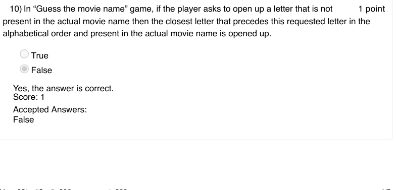

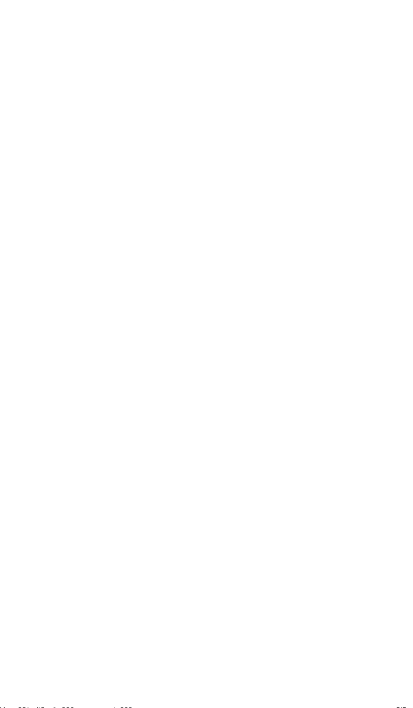
