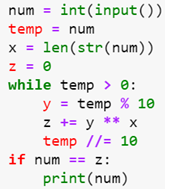
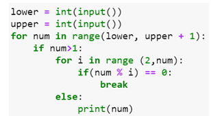
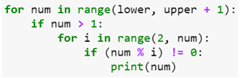
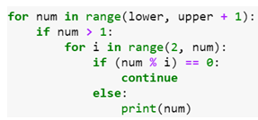
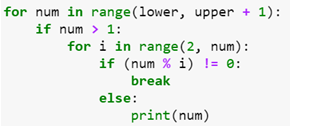

# Week 4 Quiz 💡

**1. A magic square is an n ×n matrix in which**
- Sum of numbers in each row is same
- Sum of numbers in each column is same
- Sum of numbers in each diagonal is same
- All of the above  ✅

**2. For any magic square of n × n, the magic number M is given by**
- n (n^2 + 1) / 2  ✅
- n (n + 1) / 2
- (n^2 + 1) / 2
- (n + 1) / 2

**3. Assuming that num is always a 2-digit number, what is the output of the following code?**

- Prints the number if the sum of squares of its digits is the number itself
- Prints the number if the sum its digits is the number itself
- Prints the number if the product of its digits is the number itself
- Prints nothing  ✅

**4. In a double game each pair of cards will have**
- Only two symbols in common
- Only one symbol in common  ✅
- All symbols in common
- No symbols in common

**5. The minimum number of people required to guarantee that at least two people will have their birthdays falling on the same day of a
non-leap year is..**
- 365
- 364  
- 366  ✅
- 367

**6. What does the following code snippet in python compute?**
                           
    num = int(input())
    for i in range(1, 11):
       print(num*i)
         
- Factorial of num
- Multiplication table of num  ✅
- Powers of num
- None

**7. Which of the following will print all prime numbers in an interval?**

-   ✅

- 

- 

- 

**8. Which of the following method in python choses a movie from the list of movie names given below?**

    movies =["zindagi" , " chinatown " , "darr" , " 3idiots " , "sixthsense" , "speed" , "avtaar"]
    
- random.random(movies)
- random.choice(movies)  ✅
- random.select(movies)
- All of the above

**9. In “Guess the Movie Name” game, at-most how many guesses do you need to make for a five lettered movie name with all distinct letters in it?**
- 53,130  ✅
- 6,37,5600
- 120  
- 5

**10. In “Guess the movie name” game, if the player asks to open up a letter that is not present in the actual movie name then the closest letter that precedes this requested letter in the alphabetical order and present in the actual movie name is opened up**
- True
- False  ✅
