# JOC Jan-2021 · Week 5: portal print

- Source: `JOC Jan-Apr 2021 (text PDF).pdf` pages 18–22 (portal review printout). Parsed text below; the cropped image under each question is the exact page content (code, figures and ticks as printed) and is authoritative.
- `[x]` = option equal to the portal's **Accepted Answer** (official). Lines may carry stray spaces from the PDF text layer.

> getpythoncode@gmail.com  · Due on 2021-02-24, 23:59 IST. · Assignment submitted on 2021-02-23, 21:21 IST

### Q1. Let marks scored be a dictionary of the items given below:
marks_scored = { }
marks_scored[’maths’]= 80
marks_scored[’science’]=90
marks_scored[’english’]=85
marks_scored[’social’]=95
Which of the following operation will print the items of the dictionary?

- [x] marks_scored.items()
- [ ] marks_scored.keys()
- [ ] marks_scored.values()
- [ ] all of the above
> Yes, the answer is correct. Score: 1

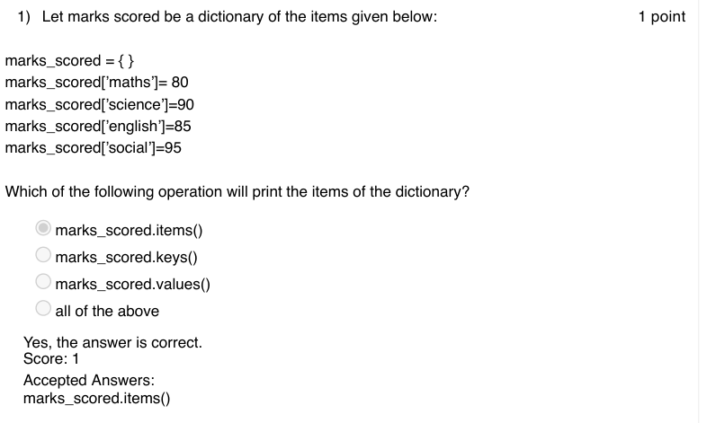

### Q2. Which of the following operation on the dictionary marks_scored in Question 1 will
remove a specified key and return the corresponding value?

- [ ] marks_scored.remove
- [ ] marks_scored.del
- [x] marks_scored.pop
- [ ] marks_scored.popitem
> Yes, the answer is correct. Score: 1

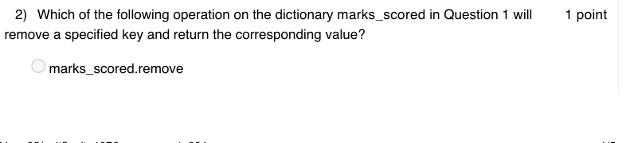

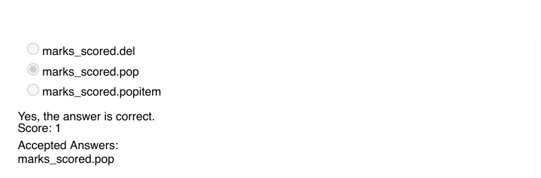

### Q3. Speech recognition does not work on .wav extension files

- [ ] True
- [x] False
> Yes, the answer is correct. Score: 1

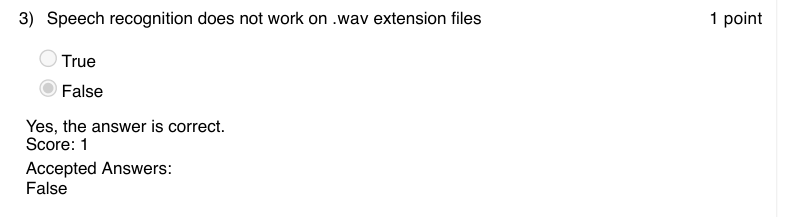

### Q4. What are the items in the following dictionary :
Dictionary = {x: x*x for x in range(11) if x % 2 == 0 }
print(Dictionary)

- [ ] Dictionary of odd numbers and their squares
- [x] Dictionary of even numbers and their squares
- [ ] dictionary of numbers divisible by 2
- [ ] non of the above
> Yes, the answer is correct. Score: 1

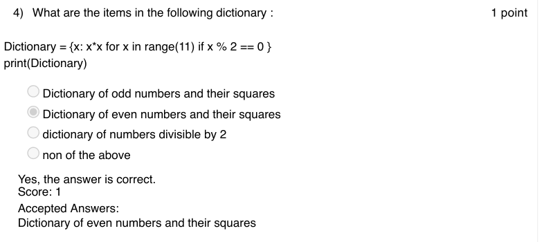

### Q5. In the game ”Rock, Paper and Scissor”, if player one enters 456 and player two enters
684 with their secret bits 0 and 2 respectively, then the expected outcome of the game would be
______

- [x] Player one wins
- [ ] Player two wins
- [ ] draw
- [ ] insufficient data
> Yes, the answer is correct. Score: 1

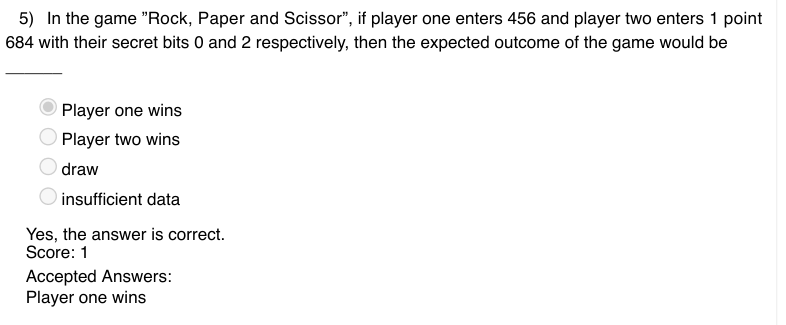

### Q6. What is the output of the following code:
Ajay
sem : 3
roll_no : 1
total_marks : 85
Shwetha
sem : 3
roll_no : 2
total_marks : 90
Ajay, sem : 3,roll_no : 1, total_marks : 85
Shwetha, sem : 3, roll_no : 2, total_marks : 90
{ Ajay, sem : 3,roll_no : 1, total_marks : 85 , Shwetha, sem : 3,
roll_no : 2, total_marks : 90 }

- [ ] none of the above
> Accepted answer (not matched to a printed option): Ajay; sem : 3; roll_no : 1; total_marks : 85; Shwetha; sem : 3; roll_no : 2; total_marks : 90
> Yes, the answer is correct. Score: 1

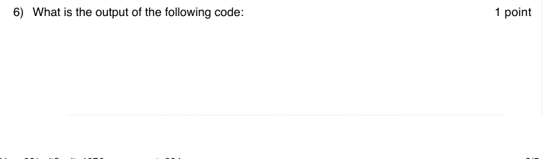

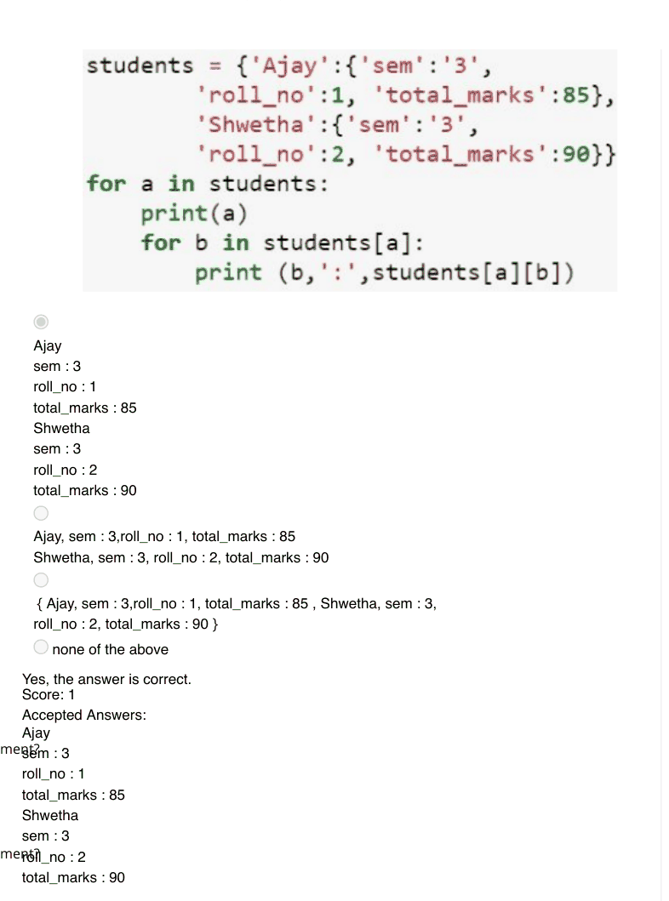

### Q7. Binary search can be applied on any list of random elements
True
False

Accepted answer(s): False
> Yes, the answer is correct. Score: 1

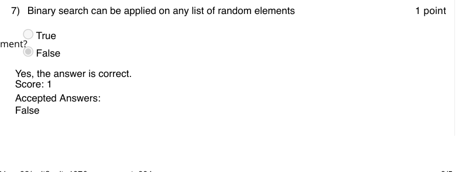

### Q8. Which of the following is true about bubble sort?

- [ ] In each iteration the first element in unsorted list is compared with the remaining elements
- [ ] The algorithm stops when the list is already sorted
- [x] In each iteration every consecutive pairs of the unsorted list are compared
- [ ] There is swapping of elements in each comparison made
> Yes, the answer is correct. Score: 1

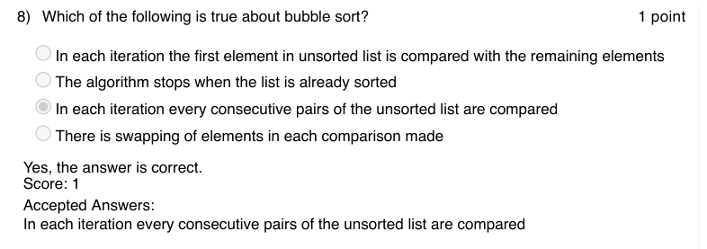

### Q9. Which are the given statements precisely explains the action of the given code?

- [ ] rolls the dices as long as the input is ’y’
- [ ] rolls the dices until the sum of their face values is 12
- [x] rolls the dices as long as the input is ’y’ or the sum of their face values is 12
- [ ] rolls the dices infinitely
> Yes, the answer is correct. Score: 1

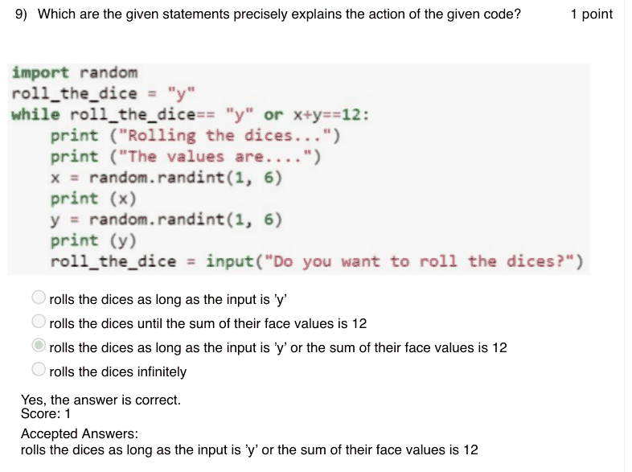

### Q10. What will be the output of the following code?

- [ ] 3 2
- [ ] 2 3
- [x] 2 3 01
- [ ] 01 3 2
> Yes, the answer is correct. Score: 1

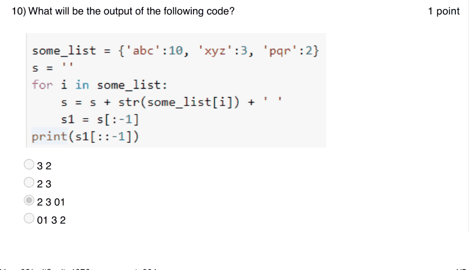

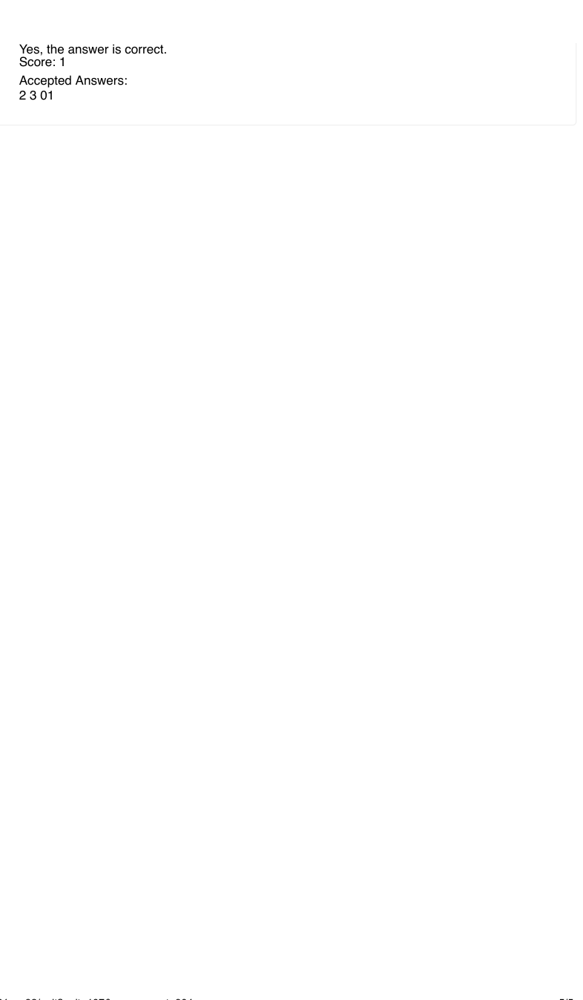
