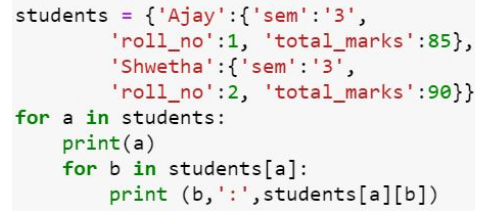
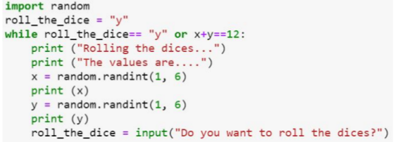
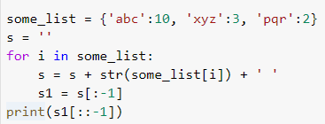

# Week 5 Quiz 💡

**1. Let marks scored be a dictionary of the items given below:-**

marks_scored = { }\
marks_scored[’maths’]= 80\
marks_scored[’science’]=90\
marks_scored[’english’]=85\
marks_scored[’social’]=95

**Which of the following operation will print the items of the dictionary?**
- marks_scored.items()  ✅
- marks_scored.keys()
- marks_scored.values()
- all of the above

**2. Which of the following operation on the dictionary marks_scored in Question 1 will remove a specified key and return the corresponding value?**
- marks_scored.remove
- marks_scored.del
- marks_scored.pop  ✅
- marks_scored.popitem

**3. Speech recognition does not work on .wav extension files**
- True
- False  ✅

**4. What are the items in the following dictionary :**

Dictionary = {x: x*x for x in range(11) if x % 2 == 0 }\
print(Dictionary)

- Dictionary of odd numbers and their squares
- Dictionary of even numbers and their squares  ✅
- dictionary of numbers divisible by 2
- non of the above

**5. In the game ”Rock, Paper and Scissor”, if player one enters 456 and player two enters 684 with their secret bits 0 and 2 respectively, then the expected outcome of the game would be ______**
- Player one wins
- Player two wins
- draw
- insufficient data  ✅

**6. What is the output of the following code:**

- Ajay\
  sem : 3\
  roll_no : 1\
  total_marks : 85\
  Shwetha\
  sem : 3\
  roll_no : 2\
  total_marks : 90  ✅

- Ajay, sem : 3,roll_no : 1, total_marks : 85\
  Shwetha, sem : 3, roll_no : 2, total_marks : 90

- { Ajay, sem : 3,roll_no : 1, total_marks : 85 , Shwetha, sem : 3,\
  roll_no : 2, total_marks : 90 }
- none of the above

**7. Binary search can be applied on any list of random elements**
- True
- False  ✅

**8. Which of the following is true about bubble sort?**
- In each iteration the first element in unsorted list is compared with the remaining elements
- The algorithm stops when the list is already sorted
- In each iteration every consecutive pairs of the unsorted list are compared  ✅
- There is swapping of elements in each comparison made

**9. Which are the given statements precisely explains the action of the given code?**

- rolls the dices as long as the input is ’y’
- rolls the dices until the sum of their face values is 12
- rolls the dices as long as the input is ’y’ or the sum of their face values is 12  ✅
- rolls the dices infinitely

**10. What will be the output of the following code?**

- 3 2
- 2 3
- 2 3 01  ✅
- 01 3 2
