# JOC Jan-2021 · Week 6: portal print

- Source: `JOC Jan-Apr 2021 (text PDF).pdf` pages 23–29 (portal review printout). Parsed text below; the cropped image under each question is the exact page content (code, figures and ticks as printed) and is authoritative.
- `[x]` = option equal to the portal's **Accepted Answer** (official). Lines may carry stray spaces from the PDF text layer.

> getpythoncode@gmail.com  · Due on 2021-03-03, 23:59 IST. · Assignment submitted on 2021-02-23, 19:20 IST

### Q1. In Caesar cipher, the mediator needs to make maximum of how many trails to break the
code?

- [ ] 1
- [x] 26
- [ ] no trail needed
- [ ] 10
> Yes, the answer is correct. Score: 1

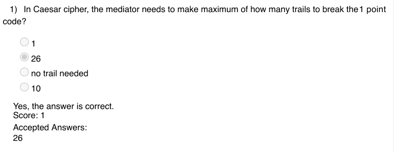

### Q2. What is the result of the following code if the input is COMPUTING?

- [ ] FRPSXWLQJ
- [ ] HTRUZYNSL
- [x] GSQTYXMRK
- [ ] none of the above
> Yes, the answer is correct. Score: 1

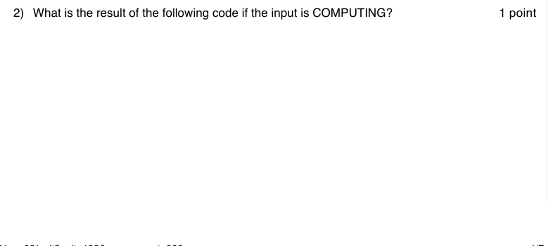

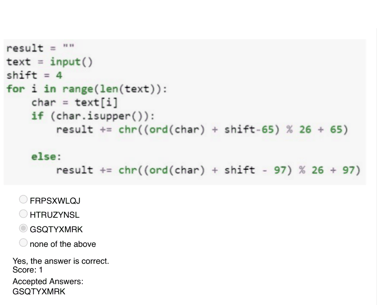

### Q3. Which of the following is TRUE about MIN-MAX strategy?

- [x] Maximise the chances of your winning and minimize the changes of the opponent winning
- [ ] The game with min-max strategy can never be drawn
- [ ] minimise the chances of your winning and maximize the chances of the opponent winning
- [ ] All the above are true
> Yes, the answer is correct. Score: 1

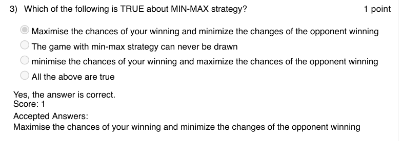

### Q4. What is the output of the following code?

- [x] Greatest common factor of num1 and num2
- [ ] Least common factor of num1 and num2
- [ ] Least common multiple of num1 and num2
- [ ] Greatest common multiple of num1 and num2
> Yes, the answer is correct. Score: 1

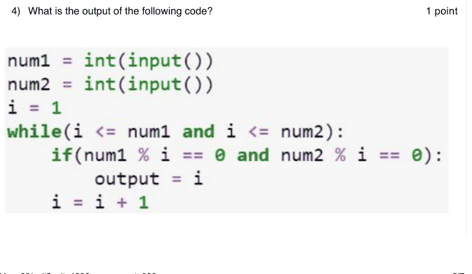

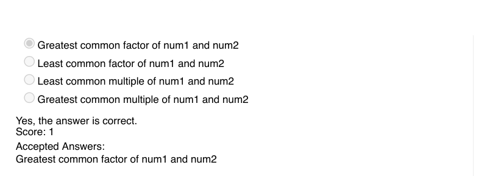

### Q5. What does the following python code compute?

- [ ] power of a raised to b
- [ ] sum of a and b
- [x] product of a and b
- [ ] none of the above
> Yes, the answer is correct. Score: 1

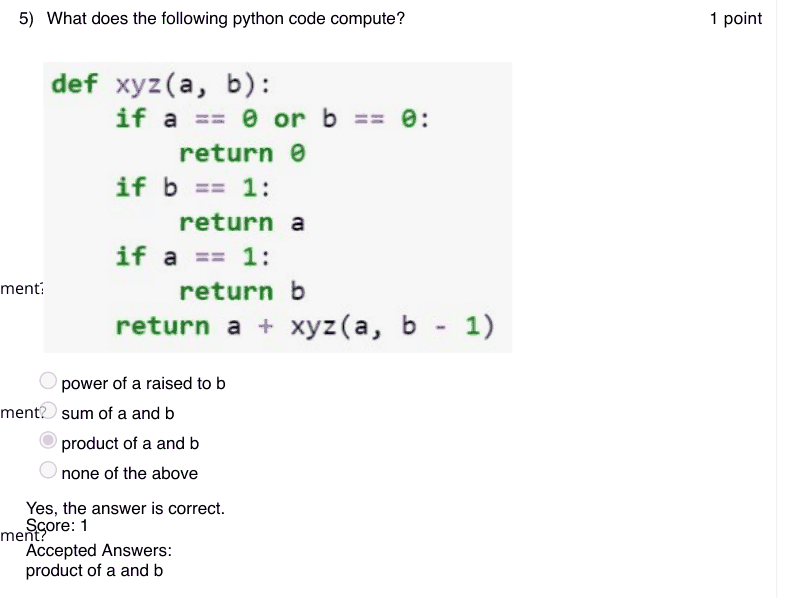

### Q6. Which of the following is not true about recursion?

- [ ] The speed of a program using recursion is same as that of the speed of its non-recursive equivalent
- [ ] The speed of a program using recursion is slower than the speed of its non-recursive equivalent
- [x] The speed of a program using recursion is faster than the speed of its non-recursive equivalent
- [ ] Recursive programs are easier to understand and code than that of its non-recursive equivalent
> Yes, the answer is correct. Score: 1

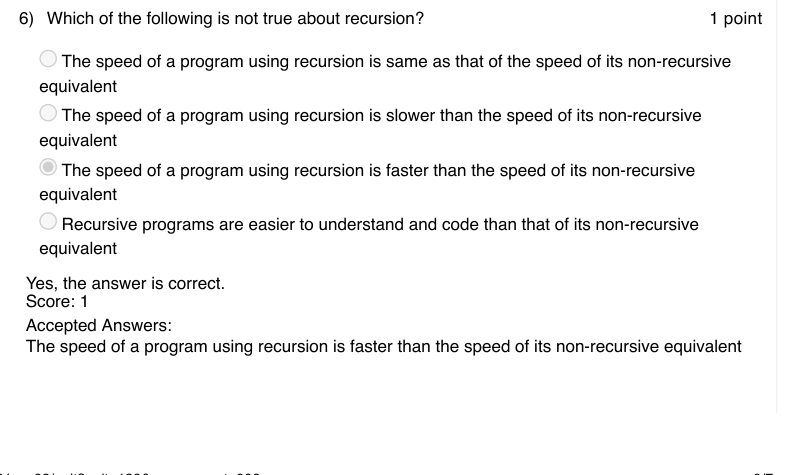

### Q7. Which of the following is the optimal code among the given codes using recursive
binary search?

> Yes, the answer is correct. Score: 1

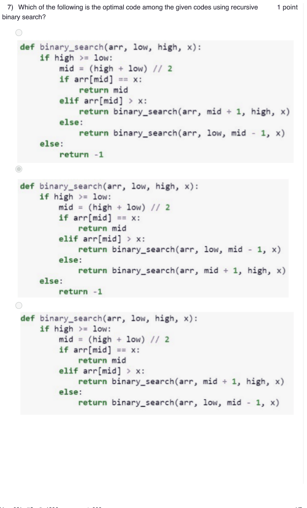

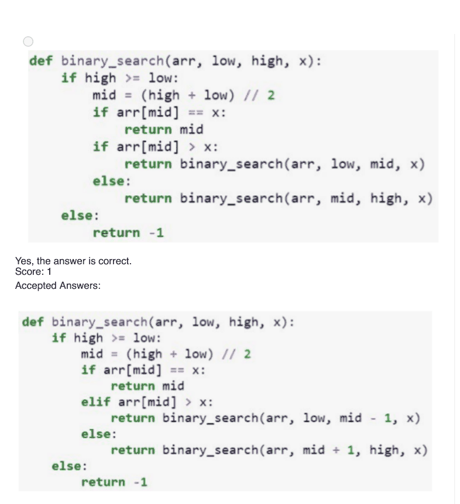

### Q8. What is the result of the following recursive function call?

- [x] 2
  6
  24
- [ ] 1
  2
  6
  24
- [ ] 2
  4
  12
- [ ] 1
  2
  4
  12
> Yes, the answer is correct. Score: 1

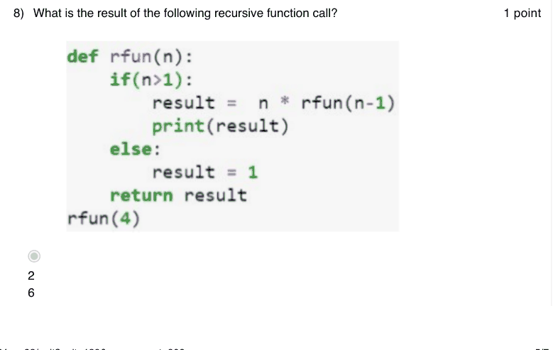

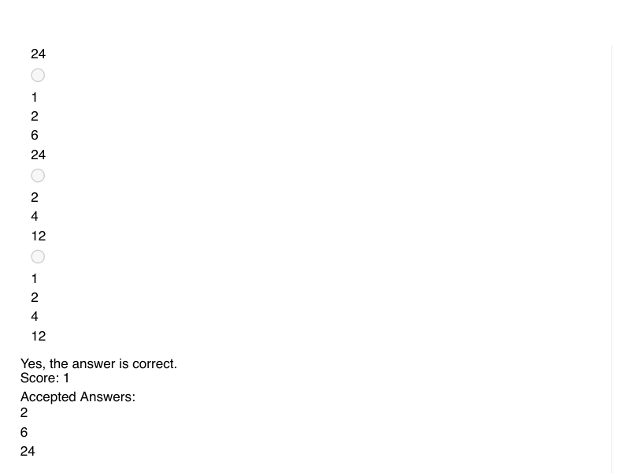

### Q9. What is the output of the following python code?

- [ ] 24
- [ ] Runs infinitely
- [x] Recursion error
- [ ] 1
> Yes, the answer is correct. Score: 1

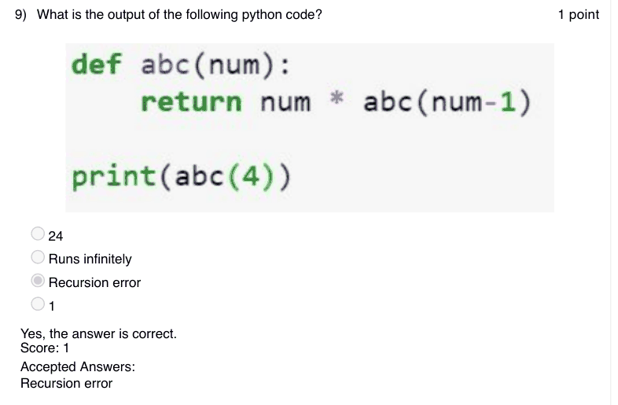

### Q10. A program can be written using recursive function only if it can be recursively defined.

- [ ] TRUE
- [x] FALSE
> No, the answer is incorrect. Score: 0

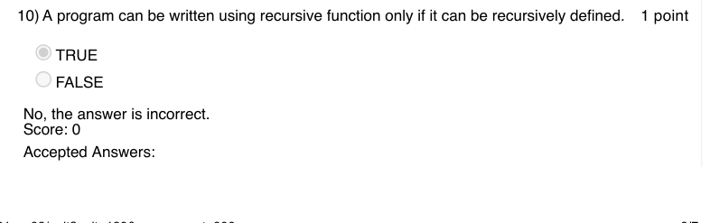

