# JOC Jan-2021 · Week 7: portal print

- Source: `JOC Jan-Apr 2021 (text PDF).pdf` pages 30–38 (portal review printout). Parsed text below; the cropped image under each question is the exact page content (code, figures and ticks as printed) and is authoritative.
- `[x]` = option equal to the portal's **Accepted Answer** (official). Lines may carry stray spaces from the PDF text layer.

> getpythoncode@gmail.com  · Due on 2021-03-10, 23:59 IST. · Assignment submitted on 2021-03-03, 21:53 IST

### Q1. Which of the following is/are uses of functions?

- [ ] Gives higher level overview of the task to be performed
- [ ] Reusability- use same functionality at various places
- [ ] Better understanding of the code
- [x] All of the above
> Yes, the answer is correct. Score: 1

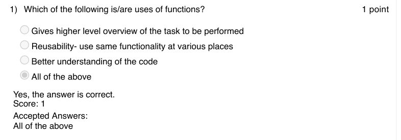

### Q2. In Snakes and Ladders game the least number of times a player has to roll a die with
the following ladder positions is ____________
ladders = { 3: 20, 6: 14, 11: 28, 15: 34, 17: 74, 22: 37, 38: 59, 49: 67, 57: 76, 61: 78, 73: 86, 81: 98,
88: 91 }

- [ ] 4
- [x] 5
- [ ] 6
- [ ] 7
> Yes, the answer is correct. Score: 1

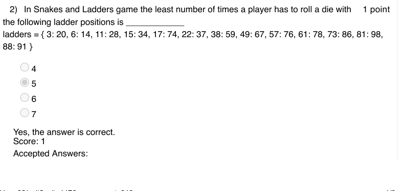

### Q3. Which of the following is the end point of the game Snakes and Ladder?

- [ ] A player has reached the end point
- [ ] A player quits the game
- [x] both A and B are the possibilities of the game to end
- [ ] None of the above
> Yes, the answer is correct. Score: 1

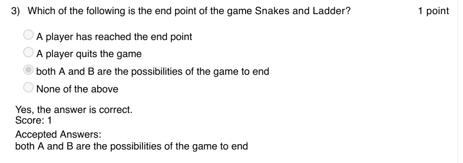

### Q4. What is the output of the following spiralprint python function?

- [ ] 1 2 3 4 5 6 12 18 17 16 15 14 13 7 8 9 10 11
- [x] 1 2 3 4 5 6 12 18 17 16 15 14 13
- [ ] 1 2 3 4 5 6 7 8 9 10 11 12 13 14 15 16 17 18
- [ ] 18 17 16 15 14 13 12 11 10 9 8 7 6 5 4 3 2 1
> Yes, the answer is correct. Score: 1

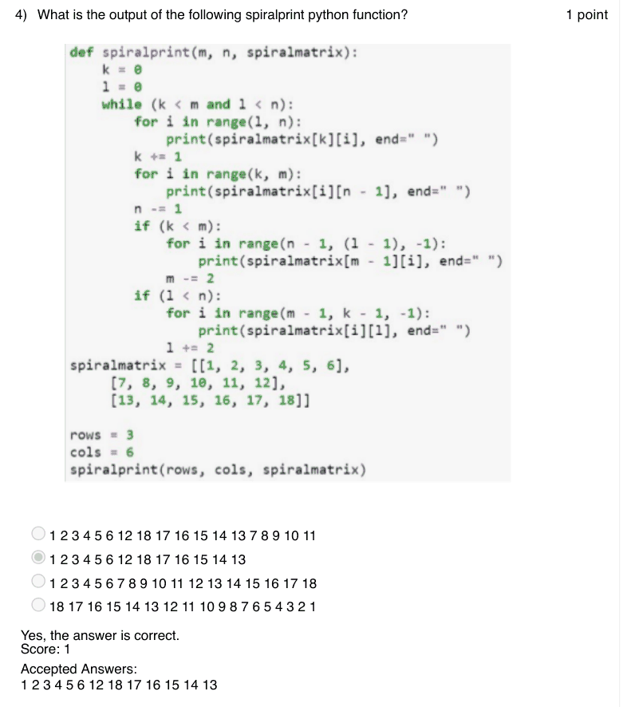

### Q5. Which of the following code snippet will draw a star?

> Yes, the answer is correct. Score: 1

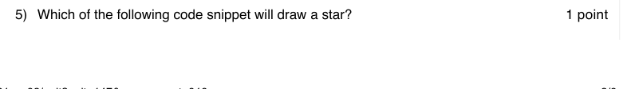

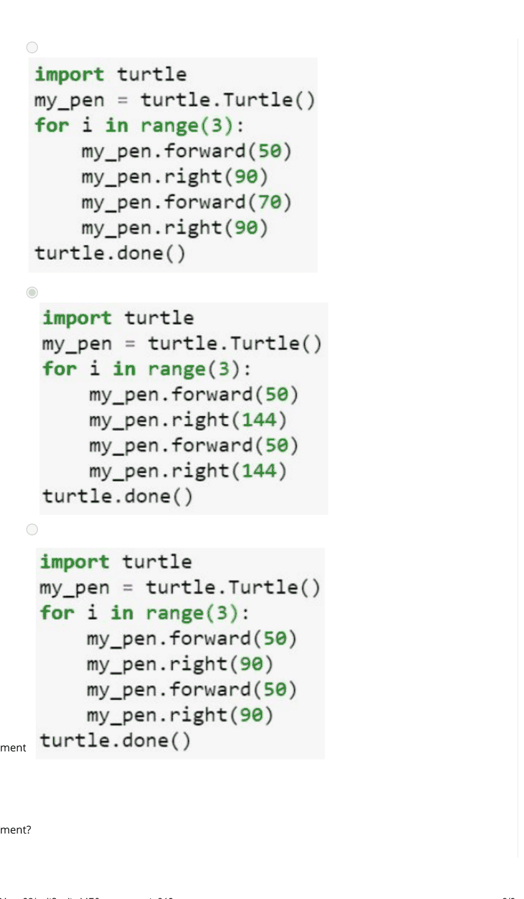

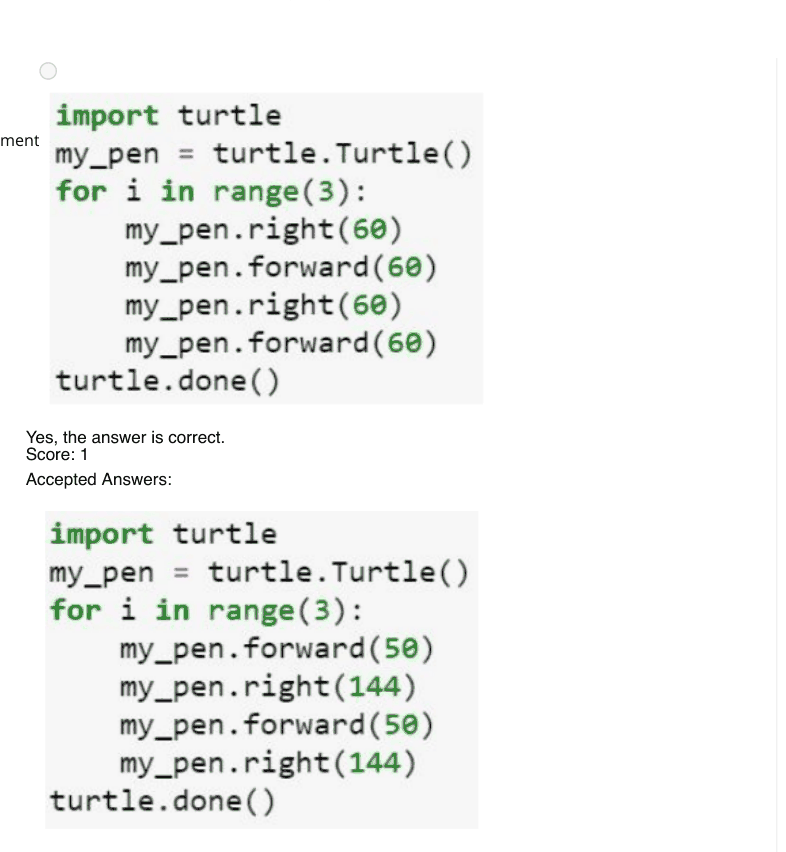

### Q6. Which of the following code snippet will draw a Hexagon?

> Yes, the answer is correct. Score: 1

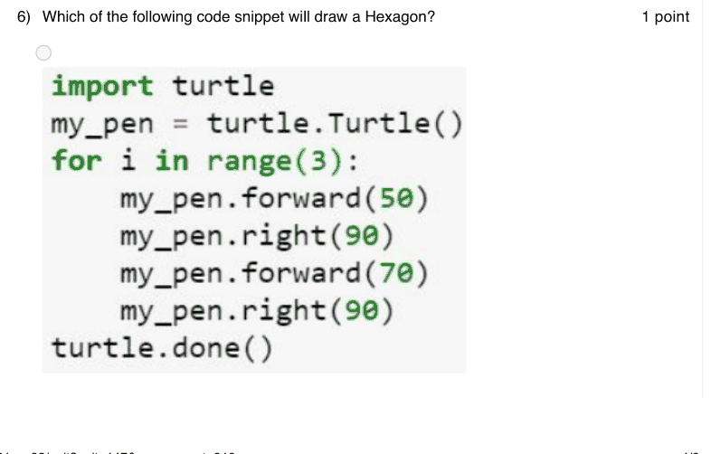

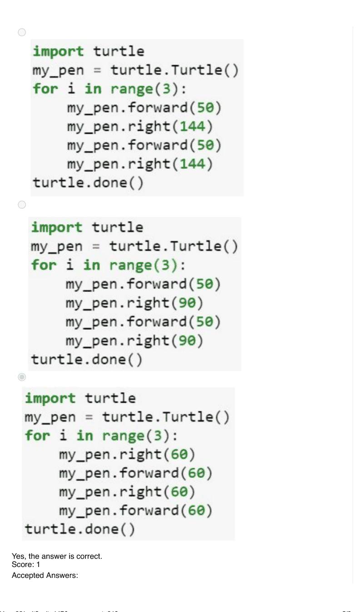

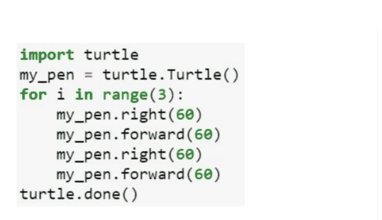

### Q7. What is the output of the following code?

> Yes, the answer is correct. Score: 1

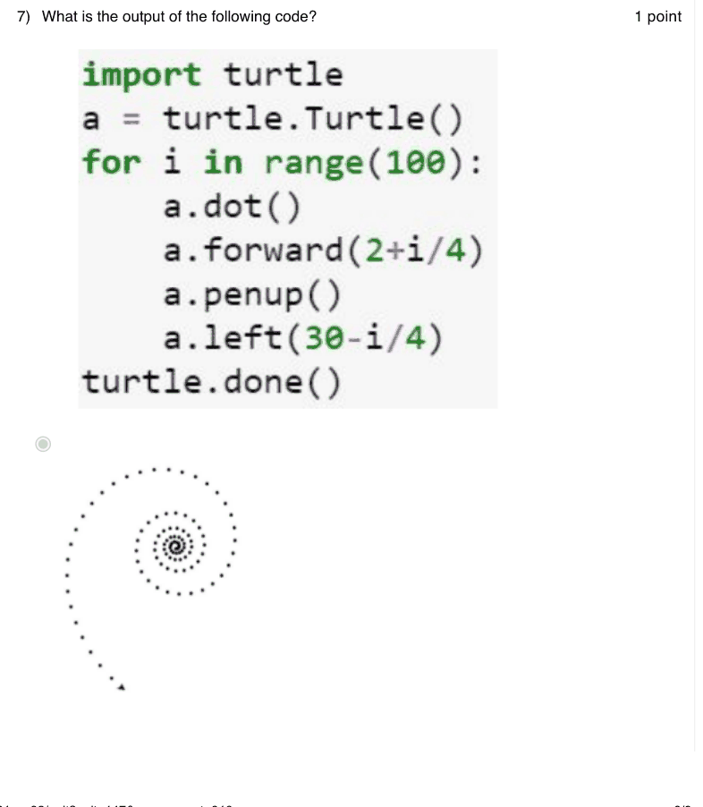

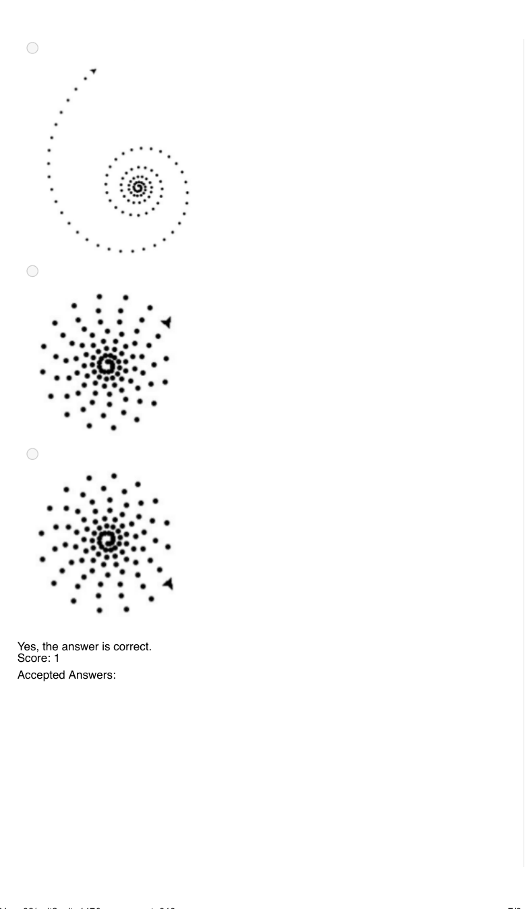

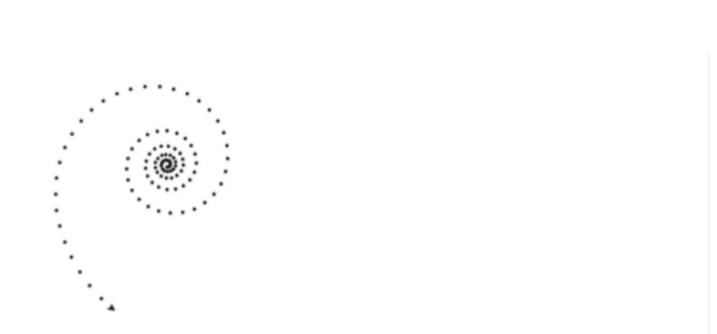

### Q8. In a file with extension csv what does csv mean?

- [ ] carry separated value
- [ ] common sector value
- [ ] class separated value
- [x] comma separated value
> Yes, the answer is correct. Score: 1

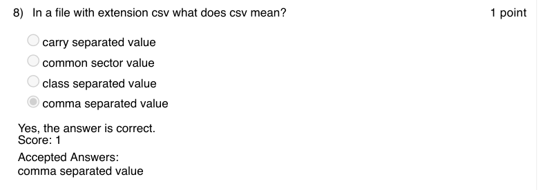

### Q9. which of the following library has to be imported to plot the route map using GPS
locations in python?

- [ ] csv
- [ ] gmplot
- [x] both
- [ ] none
> Yes, the answer is correct. Score: 1

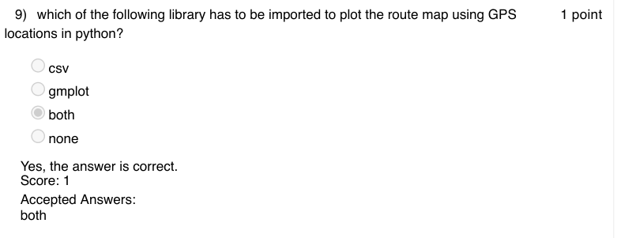

### Q10. Which of the following library moves the turtle backward?

- [ ] turtle.back(distance)
- [ ] turtle.bk(distance)
- [ ] turtle.backward(distance)
- [x] All of the above
> Yes, the answer is correct. Score: 1

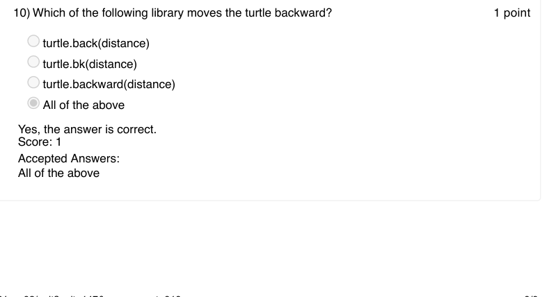

