# Week 7 Quiz 💡

**1. Which of the following is/are uses of functions?**
- Gives higher level overview of the task to be performed
- Reusability- use same functionality at various places
- Better understanding of the code
- All of the above  ✅

**2. In Snakes and Ladders game the least number of times a player has to roll a die with the following ladder positions is _____________
ladders = { 3: 20, 6: 14, 11: 28, 15: 34, 17: 74, 22: 37, 38: 59, 49: 67, 57: 76, 61: 78, 73: 86, 81: 98, 88: 91 }**
- 4
- 5  ✅
- 6
- 7

**3. Which of the following is the end point of the game Snakes and Ladder?**
- A player has reached the end point
- A player quits the game
- both A and B are the possibilities of the game to end  ✅
- None of the above

**4. What is the output of the following spiralprint python function?**

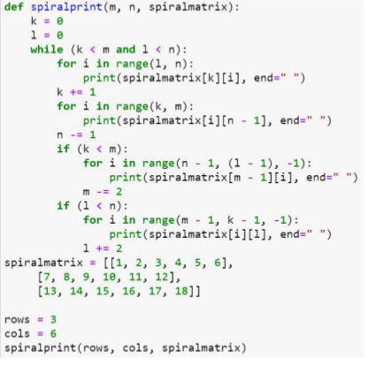

- 1 2 3 4 5 6 12 18 17 16 15 14 13 7 8 9 10 11
- 1 2 3 4 5 6 12 18 17 16 15 14 13  ✅
- 1 2 3 4 5 6 7 8 9 10 11 12 13 14 15 16 17 18
- 18 17 16 15 14 13 12 11 10 9 8 7 6 5 4 3 2 1

**5. Which of the following code snippet will draw a star?**

- 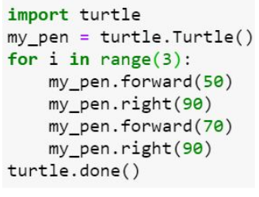

- 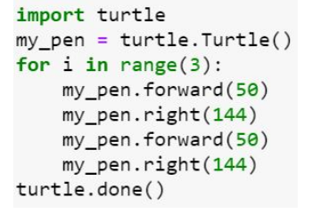  ✅

- 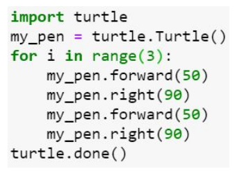

- 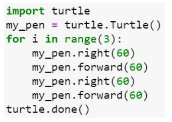

**6. Which of the following code snippet will draw a Hexagon?**

- 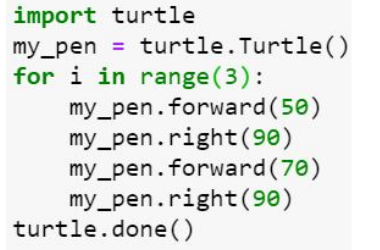

- 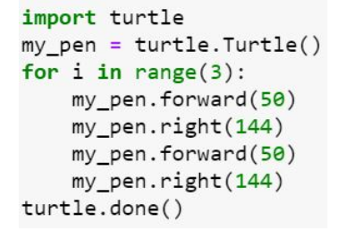

- 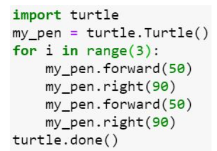

- 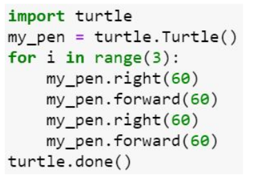  ✅

**7. What is the output of the following code?**

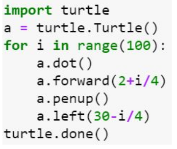

- 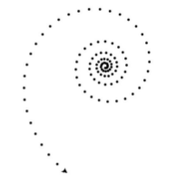  ✅

- 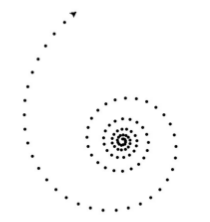

- 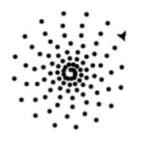

- 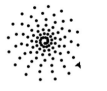

**8. In a file with extension csv what does csv mean?**
- carry separated value
- common sector value
- class separated value
- comma separated value  ✅

**9. which of the following library has to be imported to plot the route map using GPS locations in python?**
- csv
- gmplot
- both  ✅
- none

**10. Which of the following library moves the turtle backward?**
- turtle.back(distance)
- turtle.bk(distance)
- turtle.backward(distance)
- All of the above  ✅
