# JOC Jan-2021 · Week 8: portal print

- Source: `JOC Jan-Apr 2021 (text PDF).pdf` pages 39–46 (portal review printout). Parsed text below; the cropped image under each question is the exact page content (code, figures and ticks as printed) and is authoritative.
- `[x]` = option equal to the portal's **Accepted Answer** (official). Lines may carry stray spaces from the PDF text layer.

> getpythoncode@gmail.com  · Due on 2021-03-17, 23:59 IST. · Assignment submitted on 2021-03-17, 12:54 IST

### Q1. Which of the following code snippet will create a tuple in python?

- [x] name = (’kiran’,’bhushan’,’madan’)
- [ ] name = {’kiran’,’bhushan’,’madan’}
- [ ] name = [’kiran’,’bhushan’,’madan’]
- [ ] All of the above
> Yes, the answer is correct. Score: 1

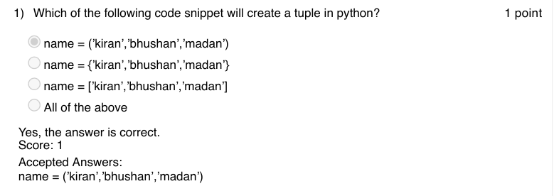

### Q2. Which of the following is not true about tuples in python?

- [ ] Tuple consumes less memory
- [ ] Tuples are immutable
- [x] Tuple supports item deletion
- [ ] Tuples does not support modification
> Yes, the answer is correct. Score: 1

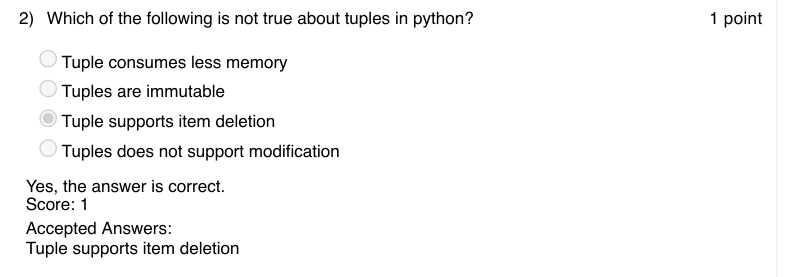

### Q3. What is the output of the following code snippet in python?
name =(’kiran’,’bhushan’,’madan’)
print (name[-1])

- [ ] invalid syntax
- [ ] tuple index out of range
- [ ] prints nothing
- [x] madan
> Yes, the answer is correct. Score: 1

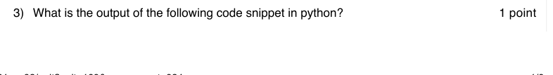

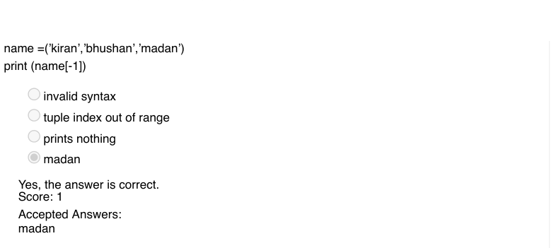

### Q4. What is the output of the following code?

- [x] the program stops when the number entered matches with the random number generated
- [ ] the program stops after certain number of trials
- [ ] the program never stops
- [ ] error
> Yes, the answer is correct. Score: 1

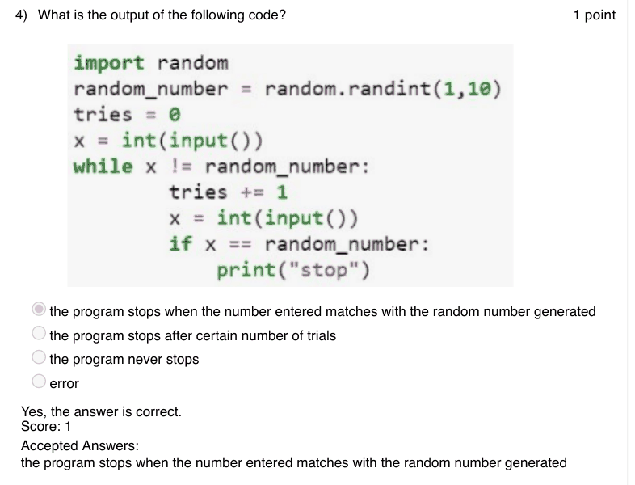

### Q5. What does the following program plot?

- [ ] Plots the random number generated in each iteration
- [x] Plots the number of times the given input matches with the random number generated
- [ ] Plots the input entered for each iteration
- [ ] none of the above
> Yes, the answer is correct. Score: 1

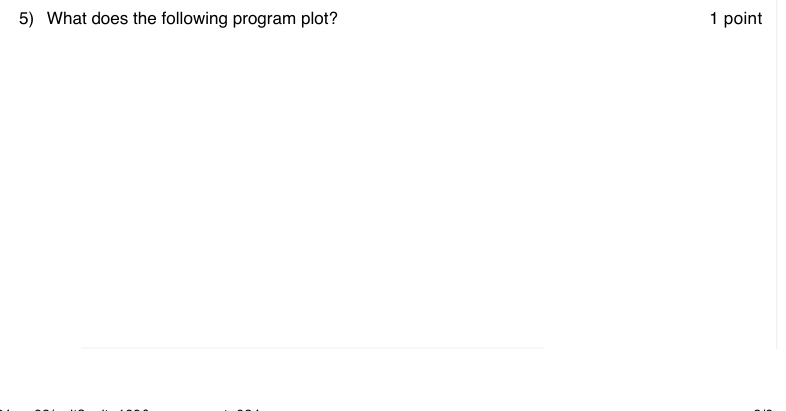

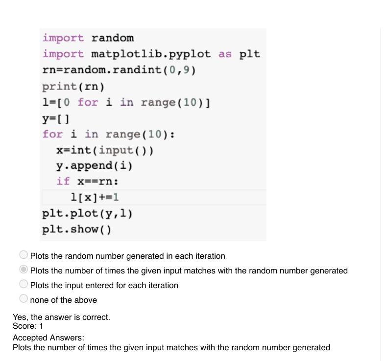

### Q6. In image processing using python what is the acronym of PIL?

- [ ] Python Interactive Library
- [ ] Pillow Library
- [ ] Python Image Library
- [x] Python Imaging Library
> Yes, the answer is correct. Score: 1

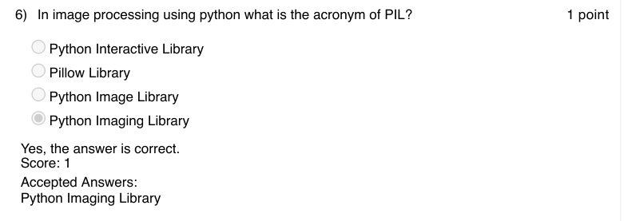

### Q7. What does the following code snippet in python compute?

- [ ] checks whether the two given texts are same
- [ ] searches for text2 in text1
- [x] finds all the occurrences of text2 in text1
- [ ] none of the above
> Yes, the answer is correct. Score: 1

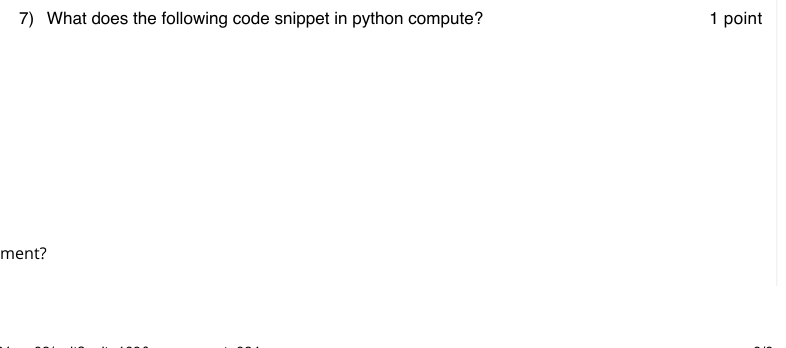

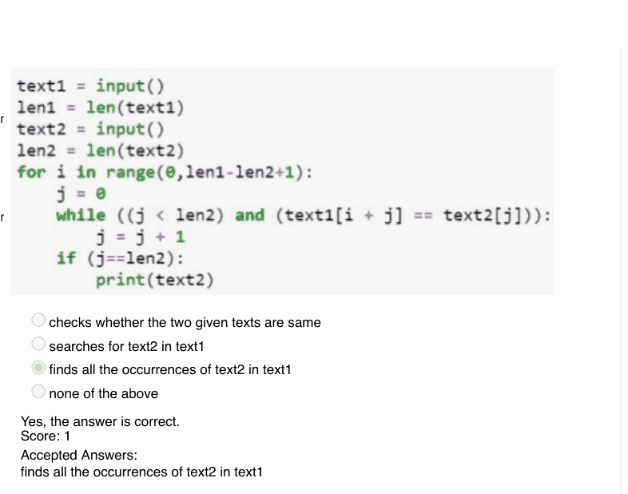

### Q8. Which of the following code will convert the uppercase letters of the given string into
lower case and prints the converted string?

- [ ] both A and B
- [ ] none
> Yes, the answer is correct. Score: 1

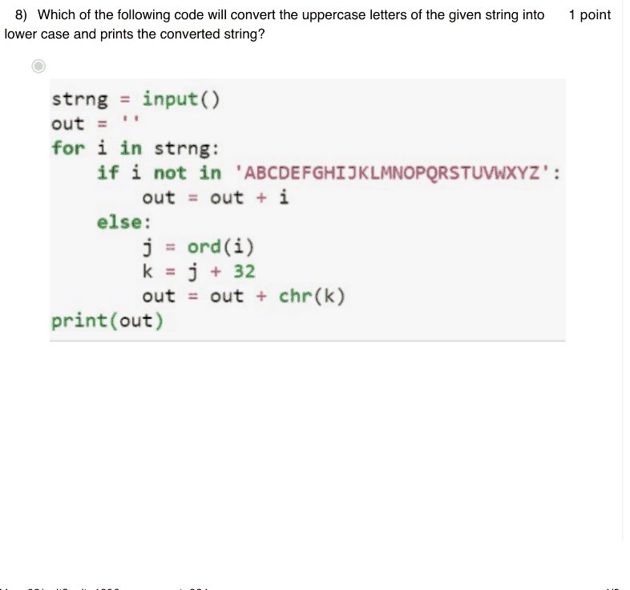

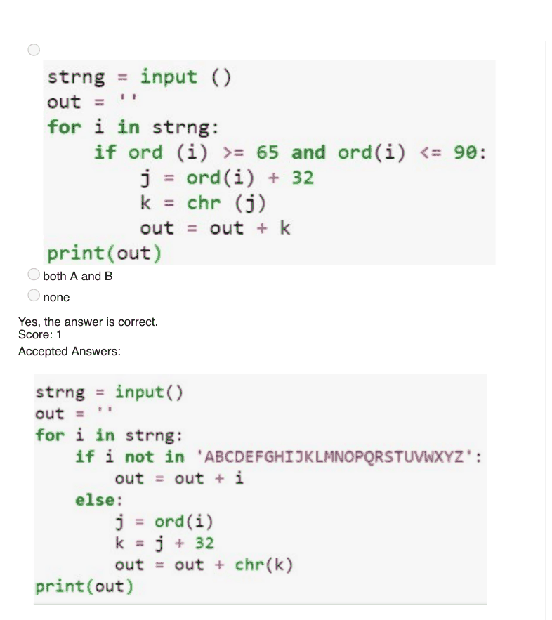

### Q9. Which of the following is the platform for building Python programs to work with
sentiment analysis of human language data?

- [ ] NLTK: Neutral Language Toolkit
- [x] NLTK: Natural Language Toolkit
- [ ] NLTK: Normal Language Toolkit
- [ ] NLTK: Natural Lingual Toolkit
> Yes, the answer is correct. Score: 1

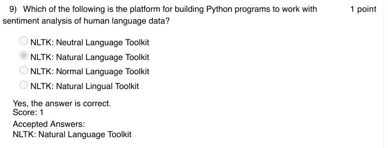

### Q10. Sentiment analysis involves working with whether  __________

- [ ] a piece of information is biased or unbiased
- [ ] a piece of information is useful or not
- [ ] a piece of information is true or false
- [x] a piece of information is positive or negative
> Yes, the answer is correct. Score: 1

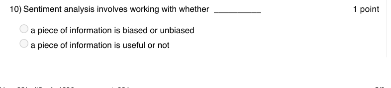

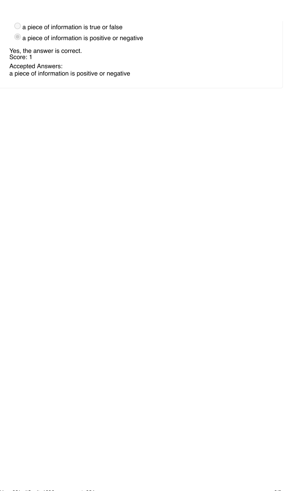

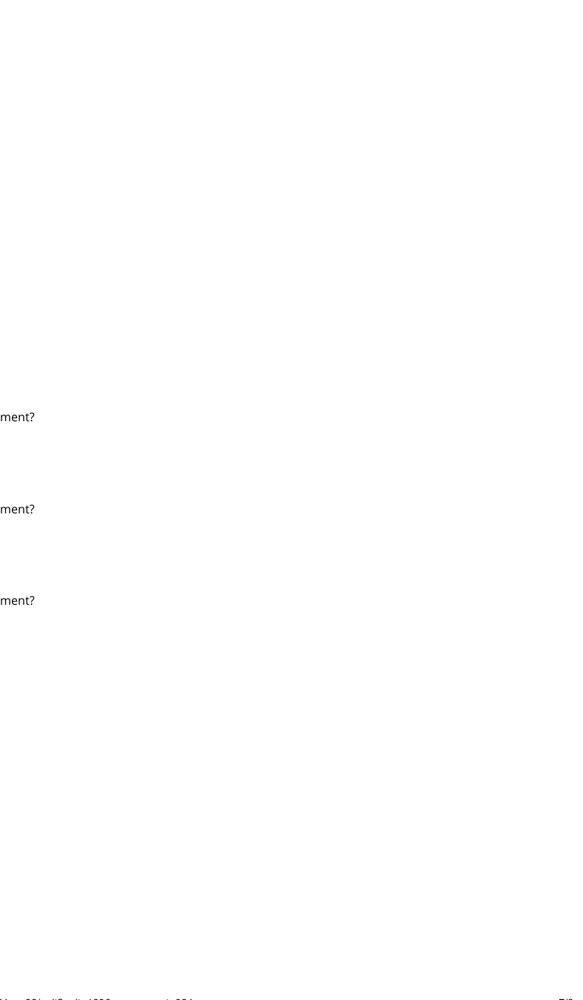

