# JOC Jan-2021 · Week 9: portal print

- Source: `JOC Jan-Apr 2021 (text PDF).pdf` pages 47–52 (portal review printout). Parsed text below; the cropped image under each question is the exact page content (code, figures and ticks as printed) and is authoritative.
- `[x]` = option equal to the portal's **Accepted Answer** (official). Lines may carry stray spaces from the PDF text layer.

> getpythoncode@gmail.com  · Due on 2021-03-24, 23:59 IST. · Assignment submitted on 2021-03-16, 20:25 IST

### Q1. Which of the following is not true about Stylometry Analysis?

- [ ] It is quantitative study of literature style
- [ ] It is based on the observation that the authors tend to write in relatively consistent and recognisable ways
- [x] any two people may have same vocabulary
- [ ] It is a tool to study variety of questions involving style of writing
> Yes, the answer is correct. Score: 1

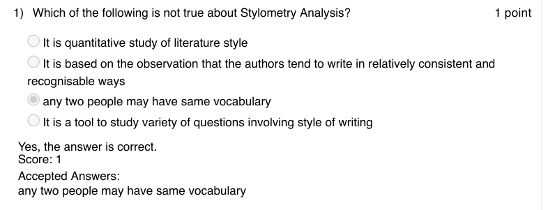

### Q2. An author’s stylic signature can be analysed by which of the following method(s)?

- [ ] Plot a graph of word length distribution
- [ ] Kilgariff’s Chi Squared method
- [ ] John Burrow’s Delta method
- [x] All of the above
> Yes, the answer is correct. Score: 1

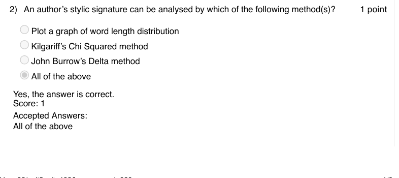

### Q3. What is the output of the following code?
[’Have nice day, my friend!!! Programming in Python is fun’]
[’Have nice day, my friend!!!’, ’Programming in Python is fun’]
’Have nice day, my friend!!!’

- [ ] ’Programming in Python is fun’ error
> Accepted answer (not matched to a printed option): [’Have nice day, my friend!!!’, ’Programming in Python is fun’]
> Yes, the answer is correct. Score: 1

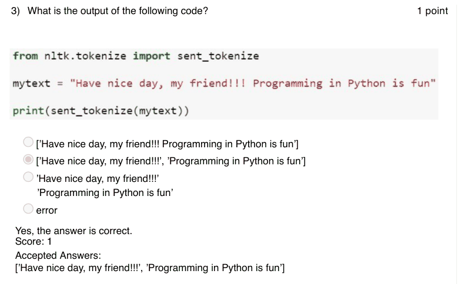

### Q4. What is the output of the following code?
none of the above

> Yes, the answer is correct. Score: 1

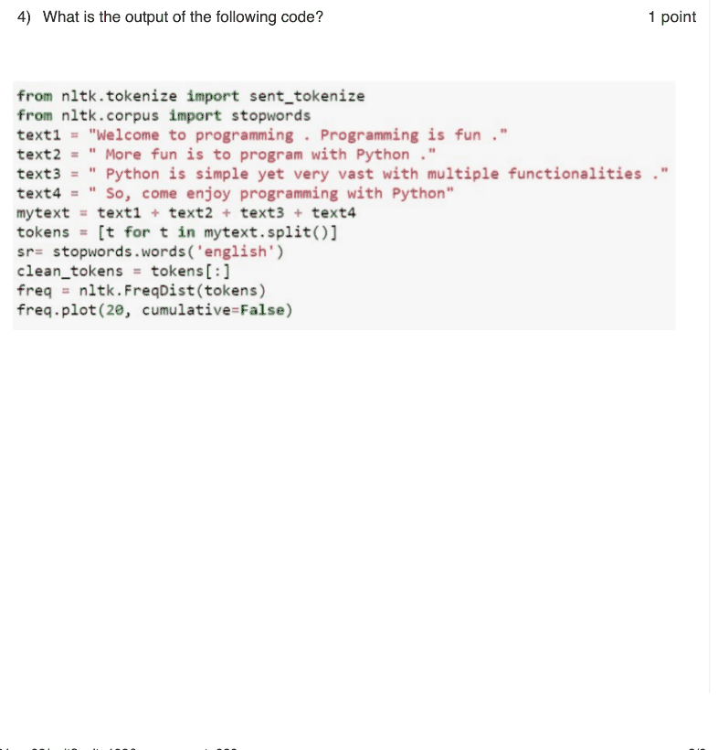

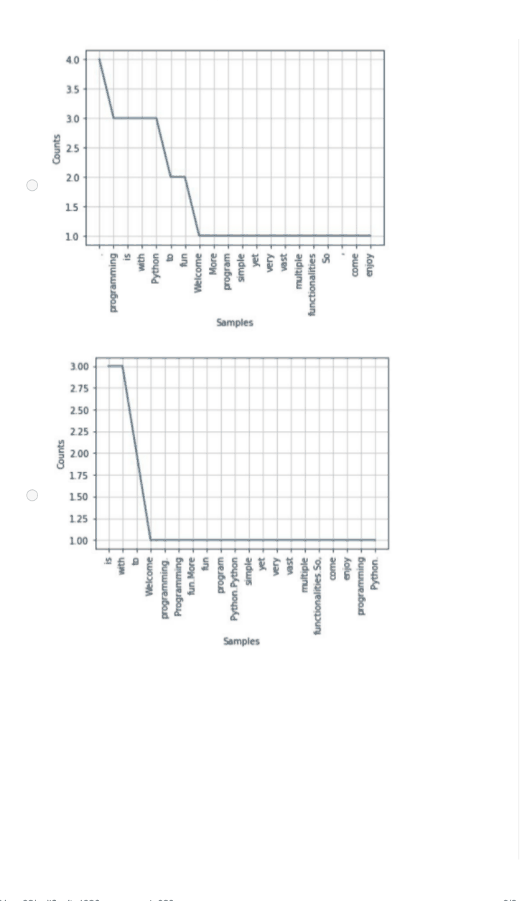

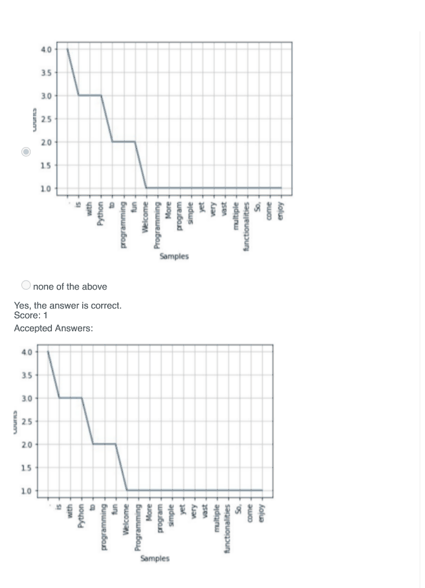

### Q5. Strings in python can be created using

- [ ] single quotes
- [ ] double quotes
- [ ] triple quotes
- [ ] only A and B
- [x] A, B and C
> Yes, the answer is correct. Score: 1

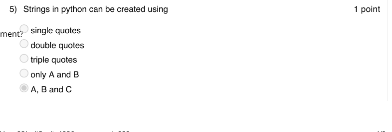

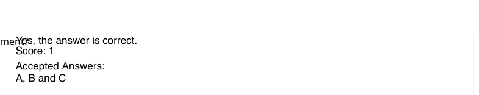

### Q6. Networkx in python is used for which of the following operation(s)?

- [ ] Visualizing social network
- [ ] Analyzing social network
- [ ] Generate social network
- [x] All of the above
> Yes, the answer is correct. Score: 1

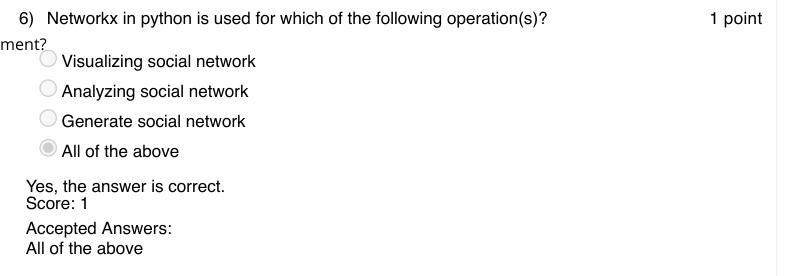

### Q7. Which of the following will generate a complete graph in python using Networkx
package?

- [ ] Graph = nx.gnp random graph(25,0.5)
- [x] Graph = nx.gnp random graph(25,1.0)
- [ ] Graph = nx.gnp random graph(25,0.25)
- [ ] Graph = nx.gnp random graph(25,0.75)
> Yes, the answer is correct. Score: 1

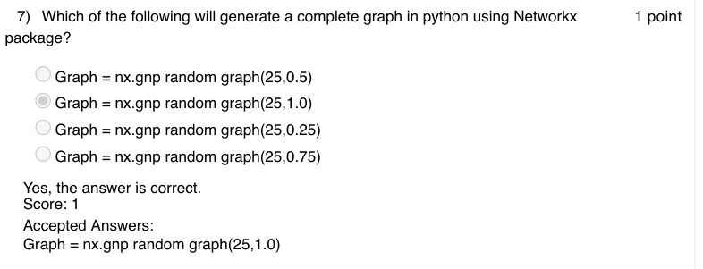

### Q8. Degree of separation of a complete graph with n nodes is always

- [ ] n
- [ ] n-1
- [x] 1
- [ ] 6
> Yes, the answer is correct. Score: 1

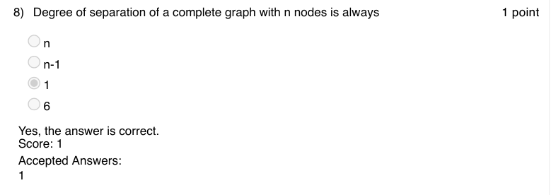

### Q9. Which of the following is true about six degrees of seperation?

- [ ] the minimum degree of separation of any node in the network is 6
- [ ] the maximum degree of separation of any node in the network is 6
- [x] the average degree of separation of the nodes in the network is 6
- [ ] the degree of separation of every node in the network is 6
> Yes, the answer is correct. Score: 1

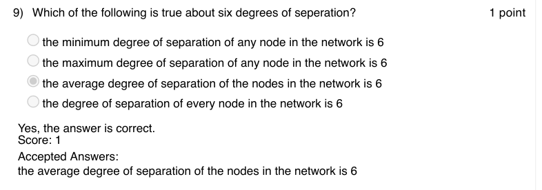

### Q10. Which of the following method will return the RBG value of a pixel in python?

- [x] getpixel()
- [ ] RBGvalue()
- [ ] pixelValue()
- [ ] none of the above
> Yes, the answer is correct. Score: 1

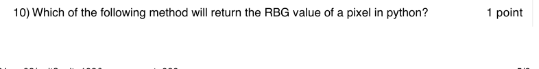

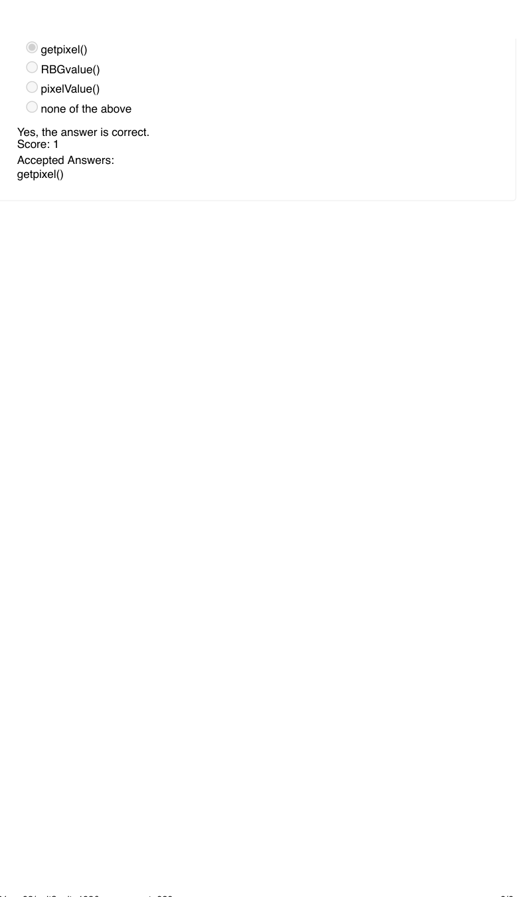
