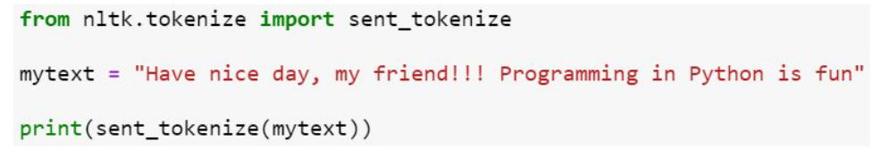
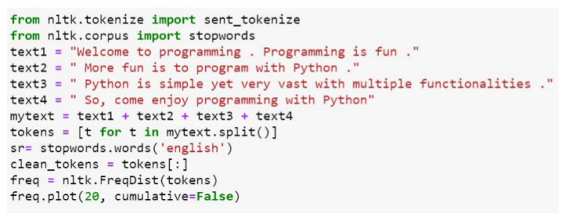
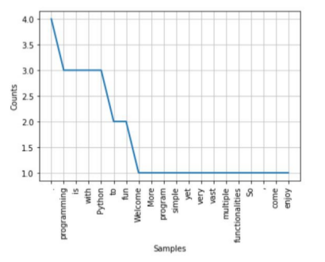
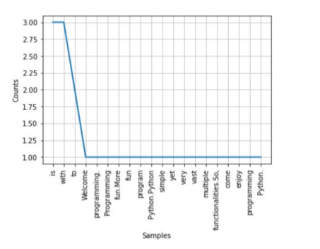
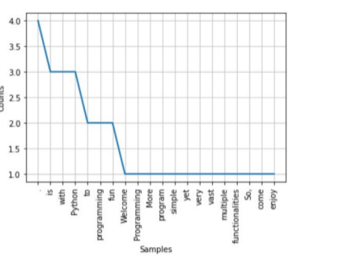

# Week 9 Quiz 💡

**1. Which of the following is not true about Stylometry Analysis?**
- It is quantitative study of literature style
- It is based on the observation that the authors tend to write in relatively consistent and recognisable ways
- any two people may have same vocabulary  ✅
- It is a tool to study variety of questions involving style of writing

**2. An author’s stylic signature can be analysed by which of the following method(s)?**
- Plot a graph of word length distribution
- Kilgariff’s Chi Squared method
- John Burrow’s Delta method
- All of the above  ✅

**3. What is the output of the following code?**

  
- ['Have nice day, my friend!!! Programming in Python is fun']
- ['Have nice day, my friend!!!', 'Programming in Python is fun']  ✅
- 'Have nice day, my friend!!!'\
  'Programming in Python is fun'
- error

**4. What is the output of the following code?**

- 

- 

-   ✅

- none of the above

**5. Strings in python can be created using**
- single quotes
- double quotes
- triple quotes
- only A and B
- A, B and C  ✅

**6. Networkx in python is used for which of the following operation(s)?**
- Visualizing social network
- Analyzing social network
- Generate social network
- All of the above  ✅

**7. Which of the following will generate a complete graph in python using Networkx package?**
- Graph = nx.gnp random graph(25,0.5)
- Graph = nx.gnp random graph(25,1.0)  ✅
- Graph = nx.gnp random graph(25,0.25)
- Graph = nx.gnp random graph(25,0.75)

**8. Degree of separation of a complete graph with n nodes is always**
- n
- n-1
- 1  ✅
- 6

**9. Which of the following is true about six degrees of seperation?**
- the minimum degree of separation of any node in the network is 6
- the maximum degree of separation of any node in the network is 6
- the average degree of separation of the nodes in the network is 6  ✅
- the degree of separation of every node in the network is 6

**10. Which of the following method will return the RBG value of a pixel in python?**
- getpixel()  ✅
- RBGvalue()
- pixelValue()
- none of the above
                                                                                                                    
