# JOC Jan-2021 · Week 10: portal print

- Source: `JOC Jan-Apr 2021 (text PDF).pdf` pages 53–57 (portal review printout). Parsed text below; the cropped image under each question is the exact page content (code, figures and ticks as printed) and is authoritative.
- `[x]` = option equal to the portal's **Accepted Answer** (official). Lines may carry stray spaces from the PDF text layer.

> getpythoncode@gmail.com  · Due on 2021-03-31, 23:59 IST. · Assignment submitted on 2021-03-31, 08:14 IST

### Q1. The game ”FLAMES” represents which of the following mathematics question?

- [x] Josephus problem
- [ ] Euclid’s problem
- [ ] Euler’s problem
- [ ] none of the above
> Yes, the answer is correct. Score: 1

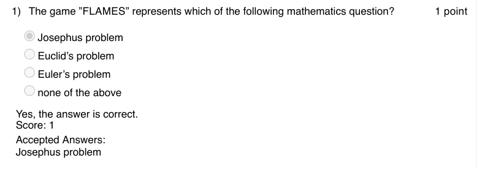

### Q2. Predict the output of the following code

- [ ] HELLO
- [ ] Hello
- [ ] hello
- [x] error
> Yes, the answer is correct. Score: 1

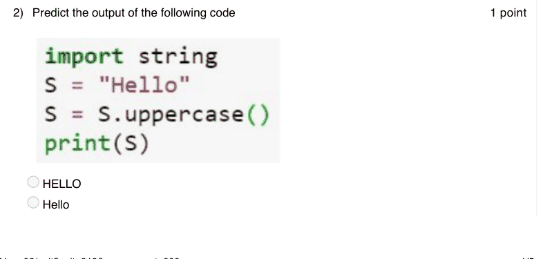

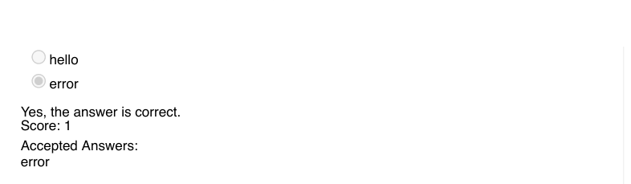

### Q3. (question text in image)

- [ ] Predict the output of the following code Hellogoodmorning Hello goodmorning Hello good morning error
> Accepted answer (not matched to a printed option): Hellogoodmorning
> Yes, the answer is correct. Score: 1

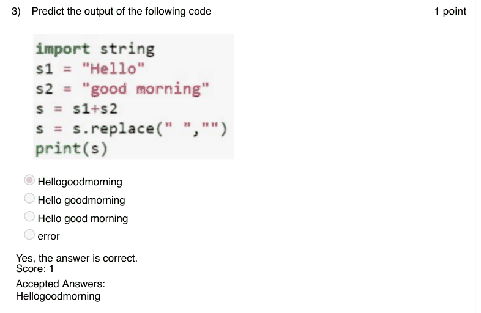

### Q4. What does the following code snippet in python print?
der
ind
nde
de

Accepted answer(s): nde
> Yes, the answer is correct. Score: 1

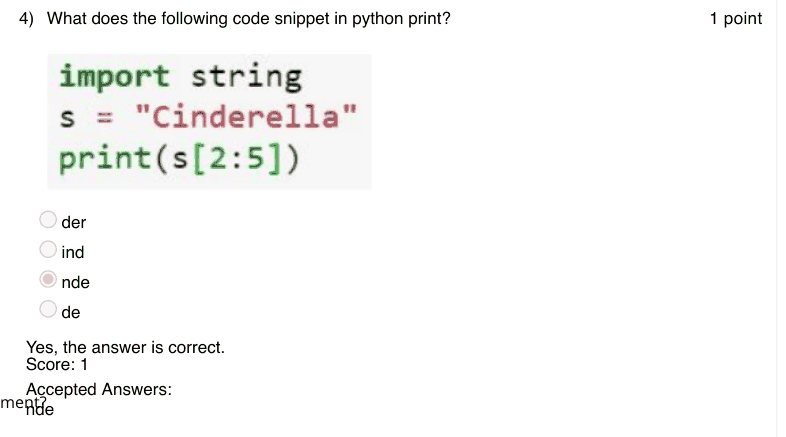

### Q5. In python, the default value of start and end index of list slicing are which of the
following options?
1, length of the list
0, length of the list
0, length of the list -1
1, length of the list -1

Accepted answer(s): 0, length of the list
> Yes, the answer is correct. Score: 1

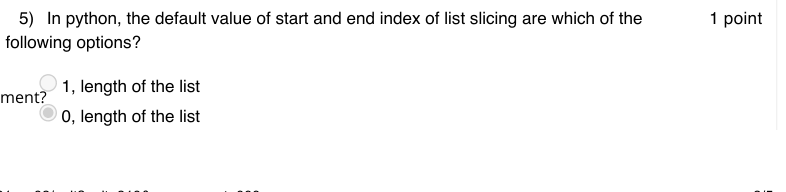

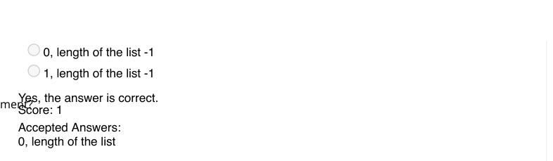

### Q6. Which of the following is not a functionality of string in python?

- [ ] lower()
- [ ] replace()
- [ ] isalpha()
- [x] append()
> Yes, the answer is correct. Score: 1

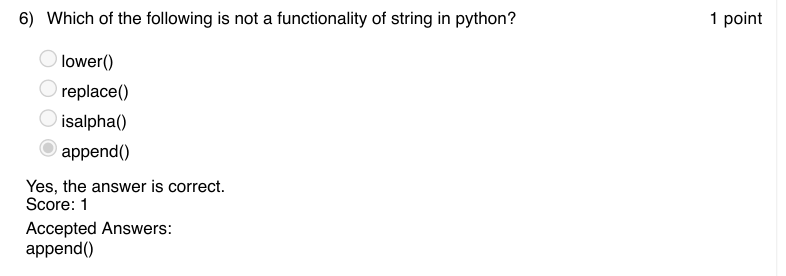

### Q7. Predict the output

- [ ] class ’numpy.2darray’
- [ ] int32
- [x] class ’numpy.ndarray’
- [ ] error
> Yes, the answer is correct. Score: 1

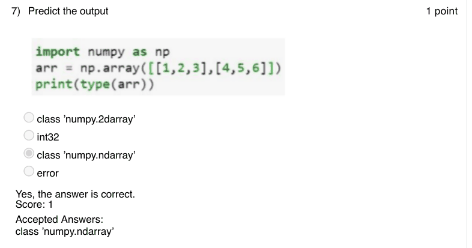

### Q8. Which of the following code snippet will print transpose of the matrix a?

> Yes, the answer is correct. Score: 1

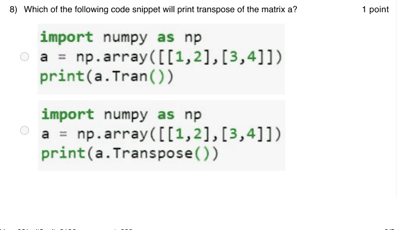

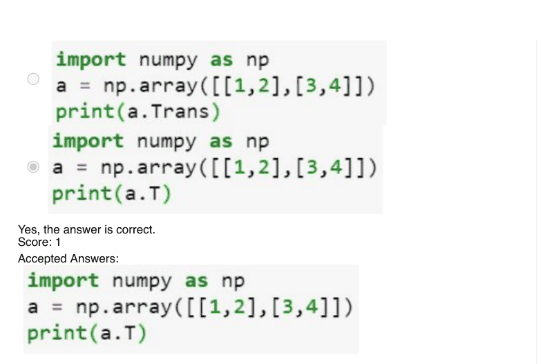

### Q9. Which of the following will print column sum of the matrix a?

> Yes, the answer is correct. Score: 1

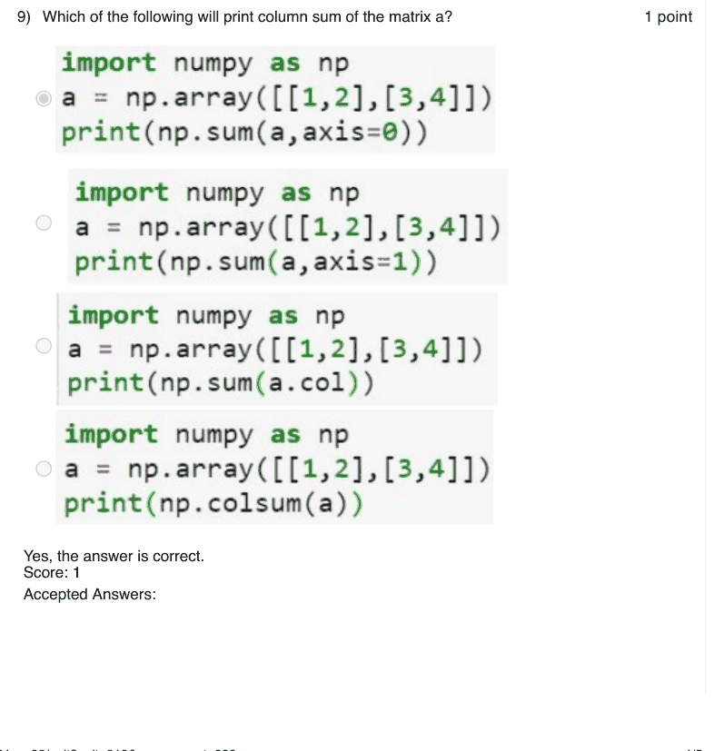

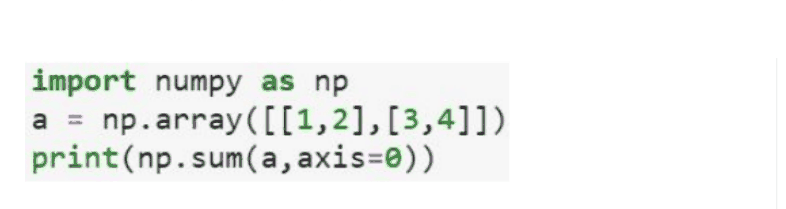

### Q10. Image compression is always a lossy compression.

- [ ] True
- [x] False
> Yes, the answer is correct. Score: 1

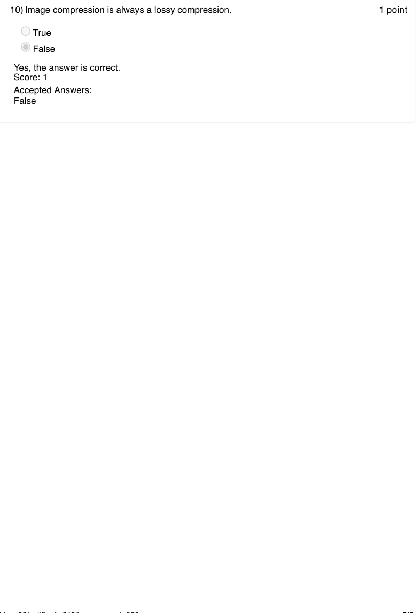
