# Week 10 Quiz 💡

**1. The game ”FLAMES” represents which of the following mathematics question?**
- Josephus problem  ✅
- Euclid’s problem
- Euler’s problem
- none of the above

**2. Predict the output of the following code**

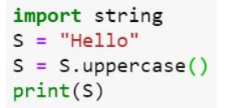

- HELLO
- Hello
- hello
- error  ✅

**3. Predict the output of the following code**

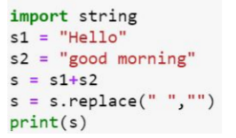

- Hellogoodmorning  ✅
- Hello goodmorning
- Hello good morning
- error

**4. What does the following code snippet in python print?**

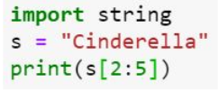

- der
- ind
- nde  ✅
- de

**5. In python, the default value of start and end index of list slicing are which of the following options?**
- 1, length of the list
- 0, length of the list  ✅
- 0, length of the list -1  
- 1, length of the list -1

**6. Which of the following is not a functionality of string in python?**
- lower()
- replace()
- isalpha()
- append()  ✅

**7. Predict the output**

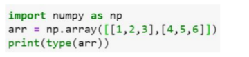

- class ’numpy.2darray’
- int32
- class ’numpy.ndarray’  ✅
- error

**8. Which of the following code snippet will print transpose of the matrix a?**

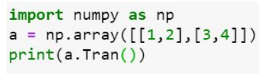

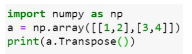
                                                                                                                       
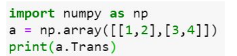

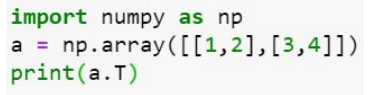  ✅

**9. Which of the following will print column sum of the matrix a?**

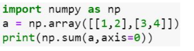  ✅

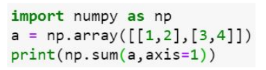
                                                                                                                       
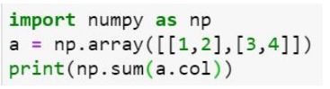

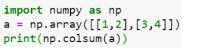

**10. Image compression is always a lossy compression.**
- True  
- False  ✅
 
